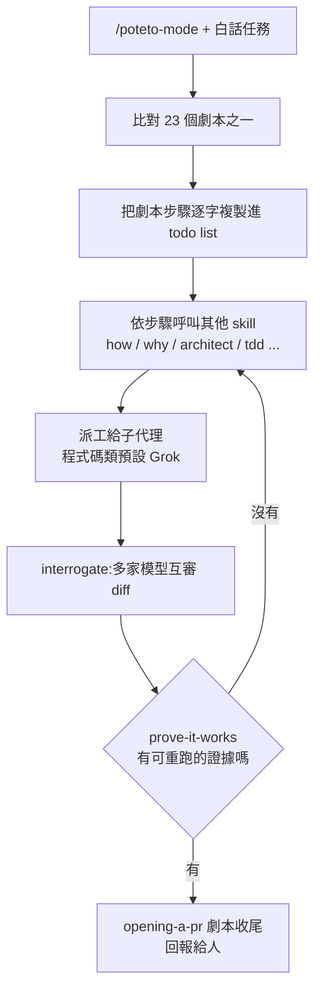

# pstack:Cursor 內部最火的 agent 工作流插件(poteto-mode、23 個劇本、24 條原則)

> 整理自 YouTube 頻道 **Why QQ**〈[Cursor 内部最火插件开源:一周被同事调用九千次](https://www.youtube.com/watch?v=Z-Fy1DghUvI)〉(2026-10-18,約 9 分鐘,官方 zh-Hans 字幕)。
>
> ⭐ 已 `git clone --depth 1` [cursor/plugins](https://github.com/cursor/plugins) 讀完 `pstack/` 原始碼(版本 **0.15.27**,2026-10-19 查詢),數量與機制以 repo 為準,補正見第六節。
>
> 立場:影片與說明欄沒有業配或聯盟連結。

---

## 一句話總結

> ⭐⭐⭐ **pstack 不是模型,是一包 Markdown:把資深工程師的「工程紀律」寫成 agent 每次開工都要照走的劇本與原則。** 核心主張是 *if you want to go fast, go deep first*:先讓一個 agent 在嚴格紀律下、每次交出證據,信任有了依據之後才敢並行(fearless parallelism)。重點不是程式碼產量,是「用最少的程式碼做最大的影響」。

---

## 一、作者與背景

- 作者 **poteto(Lauren Tan)**:待過 Meta、Netflix,現為 Cursor 的 Member of Technical Staff,也是 React 核心團隊成員(維護 React Compiler)。
- 影片說:這套技能在 Cursor 內部一週被同事調用約 **九千次**(出自作者發布貼文中的內部排行榜截圖,本文未能獨立核實)。
- 要解決的問題:agent 讓程式碼產量上升,但人越來越不敢合併——一次八百行,跑起來全是暗坑,review 時間快趕上自己寫。作者認為問題不在模型,在**工程紀律**。

---

## 二、內容物(repo 實數)

| 類別 | 影片說法 | repo 實際(`pstack/skills/` 等) |
|---|---|---|
| 工作流技能 | 二十多個 | **31 個**(不含原則),如 `how`、`why`、`interrogate`、`arena`、`swarm`、`tdd`、`unslop`、`automate-me` |
| 任務劇本 playbook | 23 條 | ✅ **23 個**(`skills/poteto-mode/playbooks/*.md`) |
| 工程原則 | 24 條 | ✅ **24 個**(每條一個 `principle-*` skill) |
| 子代理 | 兩個 | ✅ `agents/poteto-agent.md`、`agents/comment-sicko.md` |
| 授權 | MIT | ✅ `pstack/LICENSE`:MIT,Copyright 2026 Lauren Tan |



### 23 個劇本(節選)

| 劇本 | 做什麼 |
|---|---|
| `bug-fix` | 先重現(重現不了就人為製造條件),找根因,用 runtime 證據修 |
| `perf-issue` | 先跑 trace,對著 baseline 說話 |
| `hillclimb` | 盯一個指標:每輪先提假設、前後量測,有收益才各自一個 commit |
| `autonomous-run` | 長任務一路跑完不停 |
| `autopilot-full` / `autopilot-stack` | 一串 PR 逐一驗證推進,每個 code-ready head 由 swarm 驗證 |
| `orchestrate` | 多天、多 stacked PR、子代理艦隊的協調者 |
| `session-pickup` / `pause-safely` | 接手或安全暫停別的 agent 的半成品 |
| `opening-a-pr` | 其他劇本最後都會走到這裡:小而有序的 commit + Conventional Commits 標題 |

---

## 三、三個核心設計

### 1. 多模型分工

README 原文:預設把程式碼類委派(feature、refactoring、bug fix、perf、hillclimb)交給 **Grok**,最難的改動、文字與判斷交給 **Opus 5.5**;預設評審團是 Opus 5.5 / Grok。可用 `/setup-pstack` 改。

`/interrogate`:為每個設定的模型各開一個 reviewer 去對抗式審同一份 diff。SKILL.md 寫得很清楚——**對抗訊號來自模型多樣性,不是指派角色**;產出是彙整後的判決,**不自動套用修改**。

### 2. 對證據的偏執

- **prove-it-works**:對真實產物驗證(把功能跑起來、讀真實的值、看 diff),不接受代理指標、自我回報或「編譯會過」。最強的證明是**可重跑的腳本**,輸出留給 reviewer 自己重跑。
- **explain-the-number**:agent 說效能提升 30%,先搞清楚瓶頸在哪、測的是不是你要的那段。搭配 `benchmark-checklist` 盤問每個數字。

### 3. 24 條原則(節選)

| 原則 | 意思 |
|---|---|
| `laziness-protocol` | 用最小的改動解決問題 |
| `subtract-before-you-add` | 動手前先清掉冗餘檢查與死碼 |
| `attack-the-premise` | 兩個共用同一前提的修復都失敗,就把前提寫下來直接測 |
| `encode-lessons-in-structure` | 能寫成 lint 規則的就別再口頭叮嚀 |
| `never-block-on-the-human` | 可逆的工作先做再報告;**不可逆操作(force-push、刪正式資料、對外發訊息)仍要確認** |
| `test-behavior-not-implementation` | 測行為,不測實作細節 |

> 影片的評語很到位:這些原則單看都是老生常談,但**教科書管不住 agent**,寫成 agent 每次開工必讀的條文,效果完全不同。

---

## 四、兩個反共識立場

1. **沒有規劃技能**:README 有一節「why are there no planning skills?」,作者原話「i don't believe in planning. the best spec is code」。想規劃也行(`multi-phase-plan` 劇本、Cursor 內建 plan mode),但不是預設。
2. **agent 不該動不動停下來問人**:見 `never-block-on-the-human`。判斷權交給運行結果,打斷次數壓到最低。

---

## 五、應用案例

### 案例 1:在 Claude Code 裝來用

```bash
/plugin marketplace add cursor/plugins
/plugin install pstack@cursor-plugins
/pstack:setup-pstack          # 選模型,寫到 ~/.claude/rules/pstack-models.md
/pstack:poteto-mode 這個 PR 的捲軸每 750ms 會漂一次,先重現再修並驗證
```
Claude Code 會幫 plugin 指令加前綴,所以 `/poteto-mode` 變成 `/pstack:poteto-mode`。需要 Cursor 專屬功能(bugbot、automations)的步驟會被跳過並留一行註記。

### 案例 2:不裝也能抄——把原則搬進自己的 CLAUDE.md

本庫的寫作流程其實已經在用同樣的精神:每篇筆記數字都要比對一手來源(= prove-it-works),Whisper 轉完要掃結尾有無幻覺迴圈(= 驗證觀測方法本身)。可以直接把 `principle-explain-the-number` 的問句清單抄進自己的 agent 規則。

### 案例 3:`/automate-me` 做自己的 mode

它會翻你最近和 agent 的對話紀錄,歸納你的實際工作習慣,產生一個以你命名的 `-mode` skill(如 `jay-mode`);重跑時只看上次編輯之後的新紀錄、就地修改。等於把「做插件的方法」也一起給你。

### 案例 4:信任的建立順序

紀律 → 證據 → 信任 → 才並行。新人入職也一樣:先讓他交幾次帶證據的活,才讓他獨立帶專案。和 [[superpowers-vs-matt-skills-strong-model]]、[[matt-pocock-skills-teardown]] 對照看:同樣是「skill 包」,pstack 的重心在**驗證與證據**,不在流程步驟多寡。

---

## 六、補正與批判(對照 repo)

- ⚠️ **技能數量**:影片說「二十多個工作流技能」,repo 實際 31 個(不含 24 條原則);劇本 23、原則 24、子代理 2 都對得上。
- ⚠️ **Claude Code 已有官方支援**:影片說「社群有人移植到 Claude Code」(移植 repo 約 2,700 star 本文未核實)。現行 README 已提供官方安裝方式(`/plugin marketplace add cursor/plugins`),由 repo 根目錄的 `harness/pstack/` 產生 Claude Code 版,CI 會檢查生成版是否過期。Cursor 以外的使用者優先用官方版。
- cursor/plugins 整個 repo 約 12.7k star(GitHub API,2026-10-19),repo 層級沒有偵測到授權,MIT 授權在 `pstack/` 子資料夾。
- 「一週九千次」是作者內部數字,無法獨立查證。
- `never-block-on-the-human` 與「不規劃」適合個人或有完善 review 的團隊;在需要合規審批的環境照搬要小心。
- 相關:[[always-on-agent-grok-bot-lee-robinson]](同為 Cursor 團隊的 agent 實務;pstack 也有 `make-bot-ui` skill 對接 Grok Bot webhook)。

---

## 來源

- Why QQ〈Cursor 内部最火插件开源:一周被同事调用九千次〉:https://www.youtube.com/watch?v=Z-Fy1DghUvI(官方 zh-Hans 字幕)
- cursor/plugins — pstack:https://github.com/cursor/plugins/tree/main/pstack(clone 版本 0.15.27,2026-10-19)
- pstack README(安裝、23 劇本、規劃立場):https://github.com/cursor/plugins/blob/main/pstack/README.md
- GitHub API:https://api.github.com/repos/cursor/plugins
