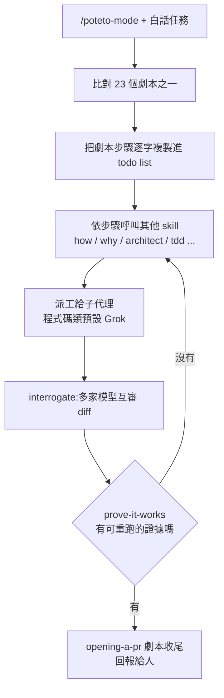
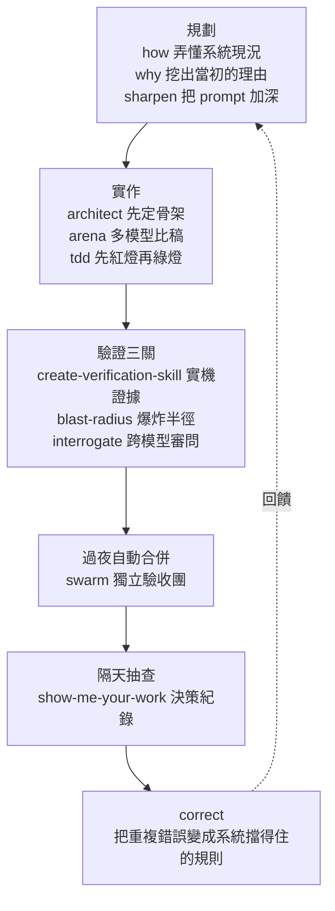
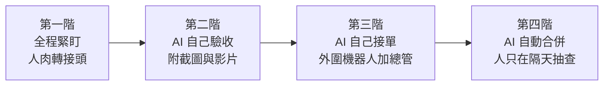

# pstack:Cursor 內部最火的 agent 工作流插件(poteto-mode、23 個劇本、24 條原則)

> 整理自 YouTube 頻道 **Why QQ**〈[Cursor 内部最火插件开源:一周被同事调用九千次](https://www.youtube.com/watch?v=Z-Fy1DghUvI)〉(2026-10-18,約 9 分鐘,官方 zh-Hans 字幕)。
>
> ⭐ 已 `git clone --depth 1` [cursor/plugins](https://github.com/cursor/plugins) 讀完 `pstack/` 原始碼(版本 **0.15.27**,2026-10-19 查詢),數量與機制以 repo 為準,補正見第六節。
>
> 立場:影片與說明欄沒有業配或聯盟連結。
>
> ➕ 2026-11-01 增補第七節:Gary Chen〈[pstack 深度拆解](https://www.youtube.com/watch?v=l_xDqUm0MDQ)〉(2026-10-31)的三階段工作流、信任曲線、六步清單與核實結果(對照 0.15.36)。

---

## 一句話總結

> ⭐⭐⭐ **pstack 不是模型,是一包 Markdown:把資深工程師的「工程紀律」寫成 agent 每次開工都要照走的劇本與原則。** 核心主張是 *if you want to go fast, go deep first*:先讓一個 agent 在嚴格紀律下、每次交出證據,信任有了依據之後才敢並行(fearless parallelism)。重點不是程式碼產量,是「用最少的程式碼做最大的影響」。

---

## 一、作者與背景

- 作者 **poteto(Lauren Tan)**:待過 Meta、Netflix,現為 Cursor 的 Member of Technical Staff,也是 React 核心團隊成員(維護 React Compiler)。
- 影片說:這套技能在 Cursor 內部一週被同事調用約 **九千次**(出自作者發布貼文中的內部排行榜截圖,本文未能獨立核實)。
- 要解決的問題:agent 讓程式碼產量上升,但人越來越不敢合併——一次八百行,跑起來全是暗坑,review 時間快趕上自己寫。作者認為問題不在模型,在**工程紀律**。

---

## 二、內容物(repo 實數)

| 類別 | 影片說法 | repo 實際(`pstack/skills/` 等) |
|---|---|---|
| 工作流技能 | 二十多個 | **31 個**(不含原則),如 `how`、`why`、`interrogate`、`arena`、`swarm`、`tdd`、`unslop`、`automate-me` |
| 任務劇本 playbook | 23 條 | ✅ **23 個**(`skills/poteto-mode/playbooks/*.md`) |
| 工程原則 | 24 條 | ✅ **24 個**(每條一個 `principle-*` skill) |
| 子代理 | 兩個 | ✅ `agents/poteto-agent.md`、`agents/comment-sicko.md` |
| 授權 | MIT | ✅ `pstack/LICENSE`:MIT,Copyright 2026 Lauren Tan |



### 23 個劇本(節選)

| 劇本 | 做什麼 |
|---|---|
| `bug-fix` | 先重現(重現不了就人為製造條件),找根因,用 runtime 證據修 |
| `perf-issue` | 先跑 trace,對著 baseline 說話 |
| `hillclimb` | 盯一個指標:每輪先提假設、前後量測,有收益才各自一個 commit |
| `autonomous-run` | 長任務一路跑完不停 |
| `autopilot-full` / `autopilot-stack` | 一串 PR 逐一驗證推進,每個 code-ready head 由 swarm 驗證 |
| `orchestrate` | 多天、多 stacked PR、子代理艦隊的協調者 |
| `session-pickup` / `pause-safely` | 接手或安全暫停別的 agent 的半成品 |
| `opening-a-pr` | 其他劇本最後都會走到這裡:小而有序的 commit + Conventional Commits 標題 |

---

## 三、三個核心設計

### 1. 多模型分工

README 原文:預設把程式碼類委派(feature、refactoring、bug fix、perf、hillclimb)交給 **Grok**,最難的改動、文字與判斷交給 **Opus 5.5**;預設評審團是 Opus 5.5 / Grok。可用 `/setup-pstack` 改。

`/interrogate`:為每個設定的模型各開一個 reviewer 去對抗式審同一份 diff。SKILL.md 寫得很清楚——**對抗訊號來自模型多樣性,不是指派角色**;產出是彙整後的判決,**不自動套用修改**。

### 2. 對證據的偏執

- **prove-it-works**:對真實產物驗證(把功能跑起來、讀真實的值、看 diff),不接受代理指標、自我回報或「編譯會過」。最強的證明是**可重跑的腳本**,輸出留給 reviewer 自己重跑。
- **explain-the-number**:agent 說效能提升 30%,先搞清楚瓶頸在哪、測的是不是你要的那段。搭配 `benchmark-checklist` 盤問每個數字。

### 3. 24 條原則(節選)

| 原則 | 意思 |
|---|---|
| `laziness-protocol` | 用最小的改動解決問題 |
| `subtract-before-you-add` | 動手前先清掉冗餘檢查與死碼 |
| `attack-the-premise` | 兩個共用同一前提的修復都失敗,就把前提寫下來直接測 |
| `encode-lessons-in-structure` | 能寫成 lint 規則的就別再口頭叮嚀 |
| `never-block-on-the-human` | 可逆的工作先做再報告;**不可逆操作(force-push、刪正式資料、對外發訊息)仍要確認** |
| `test-behavior-not-implementation` | 測行為,不測實作細節 |

> 影片的評語很到位:這些原則單看都是老生常談,但**教科書管不住 agent**,寫成 agent 每次開工必讀的條文,效果完全不同。

---

## 四、兩個反共識立場

1. **沒有規劃技能**:README 有一節「why are there no planning skills?」,作者原話「i don't believe in planning. the best spec is code」。想規劃也行(`multi-phase-plan` 劇本、Cursor 內建 plan mode),但不是預設。
2. **agent 不該動不動停下來問人**:見 `never-block-on-the-human`。判斷權交給運行結果,打斷次數壓到最低。

---

## 五、應用案例

### 案例 1:在 Claude Code 裝來用

```bash
/plugin marketplace add cursor/plugins
/plugin install pstack@cursor-plugins
/pstack:setup-pstack          # 選模型,寫到 ~/.claude/rules/pstack-models.md
/pstack:poteto-mode 這個 PR 的捲軸每 750ms 會漂一次,先重現再修並驗證
```
Claude Code 會幫 plugin 指令加前綴,所以 `/poteto-mode` 變成 `/pstack:poteto-mode`。需要 Cursor 專屬功能(bugbot、automations)的步驟會被跳過並留一行註記。

### 案例 2:不裝也能抄——把原則搬進自己的 CLAUDE.md

本庫的寫作流程其實已經在用同樣的精神:每篇筆記數字都要比對一手來源(= prove-it-works),Whisper 轉完要掃結尾有無幻覺迴圈(= 驗證觀測方法本身)。可以直接把 `principle-explain-the-number` 的問句清單抄進自己的 agent 規則。

### 案例 3:`/automate-me` 做自己的 mode

它會翻你最近和 agent 的對話紀錄,歸納你的實際工作習慣,產生一個以你命名的 `-mode` skill(如 `jay-mode`);重跑時只看上次編輯之後的新紀錄、就地修改。等於把「做插件的方法」也一起給你。

### 案例 4:信任的建立順序

紀律 → 證據 → 信任 → 才並行。新人入職也一樣:先讓他交幾次帶證據的活,才讓他獨立帶專案。和 [[superpowers-vs-matt-skills-strong-model]]、[[matt-pocock-skills-teardown]] 對照看:同樣是「skill 包」,pstack 的重心在**驗證與證據**,不在流程步驟多寡。

---

## 六、補正與批判(對照 repo)

- ⚠️ **技能數量**:影片說「二十多個工作流技能」,repo 實際 31 個(不含 24 條原則);劇本 23、原則 24、子代理 2 都對得上。
- ⚠️ **Claude Code 已有官方支援**:影片說「社群有人移植到 Claude Code」(移植 repo 約 2,700 star 本文未核實)。現行 README 已提供官方安裝方式(`/plugin marketplace add cursor/plugins`),由 repo 根目錄的 `harness/pstack/` 產生 Claude Code 版,CI 會檢查生成版是否過期。Cursor 以外的使用者優先用官方版。
- cursor/plugins 整個 repo 約 12.7k star(GitHub API,2026-10-19),repo 層級沒有偵測到授權,MIT 授權在 `pstack/` 子資料夾。
- 「一週九千次」是作者內部數字,無法獨立查證。
- `never-block-on-the-human` 與「不規劃」適合個人或有完善 review 的團隊;在需要合規審批的環境照搬要小心。
- 相關:[[always-on-agent-grok-bot-lee-robinson]](同為 Cursor 團隊的 agent 實務;pstack 也有 `make-bot-ui` skill 對接 Grok Bot webhook)。

## 七、Gary Chen 補充:「一個月 2,500 張 PR」的工作流拆解(2026-10-31)

> 來源:Gary Chen〈[pstack 深度拆解!怎麼讓 AI 全自動完成你的工作?](https://www.youtube.com/watch?v=l_xDqUm0MDQ)〉(約 27 分鐘,官方 zh-TW 字幕)。
>
> ⚠️ **立場揭露:** 說明欄與片尾推廣作者自家 Skool 社群與「AI 實戰營」(含「混搭 Matt 與 Lauren skill」整理和「自評你在六步哪一步」的提示詞),屬付費或會員內容,**本文不轉述**。影片無其他業配。
>
> 本節對照 pstack **0.15.36** 原始碼(`git clone --depth 1`,2026-11-01)查核影片講法;talk 本身(SpaceX 演講)我沒找到原文,影片裡的 PR 數字都是第二手轉述,見 [[agent-verification-before-scale-lauren-tan-reaction]]。

### 7.1 三階段 + 後勤:影片怎麼串起 pstack



- **設定:** 第一次跑 `/setup-pstack`,偵測可用模型並替每個角色分配。預設是寫程式、跑測試、分頭找資料給便宜快的 Grok(`grok-4.7-xhigh-fast`),架構、文案、當裁判給 Claude Opus(`claude-opus-5-5-xhigh`)。與 repo 預設相符。
- **規劃:** `/how`(現況怎麼運作)與 `/why`(查 Git 紀錄、工單、文件、聊天,找出當初為何這樣寫,避免 AI 把「防呆保護」當贅碼刪掉)。`/sharpen` 讓 prompt「更深而非更大」。
- **實作:** `/architect` 先定外框、`/arena` 讓不同家模型各自設計再嫁接、`/tdd` 強制先寫會失敗的測試防作弊。
- **驗證三關(影片稱這是 2,500 PR 的核心):** 證明會動、標出影響範圍、跨模型審問。PR 送到人類面前時已附操作影片或截圖與爆炸半徑資料,看幾十秒就能核准。
- **過夜模式:** 寫 PR 的 AI 不能核准自己的 PR;合併前派一批沒參與寫碼的獨立 AI 到雲端開 App 點擊測試,全過才合併。
- **補強環境 `/correct`:** AI 屢犯同一錯時,不是在 AGENTS.md 加一條「下次注意」(軟規則,忘了也沒人知道),而是改到「物理上不可能再發生」:專案內每件事只留一種標準寫法、把老毛病寫成 Linter 規則接 CI。影片舉的例子是禁用 React 的 `useEffect` 用法(**此例出自演講轉述,未核實**)。AGENTS.md 是最後手段。
- **後勤兩套:** 平行派工(多個專案各有一個只拆任務、不寫碼的總管 AI,底下工人 AI 實作,再交驗收團)與自動進單(對外由 Grok Bot 盯 Slack、X、email,先重現 bug 再轉成標準任務單;對內由巡邏 AI 掃壞寫法、**只記清單不准自己修**,過幾天看清單常發現十個問題同一根因,再一次派工)。

### 7.2 信任曲線與六步清單(影片整理,非 repo 內容)



「人肉轉接頭」是 Lauren 剛進 Cursor 時自述:AI 看不到自己做出的結果,只能靠人截圖、貼錯誤訊息來回轉述;人還卡在中間,就不可能同時開很多個 AI。她警告**信任地基沒打好就並行十幾個 AI,只是用十倍速度產垃圾並燒 token**;據轉述她先花了六百多張 PR 重整專案成防呆架構(未核實)。

Gary 給一般人的六步,每步有過關標準:

| 步驟 | 做什麼 | 過關標準 |
|---|---|---|
| 1 | 只用一個 AI,觀察它怎麼失敗,不急著裝 pstack | 能說出它最常犯的三種錯 |
| 2 | 把糾正變規則;能用系統檢查或 hook 攔的,不要只寫文件 | 同一種錯不再出現第二次 |
| 3 | 交件一律附證據(網頁就自己開瀏覽器點、截圖;整理資料就列出核對了哪幾筆) | 不用開檔,看證據就能判斷對錯 |
| 4 | 同時開兩三個 AI,做與審分開,審的用不同模型,你再按合併 | 同開三個仍顧得過來,大部分不必重做 |
| 5 | 睡前交代長任務,但**停在合併之前**:完成條件要非黑即白、設停損點、只准存檔與開 PR | 合併、發布、刪資料、對外發訊息等難回復動作留給隔天的你 |
| 6 | 連續幾天都能直接合併,才開自動合併與排程進單 | 獨立驗收全過才合併,隔天只抽查 |

### 7.3 與 Matt Pocock 的比較(Gary 的判斷)

| | Matt Pocock | Lauren(pstack) |
|---|---|---|
| 重心 | 動工前人機對齊、合併前人把關 | 動工後多模型自動驗收,人退到事後抽查 |
| 流程 | grill-me 反問、寫規格、拆任務卡、PR 附證據 | 能靠讀碼或實測查清的問題,一律不准停下來問人 |
| 模型與成本 | 單一模型跑得順,token 用量相對低 | 刻意狂燒 token:多家交叉審問加十幾個 AI 實機驗收 |
| 適合 | 0 到 1、想法模糊 | 歷史包袱大、要修 bug、重構、改效能 |

Gary 的結論:兩者互補(Lauren 本人也這樣說),**一般人建議先從 Matt 的模式起步**,因為自動合併的前提是已有完整驗證與防呆環境與足夠預算。詳見 [[matt-pocock-skills-teardown]]、[[superpowers-vs-matt-skills-strong-model]]。

### 7.4 核實結果(對照 pstack 0.15.36)

| 狀態 | 項目 |
|---|---|
| ✅ 已核實 | `/setup-pstack` 與預設模型(grok-4.7-xhigh-fast、claude-opus-5-5-xhigh);`/how`、`/why`、`/arena`、`/architect`、`/tdd`、`/interrogate`、`/swarm` 都存在;`/correct` 的順序是架構、型別、會說出修法的 lint、測試,**文件最後**,並要求用過去真實錯誤證明檢查真的會擋;`/show-me-your-work` 是 TSV 決策紀錄,交付前由**不同模型家族**的子代理核對;poteto-mode 的 Autopilot-full:一個 owner 管一張 PR 到合併,根節點在合併前 swarm 驗證 |
| ⚠️ 需修正 | ① `/sharpen` 實際是**四步**(頂尖專業人士會做什麼、最原始素材、具體方法與工具、**除你我之外什麼能證明結果對**),影片講三個面向加最後的客觀驗證,大意相符。② 影片把 `/blast-radius` 說成「標出風險高低方便你調整審查時間」;repo 的重點是**找出「這個改動之所以安全」的那一個事實,並跑真實程式碼證明**(「聽起來合理的報告毫無價值」,信心從『我說的』到『在真實 App 重現』分五級)。標風險高低只是副產品。③「寫 PR 的 AI 永遠不能核准自己」是影片的概括:repo 是 owner 負責到合併,但**合併前由根節點的 swarm 獨立驗證**;約十個驗收 AI、雲端開 App 點擊的細節我沒在 SKILL 看到數字,當作演講轉述。④ 影片說「將近六十個 skill」:0.15.36 的 `skills/` 有 58 個資料夾(含 24 條原則型),與先前版本的 31 個流程型技能不衝突 |
| ❓ 未核實 | 2,500 PR/月、日均 80 多張、一早醒來有 20 張 PR、六百多張地基 PR、Lauren 在 SpaceX 負責 Grok Bot(皆為演講自述或第二手);`useEffect` 禁用例子;「四個月前的 cross model review 影片」 |

### 7.5 應用案例:一個人怎麼走到第四步

情境:你獨立維護一個後端服務,每週要處理十幾個小需求與 bug。

1. **第一週(步驟 1–2):** 只用 Claude Code,每次糾正都記下。發現三類錯:亂改舊相容程式、補假測試、改完沒跑。把「改 API 欄位必須跑 contract 測試」做成 hook(失敗就擋提交),不是只寫在 CLAUDE.md。
2. **第二、三週(步驟 3):** 規定交件附證據:改 API 就附 curl 實際請求與回應、改頁面就附截圖。你看證據 30 秒內能判斷對錯,才算過關。
3. **第四週(步驟 4):** 同時開三個 worktree 處理三張互不相干的單;寫的用 Claude,審的換另一家模型,你只按合併。
4. **第五週(步驟 5):** 睡前丟一個「把某模組 lint 錯誤清到 0」,完成條件寫成 `lint 結果為 0 且測試全過`、卡 30 分鐘就停下寫原因;只准開 PR。
5. **連續兩週早上都能直接合併:** 才考慮開自動合併與排程巡信箱。
6. 以上每一步的**反面**是:剛裝完 pstack 就想過夜自動合併。影片與 Lauren 都強調那會用十倍速度產垃圾。

---

---

## 來源

- Why QQ〈Cursor 内部最火插件开源:一周被同事调用九千次〉:https://www.youtube.com/watch?v=Z-Fy1DghUvI(官方 zh-Hans 字幕)
- cursor/plugins — pstack:https://github.com/cursor/plugins/tree/main/pstack(clone 版本 0.15.27,2026-10-19)
- pstack README(安裝、23 劇本、規劃立場):https://github.com/cursor/plugins/blob/main/pstack/README.md
- GitHub API:https://api.github.com/repos/cursor/plugins
- Gary Chen〈pstack 深度拆解!怎麼讓 AI 全自動完成你的工作?〉:https://www.youtube.com/watch?v=l_xDqUm0MDQ(官方 zh-TW 字幕,2026-10-31)
- pstack 0.15.36 原始碼(第七節核實用,2026-11-01):https://github.com/cursor/plugins/tree/main/pstack/skills
