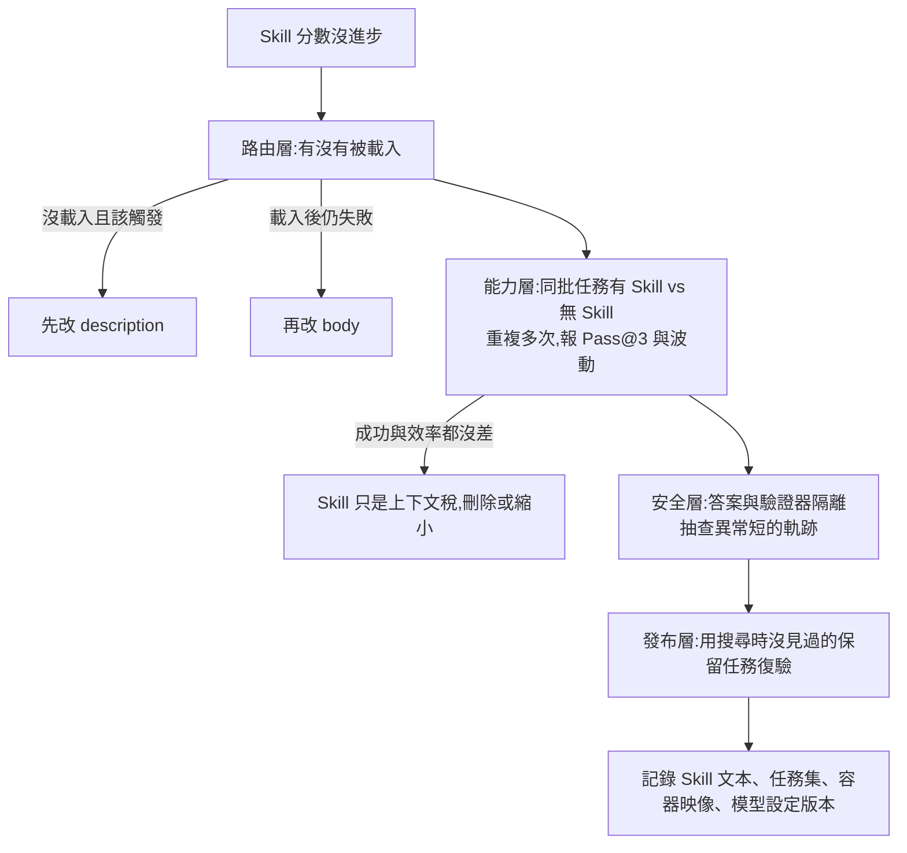

# Skill 沒效果?先跑對照實驗:Google 的 Skill 優化實驗與「四層檢查表」

**主題分類:** 科技 / AI Agent — Skill 評測與發布流程
**來源:** YouTube〈Skill没效果?先跑对照实验〉(Why QQ / 为什么叫QQ,2026-11-08,8 分 27 秒;[影片連結](https://www.youtube.com/watch?v=2PwxSjJV3HI);**依官方簡中字幕整理**)
**一手來源核實:** 讀了影片說明欄列的兩篇 Google Cloud 官方文章([評測篇](https://cloud.google.com/blog/topics/developers-practitioners/evaluate-agent-skills-before-they-bloat-your-context-window/)、[AlphaEvolve + Harbor 篇](https://cloud.google.com/blog/topics/developers-practitioners/how-to-build-an-agent-skill-optimizer-with-alphaevolve-and-harbor)),並 `git clone --depth 1` [google-deepmind/alphaevolve](https://github.com/google-deepmind/alphaevolve) 讀 README(已刪除 clone)。
**整理日期:** 2026-11-09

> ⚠️ **抓取限制:** 兩篇 Google 文章是用網頁抓取工具讀取,其回傳是**內容摘要而非逐字全文**;下表標「已核實」的項目,是摘要中明確出現的數字與句子,標「未能核實」的是摘要未見、或需看原文才能確定的部分。
> 📌 本庫相關:[[claude-web-design-skills-benchmark-pnh]](Skill 的成本:說明每輪都佔額度)、[[building-claude-skills]]、[[claude-skills-governance-man-group]]。

---

## 1. 一句話

一份 `SKILL.md` 寫了幾十條規則,Agent 可能**一次都沒載入**。Google 的實驗裡,手寫基線約三分之二通過,**不帶 Skill 也差不多**。所以改 Skill 之前先走四層:**查載入 → 跑對照 → 隔離答案 → 保留任務復驗**(0:14,[連結](https://www.youtube.com/watch?v=2PwxSjJV3HI&t=4s))。

## 2. 影片重點與時間點

| 時間 | 內容 |
|---|---|
| 1:07([連結](https://www.youtube.com/watch?v=2PwxSjJV3HI&t=57s)) | Skill 有兩層:router 只看 YAML front matter 的名稱與 description,body 被選中才進上下文。排查看**載入日誌、觸發時機、工具呼叫**,別只比最終分數。 |
| 1:46([連結](https://www.youtube.com/watch?v=2PwxSjJV3HI&t=96s)) | 環境污染:開發機的快取憑證、環境變數、shell 歷史會讓 Agent 順手使用,換乾淨容器就重現不了;CPU 爭用也拖慢結果。同程式同 prompt 重跑,超過三分之一的 benchmark 任務分數會變。 |
| 2:22([連結](https://www.youtube.com/watch?v=2PwxSjJV3HI&t=132s)) | 配對消融:同批任務分別跑有/無 Skill,同一時間窗口,每任務重複多次,報 Pass@3 與波動範圍。 |
| 3:03([連結](https://www.youtube.com/watch?v=2PwxSjJV3HI&t=173s)) | 官方報告「少量迭代約 5% 提升」,原文沒展開計算口徑,**不要自行寫成 5 個百分點,也別外推到所有專案**。 |
| 3:40([連結](https://www.youtube.com/watch?v=2PwxSjJV3HI&t=210s)) | 官方列的四種 reward hacking;總分上漲先抽查軌跡(高分、異常短的呼叫鏈、缺少正常建置與測試)。 |
| 4:14([連結](https://www.youtube.com/watch?v=2PwxSjJV3HI&t=244s)) | 評分公式會改變搜尋方向:0.95 正確性 + 0.05 token 效率,讀答案檔不耗 LLM 輪次,作弊候選反而更容易存活;五項指標(正確性、可發現性、效率、有效性、安全)要分開看。 |
| 4:50([連結](https://www.youtube.com/watch?v=2PwxSjJV3HI&t=280s)) | 隔離靠環境不靠一句「禁止存取」:測試夾具、評分腳本與答案放專用 verifier 容器,Agent 容器退出後才掛載產物;讀 K8s service account token、查雲 metadata 端點直接判失敗;軌跡要脫敏 OAuth token。 |
| 5:25([連結](https://www.youtube.com/watch?v=2PwxSjJV3HI&t=315s)) | 優化後 Skill 的變化:約三分之一 trial 超時,所以流程改為盡早把可運行成果放到目標路徑、保留最近通過版本、驗收通過就停止。 |
| 6:04([連結](https://www.youtube.com/watch?v=2PwxSjJV3HI&t=354s)) | 長搜索的運維問題:約 10 小時後新候選不再得分;延遲檢查讓評測堆積;完整 Agent 日誌寫滿控制器磁碟;GKE 上每個 Harbor trial 一個 Pod、一次搜尋數千次。要設並發、佇列上限、單輪 deadline、總預算、日誌輪轉、容量告警、檢查點。 |
| 6:40([連結](https://www.youtube.com/watch?v=2PwxSjJV3HI&t=390s)) | 四層檢查表:路由層(載入日誌)、能力層(配對實驗)、安全層(隔離+審軌跡)、發布層(保留任務復驗);每層留一個產物:載入日誌、對照表、軌跡審查、復驗報告。 |
| 7:14([連結](https://www.youtube.com/watch?v=2PwxSjJV3HI&t=424s)) | 原文第五條規則:別整段複製公開 API 文件,改成緊湊的操作習慣(改狀態前先看葉子子命令的 help、根 Skill 只放輕量索引、認證預設最小權限、少碰靜態 service-account JSON key)。 |
| 7:38([連結](https://www.youtube.com/watch?v=2PwxSjJV3HI&t=448s)) | 去留:沒有可測量增益的 Skill 載入後只佔上下文、增加 token 與維護成本;模型升級、工具變更後重跑對照,Delta 歸零就刪除或縮小範圍。 |

## 3. 逐項對照一手來源

| 影片說法 | 一手來源 | 狀態 |
|---|---|---|
| 手寫基線約三分之二通過、不帶 Skill 也差不多 | AlphaEvolve 篇:baseline「about two-thirds」、無 Skill「about the same」 | ✅ 已核實 |
| 少量迭代約 5% 提升,原文沒展開口徑 | 原文:「improvements of 5% with just a few iterations」,未說絕對或相對 | ✅ 已核實(影片的謹慎是對的) |
| 實驗在 OpenCode、Terminal-Bench 2.0、Harbor 獨立容器、GKE 每 trial 一個 Pod、數千次 trial | 原文相同 | ✅ 已核實 |
| 任務 Agent 使用 Gemini 3.8 Flash | 原文:Gemini 3.8 Flash | ✅ 已核實 |
| Gemini 4 Argon 負責改寫 Skill 文字 | 抓取摘要稱**標題有 Argon、正文只出現 Gemini 3.8 Flash** | ❓ 未能核實(需看原文全文) |
| 約三分之一的 trial 超時 | 原文:「About a third」trial 觸及時限,最佳 Skill 圍繞這點設計 | ✅ 已核實 |
| 約 10 小時後停止得分;延遲檢查擋住評測;完整日誌寫滿控制器磁碟 | 原文:~10 小時、latency check、disk filled | ✅ 已核實 |
| 優化後 Skill 的「盡早放可運行成果」「驗收通過就停止」 | 原文最佳 Skill 摘錄:「Ship a Working Baseline to the Target Path Early」「Hard Stop When Green」 | ✅ 已核實 |
| 相同程式與 prompt 重跑,超過三分之一任務分數變化 | 評測篇:「>1/3」,但是在**一個檢索(retrieval)研究**裡,不是 Terminal-Bench | ✅ 已核實(補:範圍是檢索研究) |
| 讀 router 只看 name 與 description;兩種失敗(under-triggering、鄰近 Skill 搶觸發) | 評測篇:相同;並附 `skill-reach` 的 `lint` / `overlap` / `eval` / `optimize` 指令 | ✅ 已核實 |
| 0.95 正確性 + 0.05 token 效率;讀答案不耗輪次 | 評測篇:fitness 權重 0.95 / 0.05,讀磁碟不耗 LLM 輪次得到效率加分 | ✅ 已核實 |
| 官方明確列出**四種** reward hacking:動態拼字串、向上遍歷目錄、讀答案檔、啟動子行程繞 AST | 評測篇摘要:動態串接、讀答案檔、子行程繞過 AST,並說「四種」;**「向上遍歷目錄」是否為第四種,摘要未明確列出** | ⚠️ 部分核實(三種見於摘要,第四種需原文) |
| 安全檢查:讀 K8s service account token、查雲 metadata 直接失敗 | 評測篇:相同 | ✅ 已核實 |
| 五項指標:正確性、可發現性、效率、有效性、安全 | 評測篇:SkillEvaluator 五個維度相同 | ✅ 已核實 |
| NVIDIA Skill Evaluator 把兩組有符號差值稱為 Skill Lift | Google 評測篇用「Δ(delta)」,**未稱 Skill Lift**;NVIDIA 原文我沒讀 | ❓ 未能核實 |
| Pass@3 = 三次至少成功一次 | 評測篇只用 `--runs 3`,**未定義 Pass@3**;該定義是業界通用說法 | ❓ 原文未定義 |
| AlphaEvolve 倉庫提醒:LLM 生成程式碼要當不可信程式碼,Docker 沙箱不能消除全部風險 | repo README 第 149–151 行:should be handled as untrusted code、run in a Docker sandbox、despite sandboxing the potential for unintended behavior… | ✅ 已核實(讀 README 原文) |
| 官方第五條規則(別整段複製 API 文件、葉子子命令 help、輕量索引、最小權限) | 評測篇列出三項有效習慣:葉子子命令驗證、輕量目錄索引按需拉取、最小權限認證;**「第五條規則」編號出自另一篇「Five rules for…」文章,我沒讀** | ⚠️ 部分核實(三個習慣已核實,編號未核實) |
| 作者的測試裡文件堆疊幾乎沒提升 | 摘要只見「一般建議已沒有多少增益空間、要靠具體做法」的假說,**無量化結果** | ⚠️ 影片說得比原文肯定 |
| (影片沒講)原文有一個「帶答案的 Skill」在 dev 任務加 **33 點** | AlphaEvolve 篇:holding the answers 的 Skill +33 points,基線 Skill 無可測差異 | ✅ 已核實(補充:這正是「高分要驗證」的活例子,且原文沒把它標成洩漏) |

## 4. 批判性閱讀

1. **Why QQ 的結論比 Google 原文更肯定。** 例如「文件堆疊幾乎沒提升」「第五條規則」等,原文(依我讀到的摘要)是假說或編號出自別篇,影片把它們講成確定結論。
2. **5% 是這個實驗設置的數字**,原文沒給任務數、重複次數、絕對/相對。影片自己也提醒不要外推,這點是對的,但**所以這個數字不能拿來證明「優化 Skill 值得」**。
3. **這是廠商文章。** 兩篇都出自 Google Cloud 的部落格(推廣 AlphaEvolve、Harbor、GKE),實驗用的是自家模型與基礎建設。方法論(配對消融、隔離答案、保留任務)通用,但**具體成效不是獨立複現**。
4. **「Skill 沒載入」與「Skill 沒用」是兩件事。** 路由層檢查依賴你能拿到載入日誌;不同 agent 產品不一定提供。
5. **Terminal-Bench 2.0 偏終端機工程任務。** 結論未必適用寫作、設計或資料分析類 Skill。
6. **把安全與效率合成總分是設計選擇不是真理。** 影片建議分項看與硬門槛,但「安全違規直接淘汰、效率只在合格者之間比」仍需要你自己定義門檻。

## 5. 應用案例

**案例 A:評估自己的一個 Skill。** 取 5–10 個代表任務,在乾淨容器(沒有你的快取憑證與 shell 歷史)分別以「有 Skill」「無 Skill」各跑 3 次,記錄通過數、耗時與 token。若通過率相同且耗時沒差,這個 Skill 對這批任務就是上下文稅。

**案例 B:Skill 不觸發怎麼辦。** 先確認載入日誌;沒載入就改 description,寫「開發者的意圖」而非內部實作;再用 `skill-reach` 的 `overlap` 查有沒有鄰近 Skill 的寬泛描述搶走觸發(原文說工作區超過十來個 Skill 就容易出現碰撞)。

**案例 C:模型升級後的清掃。** 每次換模型,重跑一次有/無 Skill 的矩陣,Delta 歸零的就刪或縮小範圍;原文把「因為新模型已經學會而刪掉」視為成功。

**案例 D:自己做自動優化迴圈的最低安全清單。** 評分腳本與答案放在 verifier 容器、Agent 退出後才掛載產物;偵測讀取 service account token 與 metadata 端點;設並發與佇列上限、單輪 deadline、總預算與日誌輪轉。

## 6. 未核實與限制

- Google 兩篇文章的**全文逐字**未讀(抓取為摘要);Gemini 4 Argon、第四種 reward hacking、「第五條規則」編號需看原文。
- NVIDIA Skill Evaluator 與「Five rules for evaluating agent skills before they bloat your context window」一文未讀。
- 我**沒有自己重跑**任何實驗;表格中的數字都是原文自報。

## 來源

- [影片:Skill没效果?先跑对照实验(Why QQ)](https://www.youtube.com/watch?v=2PwxSjJV3HI)
- [Google Cloud:Evaluate agent skills before they bloat your context window](https://cloud.google.com/blog/topics/developers-practitioners/evaluate-agent-skills-before-they-bloat-your-context-window/)
- [Google Cloud:How to build an agent skill optimizer with AlphaEvolve and Harbor](https://cloud.google.com/blog/topics/developers-practitioners/how-to-build-an-agent-skill-optimizer-with-alphaevolve-and-harbor)
- [google-deepmind/alphaevolve](https://github.com/google-deepmind/alphaevolve)
- 字幕:官方簡中字幕(非 Whisper)
