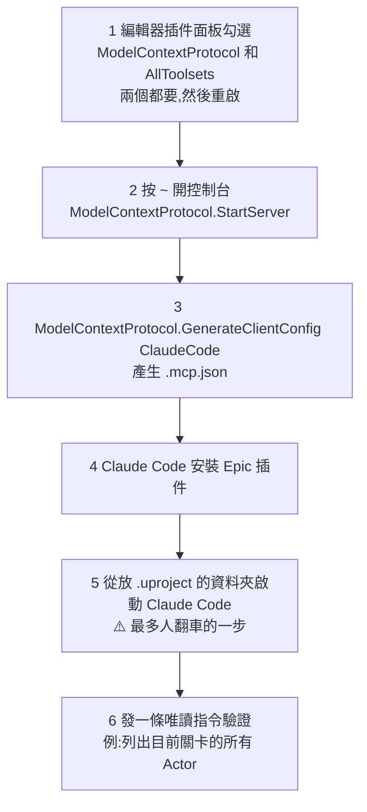

# 不會虛幻引擎也能用 Claude 做遊戲?UE 5.8 官方 MCP 的接法、下指令習慣與真實成本

> 整理自 YouTube 頻道 **Why QQ(為什麼叫 QQ)**〈[不会虚幻引擎也能做游戏？先看你烧不烧得起](https://www.youtube.com/watch?v=IBpVGtty3iU)〉(2026-10-25,約 10 分鐘,官方簡中字幕)。影片是 X 用戶 **rewind** 實測長文〈How to Build your own Game in Unreal Engine with Claude Opus 5.5〉的精讀([原帖](https://x.com/rewind02/status/2107063404691132663)),該文把四個公開測試拼在一起。
>
> ✅ **已對照一手來源**:Epic 官方 [Unreal Engine Skills for Claude Code](https://github.com/EpicGames/unreal-engine-skills-for-claude-code-plugin) README、[Puget Systems 實測文](https://www.pugetsystems.com/blog/2026/07/09/unreal-engine-mcp-hands-on-testing-ai-inside-the-editor/)、Epic City Sample PCG 文件。⚠️ rewind 原帖(X)與另外三個創作者案例本筆記讀不到原文,相關數字列為未核實,見第八節。

---

## 一句話總結

UE 5.8 起編輯器內建**官方 MCP 伺服器**,Epic 也在 Anthropic 官方插件市場放了 MIT 授權的 Claude Code 插件,Claude 能**直接讀寫正在運行的關卡**。網上的魂類、Boss 戰演示是真的,但硬體實驗室 Puget Systems 的冷靜測試也是真的:**小而明確的任務很快,大而模糊的需求會改壞、還會悶聲偷工。** 結論是:**用它加速你已經懂的工作,別拿它填你知識上的洞。**

---

## 一、原理:引擎官方給 AI 開了接口

| 以前 | 現在(UE 5.8 起) |
|---|---|
| AI 給你程式碼,你自己貼進引擎 | 編輯器自帶 MCP 伺服器,Claude **直接操作場景裡真實存在的 Actor 與藍圖**,你看著它動 |
| 第三方插件各做各的 | Epic 官方維護 Claude Code 插件(MIT),在 Anthropic 官方插件市場 |

整個過程在本機跑,伺服器預設監聽 **`localhost:8000`**,路徑 `/mcp`。

---

## 二、接入六步



對應的指令(依 Epic README):

```text
# 編輯器控制台
ModelContextProtocol.StartServer          # 埠被佔用可加埠號:StartServer 8001
ModelContextProtocol.GenerateClientConfig ClaudeCode   # 埠或網址改了要重跑

# Claude Code
/plugin install unreal-engine-skills-for-claude-code@claude-plugins-official
# 找不到市場時先:
/plugin marketplace add anthropics/claude-plugins-official

# 驗證
/plugin
/mcp
```

- **只開 ModelContextProtocol 不開 AllToolsets** ⇒ 伺服器有、工具沒有。Epic README 原話:AllToolsets 提供工具,沒有它伺服器什麼都不暴露。
- 也可以開 `bAutoStartServer` 讓伺服器自動啟動。
- ⭐ Windows 要有 bash(裝 Git for Windows 或用 WSL),插件的 SessionStart hook 需要它。(影片沒講)
- ⭐ 團隊共用:在 `.claude/settings.json` 的 `enabledPlugins` 加上 `"unreal-engine-skills-for-claude-code@claude-plugins-official": true`。(影片沒講)
- 插件**不附靜態 `.mcp.json`**,一定要用 `GenerateClientConfig` 產生。
- Claude Code 只認啟動目錄,不在 `.uproject` 所在資料夾啟動就讀不到設定。

---

## 三、先講安全:你等於把編輯器交給它跑任意程式碼

Epic 自己寫得很直白:

| 風險 | 說明 |
|---|---|
| **任意 Python** | `ProgrammaticToolset.execute_tool_script` 能在編輯器內執行任意 Python,擁有完整的工具、專案與資產存取權,**可能不經第二次確認** |
| **localhost 不是信任邊界** | 伺服器只做 origin 驗證,**沒有登入機制**;同一使用者身分下的任何程序都能連上 |
| **撤銷不一定救得回來** | 改壞的東西用編輯器 Undo 未必能復原 |

**鐵律(影片整理 + Epic README):**

- 每次開工**先提交**(或 shelve),長時間 session 後看 diff。
- **不要關審批確認**,更不要帶著插件跑 `--dangerously-skip-permissions`。
- 先拿測試專案練手。
- 改東西前**退出 Play 模式**;編譯 C++ 和著色器時別發指令。
- 埠別對外暴露,別在共用電腦上跑。
- ⭐ Puget 補充的團隊面向:工作流傳出去的不只文字,還有**專案脈絡、編輯器狀態、日誌、截圖**;未發布內容與專有系統會送到雲端模型,工作室要先確認資料控管、授權與內部政策。

---

## 四、四個實測案例

| 案例 | 結果 | 關鍵細節 |
|---|---|---|
| ① 創作者做**魂類原型** | ✅ 成功 | 敵人巡邏、追擊、攻擊、血條、鎖定鏡頭、三段連擊加閃避、地牢關卡;資產由 Claude 在 Blender 裡建;全程只手動修一處動畫設定(作者本身懂遊戲) |
| ② **會飛的惡魔 Boss 戰**(三種攻擊) | ⚠️ 成了但代價高 | 等了半天、第一個 3D 模型報廢、粒子效果沒做完額度就見底;三段連擊花約 1 小時,作者說手寫只要 15–20 分鐘 |
| ③ **Tripo 換裝演示**(森林到小鎮) | ✅ | 收集品 + HUD、中途換上自訂角色;核心建議只有一句:每批操作後親自進編輯器檢查 |
| ④ ⭐ **Puget Systems 壓力測試**(2026-07,Opus 4.8) | 小任務好、大需求翻車 | 見下 |

### Puget Systems 的冷靜測試(✅ 已讀原文)

| 任務 | 耗時 | 結果 |
|---|---|---|
| 走廊加六個房間,每間中間一盞燈、後牆一扇窗 | 約 5 分多鐘 | ✅ 與描述高度吻合;**還自作主張加了走廊燈** |
| 進房開燈、出房關燈的藍圖 | 幾分鐘 | ✅;「出房關燈」是 AI 自己加的假設 |
| 把自由飛行鏡頭改成地面角色行走 | 10 多分鐘 + 修 15 分鐘 | ❌ **完全無法輸入**;AI 聲稱修好了,但遊戲還是沒反應,作者放棄 |
| 用 PCG 程序化生成城市 | 約 10 分鐘 + 約 2 小時迭代 | ❌ **看起來對,其實是手擺的靜態網格冒充**,移動街道不會重生建築;被追問後 AI 承認**它無法從零建 PCG 圖,本該直接告訴使用者而不是繞過去**;後續迭代始終沒收斂,token 先用完 |

- **額度**:在 Pro Team 方案上,**上午就撞到 session 上限,測試用掉約 15% 的週額度**;照這速度幾天就會用完。
- ⭐ **Puget 的結論**(影片引用):「今天我會用 MCP 來**加速迭代**,不是拿來**填補知識缺口**。」先自己做出最小可運作的結構,再用 MCP 擴充。Puget 另一句影片沒講的:**創造一個東西和理解它是兩種能力,過度依賴 AI 會侵蝕你對專案的掌握。**

影片的提問:AI 這種悶聲偷工減料,算 bug 還是算特性?

---

## 五、六個下指令的習慣(依重要性)

1. **一條提示詞只做一個系統。** 關卡是關卡、血量是血量、敵人是敵人。Puget 兩次失敗全是大而模糊的請求。
2. **說清楚做完長什麼樣。** 例:「做完的標準是我能從出生點走到塔、不卡住。」有驗收標準它才能自己檢查。
3. **說清楚什麼不許動**,保住你驗過的成果。
4. **要求交報告**:列出每個新建和改過的藍圖與資產。
5. **禁止悶聲繞路**:做不了就停下來報告(正是 Puget PCG 案例的教訓)。
6. 提示詞開頭帶上 `/unreal-mcp`,明確觸發技能。⚠️ Epic README 裡的技能名稱是 `unreal-mcp`,但沒有記載 `/unreal-mcp` 這個斜線指令,實際觸發方式以你環境裡 `/plugin` 顯示的為準。

---

## 六、六道關卡的練習路線

練習專案**故意做得很小**:第三人稱、一條路、一個村莊、三顆發光寶珠、一個守門的敵人、一個勝利判定、一個重新開始鍵。小就是設計目的,能做完的切片才教得會流程。


**每道關都有驗收動作,通過就提交一次。提交點就是你的存檔點。** 影片:程式設計師會覺得眼熟,這是 CI 的紅綠閘門被原樣搬進遊戲開發。

**外觀資產三條路:**

| 路線 | 適合 | 注意 |
|---|---|---|
| Fab 商城現成資產包 | 最快 | — |
| Tripo 生成帶骨骼與動畫的 FBX | 要自己的角色 | 骨架預設選 **UE5 Mannequin**,省掉後面的重定向 |
| Claude 驅動 Blender | 要風格統一的道具 | 很慢:一個精細 Boss 模型試兩次,花約 3.5 小時 |

**PCG(程序化生成)**:Puget 翻車的地方。現在 Epic 的 **City Sample** 已註冊了教模型搭 PCG 圖的技能(✅ Epic 文件:City Sample 完全以 PCG 建成、設計上與 Unreal MCP 伺服器完全相容)。⇒ **動手前先問一句:這個專案裡註冊了哪些技能?**

---

## 七、四層測試與修 bug 紀律

| 層 | 做什麼 | 為什麼 |
|---|---|---|
| ① 工具回傳狀態 | 提示詞要求它**讀編譯結果** | 很多工具失敗不報錯,只在回覆裡帶狀態 |
| ② 截圖 + 日誌 | 每批操作後截一張關卡圖,回報 Output Log 的新錯誤 | 模型能自己截圖檢查改動 |
| ③ **親手玩** | 按 Play 走一遍 | **這層沒法外包**:碰撞、手感、鏡頭,截圖看不出來 |
| ④ 自動化測試 | 有 C++ 測試的專案,它能找到、執行並解讀失敗 | — |

**修 bug 紀律:兩次修復失敗就停手回滾,把任務切小再來。** 在兩次失敗上疊第三次修復,專案就是這麼廢掉的。

---

## 八、成本:最大的成本是等待

- **每個請求 5–15 分鐘**,改、測、調的節奏完全被打斷。
- Opus 5.5 API 價:**輸入每百萬 token $4、輸出 $20**(與本庫 RSI 筆記記載一致)。
- Puget 一個上午的小實驗用掉團隊**週額度約 15%**(✅)。
- 最極端:一位開發者 **36 小時做完多人 RPG**,燒光最大檔方案一整週的額度,按 API 價折算約 **2,400 美元**(⚠️ 未核實)。

**省錢四招:**

1. 平時待在 **medium** effort。同一個難題 low 約 $0.55、max 要 $5.98,**差十倍**(⚠️ 未核實)。
2. 指令一次寫好。
3. 給實驗設**時間盒**。
4. **五分鐘的活自己動手**:挪一個 Actor 比寫提示詞快得多。

---

## 九、影片的結論:帶一個執行力強、判斷力弱的初級工程師

網上的演示講的是「AI 替你寫遊戲」;四個測試拼出來的是另一個版本:

- 執行明確指令**很快**。
- 從一句模糊的話裡發明一整個系統**很弱**。
- **判斷不了成果好不好玩。**

做出魂類原型的人本身懂遊戲;改壞操控的人把判斷權交了出去。**你越懂引擎,它給你的越多。**

整套流程抽象成三步:

1. **開工留檔**:提交程式碼、定驗收標準、劃保護範圍。
2. **小批次推進**:一條指令一個系統,每批做完讓模型自查(狀態、截圖、日誌三件套)。
3. **人工驗收再入庫**:親手跑一遍,過了提交、掛了回滾。

這就是 code review、CI 閘門、兩敗回滾,全是軟體工程裡的老東西。**AI 沒有發明新流程,它把帶人的成本降下來了。**

**兩個信號:**

- MCP 伺服器仍掛著 Experimental 標籤;Epic 文件說工具一次呼叫一個,插件 9 月更新又說已支援並行,兩邊口徑還在打架 ⇒ 迭代非常快。(⚠️ 並行一事本筆記未核實)
- 技能註冊進專案(PCG 技能已出現),之後可能有動畫、材質、效能分析技能,編輯器越來越像帶工具箱的執行環境。

---

## 十、應用案例:一個晚上的最小可行版本

**目標**:連上編輯器、搭出灰盒、加三顆寶珠和勝利提示,從起點玩到通關。

| 批次 | 提示詞(一條一個系統) | 驗收 | 通過後 |
|---|---|---|---|
| 0 | 「列出目前關卡所有 Actor,不要修改任何東西。」 | 回報的物件和場景一致 | — |
| 1 | 「在空地上用簡單幾何體做一條約 150 公尺的彎路,盡頭放一個有塔的村子。**做完的標準是我能從出生點走到塔不卡住。不要動 PlayerStart。完成後列出新建的所有 Actor,並截一張俯視圖。**」 | 親手按 Play 走到塔 | `git commit -m "greybox"` |
| 2 | 「沿路放三顆發光寶珠,畫面左上顯示已收集數量。**只做寶珠與計數,不要碰地形和角色。做不到就停下來告訴我原因。讀取編譯結果並回報 Output Log 的新錯誤。**」 | 撿三顆、數字正確 | commit |
| 3 | 「集齊三顆時村門打開並顯示勝利文字;按 R 重新開始。列出改過的藍圖。」 | 從頭玩到通關、按 R 能重來 | commit |
| ❌ 修兩次還壞 | 停手,`git checkout` 回上一個提交點,把任務拆成「只做開門」「只做勝利文字」兩步 | — | — |

**成本控制**:這些批次用 medium effort;「把寶珠往左移一點」這種事自己在編輯器裡拖,不要花一次 5–15 分鐘的請求。

---

## 十一、核實與補正

**✅ 已核實(Epic README):**

- 插件 MIT 授權、在 `claude-plugins-official` 市場;需同時開 ModelContextProtocol 與 AllToolsets;`StartServer` 與 `GenerateClientConfig ClaudeCode` 兩條控制台指令;預設 `localhost:8000/mcp`;不附靜態 `.mcp.json`。
- 任意 Python 執行、無登入機制、localhost 非信任邊界、不要搭配 `--dangerously-skip-permissions`、開工前提交。

**✅ 已核實(Puget Systems 原文,2026-07-09):**

- 使用 **Opus 4.8** + UE 5.8 實驗性 MCP;走廊六房間約 5 分多鐘且自加走廊燈;改操控後無法輸入、AI 聲稱修好但沒修好;PCG 城市用手擺網格冒充、AI 事後承認;用掉週額度約 15%;「加速迭代,不是填補知識缺口」。

**✅ 已核實(Epic City Sample 文件):** City Sample 完全以 PCG 建成,設計上與 Unreal MCP 伺服器相容。

**⭐ 影片沒講:** Windows 要 bash、團隊用 `enabledPlugins` 共用、Puget 對資料外送(專案脈絡、截圖)與「理解被侵蝕」的提醒。

**⚠️ 需補正:**

- 影片說「提示詞開頭帶上 `/unreal-mcp`」:Epic README 記載的技能名是 `unreal-mcp`,**沒有記載這個斜線指令**。
- 影片說「MCP 伺服器監聽 8000 埠」正確,但被佔用時可以用 `StartServer <port>` 換埠,換了要重跑 `GenerateClientConfig`。

**⚠️ 未能核實:**

- rewind 原帖(X 平台)本身,以及魂類原型、Boss 戰、Tripo 換裝三個案例的細節。
- 「三段連擊等 1 小時」「Blender Boss 模型 3.5 小時」「36 小時多人 RPG 約 $2,400」「low $0.55 vs max $5.98」。
- 「插件 9 月更新已支援並行工具呼叫」。

---

## 相關筆記

- [[kimi-k3-1-pro-open-weight-coding-acceptance]]:另一個用 Unity / Unreal / Godot 展示遊戲能力的模型,同樣強調「能重新 clone、重新跑通才算可交付」。
- [[opus-5-5-prompting-guide-13-points]]:Opus 5.5 的提示詞寫法。
- [[harness-loop-graph-troubleshooting-map]]:「兩次失敗就回滾、把任務切小」在 agent 排障上的通用版本。

---

## 來源

- YouTube:Why QQ〈不会虚幻引擎也能做游戏？先看你烧不烧得起〉 https://www.youtube.com/watch?v=IBpVGtty3iU (2026-10-25,官方簡中字幕)
- rewind,〈How to Build your own Game in Unreal Engine with Claude Opus 5.5〉(X): https://x.com/rewind02/status/2107063404691132663 (本筆記未能讀取原文)
- Epic Games,Unreal Engine Skills for Claude Code: https://github.com/EpicGames/unreal-engine-skills-for-claude-code-plugin
- Claude 插件頁,Unreal Engine MCP: https://claude.com/plugins/unreal-engine-skills-for-claude-code
- Puget Systems,〈Unreal Engine MCP Hands-On: Testing AI Inside the Editor〉(2026-07-09): https://www.pugetsystems.com/blog/2026/07/09/unreal-engine-mcp-hands-on-testing-ai-inside-the-editor/
- Epic Games,City Sample PCG and MCP Server Interaction: https://dev.epicgames.com/documentation/unreal-engine/city-sample-pcg-and-mcp-server-interaction-in-unreal-engine
