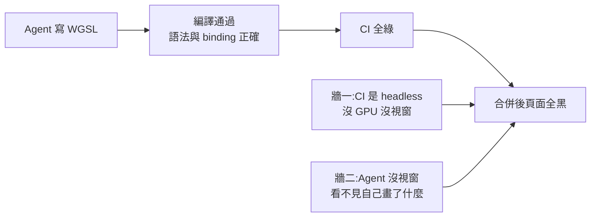
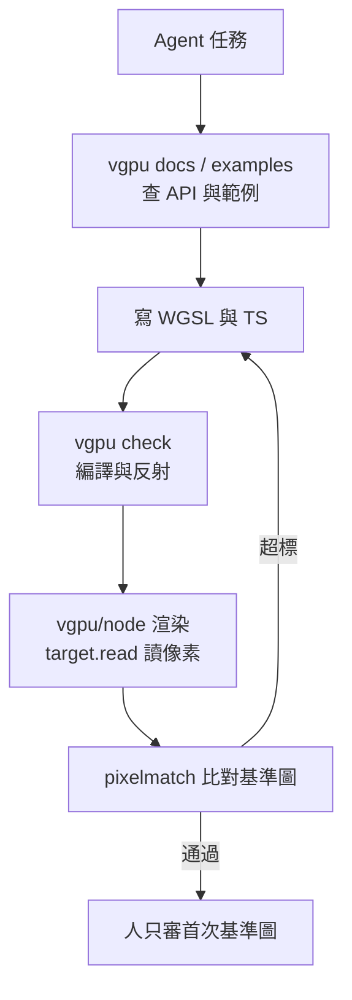

# Vercel vgpu:讓 Agent 寫的 Shader「畫對了」能被機器驗收(Golden Image 與三道關卡)

> 整理自頻道 Why QQ〈Vercel开源vgpu:一行命令让AI把着色器写对〉(2026-08-31),並**clone `vercel-labs/vgpu` 讀原始碼與文件核實**(clone 於 2026-11-06,canary 分支,讀完已刪除)。
> 該片原有官方簡中字幕但被 YouTube 限流取不到,逐字稿以 CPU 版 Whisper 轉錄,可能有同音字誤差。影片無業配。

## 一句話總結

**「能編譯」不等於「畫對了」。** AI 寫 Shader 時,CI 是 headless、Agent 又看不到畫面,驗收就成了真空。vgpu 的解法是三個條件:**渲染環境確定性、輸出能讀回像素、有標準答案可比對**,再提供 CLI、文件、MCP 讓 Agent 自己跑完整迴圈。但影片對 **Mock 的角色講得過頭**:原始碼顯示像素快照走的是 `vgpu/node`(Dawn),不是 Mock(見〈核實〉)。

## 1. 問題:兩道牆



- 編譯器只保證語法對、binding 對得上;顏色算錯、座標系反了、混合模式寫錯它都不管。
- 過去這段落差靠人眼補;現在寫程式的是 Agent,驗收也得是機器。
- 傳統解法是 **Golden Image**:存一張正確渲染的參考圖,改動後重渲染、逐像素 diff,誤差超標就報錯;但需要人搭環境、存參考圖、調閾值,Shader 驗收長期靠人肉盯螢幕。

## 2. 三個硬條件(影片的核心判斷)

1. **渲染環境確定性**:同樣程式碼每次結果一致,否則 CI 在擲骰子。
2. **輸出能讀回像素**:結果要變成程式拿得到的資料,不能只停在螢幕。
3. **有標準答案**:快照比對需要可信的參考圖。

缺任何一環,AI 產出就只能人肉抽查。這三問也能套到前端截圖測試、PDF 排版 diff、報表數值快照。

## 3. vgpu 怎麼對應(已對照原始碼)

repo 為 monorepo(`packages/` 含 `vgpu-api`、`core`、`wgsl`、`wgsl-std`、`adapter-node`、`adapter-mock`、`render`、`vgpu`(CLI)等),MIT。

最小 headless 範例(取自 README):

```ts
import { draw, frame, init, target } from "vgpu/node";
import triangleShader from "./triangle.wgsl";

const gpu = await init();
const colorTarget = target(gpu, { size: [256, 256], format: "rgba8unorm" });
const triangle = draw(gpu, { shader: triangleShader });

frame(gpu, (f) => f.pass(colorTarget, triangle));
const pixels = await colorTarget.read();   // 像素直接回到程式手裡
gpu.dispose();
```

- **所有入口第一參數都是 `gpu`**(`init()` 回傳的單一 `Gpu` context),無隱藏全域狀態;frame、pass、clear、draw 全是顯式呼叫。
- **`target.read()` 是地基**:瀏覽器 Canvas 畫完上屏、很難取像素;讀回後可存 PNG、做快照 diff、算誤差指標當 CI 門檻。
- 快照比對實作(`packages/vgpu-api/test-utils/snapshot.ts`、`packages/vgpu/lib/snapshot/png.js`):用 **pixelmatch** 逐像素比、**pngjs** 讀寫 PNG;`pixelmatchThreshold` 預設 0.1、`maxDiffRatio` 預設 0;失敗時寫出 `.actual.png` 與 `.diff.png`,並提示用 `vgpu snapshot --update` 在 Docker GPU harness 內重建基準圖。
- **三個運行時**(README):瀏覽器(畫到 canvas)、`vgpu/node`(Dawn headless)、`vgpu/mock`(測試用確定性 mock)。
- **確定性的來源**:`vgpu/node` 文件提供 `init({ adapter: "software" })`,強制使用同一個 Mesa(lavapipe)CPU 渲染器;`"hardware"` 則要求真 GPU、否則失敗;環境變數 `VGPU_ADAPTER=software|hardware` 可在 CI 覆寫。`npx vgpu install-software-renderer` 一次性安裝 CPU 渲染器,`npx vgpu doctor` 端到端檢查(取 adapter 並渲染一幀)。

### WGSL 模組化與工具鏈

- `.wgsl` 檔像 TS 一樣 `import`/`export`(函式、struct、const);`@vgpu/wgsl-std` 提供 hash、noise、color、sampling 等標準模組;建置時透過反射解析,**WGSL 是 binding 的唯一事實來源**,不必在 JS 端手寫對應宣告,解決「Shader 與 JS 兩套人肉帳本」的 binding 漂移。
- 未使用的宣告在壓縮前被剪掉;README 稱一個完整全螢幕特效 gzip 後 **25 KB,預算由 CI 強制**(`scripts/check-bundle-size.mjs` 以 gzip 量測並對預算判定)。
- `vgpu check <file.wgsl>` 對單一入口做 WGSL 反射與驗證並輸出 JSON(診斷、反射、WGSL);驗證失敗時仍保留診斷資訊。

### Agent-first 入口

```bash
npx vgpu docs find effect        # 離線查與已安裝版本相符的文件
npx vgpu examples search "raymarching"
npx vgpu examples pull <id> --out ./example
npx vgpu check shader.wgsl
npx vgpu mcp                     # 本機 stdio MCP;公開唯讀端點 https://vgpu.sh/api/mcp
npx skills add vercel-labs/vgpu  # 薄薄的文件路由 skill,不含版本化 API 參考
```

另有 `vgpu.sh/agents.md`、`llms.txt`、`llms-full.txt`、無 token 的 examples 唯讀 API(OpenAPI)。Agent 的迴圈因此是:查文件、搜範例、寫碼、`check`、渲染讀像素、快照比對,全程不需瀏覽器或人看一眼。



## 4. 影片的冷水:邊界

- **軟體渲染不等於真機**:浮點精度、MSAA、取樣、混合順序都可能不同;在 CPU 渲染器上調好的閾值,換後端可能爆。定位是**防邏輯回歸**;跨裝置一致性要上真機或放寬容差。
- **參考圖第一張還是靠人**:人的判斷只是被推遲到建基準圖;效果一升級,基準圖又要人工重定。機器驗收砍掉的是**日常回歸成本**,不是首次確權。
- **編譯器差異**:同一段 WGSL 在 Tint(Chrome/Dawn)能過、Naga(wgpu/Firefox)可能報錯;vgpu 的編譯期反射只解決 binding 漂移,**不保證語意在所有編譯器等價**。
- 影片也點出:這些技術(Golden Image、headless Dawn 加軟體渲染、逐像素比對)都不是新發明,vgpu 的價值是**打包成跨運行時 API 並配齊 Agent 介面**。

## 5. 核實(對照 repo)

**已核實**
- 倉庫 `vercel-labs/vgpu`、MIT、三運行時(browser / `vgpu/node` / `vgpu/mock`)、`target.read()`、pixelmatch + pngjs 快照比對、`npx vgpu docs|examples|check|mcp`、`agents.md`/`llms.txt`/OpenAPI/MCP、WGSL import/export 與反射、25 KB gzip 預算由 CI 強制(README 與 check-bundle-size 腳本)。
- 版本:影片稱 0.3.1;我讀到的 canary 中 `vgpu-api` 已是 **0.6.0**(`@vgpu/cli` 0.2.4),API 持續演進(例如 0.6.0 起 `draw`/`effect`/`compute` 只接受預先處理的 `ShaderSource`,並新增 `gpu.lost`),**範例以當時版本文件為準**。

**需修正(影片說法與原始碼不符)**
- 影片說「Mock 是確定性軟體模擬、不碰 GPU,pixelmatch 比對在 Mock 上跑綠」。**原始碼:`createMockAdapter` 是純 JavaScript、以 `Uint8Array` 記憶體 buffer 實作的 adapter;`adapter-mock` README 明寫「`vgpu/mock` 用於指令/資源測試,`vgpu/node` 才用於真實渲染與讀回快照」。** 也就是 Mock 不光柵化像素;真正做像素快照、又要確定性的,是 `vgpu/node` 搭 `adapter: "software"`(Mesa lavapipe CPU 渲染)。影片「三道關卡」的分工(瀏覽器看畫面、Node 看 CI 連通、Mock 看邏輯)方向可用,但「Mock 出像素」這一環應改成「software renderer 出像素」。

**未能核實**
- 「完整驗收只要 842 毫秒」「`pnpm test:render` 指令」「粒子壓縮後 397 位元組」:在 repo 的文件、README、package.json 中搜尋不到(根 `package.json` 無 `test:render`),可能來自官網或舊版範例;影片自稱「官方口徑,我沒實測」。
- 「2026 年 8 月 27 日 Vercel 在 X 發文」未能獨立核實;說明欄僅附 https://vgpu.sh/。
- Whisper 聽寫:「Visual」應為 Vercel(推定);「Barbiland Lite」(約 1:28,疑為 llvmpipe)、「Bubblenlight」(約 8:31,疑為 pixelmatch)、「Executive Talk」(約 8:40)= ExecuTorch、「ThoreVG」(約 8:45)= ThorVG。2026-11-07 以影片畫面截圖確認:第 17 節投影片列出 Golden Image、Dawn、SwiftShader、llvmpipe、ExecuTorch、pixelmatch、luma.gl、ThorVG 八項零件;前兩項的對應為依投影片推定,本文未採用其內容。

## 應用案例

> 你的團隊用 Claude Code 寫 WebGL 轉場特效,PR 常因「畫面歪了」被打回。導入同樣的三問:①環境——CI 映像預先 `install-software-renderer`,測試用 `init({ adapter: "software" })`;②讀回——特效渲染到 256×256 的 `target`,`await colorTarget.read()`;③標準答案——人工確認過一張基準 PNG 後 commit,之後用 `pixelmatch` 比對,`maxDiffRatio` 設 0.001。Agent 改完 Shader 自己跑 `check` 加快照,看到 diff 圖才會回頭修;人只在「基準圖第一次建立」和「刻意改視覺」時審圖。跨瀏覽器差異(Tint 對 Naga)再用一輪真機或多瀏覽器 smoke test 補。
>
> 同樣的框架能套到非 Shader:前端元件截圖測試、PDF 版面 diff、報表數值快照——只要環境確定、輸出可讀回、有基準,AI 產出就能被機器驗收。

相關閱讀:[[agent-verification-before-scale-lauren-tan-reaction]](先給 Agent 驗證手段再談規模)、[[addy-osmani-critical-thinking-when-agents-do-the-work]](綠燈證明了什麼)。

## 來源

- Why QQ〈Vercel开源vgpu:一行命令让AI把着色器写对〉(2026-08-31):https://www.youtube.com/watch?v=nScMXSWz9aE (該片無官方字幕取得,逐字稿以 CPU 版 Whisper 轉錄,可能有同音字誤差)
- vgpu 官網:https://vgpu.sh/
- 原始碼:https://github.com/vercel-labs/vgpu (README、`packages/adapter-mock`、`packages/adapter-node`、`apps/docs/content/docs/get-started/node.mdx`、`packages/vgpu-api/test-utils/snapshot.ts`、`packages/vgpu/lib/{check,snapshot}`、`scripts/check-bundle-size.mjs`)
