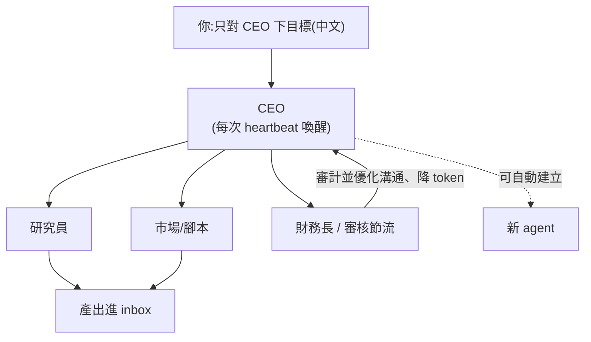
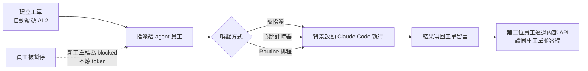

# 打造「0 人 AI 公司」:用 Hermes Agent + Paperclip 讓 AI 互相協作

**主題分類:** AI / Agentic Engineering(代理工程)
**來源:**
- YouTube 影片〈0人AI公司!你不能錯過的全自動創業?超點單上手!〉(酷可實驗室 Coocolab,2026-05-24,約 15 分;依繁中逐字稿整理)——§1–§4 Hermes + Paperclip 的玩法
- YouTube 影片〈GitHub 9.8万星爆火项目Paperclip:给你的AI开一家公司?订阅额度直接用〉(YAHA學堂,2026-10-10,約 8.6 分;依自動字幕整理)——§5 單機實操:工單、預算、Routine、AI 互審;並以 `git clone` 讀 paperclipai/paperclip 原始碼核對
**整理日期:** 2026-05-25

---

## 1. 概念

把「公司」做成一群會 **互相溝通協作的 AI agent**:你只對 **CEO** 下達目標,CEO 依職位把工作分派下去,還能 **自行招募(建立)新 agent**。整套可 **自動化、可自我提升、有記憶**(犯錯下次會改進)。可玩成你的「交易團隊」「無人廣告公司」等任意形狀。

兩個核心工具:

| 工具 | 角色 |
|---|---|
| **Hermes Agent** | 底層執行 agent,具 **自我升級** 能力、可 **遠端操作**(Telegram/Discord)、會自己找出更有效率的做事方式。 |
| **Paperclip** | 「公司介面平臺」,讓不同 agent 互相協作;你跟 CEO 講要做什麼,他安排職位、產出進 inbox。 |

> 與本 repo 關聯:這是 [[function-calling-mcp-a2a]] 講的 **A2A(agent 間協作)** 的具體消費級實作;省 token 的「財務長」角色則呼應 [[ai-token-saving]] 的 RTK 與 [[kv-cache]] 的成本觀。

---

## 2. 安裝流程

### Step 1 — 安裝 Hermes Agent
1. 開終端機(Terminal),貼上官網提供的安裝指令、按 Enter。
2. 它自動檢查環境(過程約 3–5 分鐘),中途問是否安裝相依套件就選「是」。
3. 選語言模型:**建議選第 4 個 Anthropic Claude**(也可用 ChatGPT 等)。
4. 提供 Anthropic **API Key**:可用 Claude Pro/Max 登入,或到 `platform.claude.com` 取一組 API key 貼上(貼上時不顯示)。
   - 模型建議用 **4.6**(相對便宜又不會太弱);越新越貴但效能越好。
5. 設定通訊方式(Telegram/Discord,可跳過)——用於在外面遠端發指令(如查 GitHub 代碼有沒有上傳/修正)。
6. 完成後在 Terminal 打 `Hermes` 啟動,**直接打中文** 下指令。
   - 範例:「截取 YouTube 酷可實驗室九張影片的圖片,合成一張 JPEG」→ 它自動做完並回傳檔案位置。

### Step 2 — 安裝 Paperclip
1. 需 **Node.js 24.11 以上**;Terminal 執行 `npx paperclipai@latest onboard --yes`(官方 README 的 quickstart 指令)。
2. 安裝後自動開網頁:設定 **公司名稱** 與 **目標(可打中文)**。
3. 連接 agent:預設是 Claude Code → 選 **More Agent Type** → 選剛裝的 **Hermes** → 選模型(較貴用 4.7)。
4. 生成你的 **CEO**。
5. 之後重開:Terminal 打 `npx paperclipai run`(CLI 套件名為 `paperclipai`,子命令 `run`)。

---

## 3. 操作要點

- **組織架構:** CEO 之下可有研究員、風險控管、財務、市場調研、腳本/寫作等職位。對 CEO 說「我要招聘」,他會分析需要什麼組織架構並去找人。
- **語言:** 預設英文;點 CEO → **Assign Task** 告訴他「交流與最終報告用中文」,之後就會用中文回覆。
- **目標(Goals):** 新增目標後,agents 會朝目標推進。
- **心跳(Heartbeat):** 關著時 agent **不會動**,要「給他心跳」才動。
  - 到 **Configuration → Run Policy → `heartbeat on interval`**:設每隔幾分/幾秒觸動一次。例如每 30 分鐘 CEO「活起來」一次,去和組員溝通、檢查是否朝目標實作。
  - **`can create new agents` 一定要開:** CEO 才能依流程需要自動建立新職位的 agent 並排進組織圖。
  - **Set budget:** 可限制花費上限(例如 $30)。
- **暫停:** 按 `pause`(暫停 CEO 後它不再下指令,底下在跑的任務跑完回報即止)。
- **產出:** 最後成果進 **inbox**(像收信)。



---

## 4. 省錢與實務建議(重要)

- **多數 agent 不需要用最新模型**——用最新的 token 會燒很快。
- **先想清楚任務量:** 重任務(如回測某策略「過去一年 BTC 一分鐘 K 棒」)資料量巨大、極燒 token;生成腳本/文案、前段搜尋則還好。
- **務必招一位「審核節流人員(像財務長)」:** 審計 agent 之間的溝通並優化——若 CEO 與某 CMO 頻繁重複貼同一段文本,他會自動讓溝通更簡短不重複以省成本(影片示例:把冗長段落優化後總共 **減少 6,000 多行**)。
  - 招法:跟 CEO 說「招一位能優化團隊、減少 token 消耗的職位」,再讓他 **定期審核**(工作量大可每 3 小時一次)。
- **它不是聊天機器人:** 想聊天直接用 Claude/ChatGPT 更便宜;它的價值在 **AI 與 AI 協作的編排**,且你能看到事情如何被執行。
- **指令要明確、思路要清晰:** 錯誤指令來回修改會花很多代幣。

> 一句總結:很像在玩《模擬市民》,只是它 **會燒你的錢、同時產出有價值的產值**,團隊還會自己成長。

---

## 5. 單機實操:把 Paperclip 當成 agent 的工單系統(YAHA學堂 2026-10-10)

> ⚠️ **立場揭露**:YAHA學堂 說明欄請觀眾按 Hype 支持頻道,本片未見聯盟連結或業配;Paperclip 為 MIT 開源,另有 Paperclip Cloud 候補名單(商業化方向)。

### 5.1 專案現況(GitHub API 核對,2026-10-11)

| 項目 | 數值 |
|---|---|
| Repo | [paperclipai/paperclip](https://github.com/paperclipai/paperclip) |
| Star | **約 99,700**(影片說 9.8 萬,上傳後仍在漲) |
| 授權 | MIT |
| 建立日 | 2026-03-02 |
| 官方標語 | *If OpenClaw is an employee, Paperclip is the company.* |
| 技術棧 | Node.js server + React UI;內建 `embedded-postgres`(影片說首次執行下載約 1.4 GB,含內建資料庫,屬正常、不是當機) |

> 🔎 **補正**:影片說明欄寫官網 `paperclip.inc`,但 repo README 列的官網與文件是 **`paperclip.ing`** / `docs.paperclip.ing`,以 repo 為準。

YAHA 的定位比 §1–§4 更務實:不是「零人類公司」,而是 **「Jira 工單 + 組織架構圖 + 財務系統」合體**,解決同時開七八個 Claude Code 終端時的三個老問題——**上下文丟失、任務追蹤、成本失控**。

### 5.2 一張工單的生命週期



- **員工檔案**:每個 agent 有職位、上司(Reports to)與「董事會」(就是你)——這是組織的最小單元。
- **喚醒**:被指派任務、或開心跳計時器定期醒來檢查漏掉的工作。
- **暫停**:員工頁按 Pause,之後指派給他的工單會變 **blocked**,一個 token 都不燒;工單黃色提示列按 Resume 恢復。
- **AI 互審**:雇第二位員工、把「Reports to」設為第一位,派他審 AI-2 的產出;他能**透過內部介面直接讀同事的工單留言**,上下文在公司內流通,不必你手動搬。

### 5.3 訂閱直連:不用 API key 的代價與陷阱

影片強調「Claude 訂閱直連、不用 API key、一分錢不多花」。原始碼確認了機制,也找到一個影片沒講的開關:

```ts
// packages/adapters/claude-local/src/server/execute.ts
function resolveClaudeBillingType(env: Record<string, string>): "api" | "subscription" | "metered_api" {
  if (isBedrockAuth(env)) return "metered_api";
  return hasNonEmptyEnvValue(env, "ANTHROPIC_API_KEY") ? "api" : "subscription";
}
```

- ⚠️ **只要環境裡有 `ANTHROPIC_API_KEY`,就改走 API 計費**(adapter 的檢查訊息也會提示「Unset ANTHROPIC_API_KEY if you want subscription-based Claude login behavior」)。很多開發者 shell 設定檔裡常駐這個變數——那就不是「一分錢不多花」了。
- 訂閱模式下員工花費顯示 **$0**,因為用的是訂閱額度而非美元計費。

### 5.4 三層預算保險絲(以及它管不到什麼)

README 提到的嚇人場景:失控迴圈在你發現前燒掉幾百美元的 token。Paperclip 的預算可設在公司、agent、專案三層。資料表定義(`packages/db/src/schema/budget_policies.ts`)的預設值:

| 欄位 | 預設 | 意義 |
|---|---|---|
| `warn_percent` | **80** | 用到 80% 發軟警告(可設 1–99) |
| `hard_stop_enabled` | **true** | 到 100% 硬停 |
| `metric` | `billed_cents` | 以**計費美分**計算 |
| `unpriced_usage_policy` | `block` | 無法定價的用量預設擋下 |

> 🔎 **補充(影片沒講)**:預算以 `billed_cents` 計,而成本事件表把 `subscription_included` 類型排除在「未定價」之外——也就是說**訂閱模式的用量記為 $0,美元預算不會因此觸發**。預算保險絲保護的是走 API key 的員工;訂閱員工的上限其實是 Claude 方案自己的 5 小時/7 天額度。兩者搭配才完整。

### 5.5 Routine:不用學 cron 的定時任務

- 例:每個工作日早上 9 點自動開工單、喚醒員工、完成後回報;Repeat 下拉選 **Weekdays** 即可,不必寫排程語法;可按 Run now 立即執行,Runs 頁看歷史。
- 兩個好預設(`packages/db/src/schema/routines.ts` 核對屬實):
  - `concurrency_policy = coalesce_if_active`:上一輪還沒跑完,新的一輪**合併進去**,不會堆疊。
  - `catch_up_policy = skip_missed`:電腦關機錯過的時段**直接跳過**,開機時不會一口氣補跑積壓任務。

### 5.6 支援的 agent 與 CLI

- repo 的 `packages/adapters/` 有 **12 個 adapter**:claude-local、codex-local、cursor-local、cursor-cloud、gemini-local、grok-local、kimi-local、opencode-local、pi-local、hermes、hermes-gateway、openclaw-gateway(與影片「支援 12 種 AI 工具」一致)。
- CLI(`paperclipai`)可查公司、列 agent、建工單、看成本彙總(`cost` 相關子命令),適合寫進腳本。

### 5.7 應用案例:一人內容工作室的每日選題流水線

1. `npx paperclipai@latest onboard --yes`,公司取名「AI 影片工作室」,第一位員工「小陳」(Claude Code,訂閱直連)。**先 `echo $ANTHROPIC_API_KEY` 確認是空的。**
2. 建 Routine:工作日 09:00,「蒐集今日 AI 新聞,產出三個選題,每個附發布理由、建議時程、可查證來源連結」。
3. 雇第二位員工「小審」,Reports to 小陳,Routine 跑完後指派他審稿:逐題標「同意 / 不同意 + 理由」。
4. 若另有一位走 API key 的員工(例如跑 Codex 做剪輯腳本),替他設專案預算 $10:80% 收到警告、100% 硬停。
5. 你每天只看兩位員工互審後的結論,決定拍哪一題——從「操作員」變成「審報告的老闆」。

---

## 來源

- [YouTube:0人AI公司!你不能錯過的全自動創業?超點單上手!(酷可實驗室 Coocolab)](https://youtu.be/yLOtgJwjhZ8)
- [YouTube:GitHub 9.8万星爆火项目Paperclip:给你的AI开一家公司?(YAHA學堂)](https://www.youtube.com/watch?v=vZHaSwnJmSk)
- [paperclipai/paperclip GitHub repo](https://github.com/paperclipai/paperclip)
- [Paperclip 官方文件:成本與預算](https://docs.paperclip.ing/guides/day-to-day/costs/)
