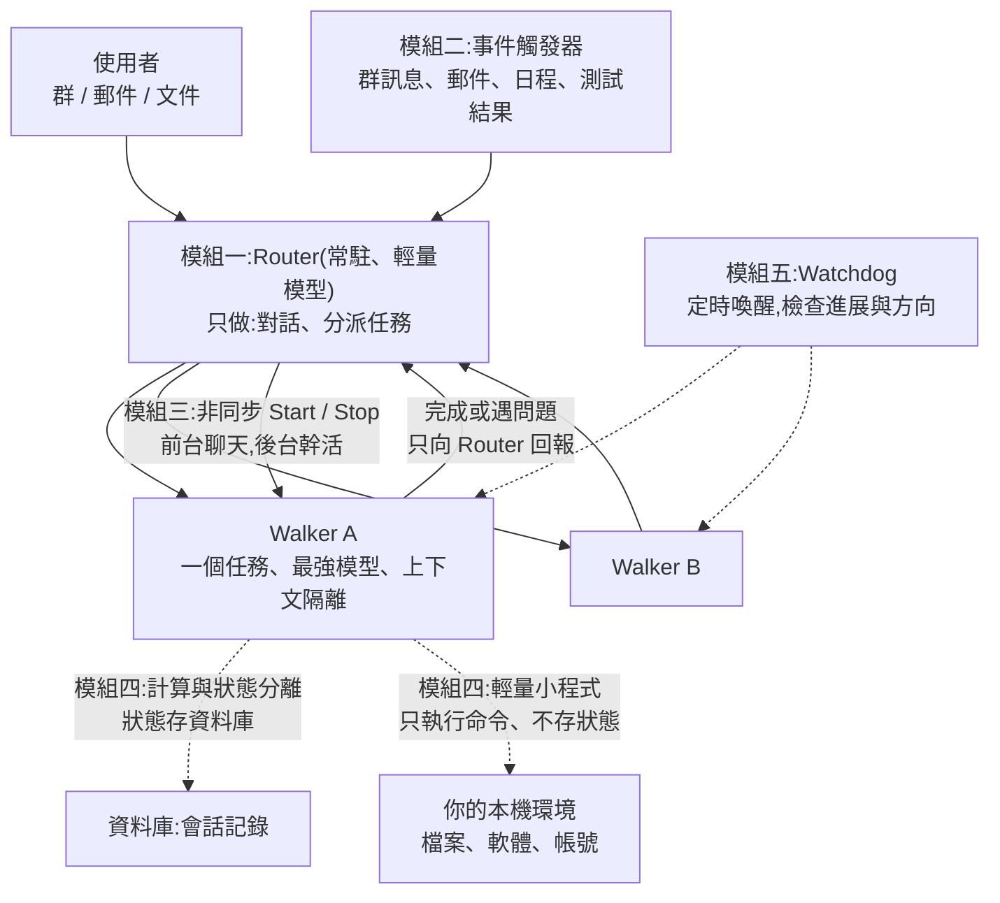
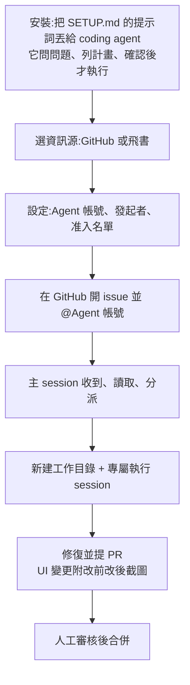
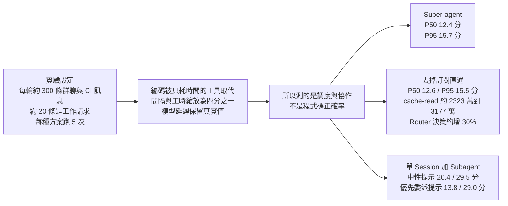

# DeepSeek「Super Agent」是什麼:從 ReAct 單會話,到 Router / Walker 的五個模組

> 整理自 YouTube「轩辕的编程宇宙」〈DeepSeek最新开源的Super Agent是什么东西,一个动画彻底搞懂!〉(2026-11-02,約 12.6 分鐘,影片 ID `jLeYfSBXG_E`)。
>
> **立場聲明:** 影片無業配;說明欄僅放作者自己的圖文教程連結與動畫工具 svganimate.ai 的標示(自我宣傳等級,非付費置入)。影片轉述的是 DeepSeek 的設計文章〈Exploring Super-agent Design: Towards a More Autonomous Agent System〉。**我沒有找到該文章全文**,因此影片中「文章說了什麼」無法逐句核對;能核對的是 DeepSeek 同步公開的原型 repo(已 clone 讀完),見下方核實段。
>
> 該片無字幕,逐字稿以 CPU faster-whisper 轉錄,非官方字幕。
>
> **增補(2026-11-03):** 併入第二支影片 AI随风〈DeepSeek SuperAgent 实测:接单干活全自动〉(2026-11-02,約 13 分鐘,影片 ID `OrNE5vMFD2k`,無字幕、Whisper 轉錄),見 §6——前半是概念講解,§6 是實際裝起來跑一遍的操作紀錄。
>
> **增補(2026-11-04):** 併入第三支 Why QQ〈DeepSeek新原型:Super-agent 会话不用你〉(2026-11-03,約 10 分鐘,影片 ID `038BebtLg1U`,官方簡中字幕),見 §7——補上設計文章的**消融實驗數字與口徑**、Fast/Slow Path、Chain of Recall 等前兩支沒講的部分。此片無業配,片尾僅一般三連呼籲。

---

## 一句話總結

影片的論點:**今天的 Agent 是「一個會話一次做一件事、你說一句才動一下」的串行 ReAct 迴圈,瓶頸已從 AI 變成人的注意力(同時最多盯 3–5 個會話)。DeepSeek 提的 Super Agent 把「對人說話」和「幹活」拆成兩層(Router + Walker),再加上事件觸發、非同步工具、雲端計算 + 本機執行環境分離、看門狗,讓 Agent 變成連續、高效、主動、持久。** 我的核實結論:方向有 repo 佐證,但**影片用的名稱(Router、Walker、Watchdog、Daemon)與原型 repo 的名稱並不一致,且 repo 只實作了部分設計**。

---

## 1. 問題:為什麼 ReAct 迴圈不夠

| 現況 | 影片說的後果 |
|---|---|
| 一個會話同時只能做一件事,你說一句才動一下 | 要同時做報告、回信、做簡報,就得開多個會話 |
| 每個會話上下文互相獨立 | 哪個做到哪,全靠你自己記 |
| 加了 MCP、飛書、郵箱 | 仍不夠:Agent 忙的時候新訊息進不來;多件事混在一個會話會串;跑在本機,**蓋上電腦蓋子就停** |

影片轉述 DeepSeek 的觀察:人同時最多顧 3–5 個會話,所以生產力瓶頸從 AI 轉到人。(此數字出自影片轉述,**我未能對照原文**。)

Super Agent 的四個特性(影片):**連續**(群裡說方案 A、郵件裡改口,它知道是同一件事)、**高效**(忙的時候可直接下新指令)、**主動**(自己盯訊息、該出手才出手,否則保持安靜)、**持久**(一直在線、接在真實工作環境、出錯能自己恢復)。

---

## 2. 五個模組

### 模組一:兩層分工(Router + Walker)

- **Router**:常駐在線,只做兩件事——跟你溝通、把任務分派下去。所有跨任務資訊匯總在這裡;自己不幹活,所以不會被具體任務拖住。影片轉述 DeepSeek 的經驗:Router 的活沒想像中複雜,**輕量模型就夠**。
- **Walker**:一個 Walker 負責一個任務,上下文互相隔離,配**最強**模型;不直接跟你對話,完成或遇到問題都向 Router 回報,由 Router 統一回覆。
- 效果:你面前始終只有一個對話窗,「會話」變成系統內部的事。
- **Router 會不會堵塞?** 影片的答案:Router 思考時新事件先排隊、下一輪一起處理;Router 每步是「長輸入、短輸出」,多條事件合併讀取,模型平行處理輸入,耗時只多一點,所以事件越多、平均每條處理得越快。(這是影片轉述的設計理由,**非我驗證的效能數字**。)

### 模組二:事件觸發(讓 Agent 主動)

驅動 Agent 的不再是你敲的那句話,而是環境裡的事件(群訊息、郵件、日程提醒、文件評論、測試結果),稱為 Trigger。一個事件進來有四件事:

1. **過濾**:群裡多數訊息與 Agent 無關,全交大模型判斷又慢又貴。先用寫死的程式規則(來源、群組、白名單)篩一大批,剩下的再交大模型依提示詞策略判斷。
2. **路由**:同一話題 / 同一封郵件下的連續訊息算一條 thread;Router 為新任務建立 Walker 後,Walker 訂閱該 thread,之後這條 thread 的訊息直接送給它,不再經 Router。訂閱是**多對多**:兩個 Walker 改同一份程式碼,會收到同樣訊息,不必互相通信就能發現衝突。
3. **上下文怎麼給**:借 CPU 快取的想法。近期很可能用到的內容 **inline** 放進來;太長的留在外面,視窗只放摘要和引用,要用再讀。每個物件有 ID,讀一個物件時順帶帶出相關物件的 ID,模型可一跳一跳往外找,所以很久以前的任務,Router 也能順線索找回上下文。
4. **提前行動**:不等你開口,先在後台試做,有用就交給你、沒用就丟。例:收到會議邀約,先查日程有沒有衝突、寫好回覆草稿。DeepSeek 內部有一個群配了「靜默復現並修復」策略:有人報問題,Agent 先在後台復現、找修法,**確認問題成立且方案簡單才交出結果,否則全程不出聲**。

### 模組三:與人互動(非同步工具 + 渠道規矩)

- 傳統 ReAct:模型呼叫一次工具就得等它跑完,期間你說什麼它都不理。DeepSeek 把 shell 命令改成**非同步的 Start / Stop**:呼叫後立刻返回一個啟動確認,後台跑完再把結果當成**一條新訊息**投回來;模型覺得跑太久也可主動 Stop。前台聊天、後台幹活互不耽誤。
- **不同渠道密度不同**:把終端裡冗長的推理與密集工具呼叫原樣發到群裡會刷屏。雙層架構已解決一半(推理和工具呼叫關在 Walker 裡,群裡只看結論);再用提示詞給渠道定規矩——IM 這類即時通訊要**低打擾**,像同事一樣只在需要你決策或驗收時發訊息;郵件、文件這類非同步渠道則要**完整、資訊密度高**,一次交代背景、結論和依據。

### 模組四:持久在線(計算、狀態、執行環境三者拆開)

Agent 幹活綁著三樣東西:**計算**(推進 Agent 迴圈)、**狀態**(會話記錄)、**執行環境**(檔案、已裝軟體、帳號密碼)。本機 Agent(Codex、Claude Code、DeepSeek Harness)三樣全綁在一台電腦;雲端 Agent(Manus、各種雲端小龍蝦)可持久在線,但使用者資料往往在本機,搬不上去。DeepSeek 的做法分兩步:

1. **計算與狀態分離**:計算部分做成**無狀態**,放雲端容器;會話記錄存資料庫。容器可隨時重啟、擴容、替換,任務連續性靠資料庫保證。
2. **計算與執行環境分離**:不把環境同步到雲端沙箱(有未存檔修改、私人帳密、公司內網依賴,同步成本高又易漏),也不要求使用者全搬上雲;而是環境留在本機,只裝一個**很輕量的小程式(影片稱 Daemon)**,不存任何會話狀態,只負責執行命令、回傳結果。雲端 Agent 要什麼就透過它讀 / 執行;可依任務在不同設備間切換,電腦暫時關機,等它重新上線後雲端 Agent 再接著做完。

### 模組五:Watchdog(看門狗)

光有存算分離不夠,還要能從異常自己恢復。Agent 的特殊之處:**很多故障不是行程崩潰,而是模型陷入無效迴圈或做著做著跑偏**,所以只監控「程式活沒活」不夠,還得監控「任務有沒有進展」。DeepSeek 在主系統外放一個獨立的 Watchdog,用定時訊息喚醒它;除了處理崩潰等基礎故障,還讓模型判斷每個 Walker 有沒有實質進展、方向有沒有偏離整體目標,發現問題就介入修復。Watchdog 本身也是一個 Agent,維運的人可直接用自然語言問它「剛才為什麼出故障」,也可請它線上調整主系統行為。

---

## 3. 影片自己交代的限制

- 系統還在**很早期**;能用較低複雜度跑起來,是因為做了不少簡化。
- 未定論的問題:模型變大後 Router 何時拆、怎麼拆;Walker 之間要不要直接通信;運行數月後長期記憶怎麼做;使用者不再直接面對會話後,用什麼介面管理任務;Agent 與 Agent 如何安全協作。
- **最大問題是安全**:被更多環境事件驅動就接觸更多不可信輸入;雲端 Agent 連著你的各台設備,一旦被入侵或遭提示詞注入,所有連著的設備都有風險;就算雲端沒被攻破,設備上的帳密進入模型上下文也可能洩漏。解決不了安全與隱私,Super Agent 只能在很小、很可信的範圍內工作。
- 開源項目只是**驗證思路的原型,不是正式產品**。

---

## 4. 核實紀錄(2026-11-03 查證,已 clone 原型 repo 讀完)

查證對象:`github.com/deepseek-ai/dsh-superagent-prototype`(2026-10-31 發布,MIT,單一 commit「add the dsh-superagent research prototype」)。

**已核實**
- repo 存在,README 明確標示「**Research prototype for reference only, not an official DeepSeek product**」,並說「這份程式與內部版本、與文章 *Exploring Super-agent Design: Towards a More Autonomous Agent System* 描述的實作**不完全相同**,文章中的**部分設計只是未來方向,原型沒有實作**」。這與影片「只是驗證思路和原型」吻合。
- 設計哲學與「主動但安靜」吻合:`docs/000-philosophy.md` 的核心原則是「**用最少的人類注意力,給出最多價值**」;Agent 只在被請求或有團隊寫明規則時行動,只在人需要決策或可用結果時才說話,主動型工作預設只「記錄會做什麼」(observe 模式)。
- 兩層分工有對應:repo 有 **main Session**(代碼與提示詞稱 `orchestrator`,使用 `dsh-superagent-router` 預設)負責評估事件、分派、回覆,以及每個 Ticket 一個 **Executor Session**(代碼稱 `worker`,目錄與 Session 名 `worker-<ticket id>`)。
- 事件 → 評估 → 執行的模型也對應:Source(GitHub、飛書)產生 **Trigger**,同一話題組成 **Thread**,Thread 內一次只跑一個 **Eval**;Eval 通過才建立 **Ticket** 與授權範圍 **Mandate**;**Subscription 是多對多**,後續訊息直接 fan-out 給訂閱的 Ticket,不經 Eval。這與影片「過濾 → 路由 → 多對多訂閱」一致。
- 非同步工具:`docs/003-execution.md` 寫明 Executor 的前台 shell 命令超過 **5 秒移為後台 job**,Executor 因此能在下一步收到新訊息而不是卡在長命令上;完成的 job 或 subagent 會帶結果喚醒 Executor。與影片「Start/Stop 非同步」概念吻合。
- 渠道規矩有對應:提示詞要求 IM 低打擾、只在需要決策或驗收時發訊息(`prompts/` 下的 replies、handoff 等)。
- 安全顧慮屬實且 repo 更直白:Executor 以 `danger-full-access` 用操作者的 OS 帳號執行,帳號 wrapper「**不是安全邊界**」,worker 能用絕對路徑執行任何程式;建議為 Agent 使用專用 OS 帳號。

**需修正 / 影片名稱與 repo 不一致**
- 影片的 **Router / Walker** 在 repo 裡叫 **orchestrator(main Session)/ worker(Executor Session)**;repo 的核心術語是 Source、Trigger、Thread、Eval、Mandate、Ticket、Assignment、Subscription。可能是 DeepSeek 原文章用的名稱與 repo 不同,也可能是影片作者的譯名或 Whisper 誤聽;**我無法確認哪一個**。
- **repo 內沒有 Watchdog 與「Daemon」**:對 `docs/`、`prompts/`、`src/` 搜尋 watchdog、daemon,無對應實作。repo 的 `Passes`(每 2 秒的處理輪詢)、重啟後恢復被中斷的 Assignment、Eval 逾時重排、重試與 `unavailable` 判定,屬於較基礎的恢復機制,**不等於影片說的「用模型判斷 Walker 有沒有實質進展」的看門狗**。
- **「計算在雲端容器無狀態、狀態存資料庫、本機只裝輕量 Daemon」在 repo 中也沒有看到**:repo 的部署是一個本機 DeepSeek Harness profile(`127.0.0.1` 面板),狀態在本機 state 目錄。所以模組四(雲端 + 本機分離)更可能是**文章裡的設計方向,不是原型已實作的內容**。
- 影片的「**Router 用輕量模型**」:repo 有 `role-models` 與設定可分別指定 Eval / Execution 模型,但「Router 預設輕量」的**經驗說法**我沒在 repo 中看到。

**未能核實**
- 〈Exploring Super-agent Design: Towards a More Autonomous Agent System〉全文(兩次搜尋都沒找到);因此影片中「人同時最多顧 3–5 個會話」「Router 事件越多平均處理越快」「靜默復現並修復」「近期內容 inline、長內容留外面的快取式上下文」等說法,**都只有影片轉述,未對照原文**。其中「上下文用 ID 一跳一跳往外找」的概念,repo 內有 `orchestrator_eval_read` 逐頁擴展上下文的工具,但是否就是影片所說機制未確認。
- 「各種雲端小龍蝦」的具體所指,與 Manus 之外的產品未確認。

---

## 5. 應用案例

- **團隊 GitHub 維護**:repo 的實際用途——為一個 GitHub repository 配一個 Agent 帳號,有人在 issue 或 PR 裡 @ 它(或團隊寫的規則允許主動處理),它開 Ticket、在獨立目錄裡做事、用 PR 回覆;面板只顯示「需要人處理」的項目。適合先用 `observe` 模式跑一陣,看它「會做什麼」合理再切 `auto`。
- **自己做多任務助理**:同時有「寫調研報告 + 回信 + 做簡報」時,不是開三個會話自己記進度,而是一個入口收單、背後各開一個隔離上下文的執行者。可借用的設計:**對話層用便宜模型,執行層用強模型;每個任務的推理過程關在內部,只對外送結論。**
- **主動型規則要先寫窄**:例如「CI 失敗且與近期提交相關時,先在後台復現並準備修復,只有確認可行才通知人」——對應影片的靜默復現;repo 也要求先以記錄模式觀察。

## 6. 實測:裝起來、接單、出 PR(AI随风〈DeepSeek SuperAgent 实测〉`OrNE5vMFD2k`)

> **立場:** 影片無業配;說明欄只列章節與自己的實測內容,片中提到的 mattpocock/skills 是作者拿來當 PR 規範的第三方技能(我未讀該技能內容)。作者另說飛書對接留到下一集。

### 6.1 作者的操作流程(影片說法,對照 repo 後標註)

| 影片說法 | 對照 repo(`dsh-superagent-prototype`) |
|---|---|
| 安裝只要把一段提示詞發給 AI 工具,它讀 SETUP 文件、下載、安裝,過程中問你選哪個資訊源 | **屬實**:README 寫「Read SETUP.md…set up dsh-superagent with me」;SETUP.md 規定**一次一個問題**、給推薦答案、**最後列完整計畫經確認才執行**、**絕不在聊天裡要密碼** |
| 資訊源有 GitHub 與飛書,任務要有來源也要能回覆,是**雙向**通道 | **屬實**:Source 同時定義事件與回覆的 Channel(GitHub 留言 / 飛書話題回覆) |
| SuperAgent 跑在**另一個獨立的 DeepSeek Harness 站點**,與日常工作的桌面介面分開 | **屬實**:docs/006 要求建一個**專用 profile**(如 `superagent`),因為外掛會改行程層級的 `PATH` 與 git 設定,需獨立重啟與升級 |
| **自己不能給自己提問**:用自己的帳號開 issue,Agent 不接;必須有另一個人(同事 / 協作者)當發起者 | **方向屬實,但原因要說準**:Agent 要用**專用的 GitHub 帳號**(不能是 GitHub App,因為要讀該帳號的通知);Source 會**丟掉 Agent 自己的訊息**。若 Agent 帳號與你是同一個,你的 issue 就被當成它自己的訊息。更完整的規則是:發起者要在**准入名單**上,且要「@Agent」才是明確請求 |
| **@ 它** → 立刻接單;**沒 @ 但發起者在名單內** → 看模式:**「僅觀察」只記錄、不幹活;「自動接單」則直接開工** | **大致屬實**,repo 的名稱是 accept mode:`off` / `observe`(**預設**)/ `auto`。明確 @ 的請求**在任何模式都會執行**;未 @ 的「主動」工作在 `observe` 只記錄「會接」的判斷,`auto` 才真接。注意 repo 的 auto 還要求**有符合的規則(rule)**,不是只要在名單內就接,影片說得較寬鬆 |
| 每個任務**新建工作目錄**,分派一個**專屬執行 session**;主 session(協調者)負責收單、讀取、分派 | **屬實**:每個 Ticket 一個 `worker-<id>` Executor Session 與目錄;prepare 指令常用 `git worktree` 建 checkout |
| 設定可選**研判模型**(負責研判與路由)、**執行模型**、推理強度,**並行工單數預設 3** | **部分核實**:repo 有分開指定 Eval / Execution 模型與 `maxWorkers` 設定;**「預設 3」我沒在文件中看到數字**,以面板為準 |
| 提示詞分階段、可改,可定溝通方式、通知寫法、交付要求 | **屬實**:docs/004 把提示詞拆成多個可覆寫的部分(shared / orchestrator / worker / handoff / team 的 communication、delivery、scope 等) |
| UI 變更的 PR 要附**改前 / 改後截圖**,並有「修改範圍」「單向門 / 雙向門」欄位 | **改前改後屬實且是硬規定**:`prompts/team/delivery.md` 要求 UI 變更的 PR 描述**必須同時有 Before 和 After**,只有 After 算未完成,且禁止拿 mockup 冒充舊版。**「單向門 / 雙向門」不在 repo 的預設提示詞裡**,影片說那是用 mattpocock/skills 的 PR 技能產生的模板;其解釋(單向門 = 發布後無法回滾、雙向門 = 可回滾)是作者的說法,我未核實該技能 |
| 人工審核後合併;未來低風險 PR 可能連審核都省掉、自動發布 | repo 預設**相反且更保守**:**Agent 不會用自己的帳號啟用 auto-merge**,預設由人合併;除非提示詞指定另一個帳號的 merge CLI,且 PR 小於 200 行、必要核准涵蓋 head commit 才可自動合併。影片這句是作者對**趨勢**的看法,不是這個原型現在的行為 |

### 6.2 作者的結論(影片觀點)

- 自動化接單就是三步:**接單、幹活、人審**;更複雜的系統只是把每一步做得更準(更多 agent、更多模型去 code review 與檢查)。
- 推論:模型能力邊際效益遞減、產出的 PR 越來越多,人看不過來,所以要把注意力移到更有價值的事。
- 提醒:作者自己說**這還不是完整版**(與 repo README「研究原型」的說法一致)。

### 6.3 應用案例

- **照著試跑的最小設定**:建一個專用 Agent GitHub 帳號、再用另一個帳號當發起者;先把 accept mode 留在 `observe`,只靠「@Agent」觸發,觀察它的 PR 品質,再決定要不要開 `auto`。
- **UI 專案的交付規範**:把「改前 / 改後截圖」寫進 delivery 提示詞,讓審核者不必自己拉分支就能判斷改對沒;這是 repo 本來就有的預設,不用另外寫。
- **安全提醒**:repo 說 Executor 以 `danger-full-access` 用你的 OS 帳號跑,wrapper 不是安全邊界;要玩請用**專用 OS 帳號 + 只有 Agent 的憑證**,別在日常工作機直接開。

## 7. 實驗口徑與缺少的環節(Why QQ〈DeepSeek新原型:Super-agent 会话不用你〉`038BebtLg1U`)

這支直接講設計文章(2026-10-31 發表,英文題名〈Exploring Super-agent Design: Towards a More Autonomous Agent System〉,我現在從 IT之家、愛范兒的報導確認它存在,**但仍未讀到英文原文**)。相對前兩支,新增的內容:

| 項目 | 影片說法 | 核對 |
|---|---|---|
| 人同時只能跟 3 到 5 個活躍 Session | 文章的觀察 | 未能核實(報導未見此數字) |
| 三個對象要分清 | 設計文章(內部實例)、GitHub repo(公開研究原型、只實作一部分)、DeepSeek Harness(底層環境) | ✅ 與前面 §4 一致;README 自己註明僅供研究參考 |
| Fast Path / Slow Path | 程式規則先擋來源、群組、白名單、明確請求;過關的候選才交 LLM 判斷語意 | 設計文章概念;repo 對應 Eval 與 accept mode(`docs/002`) |
| 訂閱直通 | 同一 PR 的 CI 與評審、同一 IM 話題的後續,直接投給已建立的 Worker,不再重新路由 | ✅ `docs/002`:訂閱 Thread 的訊息直達 Ticket、繞過 gate、不授予新權限 |
| Inline & Spill、Chain of Recall | 高機率用到的放進視窗,長文只留摘要與讀取入口;每個 Trigger/Thread/Worker 有 ID,可沿引用鏈回溯 | 報導一致;repo 未逐項核對 |
| start()/stop() 非同步 | `start()` 立即返回 Started,完成結果作為新事件投回;前台 Shell 五秒後轉背景 | ✅ 五秒規則見 §4;文章同時注明**異步機制已在 Harness 實現、尚未預設開啟**(影片轉述) |
| 回覆不超過 100 詞 | 文章驗證過的規則 | ✅ repo `prompts/replies.md`:「100 words is a hard ceiling, not a writing target」,傳輸層會拒絕更長的 IM 訊息,連 Markdown 連結標籤與網址都算字數 |
| Watchdog、雲端 Agent Loop + 本地 daemon(BYOM) | 設計方向,影片明說公開版沒實作 | ✅ repo 全文搜尋沒有 watchdog;與 §4 結論一致 |
| 接受模式 off / observe / auto,預設 observe | 命中規則的推斷任務只記錄 would accept,不執行 | ✅ `docs/002`:`observe` (default),正向評估記為 ignore 並標 "would accept" |

### 消融實驗(最容易被誤讀的數字)

- **直通省的是路由和 token,不是完成時間:** 去掉直通後 P50、P95 幾乎沒變(12.4 到 12.6、15.7 到 15.5),但 cache-read token 約增 37%、Router 決策約增 30%。
- **「優先委派」提示詞確實能縮短 P50(20.4 到 13.8 分),但 P95 仍 29.0 分**,影片說長尾來自某次未委派;這支持「提示詞不穩定」的論點,同時也說明這是 5 次的小樣本。
- **Super-agent 的總 cache-read 高於單 Session**:用更多上下文換更穩的並行調度,沒有全維度勝出。
- 事件速率升高時 Router 有批處理兜底(合併積壓的 Trigger),所以負載增加也沒撞上單 Router 吞吐上限(影片轉述)。
- 核對:12.4/15.7、29.5、Router 約增 30%、cache-read 約 2320 萬到 3180 萬(約 37%)、「合成訊息、模擬工具延遲,主要測調度而非編碼品質」都與 [IT之家](https://www.ithome.com/1/020/615.htm)、[愛范兒](https://www.ifanr.com/1687026)的報導一致。**這是二手報導對原文的轉述,不是原文;其餘分項(20.4、13.8、29.0、12.6、15.5)我只在影片看到,未能獨立核實。**

### 影片給的四個自我檢查(可搬去自己的系統)

1. 新訊息會不會阻塞舊任務?
2. 後續事件要重複路由幾次、長文會不會反覆進入視窗?
3. 授權能否脫離提示詞被強制執行?(影片提醒:Worker 以運行帳號的權限執行命令,目錄封裝與禁用命令只是預設約束,試用請用獨立帳號、最小權限、隔離環境與分支保護。)
4. 每完成一項任務,打斷了人多少次?(比在線時長更接近真實體驗。)

**應用案例:** 想自己做小型版本,可照影片建議從非核心倉庫開始:只接明確 @ 請求、先跑 observe,記錄每次「接單、打斷、交付」,再逐步開一條窄規則,而不是一開始就開 auto。

## 8. 與本庫其他筆記的關係

- 底層執行環境:[[agent-runtime-deepseek-harness-cordis]](DeepSeek Harness 的插件樹與事件日誌;dsh-superagent 就是打包成這個 harness 的 bundle)。
- 長時間自主執行的評估問題:[[long-running-agents-goal-evaluation]]。
- 同一頻道的另一支(KV cache / 長上下文):[[long-context-attention-mha-to-csa-xuanyuan]]。

## 字幕還原(Whisper 推定,已通讀檢查)

| 字幕寫法 | 還原 | 備註 |
|---|---|---|
| GPC哥、Deepsec、DeepSake、Dipsec | DeepSeek | 公司名 |
| 超纖Agen、Super Aging | Super Agent | |
| Rooter、Rootert | Router | |
| Walkers、Walkert、Walkered | Walker | |
| 吹梗 | Trigger(觸發器) | 影片中同句對應「觸發器」 |
| 綏化、絧化、挥化 | 會話(session) | 全片 |
| sread | thread | |
| 西式模型的注意力 | 稀釋模型的注意力 | 推定 |
| 長江的做法 | 常見的做法 | 推定(原音難辨) |
| House 的命令 | shell 的命令 | 推定,與 repo 的 shell job 吻合 |
| 云钻的小龙虾 | 雲端的「小龍蝦」類 Agent | 推定,具體產品未確認 |
| Daemon / Demon | Daemon | 影片稱「很輕量的小程式」,名稱推定 |
| 信息员、CellerUp、DPC、DBSC、AZ | 資訊源(Source)、SETUP、DeepSeek、DeepSeek、Agent | 第二支影片(AI随风),依上下文推定 |
| 盐胖/盐炮模型、研判 | 研判模型(負責研判與路由) | 第二支影片,推定 |
| Open Cloud Go,Stay E-Fresh | 疑為作者選的某個服務商與模型名 | **未能辨識,未寫入正文** |
| 警官查 | 僅觀察(observe) | 推定 |
| 門控/門空、單順門 | 單向門 / 雙向門 | 與上下文「無法回滾 / 可回滾」吻合,推定 |

## 來源

- 轩辕的编程宇宙〈DeepSeek最新开源的Super Agent是什么东西,一个动画彻底搞懂!〉 https://www.youtube.com/watch?v=jLeYfSBXG_E (無字幕,CPU faster-whisper 轉錄,非官方字幕)
- DeepSeek 原型 repo(已 clone 讀 README、`docs/000`–`007`、`prompts/`):https://github.com/deepseek-ai/dsh-superagent-prototype
- DeepSeek Harness:https://github.com/deepseek-ai/deepseek-harness
- 作者圖文教程(說明欄):https://www.xuanyuancode.com/ai-llm
- AI随风〈DeepSeek SuperAgent 实测:接单干活全自动〉 https://www.youtube.com/watch?v=OrNE5vMFD2k (無字幕,CPU faster-whisper 轉錄,非官方字幕)
- Why QQ〈DeepSeek新原型:Super-agent 会话不用你〉 https://www.youtube.com/watch?v=038BebtLg1U (官方簡中字幕)
- 設計文章報導(二手):IT之家 https://www.ithome.com/1/020/615.htm ;愛范兒 https://www.ifanr.com/1687026

> 本篇的設計內容主要來自影片轉述,**原文章未能取得(只確認存在於 2026-10-31,並以二手報導核對部分數字)**;與 repo 的對照以上述核實段為準。引用具體機制前請回到 DeepSeek 原文章與 repo 文件。
