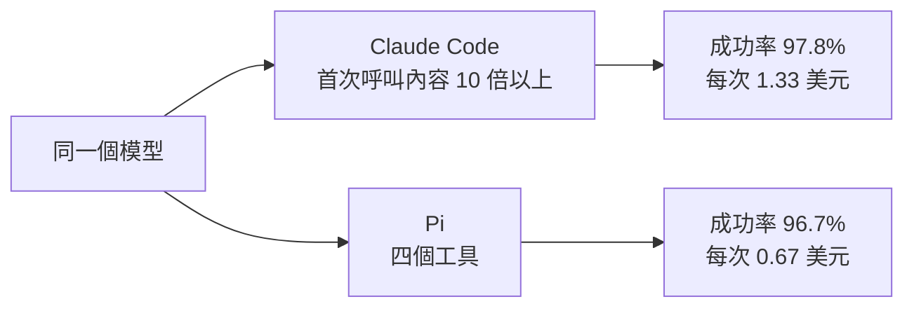
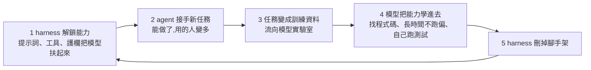

# Agent Harness 已死?模型吃掉 harness、harness 去開下一片疆土

> 整理自 YouTube 頻道 **AI学长小林**〈[Agent Harness 已死？越复杂的 Agent，越像智商税](https://www.youtube.com/watch?v=KjLmBefKvv4)〉(2026-10-27,約 12 分鐘,官方簡中字幕)。影片轉述 **AI Engineer 大會 10-19 發布的演講〈Is the Agent Harness Dead?〉**,講者 **Jediah Katz**(2025 年初加入 Cursor 做 harness;Cursor 併入 SpaceX 後轉入 SpaceXAI)。
>
> ⚠️ **立場揭露**:作者說明欄推廣自家付費「AI 工作流課程」與 N8N 工作流倉庫。
>
> ✅ **已核對 HarnessTax 研究數字**(UC Berkeley + Arena,2026-09-16)。⚠️ Katz 演講原片、EPFL 研究本筆記未讀到原文,見第七節。

---

## 一句話總結

Katz 的兩句話看似矛盾、其實同時成立:**寫程式這塊,花俏的 harness 已經不能讓模型變更聰明了;但 harness 比以往任何時候都更重要。** 原因是一個**資料飛輪**:harness 先把模型扶起來 → 任務變成訓練資料 → 模型學會 → harness 拆掉腳手架 → 去下一個模型還不會的領域重新扶。程式碼這圈已經轉完,所以 coding harness 越來越薄;辦公類 agent(如 Grok Bot)才剛開始,正在把護欄加回去。而**在哪裡跑、能碰什麼、花多少錢**這三件事,模型再聰明也吃不掉。

---

## 一、Harness 是什麼

直譯是「馬具」:馬有力氣,但不套上韁繩和車轅就拉不了車。**模型是馬,harness 是包在模型外面、讓它真正能幹活的那層軟體。** Katz 的比喻:harness 是模型的**眼睛和手**。

它管的事:給什麼提示詞、能用哪些工具、記憶怎麼存、對話太長怎麼壓縮、哪些事要攔住、任務在哪台機器上跑、斷了怎麼接著跑。Claude Code、Codex、Cursor 的 agent,說白了都是「一個模型 + 一套 harness」。

**三年換了三個名字,做的是同一件事**:2023 提示詞工程師 → 2025 年中上下文工程師 → 2026 年初 harness 工程師(本庫 [[harness-engineering-evolution]] 有完整演進史)。

---

## 二、為什麼有人說它死了:最懂 harness 的幾家都在做減法

| 時間 | 事件 | 代表的思路 |
|---|---|---|
| 2026-01-14 | Cursor 部落格:幾百個 agent 同時跑近一週,從零寫瀏覽器,**超過一百萬行、一千個檔案** | 模型不夠強,就靠 harness 大力出奇蹟(很燒錢) |
| 2026-07-24 | Anthropic 的 Claude Code 工程師:為新模型**刪掉約 80% 系統提示詞**,新模型照樣做得好 | 說明書刪掉五分之四 |
| — | YC 總裁 Garry Tan:「如果你的 harness 一掛,記憶就跟著沒了,說明你把 harness 做得太厚。」記憶和技能都是 markdown 檔,harness 只是指揮,**讀這些檔案但不擁有它們** | harness 應該薄 |
| — | Cursor 拆掉護欄:以前有個小模型**專門負責把改好的程式碼貼進檔案**(當時大模型連這步都做不好),現在也拆了 | 腳手架完成任務就拆 |

(80% 那件事本庫 [[context-engineering-claude-5-unhobbling]] 與 [[claude-md-cut-82-percent-and-maintain-it]] 有詳述。)

---

## 三、證據:分數一樣,錢差很多

### HarnessTax(UC Berkeley + Arena,✅ 已核對)

- 作者包括 Ion Stoica、**Matei Zaharia**(Spark 作者)等。
- **7 個模型 × 3 種 harness = 21 組**,在 SWE-bench Lite 與 Terminal-Bench 2.0 上跑。
- 三種 harness:**Claude Code**、**OpenAI Codex CLI**、開源的 **Pi**(只有讀、寫、改檔、跑命令四個工具,本庫 [[pi-agent-minimal-harness]])。

**三條結論:**

1. **換 harness 對做對幾題影響很小,對花多少錢影響很大**:同樣成績,成本最多差約 5 倍。
2. **最簡單的 Pi 成績和成本都能打**,兩個基準上都在成本—成功率的前沿上。
3. **模型配別家的 harness 有時比配自家的還好**:Anthropic 與 OpenAI 模型的 12 組比較中,**9 組**是非原廠 harness 成績最高。

**最直觀的一組(Fable 5,SWE-bench Lite):**

| Harness | 成功率 | 每次成本 |
|---|---:|---:|
| Claude Code | 97.8% | $1.33 |
| Codex | 96.7% | — |
| Pi | 96.7% | **$0.67** |

差 1.1 個百分點(約每 90 題多做對 1 題),但 Claude Code 貴一倍。**貴在哪**:7 個模型平均下來,Claude Code 第一次呼叫模型時塞進的內容是 Pi 的**十倍以上**(更長的說明、更多工具定義),「還沒開始幹活就先讀了十倍長的說明書」。

### EPFL 的 ML 工程 agent 研究(⚠️ 未讀原文)

瑞士洛桑聯邦理工 9-30 掛上 arXiv,測 AI 自己做機器學習工程。這類 agent 外面常套一堆規則、多 agent 編排、專門查資料的子 agent。結論:**同樣的模型、同樣的時間,這些精心搭的系統比一個只會讀寫和跑命令的極簡 agent 沒有優勢。**

⇒ 兩項研究指向同一件事:**模型夠強以後,外面那層花俏的東西在分數上加不了多少。**

---

## 四、核心圖:模型吃掉 harness,harness 去開下一片疆土

**矛盾怎麼解開**:寫程式這件事,飛輪基本已經完整轉過一圈,所以 coding harness 越來越薄。**這不是 harness 失敗,是它的活幹完了。** Katz 在 X 上的說法:因為模型變聰明,coding agent 的 harness 經歷了一段停滯,但現在飛輪又回到起點。

### 反例:Grok Bot 正在把護欄加回去

2026-08-11 SpaceXAI 發布 **Grok Bot** 早期測試版:「幫你幹真活的 AI 同事」,會登入你的各種工具、像你一樣去用,做簡報、訂機票、給同事發郵件。

Katz:「這些新領域裡的很多事,模型還沒拿下。」所以在 Grok Bot 上做的事**正好和在 Cursor 時相反**,一條條把提示詞和護欄加回去:

- 網頁上的流程怎麼走(做 PPT、訂機票)。
- **多久跟你匯報一次進度**:讓你知道它在幹嘛,又不一直打擾你。
- ⭐ **什麼時候自己直接做、什麼時候先停下來問一句**:給同事發郵件這種事,你希望它能做,但得照你想的那樣做。
- 結構:**長期在線的協調者**,底下指揮一群幹活的 agent(像請了一位很厲害的律師,他跟你對接、管大方向,具體活分給手下助理)。

(本庫 [[always-on-agent-grok-bot-lee-robinson]] 有 Grok Bot 架構的詳細拆解。)

---

## 五、模型再聰明也吃不掉的三件事

| 問題 | 為什麼是 harness 的事 |
|---|---|
| **在哪裡跑** | agent 一個任務從幾分鐘變成幾小時、幾天。不可能掛在你筆電上,一闔蓋就斷了。需要雲端機器、狀態保存、斷了能接著跑 ⇒ **這是基礎設施,不是智能** |
| **能碰什麼** | 開頭那個「只有命令列 + 全部密鑰」的極簡 harness 跑分確實不差,但你不會想把所有密鑰交給模型;公司的資安也不會同意。每個 agent、每個人能動什麼,得有人劃線,**只能在 harness 裡做** |
| **花多少錢** | 成績追平了,成本沒有。Katz 說他過去一個月一直在優化 Grok Bot 的**快取命中率、token 用量與模型搭配**,成本和速度都降了、品質沒掉。**用 agent 幹越多活,這層越值錢** |

---

## 六、以後的 harness 長什麼樣

1. **從「拼模型呼叫」變成「拼 agent」。** Cursor 內部例子:有人在群組報 bug → 自動分診 → 拉起雲端 agent 去修 → 修完錄一段修復前後的對比影片當證據 → 上線後再拉起一個 agent 盯著線上有沒有出問題。
2. **內部越來越複雜,給使用者看的越來越少。** 因為暴露出來的每個細節都會有人去依賴,以後就改不動了。

### 影片作者的判斷與建議

harness 會越來越薄、模型會越來越聰明。對使用者而言,**真正值錢的是你自己累積的 skills 和記憶檔案**:工具可以換,誰便宜誰順手就用誰;**換工具時帶不走的東西才是損失**。

---

## 七、核實與補正

**✅ 已核對 HarnessTax(研究頁 harnesstax.github.io,經 Digital Applied 報導轉述):**

- 2026-09-16 發布;作者 Melissa Z. Pan、Shuo Yang、Negar Arabzadeh、Wei-Lin Chiang、Ion Stoica、Matei Zaharia。
- 7 個模型(Fable 5、Opus 4.8、Sonnet 4.6、Haiku 4.5、GPT-5.6 Sol、GPT-5.6 Luna、Kimi K3)× 3 種 harness。
- Fable 5 在 SWE-bench Lite:Claude Code 97.8%、Codex 與 Pi 都是 96.7%;每次成本 $1.329 vs Pi $0.666。
- 12 組比較中 9 組非原廠 harness 最高;首次呼叫內容「十倍以上」。

**⭐ 影片沒講、但很重要的限制:**

- **每個基準只抽 30 題、每組跑 3 次**;多數成功率的 95% 信賴區間寬達 **25–35 個百分點** ⇒ 1.1 個百分點這種差距**在統計上不可靠**,不能說 Claude Code 真的比較準,也不能說兩者一樣準。
- **「最多差 5 倍」是單一組合**:GPT-5.6 Luna 在 SWE-bench Lite 上,Claude Code $0.152 vs Pi $0.030;同一組在 Terminal-Bench 2.0 只差約 2.2 倍。整體平均是 Claude Code 約為 Pi 的 1.5–2 倍。
- 成本用 **API 牌價**計算,沒有考慮訂閱方案。
- 作者自己提醒:公開基準可能已進入訓練資料;各 harness 對「一輪」的定義不同。
- 在 Terminal-Bench 2.0 上 Fable 5 是 Claude Code 75.6%、Codex 72.2%、Pi 71.1%,差距比 SWE-bench Lite 大。

**⚠️ 未能核實:**

- Katz 演講原片的內容與日期(搜尋沒找到原片,內容依影片轉述)。
- EPFL 研究(arXiv 9-30)。
- Cursor 被 SpaceX 以約 600 億美元收購的金額(本庫 Grok Bot 筆記也記載 Cursor 併入 SpaceX,但沒核對金額)。
- Garry Tan 的原話出處。

---

## 八、應用案例

### 案例 1:把規則和踩過的坑寫成「帶得走」的檔案

情境:你在 Cursor 的設定裡寫了一堆規則,現在想試 Claude Code 或 Pi。

| ❌ 帶不走 | ✅ 帶得走 |
|---|---|
| 只存在某個工具設定畫面裡的規則 | 專案根目錄的 `AGENTS.md` / `CLAUDE.md` |
| 某工具專屬的記憶格式 | `docs/decisions.md`、`docs/pitfalls.md` 這種普通 markdown |
| 只在某平台上的自訂指令 | `skills/<name>/SKILL.md` 這種純文字技能檔 |

原則(Garry Tan 的說法):**harness 讀這些檔案,但不擁有它們。** 明天換工具,規則跟著你走。

### 案例 2:自己做一次「harness 稅」測試

1. 挑一個平常常做的任務(例如「修一個失敗的單元測試」),準備好自動驗收。
2. **同一個模型**,在兩個工具裡各跑 3 次。
3. 記錄:成功次數、總 token(看首次呼叫的輸入長度)、牆鐘時間。

| 你是 | 看什麼 |
|---|---|
| 按量付費 | 每個「通過驗收的任務」花多少錢 |
| 包月 | 額度消耗速度 |

⚠️ 樣本少的時候(像 HarnessTax 每基準 30 題),**一兩個百分點的成功率差距不要當真**,成本差距比較可信。

### 案例 3:判斷你的 agent 該「加護欄」還是「拆護欄」

| 情況 | 飛輪位置 | 做法 |
|---|---|---|
| 寫程式、模型已很會(找檔案、跑測試、長任務不跑偏) | 飛輪轉完一圈 | 精簡系統提示詞、拆掉專用小模型與多層編排 |
| 讓 agent 發郵件、訂票、操作網頁 | 飛輪剛起步 | 加回流程說明、進度回報頻率、**「先問再做」的判斷規則** |
| 不論哪種 | 吃不掉的三件事 | 雲端執行與斷點續跑、權限與密鑰邊界、快取命中率與模型搭配 |

---

## 相關筆記

- [[harness-engineering-evolution]]:Prompt → Context → Harness 的演進史。
- [[pi-agent-minimal-harness]]:HarnessTax 裡的極簡 harness Pi。
- [[always-on-agent-grok-bot-lee-robinson]]:Grok Bot 的架構拆解(叫醒、在哪跑、怎麼做事)。
- [[context-engineering-claude-5-unhobbling]]:官方刪掉 80% 系統提示詞的來龍去脈。

---

## 來源

- YouTube:AI学长小林〈Agent Harness 已死？越复杂的 Agent，越像智商税〉 https://www.youtube.com/watch?v=KjLmBefKvv4 (2026-10-27,官方簡中字幕;含付費課程推廣)
- HarnessTax 研究頁: https://harnesstax.github.io
- Digital Applied,〈Coding agent harness cost: HarnessTax, same model, 5x〉(2026-09-17): https://www.digitalapplied.com/blog/coding-agent-harness-cost-harnesstax-same-model-5x
- The New Stack,〈Cursor SDK harness〉: https://thenewstack.io/cursor-sdk-harness/
