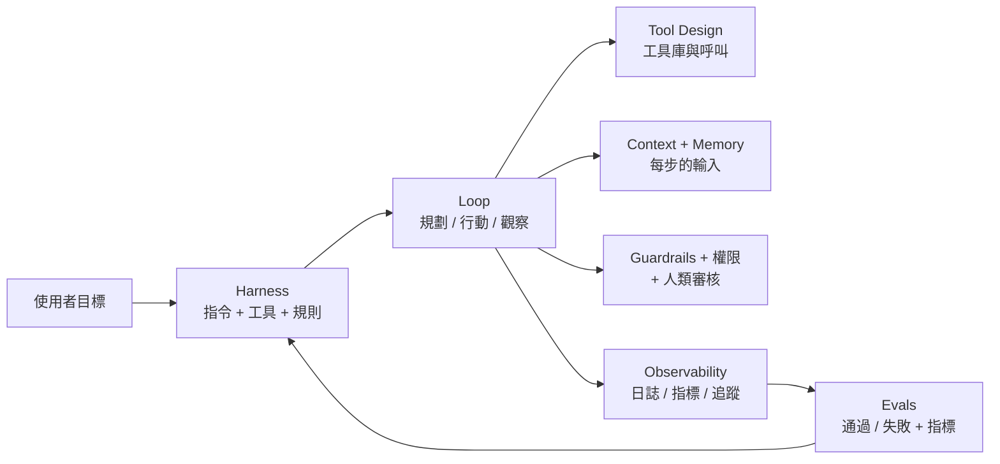
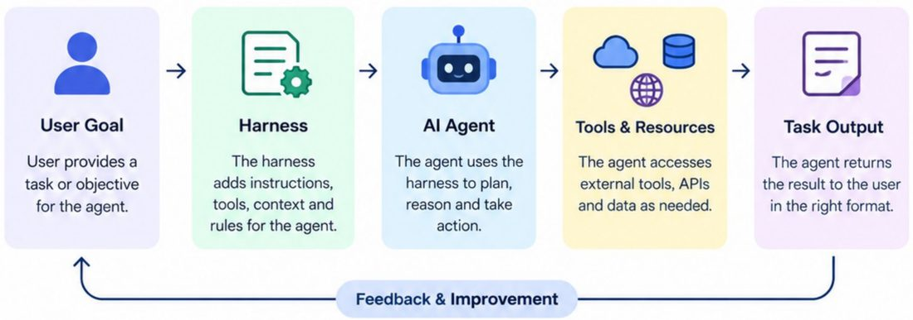
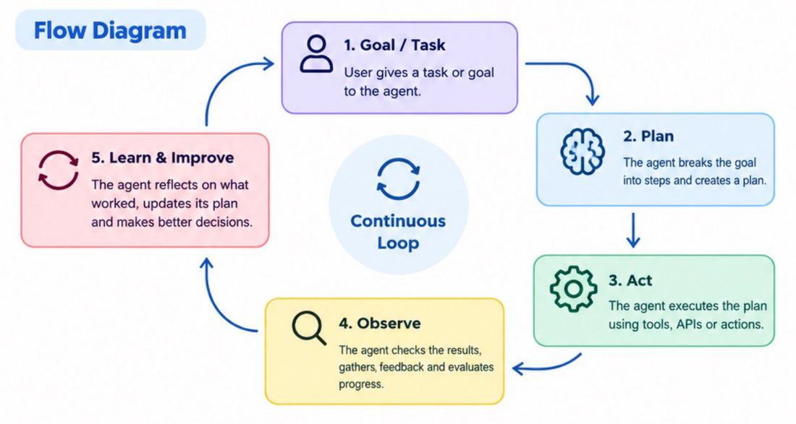
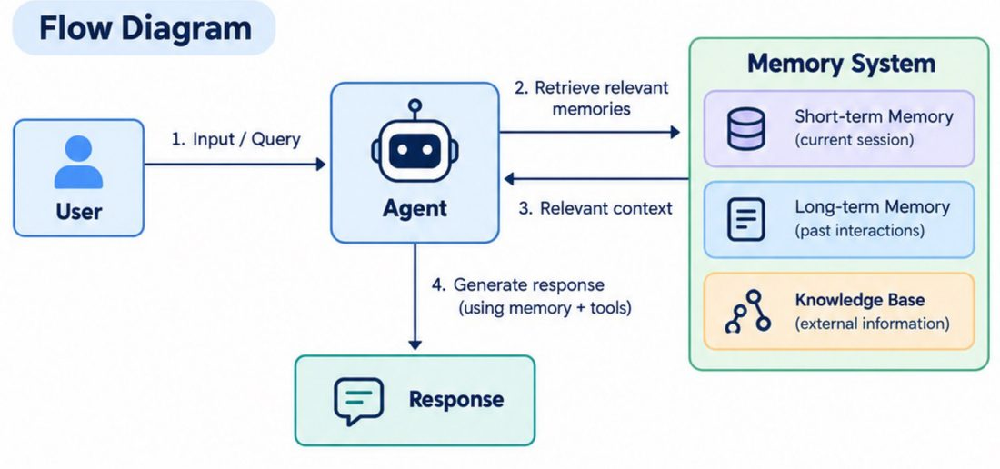
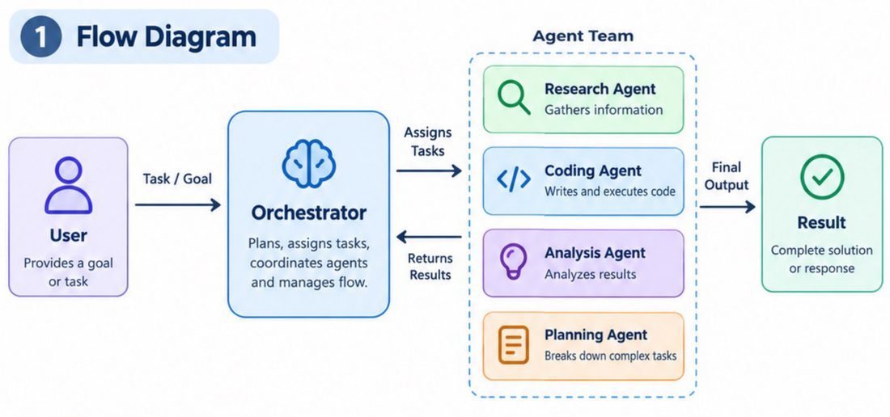
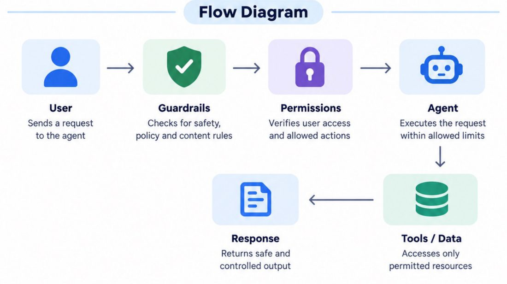
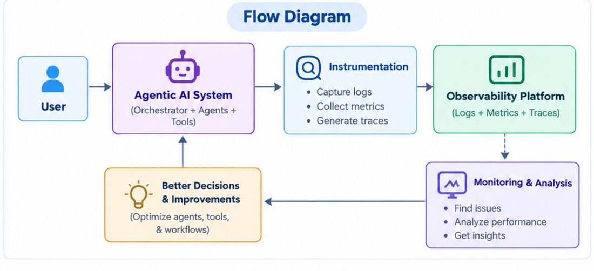

# Agentic AI 面試必知十概念地圖(Harness / Loop / Context / Tool / Memory / Orchestration / Guardrails / Evals / HITL / Observability)

> **素材性質揭露**:本篇整理自社群引流型輪播 PDF《10 Must Know Concepts for Agentic AI Interview》(作者 Anjana「AI & Tech」@aiwithanju,10 頁、每頁一張資訊圖、**沒有文字層**,內容由我逐頁看圖轉寫)。這類素材屬作者的社群流量入口(同批其他檔案封面常見 “Comment AI to get full PDF”、帶 @aiwithanju 浮水印與課程/頻道連結);本篇**只整理其知識內容,不轉述任何導購資訊**。原稿每個概念只有「一張流程圖 + 3~5 步驟」的入門層次,本篇用「自己的結構化整理 + 一手資料查證 + 本庫既有深度筆記連結」補足。

## 一句話總覽

這份 PDF 把「做 agent 的工程面」切成十個詞。它的價值是**一張面試/溝通用的詞彙地圖**,不是實作指南。十個詞其實可歸成四組:

| 組別 | 概念 | 回答的問題 |
|---|---|---|
| 讓 agent 能動 | 1 Harness、2 Loop、4 Tool Design | agent 的「外殼」「迴圈」「手腳」怎麼設計 |
| 讓 agent 知道 | 3 Context、5 Memory | 每一步模型「看到什麼」「記得什麼」 |
| 讓多個 agent 協作 | 6 Orchestration | 怎麼分工、誰指揮 |
| 讓 agent 可控可信 | 7 Guardrails & Permissions、8 Evals、9 Human-in-the-loop、10 Observability | 怎麼擋、怎麼量、怎麼讓人介入、怎麼看見它在幹嘛 |

## 十個概念逐頁整理

### 1. Harness Engineering(駕馭工程)
- 原稿定義:**設計正確的介面、工具與脈絡,讓 AI agent 有效且可靠地工作。**
- 六步:定義目標 → 設定 harness(加上指令、工具、脈絡、規則)→ agent 規劃與決策 → 使用工具與資源 → 回傳結果(正確格式)→ 依回饋改進 harness。

圖:原稿《10 Must Know Concepts for Agentic AI Interview.pdf》p1(僅裁出流程圖)。重點:**回饋改善的是 harness 本身**,不是模型權重。這正是近年「同一個模型,換 harness 表現差很多」的說法來源。深入見 [[ai-harness-explained]]、[[harness-engineering-evolution]]、[[agent-harness-loop-llmops-eval-explained]]。

### 2. Loop Engineering(迴圈工程)
- 原稿:讓 agent 透過**持續迴圈**學習與改進。五步:目標 → 規劃 → 行動 → 觀察 → 學習與改進,再回到規劃。

圖:原稿 p2 流程圖。注意:這張圖把「Learn」畫成迴圈內一步,但在多數實作裡 agent **不會更新權重**,所謂 learn 只是把觀察結果寫進脈絡/記憶,下一輪規劃時看得到。詞彙爭議與實務見 [[loop-engineering]]、[[loop-engineering-buzzword-critique]]、[[claude-code-loop-types-official]]。

### 3. Context Engineering(脈絡工程)
- 原稿:設計並管理給 LLM 的脈絡,以得到更相關、可靠的回應。五步:理解目標 → 蒐集相關脈絡(內部資料、工具、外部來源)→ 結構化(清楚指令、範例、規則)→ 生成 → 學習改進。流程圖四個積木:**檢索相關資料、加入工具描述、納入系統規則、維持對話歷史**。
- 原稿範例:「規劃 7 天日本旅行、預算 2,000 美元」→ 系統要先抓匯率/機票/景點資料、把預算限制放進規則,模型才答得準。
- 本庫延伸:[[context-engineering-claude-5-unhobbling]]、[[token-saving-three-moves-context-control]]。

### 4. Tool Design(工具設計)
- 原稿五步:使用者請求 →(agent 決定要不要用工具)→ 從工具庫挑一個並準備參數 → 執行(API/資料庫)→ 用結果回覆。範例:「查孟買天氣」→ 呼叫 Weather API。
- 面試延伸:工具的**名稱、描述、參數 schema** 本身就是 prompt;描述含糊,模型就會選錯工具或填錯參數。標準化接口見 MCP([[function-calling-mcp-a2a]]、[[mcp-server-first-build-four-pitfalls]])、結構化回傳見 [[reliable-structured-json-output-tool-use]]。

### 5. Memory Architecture(記憶架構)
- 原稿把記憶分三層:**短期記憶(當前 session)、長期記憶(過往互動)、知識庫(外部資訊)**。五步:使用者輸入 → 檢索記憶 → 把檢索結果加進當前 prompt → 生成 → **更新記憶**。

圖:原稿 p5 流程圖。注意步驟 5「寫回記憶」在圖上沒畫出箭頭,但文字有。何時寫、寫什麼、怎麼忘,是真正難的地方:見 [[agent-memory-survey-forms-functions-dynamics]]、[[agent-memory-eight-strategies-window-to-memoryos]]、[[mem0-memory-architecture-teardown]]。

### 6. Orchestration Patterns(編排模式)
- 原稿:協調多個 agent 的方式。圖中是**中央 Orchestrator**:拆解任務、指派給 Research / Coding / Analysis / Planning 等 agent,agent 平行或依序執行、回報結果,orchestrator 彙整、驗證後輸出。
- 注意:這其實只是**一種**編排模式(orchestrator-worker),標題寫的是複數 Patterns,但原稿只畫了一種。其他常見型態(路由、鏈式、平行、評估-優化)見 [[five-agent-patterns]]、[[seven-agent-architectures-selection-guide]]。

圖:原稿 p6 流程圖。

### 7. Guardrails & Permissions(護欄與權限)
- 原稿四步:**護欄檢查**(安全規則、內容政策)→ **權限驗證**(使用者身分與可用工具/資料)→ agent 在允許範圍內執行 → 回傳安全、合規、受控的輸出。
- 關鍵區分:護欄管「**能不能說/做這類事**」(內容與政策),權限管「**這個人/這個 agent 能碰什麼資源**」(存取控制)。權限應由**確定性程式碼**執行,不要只靠 prompt 叫模型自律(見下方查證)。

圖:原稿 p7 流程圖。

### 8. Evals for Agents(agent 評測)
- 原稿五步:定義任務 → 跑 agent → 用預先定義的規則/指標評分(品質、準確、安全)→ 分析結果回饋 → 迭代改進 prompt、工具、政策。流程圖:User Query → Agent → Evaluation → Results(pass/fail + metrics)→ Feedback 回 agent。
- 補充:agent 的 eval 要看**整條軌跡**(用了哪些工具、花多少步、有沒有越權),不只最終答案。LLM-as-a-Judge 等做法見 [[ai-engineering-twenty-concepts-serving-rag-ops]] 第 18 項。

### 9. Human-in-the-Loop Design(人在迴圈設計)
- 原稿四步:人設定目標與限制 → AI 規劃執行並產出 → **人審核**(準確、安全、品質)並給回饋 → 回饋用來改進。
- 設計重點:不是「每步都問人」(會被問煩、變橡皮圖章),而是**依風險分級**:唯讀/可復原動作自動放行,高風險(刪資料、付款、對外發送)才要人點頭。OWASP 也把「高風險動作需人工核可」列為緩解措施。

### 10. Observability & Tracing(可觀測性與追蹤)
- 原稿五步:使用者請求 → 執行時**插樁**(instrumentation)擷取日誌、指標、追蹤 → 觀測平台儲存並建立請求全貌 → 監控分析(找錯、效能、瓶頸)→ 優化 agent、工具與流程。

圖:原稿 p10 流程圖。三本柱 = 日誌(發生了什麼)、指標(多快/多貴/多常失敗)、追蹤(一次請求跨多元件的路徑)。agent 場景下一條 trace 通常是「LLM 呼叫 → 工具呼叫 → 子 agent → …」的樹。

## 應用案例

**情境:公司內部「報銷助理」agent 要上線。**

| 概念 | 在這個案例的具體做法 |
|---|---|
| Harness | 系統提示寫報銷政策;掛上「查發票」「查預算」「送簽」三個工具;規定輸出為固定 JSON |
| Loop | 查發票 → 發現缺欄位 → 追問使用者 → 重查 → 送簽;設最大步數 8 防無限迴圈 |
| Context | 只放這位員工的部門預算與最近 3 筆報銷,不把整份政策 PDF 塞進去(用檢索取相關段落) |
| Tool Design | 「送簽」工具描述要寫清楚「金額超過 5 萬需附主管名」,避免模型亂填 |
| Memory | 記住該員工常用成本中心(長期);本次對話的草稿(短期) |
| Orchestration | 若加上「稅務檢查 agent」,由主 agent 指派並彙整 |
| Guardrails/權限 | 只能讀本人的單據、不能代他人送簽——**在後端 API 做權限檢查**,不是靠 prompt |
| Evals | 準備 50 筆歷史報銷(含 10 筆故意違規),量通過率、誤放行率 |
| HITL | 金額大於門檻的送簽,先給主管確認再執行 |
| Observability | 每次請求一條 trace,看哪個工具最慢、哪種失敗最多 |

## 延伸閱讀與深度補充(一手資料查證)

| 項目 | 結論 | 說明 |
|---|---|---|
| 「模型 + harness」框架、循環步驟 | 概念層正確、屬原稿簡化 | 這些是業界通用詞彙,原稿未給定義出處;本庫已有多篇深度說明(上方連結)。**未能核實**「Harness Engineering / Loop Engineering」有單一權威定義,本庫 [[loop-engineering-buzzword-critique]] 即在討論其術語混亂 |
| ReAct(思考→行動→觀察)與 Loop 的關係 | **已核實** | 讀 arXiv 2210.03629 摘要:ReAct 讓模型**交錯**產生推理軌跡與任務動作;推理幫助規劃與追蹤,動作讓模型查外部來源;在 HotpotQA、FEVER 用 Wikipedia API 降低幻覺與錯誤傳播,在 ALFWorld、WebShop 勝過模仿/強化學習方法(絕對成功率 +34%、+10%)。所以 Loop 圖的「規劃-行動-觀察」就是 ReAct 的通俗畫法 |
| 「權限用程式碼執行、不靠 prompt」 | **已核實** | 讀 OWASP GenAI「LLM01 Prompt Injection」:緩解包含最小權限、**特權功能交給程式碼處理而非讓模型直接存取**、輸入輸出過濾、高風險動作需人工核可、分離並標示不可信外部內容、定期對抗測試(把模型當不可信使用者)。這支持第 7、9 項的設計原則 |
| MCP 作為工具標準化層 | **已核實** | 讀 modelcontextprotocol.io 官方簡介:MCP 是開源標準,用於連接 AI 應用與外部系統(資料來源、工具、工作流),以 USB-C 為比喻。原稿本篇未提 MCP,但第 4 項的工具庫在實務上常以 MCP 接入 |
| Orchestration「Patterns」只畫了一種 | **需補充** | 原稿標題為複數,圖與步驟只有 orchestrator-worker 單一模式;其他模式請看本庫 [[five-agent-patterns]] |
| Loop 圖的 "Learn" | **需修正(易誤解)** | 見第 2 項說明:推論時的「學習」多半只是寫入脈絡/記憶,不等於訓練。**我未對特定產品逐一核實**這點,這是對一般實作的描述 |
| Observability 三本柱、trace 結構 | **未能核實**(僅屬通用工程常識) | 原稿未給來源,我未另讀 OpenTelemetry 規範;若要引用具體語意約定,請查 OpenTelemetry 官方文件 |

## 常見面試追問

1. 「Harness 和 prompt 有何不同?」— prompt 只是 harness 的一部分;harness 還含工具、權限、狀態管理、重試與回饋機制。
2. 「怎麼避免 agent 無限迴圈或花太多錢?」— 最大步數、token/成本預算、重複行為偵測、超時(見 [[claude-task-budgets-advisory-token-countdown]])。
3. 「護欄和 evals 差在哪?」— 護欄是**執行期**攔截,evals 是**離線/持續**量測;兩者要互相餵(eval 找到的失敗模式變成新護欄)。

## 來源

- 使用者提供的本機素材批次 `new/ai-guide/`(2026-11-07 收件),檔案:`10 Must Know Concepts for Agentic AI Interview.pdf`(作者 Anjana「AI & Tech」@aiwithanju;社群引流型素材)。
- ReAct 論文:https://arxiv.org/abs/2210.03629
- OWASP GenAI,LLM01 Prompt Injection:https://genai.owasp.org/llmrisk/llm01-prompt-injection/
- Model Context Protocol 官方簡介:https://modelcontextprotocol.io/docs/getting-started/intro
