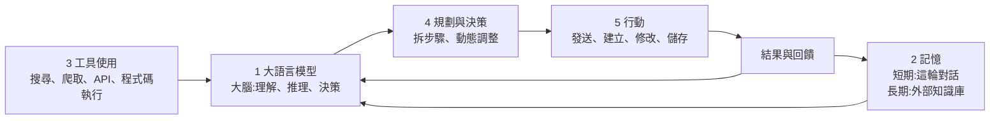
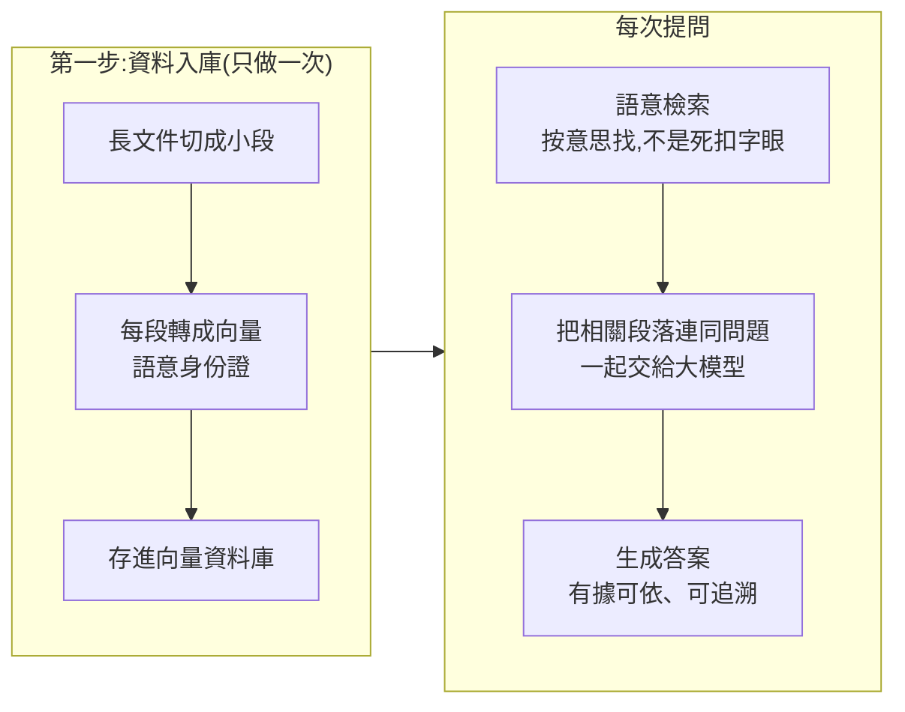

# AI Agent 入門課:五大核心要素、知識庫(RAG)與 Cherry Studio / 騰訊 ima 實操

> 整理自 YouTube 頻道 **Agent开发教程**〈[【2026十二月最新AI Agent智能体搭建全套教程】目前最细最全！手把手教你搭建企业级Agent智能体！学完即可就业！](https://www.youtube.com/watch?v=-5mwnyjP5Jo)〉(2026-10-19 上傳,約 86 分鐘,中文講課;含 4 個單元)。
>
> 該片無字幕,**逐字稿以 CPU faster-whisper 轉錄、非官方字幕**,字幕還原與無法確認項目見第九節。
>
> ⚠️ **立場揭露**:標題與片頭有「學完即可就業」「全網最細」「少走 99% 彎路」等行銷語,片頭與說明欄以**微信公眾號領取配套資料與源碼**為引流管道(說明欄附 `mp.weixin.qq.com` 連結);本筆記不收錄這些資料。標題寫「2026 十二月最新」,但影片 10 月就已上傳,以上傳日期為準。
>
> 這是**入門課**(定位:先看懂 Agent 怎麼思考,再動手),重點在概念與軟體操作,不含程式碼實作。

---

## 一句話總結

講師的框架:Agent 就是「**大模型當大腦 + 記憶 + 工具 + 規劃 + 行動**」的閉環,用「幫我寫一份新能源行業報告」貫穿五個要素;多數複雜任務要靠**多 Agent 分工**。要讓 Agent 有長期記憶,落地形態就是**外部個人知識庫**,底層是向量資料庫,技術套路是 **RAG**(讓大模型「開卷考試」)。平台分兩類:**本地部署**(Anything LLM、Dify、MaxKB:資料不出機、要自己架)與**線上平台**(秘塔搜索、知乎直答、飛書:註冊即用、資料上傳到對方伺服器)。實操示範 **Cherry Studio**(自選模型、API Key、本地知識庫)與**騰訊 ima**(個人 / 共享 / 訂閱三種知識庫)。

---

## 一、為什麼需要 Agent:注意力被切碎

講師的論點:一天忙得團團轉卻覺得什麼都沒做,不是不努力,而是**注意力被切碎**。

- 加州大學研究:知識工作者被打斷後,**平均要 23 分 15 秒**才回到原本的任務。
  - ✅ 這是 Gloria Mark 團隊的研究;Gallup 訪談原文是「被打斷的工作當天**重新接手**的平均時間為 23 分 15 秒」。⚠️ 影片說成「才能完全回到深度工作狀態」,比原話稍強。中間還包含去回訊息、查郵件等**插進來的其他事**,不是發呆 23 分鐘。
- 講師估算大部分人三分之二的時間花在回訊息、查資料、做表格這類雜事。⚠️ 為講師自述,沒有來源。
- 解法:把**重複性、流程性、不需要判斷**的事交給 Agent,人只做**決策、把控方向與品質、創作**。比喻:以前又當司機又當導航又當加油工,現在只坐後座說要去哪。

### 四種應用場景(講師用來幫助理解,不是定義)

| 類型 | 例子 |
|---|---|
| **個人助理** | 週五下班前說「下週三去深圳出差,預算 2,000,酒店離會場近」,Agent 自己比機票、酒店評分與早餐,整理行程單等你確認 |
| **情感陪伴** | 與小動物角色聊天、被傾聽與安慰;講師也強調**不能取代真實人際關係** |
| **多模態** | 拍倉庫照片 ⇒ 數貨、找出包裝破損與快過期商品 |
| **平台生態** | 例如豆包上做一個 Agent,可同時發布到抖音、微信等多平台;現在上面很多是套模板的粗製品,認真做反而容易脫穎而出 |

---

## 二、為什麼是 2026 年:行業脈絡(講師的說法)

| 項目 | 講師說法 | 核對 |
|---|---|---|
| 智能體不是新概念 | 1986 年 **Marvin Minsky**《心智社會》提出智慧由大量簡單小模組協作產生 | ✅ 《The Society of Mind》1986 年出版 |
| MCP | 2024 年底 Anthropic 提出,後來 OpenAI、Google、微軟跟進;**去年 12 月捐給 Linux 基金會**,成為工具調用的事實標準 | ✅ 2025-12-09 Anthropic 宣布把 MCP 捐給 Linux Foundation 下新成立的 **Agentic AI Foundation**,共同創辦者為 Anthropic、Block、OpenAI,Google、微軟、AWS 等支持 |
| Anthropic「大腦與雙手解耦」 | 今年 4 月推出 Managed Agents,**模型負責想、執行層負責做** | ✅ Anthropic 工程部落格〈Scaling Managed Agents: Decoupling the brain from the hands〉(2026-04-08):把 agent 拆成 brain(模型與決策迴圈)、hands(沙盒與工具)、session(持久日誌) |
| DeepSeek V4.1 Flash | 9 月 11 日發布,**能直接看懂圖片** | ✅ 次級來源:9 月 10 日發布,原生視覺輸入 |
| 業界人物表態 | 多位業界人物說 Agent 是主流 | ⚠️ 字幕對人名與引言多處不清,見第九節 |
| Claude Code / 多智能體 | 「Claude Code 已成程式設計師第一終端」;3 月推出多 Agent 模式;8 月 Auto Mode 成預設 | ⚠️ 未核實 |
| OpenAI Agents API | 9 月發布,把支撐 Codex 的基礎設施開放給開發者 | ⚠️ 未核實 |

### 用自動駕駛 L0–L5 類比

| 級別 | 類比 | 講師的說法 |
|---|---|---|
| L0 | 自己騎腳踏車 | 全靠人 |
| L1 到 L3 | 電動車加助力 | 人主導、AI 打下手(自動巡航、車道保持) |
| **L4** | 設定目的地後車自己開 | **目前正邁向 L4**:只要設定目標與資源,Agent 自己查資料、整理、寫報告 |
| L5 | 完全自動 | 還沒實現;別聽「AI 馬上取代一切」 |

重點:你是從**執行者變成監督者**,仍需設定目標、把關品質、處理例外。

### 國內平台(講師推薦順序)

| 平台 | 講師的描述 |
|---|---|
| **字節扣子(Coze)** | 市占比最高(講師說)、800 多個外掛、門檻低、可多平台發布,**新手最適合入門** |
| **Dify** | 開源社群、靈活、可私有化部署,適合企業定製 |
| **阿里百煉** | 背靠通義千問生態、企業級服務佳,適合已用阿里雲的公司 |
| **百度千帆** | 講師稱有 130 萬個 Agent,適合與搜尋相關的場景 |
| **騰訊元器** | 主打微信生態 |
| 釘釘 AI 助理、飛書 | 辦公場景,公司已在用就直接用 |

講師的建議:先上手一個把原理搞懂,換平台分分鐘。⚠️ 市占比、外掛數、Agent 數量都是講師口述,沒有查證。

---

## 三、Agent 五大核心要素

講師說五個要素**不是各幹各的,而是閉環**:大模型當總指揮,行動的結果回饋給大腦和記憶,下次做類似的事會更好。他用「寫一份新能源行業報告」貫穿:

| 要素 | 它負責什麼 | 在這個例子裡 |
|---|---|---|
| **1 大模型** | 儲存知識、處理資訊、決策,並呈現推理與規劃過程;所有理解與判斷都要先經過它 | 弄清楚你要什麼:概覽還是深度分析?給誰看?多長?重點講政策還是技術? |
| **2 記憶** | **短期**:管當前這輪對話,換話題或聊太長會遺忘甚至幻覺;**長期**:跨任務保存經驗與偏好(微調、知識圖譜、**向量資料庫**) | 想起你上週寫過的類似報告、你偏數據驅動風格、老闆愛看圖表、公司的報告模板 |
| **3 工具使用** | 補大模型的短板:**知識有截止日期**、**計算能力弱**(本質是猜下一個字,不是在做數學) | 搜尋 2026 年最新資訊,查詢銷量資料,算市場規模與成長率 |
| **4 規劃與決策** | 把複雜任務拆成步驟,依回饋動態調整 | 先列提綱(行業格局、投資建議…),按提綱一塊一塊寫;寫到競爭格局發現資料不夠,回去補搜 |
| **5 行動** | 把想法真正做成事 | 排版、匯出 PDF、寄給老闆與相關同事、存進公司共享資料夾 |

### 工具使用 ≠ 行動(最容易混淆)

| | 工具使用 | 行動 |
|---|---|---|
| 性質 | **獲取資訊**(輸入):搜尋、查詢 | **改變世界**(輸出):發送、建立、修改 |
| 比喻 | 看看外面有什麼 | 把事情做了、把東西發出去 |

講師:沒有行動,Agent 就只是問答機器人(像 Siri),「答完就完了,事情還得你自己幹」。

### 工具生態與 MCP

講師:現在各平台外掛生態成熟(扣子 800 多個外掛、Dify 有開源工具市場),新聞、天氣、Excel、郵件、資料庫查詢都能覆蓋,不寫程式碼就能用,像手機裝 App。**MCP 像 USB 介面**:過去接一個工具要寫半天、每個介面不同,現在插上去就能用。

### 兩種規劃模式

| | **ReAct(邊想邊做)** | **先規劃後執行** |
|---|---|---|
| 做法 | 先琢磨、動手、看結果、再決定下一步 | 先把完整計畫列清楚,再動手(執行中也可能修改) |
| 適合 | 探索性、結果不確定的任務 | 目標明確、步驟可預估的任務 |
| 比喻 | 開到陌生地方,邊看路邊導航,塞車就換路線 | 出門旅遊先做攻略、先買門票 |
| 缺點 | 可能繞遠路 | 遇突發狀況不夠靈活 |

講師:兩者沒有誰好誰壞,**複雜任務往往混用**:先大致規劃,執行時遇到特殊情況再靈活調整。

### 單 Agent 的極限 ⇒ 多 Agent 協作

一個 Agent 既寫程式碼、做測試又做部署:上下文視窗就那麼大,任務越複雜越容易混亂,也沒有專業分工。多 Agent 則每個專注一個角色(產品經理、開發、測試、運維),彼此傳訊息,有個總 Agent 負責協調調度,像專案經理管團隊。講師說這在今年已進入生產環境,但仍有不少功能在實驗階段。

### Minsky 的三個想法(講師:了解即可)

1. **分散式智慧體架構**:智慧不是中央大腦發號施令,而是大量簡單獨立的小模組組成的「Agent 社會」。
2. **層級協作**:低階 Agent 負責感知、運動,高階負責協調、推理與決策(像公司的基層與管理層)。
3. **無中央控制**:智慧從大量簡單個體的協作中**湧現**(比喻螞蟻群:沒有指揮官,卻能建巢、找最短路徑、結成筏過河)。

⚠️ 講師特別提醒:Minsky 的理論是**認知科學**(解釋人腦),現在談的是**工程化系統設計**(造機器),「思路可以借鑒,但不能直接照搬」。

---

## 四、知識庫:長期記憶的落地形態(RAG)

### 要解決的問題

把幾十頁專案資料餵給 AI,聊得很好,**隔天新開視窗它就一臉懵**。因為大模型本身不記得你餵過什麼。長期記憶最主流的落地方式就是**外部個人知識庫**。

### 「開卷考試」比喻

- 閉卷:知識全背在腦子裡,題目一超綱只能瞎蒙。
- 開卷:可以翻書,**答案以書本為準**。
- 個人知識庫 = 讓大模型從閉卷考生變成開卷考生。對應的技術叫 **RAG(檢索增強生成)**。

- **向量**:講師說「別死記,就理解成給每一段文字發一張語意身份證,意思相近的段落身份證也相近」。
- 檢索是**按意思找**:你問的話跟資料沒有一個字相同,只要意思相近也能翻出來。
- 答案會**標註出處**,可追根溯源。
- 講師用 Cherry Studio 的比喻說明「索引」:把一本書拆成一張張檢索卡片、做好目錄,提問時才能快速翻到那一頁。
- 筆記 1.0 與 2.0:1.0 的筆記本是**死的**,程式調不動;2.0 像僱了一個助理,可隨時檢索、總結、畫思維導圖。

(本庫 [[rag-from-scratch-buffett-clone-gary]] 有更完整的 R、A、G 流程,包括清洗、切塊、混合搜尋與 Re-ranking。)

### 誰需要?

只要在生活與工作中**持續產生記錄與筆記**就適合:

- **學生**:期末複習,課堂筆記散在七八本、參考書在一堆 PDF ⇒ 統一整理進知識庫,讓模型做章節總結、提煉重點、產生思維導圖。「以前是你在讀書,現在是書主動來找你。」
- **企業客服**(電商為例):新人客服一天被問同一個問題很多遍,老師傅走了經驗就跟著走 ⇒ 把常見問題、標準話術、業務資料沉澱進私有知識庫,用於**新人培訓**與**自動回覆標準答案**。

兩個場景的共同點:**資料只入庫一次,之後跨對話反覆調用;模型每次回答都根據你提供的資料。**

### 兩類平台怎麼選

講師的核心問題:**你的資料是鎖在自己的抽屜,還是放在別人家的保險室?**

| | **本地部署** | **線上平台** |
|---|---|---|
| 代表 | Anything LLM、Dify、MaxKB | 秘塔搜索、知乎直答、飛書 |
| 資料 | 完整保存在你自己的設備,不出機 | 上傳到平台方的伺服器 |
| 使用 | 在本地跑,隨時可用 | 打開網頁註冊就能用,對小白友好 |
| 成本 | 開源免費(講師說) | — |
| 適合 | 有行業隱私資料、把安全看得最重 | 圖方便;**資料敏感者要慎用** |
| 代價 | 要自己動手部署,有一點門檻 | 資料給了別人 |

#### 對照開源授權(講師只說「開源免費」)

| 工具 | GitHub 星數(2026-10-29) | 授權 |
|---|---:|---|
| Cherry Studio | 約 5.3 萬 | **AGPL-3.0** |
| Dify | 約 16 萬 | GitHub 標為自訂授權(Other),**使用前要讀其授權條款** |
| MaxKB | 約 2.3 萬 | **GPL-3.0** |
| Anything LLM | 約 6.8 萬 | MIT |

⚠️ 「開源 ≠ 沒有限制」:AGPL / GPL 有散布或作為服務提供時的義務,Dify 是自訂授權。**個人使用通常沒問題;要拿去做商業服務前請看授權條款。**

### 秘塔搜索(線上)示範

註冊後,左側「**專題**」本質上就是知識庫。新建專題、上傳資料(講師示範上傳 Java 資料)、取名,然後提問(例如「介紹一下 Java 編程」)。回答後面**有標註**,對應到知識庫內容,可追溯。

---

## 五、實操 1:Cherry Studio(本地客戶端 + 自選模型)

**它是什麼**:裝在你電腦上的 AI 客戶端。⭐ 最大好處:**不綁定任何一家**,多家大模型都能接進來;內建**本地知識庫(RAG)**,檔案拖進去就自動建索引;建立智能體時可直接綁定知識庫,聊天中問到相關內容會自動去庫裡檢索。(✅ GitHub:CherryHQ/cherry-studio,AGPL-3.0)

### 步驟(影片 Windows 示範)

1. 官網下載對應系統的安裝程式。**盡量不要裝在 C 槽**(系統槽)。
2. 左下角 **設定 ⇒ 模型服務**;預設模型可在「預設模型」設定。
3. 選擇模型服務商(示範用**阿里百煉**,講師稱要搜尋「百煉」;DeepSeek 則搜「深度求索」),點「**獲取密鑰**」到官網登入(示範用支付寶掃碼;沒有帳號可用手機號註冊)。
4. 在百煉建立 **API Key**,取個描述(如「用來做測試」)。⭐ **重要**:API Key **只在新建時完整顯示一次**,必須當場**複製或下載保存**;舊的 Key 之後看不到完整內容,要用就只能重建。
5. 貼回 Cherry Studio ⇒ 保存 ⇒ 點「**檢測**」確認能連上。
6. **同步模型**(示範一次同步出 280 個模型)。要加某個模型:到百煉的**模型廣場**複製模型名稱 ⇒ 回 Cherry Studio 搜尋 ⇒ 點「添加」;搜不到也可以**手動添加**,貼上模型名稱即可。加完用「檢測」確認能用。
7. 回到對話頁選模型,簡單聊兩句驗證。

### 建立知識庫

1. 左側「**知識庫**」⇒ 新建 ⇒ 取名(示範:Java 編程)。
2. 選擇**嵌入模型(向量模型)**。⚠️ 講師特別提醒:**嵌入模型決定向量怎麼生成,知識庫建好後如果要換嵌入模型,就必須重建知識庫**,因為不同模型的向量空間不通用。
3. 「文件」⇒ 選取準備好的資料(Ctrl+A 全選)⇒ 打開,等它**解析**。
4. 在對話中:開新視窗 ⇒ 點「+」⇒ 選取知識庫 ⇒ 提問(示範問「什麼是面向對象」)。約等十幾秒,回答會**標註引用來源**(示範:出自知識庫第二章「面向對象編程」)。

---

## 六、實操 2:騰訊 ima(網頁 / 桌面,開箱即用)

**定位**:騰訊的「智能工作台」,講師說它把**搜索、閱讀、寫作**三件事整合在一起,支援手機與電腦**多端同步**,適合喜歡開箱即用、又在騰訊生態裡的人。(✅ 官網 ima.qq.com;2024-10 發布,已有 Windows、Mac 與微信小程式)

講師的比較:

| | Cherry Studio | 騰訊 ima |
|---|---|---|
| 特色 | **靈活可控**:接多種模型,適合想深入玩、掌控每一步 | **開箱即用**:騰訊背書、穩定,適合想快速出結果又不想折騰 |
| 設定 | 下載 + 設定 API Key | 打開網頁即可,底層騰訊已搭好 |
| 知識庫 | RAG | 同一套 RAG 邏輯,但**自動切片、自動向量化** |

### 三種知識庫

| 類型 | 比喻 | 用途 |
|---|---|---|
| **個人知識庫** | 自己電腦裡的「我的文件」,只有你能看與加 | 自己的工作文件、學習筆記、專案資料 |
| **共享知識庫** | 部門共用資料夾,可**邀請同事一起上傳、一起查** | 團隊協作:解決「微信群裡發完就沉底、網盤裡 V1、最終版、真的最終版」的問題;**新人入職直接問知識庫,不必到處問老員工** |
| **訂閱知識庫** | 訂一份電子雜誌或行業日報,別人已整理好 | 借力別人整理的優質內容(示範訂閱「AI 讀研報」,問「今天的 AI 賽道有什麼新動態」) |

(搜尋到的次級資料也確認 ima 有個人、共享與知識庫廣場,但**「訂閱」功能本筆記沒有找到騰訊官方說明**,細節請以官網為準。)

### 操作

1. **新建**:知識庫頁面點「+」,取名(示範:Java 基礎知識庫)。
2. **上傳**:三種方式 ⇒ 本地檔案、**整個資料夾**(示範一次 17 項)、**微信檔案**。
3. ⚠️ **上傳不等於完成**:要等**解析**完成才能使用。
4. 提問(示範問「集合的要點有哪些」),回答後面有**標註**,點進去可看到來源在知識庫的哪一章(示範:第三章集合框架)。
5. **共享**:建立知識庫(示範:產品部資料庫)⇒ 右上角「分享」⇒ 兩種方式:**複製連結**,或產生**知識碼 / 二維碼**。
6. 個人庫只有刪除與修改名稱,沒有分享。
7. **訂閱**:左側「發現」⇒ 知識庫 ⇒ 挑一個(科技、教育等分類)⇒ 點「訂閱」⇒ 回到知識庫就能看到。

### 三庫搭配的日常工作流(講師口訣)

| 梯隊 | 管什麼 | 解決什麼 |
|---|---|---|
| 個人庫 | 你的家底(工作文件、學習筆記、專案資料) | 你的基本盤,別人拿不走 |
| 共享庫 | 團隊 | 資訊不同步 |
| 訂閱庫 | 輸入(行業動態、前沿資訊) | 沒時間自己找資訊 |

早上到公司:先花 5 分鐘問訂閱庫「今天行業有什麼重要消息」→ 問共享庫「昨天的專案推進到哪裡?有什麼待辦?」→ 遇到具體問題再翻個人庫「我之前做的方案數據是多少」。

> **口訣:個人庫存自己的,共享庫給團隊用,訂閱庫是蹭別人的。** 三個庫搭配起來,講師說工作效率「至少能翻一倍」。⚠️ 沒有數據支持,是行銷語。

---

## 六之二、之後的課程安排(講師預告)

智能體章節會以**扣子(Coze)與 Dify** 為主戰場,重點教**怎麼把知識庫真正掛到智能體身上,讓它幹活時自動翻書**。課程分三篇:認知篇(Agent 是什麼、ReAct、規劃、推理、記憶,跑通第一個 Agent Demo)、進階篇(LangChain 與 AutoGen 框架實戰、多 Agent 協作、Function Calling、RAG + Agent 混合架構、評估與除錯與安全邊界)、實戰篇(智能客服、自動化資料分析 Agent 上傳 Excel 產生報告與圖表、多 Agent 協作生產線)。

---

## 七、應用案例

### 案例 1:用五個要素拆解一個你自己的任務

任務:「每週一早上產出競品週報並寄給主管」。

| 要素 | 你要想清楚的 |
|---|---|
| 1 大模型 | 用哪個模型?需要多強的推理與多長的上下文? |
| 2 記憶 | 短期:本週的對話;長期:過去的週報模板、主管偏好、競品清單,**放進知識庫** |
| 3 工具 | 搜尋最新新聞、爬競品官網、讀財報資料來源、計算成長率的程式碼執行 |
| 4 規劃 | 先列提綱(動態、定價、產品更新、風險),按提綱逐塊蒐集;資料不足就補搜 |
| 5 行動 | 排版、匯出 PDF、寄信給主管、存進共享資料夾 |

⚠️ 用「**工具 = 取得資訊、行動 = 改變世界**」檢查:**行動**類(寄信、修改檔案)建議先設定**人工確認**再放行,尤其是對外發送。

### 案例 2:15 分鐘搭一個「Java 學習助手」(照講師的步驟)

1. 下載 Cherry Studio(不要裝在 C 槽)。
2. 到阿里百煉建立 API Key,**當場複製保存**。
3. 設定 ⇒ 模型服務貼上金鑰 ⇒ 檢測。
4. 新建知識庫,選一個**嵌入模型**(之後不要再換)。
5. 拖入 Java 筆記與 PDF,等解析完成。
6. 新對話 ⇒ 選取知識庫 ⇒ 問「ArrayList 和 LinkedList 差在哪?」
7. 檢查答案是否**標註出處**;出處不對就回頭看資料切片與解析是否正常。

### 案例 3:決定用本地還是線上

| 你的情況 | 建議 |
|---|---|
| 資料含客戶個資、財務、未公開專案 | **本地部署**(Anything LLM / MaxKB / Dify),或 Cherry Studio 搭配本地模型 |
| 個人學習筆記、公開資料 | 線上平台(ima、秘塔)最省事 |
| 團隊要共用且公司已在騰訊生態 | ima 的**共享知識庫** |
| 想自選模型、之後要接 Agent | Cherry Studio 或 Dify |

做之前先自問三題:資料能不能離開公司?誰需要存取?之後是否要掛到 Agent 上?

### 案例 4:自測知識庫有沒有被「開卷」帶偏

1. 準備 10 個你**確定答案在資料裡**的問題 + 5 個**資料裡沒有**的問題。
2. 問完看:前 10 個是否答對且**引用正確章節**;後 5 個它是否承認「資料裡沒有」,還是開始瞎編。
3. 若瞎編:在提示詞加「只能根據知識庫內容回答,沒有就說不知道」,並調低溫度(本庫 [[why-llms-hallucinate-benchmarks-reward-guessing]] 說明為什麼模型傾向猜)。

---

## 八、核實與補充

**✅ 已核實:**

- Minsky《心智社會》1986;MCP 2025-12 捐給 Linux Foundation 旗下 Agentic AI Foundation;Anthropic Managed Agents 部落格(2026-04-08)的「大腦與雙手解耦」;DeepSeek V4.1 Flash 約 9 月 10 日發布並原生支援圖片(次級來源);23 分 15 秒研究的來源與口徑;ima 官網與個人、共享知識庫。
- Cherry Studio(AGPL-3.0)、Dify(自訂授權)、MaxKB(GPL-3.0)、Anything LLM(MIT)的授權與星數。

**⭐ 影片沒講、值得補的:**

- **開源 ≠ 無限制**(見第四節授權表)。
- 本庫 [[rag-from-scratch-buffett-clone-gary]] 補上了影片略過的**清洗、切塊與 Metadata、混合搜尋、Re-ranking、答錯時由 R 到 G 的排查順序**。入門課只講「入庫 → 檢索 → 生成」三步,實際效果差,多半出在資料端。
- 影片只示範「綁知識庫問答」;企業場景要考慮**權限過濾**(誰能看哪些文件)與**資料更新**(舊版文件被新版取代時怎麼處理)。

**⚠️ 需補正或保留:**

- 23 分 15 秒是**重新接手任務**的平均時間(當天恢復的情況),不是「完全回到深度工作」。
- 「Claude Code 第一終端」「Coze 市占最高」「百度 130 萬 Agent」「扣子 800 多個外掛」「工作效率至少翻一倍」都是講師口述或行銷語。
- 標題「2026 十二月」與上傳日期 2026-10-19 不一致。

**⚠️ 未能核實:** OpenAI 9 月 Agents API、Claude Code 3 月多 Agent 模式與 8 月 Auto Mode 預設、各平台的數量與市占、騰訊 ima「訂閱知識庫」的官方說明。

---

## 九、字幕還原與待確認

**已依上下文與官網還原(把握高):** 「凹凸GPT」→ AutoGPT;「Cloud Code」→ Claude Code;「Charles / Chiro / Chair Studio」→ Cherry Studio;「Anison / Anything LMO」→ Anything LLM;「Define」→ Dify;「爱马 / iMata / iMac」→ ima(ima.qq.com);「密塔搜索」→ 秘塔搜索(Metaso);「摆垫 / 百联」→ 阿里百煉;「百度签发 / 前方」→ 百度千帆;「腾讯元气」→ 腾讯元器;「同一千温」→ 通義千問;「马文明司机 / 新智社会」→ Marvin Minsky《心智社會》;「Series」→ Siri;「ROG」→ RAG;「阿普主」→ UP 主。

**⚠️ 無法確認、已登記到 `TRANSCRIPT-PENDING.md` 的:**

- 「Open Ed Brokeman 在 2024 年底說 2025 是智能體元年」:疑似 OpenAI 的 Greg Brockman,也可能是 Sam Altman,**不確定是誰、說了什麼**。
- 情感陪伴 App 名稱「臨監療欲事」、電商 App「說不飯」:無法還原。
- 阿里百煉的具體模型型號(字幕:「13008max」「千問 3.8 Flash」「3.7 Texin 背頂」):不可靠,筆記只寫「千問(Qwen)系列」。
- 「ADP4.0 agent offers」:疑似騰訊的智能體開發平台,**未確認**。

---

## 相關筆記

- [[rag-from-scratch-buffett-clone-gary]]:RAG 完整流程與答錯排查。
- [[why-llms-hallucinate-benchmarks-reward-guessing]]:知識庫為什麼能降低編造、又不是萬靈丹。
- [[agent-memory-survey-forms-functions-dynamics]]:Agent 記憶的形態與功能(短期 / 長期)。
- [[harness-engineering-evolution]]:Prompt → Context → Harness 的演進,對照本課的「五要素」。
- [[agent-harness-dead-data-flywheel-katz]]:Agent 外殼層(在哪裡跑、能碰什麼、花多少錢)。
- [[grep-vs-vector-agentic-search]]:知識庫之外,agent 也可以用 grep 找資料。

---

## 來源

- YouTube:Agent开发教程〈【2026十二月最新AI Agent智能体搭建全套教程】…〉 https://www.youtube.com/watch?v=-5mwnyjP5Jo (2026-10-19;無字幕,逐字稿以 CPU faster-whisper 轉錄、非官方字幕;含微信公眾號引流)
- Anthropic,〈Donating the Model Context Protocol and establishing the Agentic AI Foundation〉: https://anthropic.com/news/donating-the-model-context-protocol-and-establishing-of-the-agentic-ai-foundation
- Anthropic Engineering,〈Scaling Managed Agents: Decoupling the brain from the hands〉: https://anthropic.com/engineering/managed-agents
- Gallup Business Journal,Gloria Mark 訪談〈Too Many Interruptions at Work〉: https://news.gallup.com/businessjournal/23146/too-many-interruptions-work.aspx
- 騰訊 ima 官網: https://ima.qq.com
- Cherry Studio: https://github.com/CherryHQ/cherry-studio
- Dify: https://github.com/langgenius/dify ;MaxKB: https://github.com/1Panel-dev/MaxKB ;Anything LLM: https://github.com/Mintplex-Labs/anything-llm
- DeepSeek V4.1 Flash 發布報導(次級來源): https://propakistani.pk/2026/09/11/deepseek-v4-1-flash-launches-with-lower-prices-and-native-vision/
