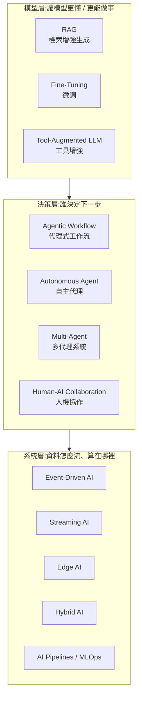

# 12 種 AI 系統架構與實例:RAG、微調、Agent、事件驅動、邊緣、混合到人機協作

> **素材性質揭露**:整理自社群引流型 PDF《12 AI Architectures with Practical Examples》(作者 Anjana「AI & Tech」@aiwithanju,12 頁,每頁一種架構,頁尾帶作者帳號)。同批素材封面常見 “Comment AI to get full PDF” 之類引流字樣,本篇只整理知識內容,不轉述導購。原稿每個架構只有「心智模型一行 + 定義 + 3 個例子」,**偏入門科普、沒有技術深度、沒有出處**;本篇用自己的對照表重整,並補上選型判斷與查證。

## 先看全圖:12 種架構分成三層

這 12 種其實**不在同一個抽象層級**,原稿把它們並列容易讓初學者誤以為是「12 選 1」。我把它分成:

## 12 種架構對照表

| # | 架構 | 心智模型(原稿) | 核心想法 | 原稿實例 | 適用時機 / 不適用 |
|---|---|---|---|---|---|
| 1 | **RAG** | Search → Retrieve → Generate | 回答前先查你的資料,答案「有依據」 | 公司知識助理查 HR 規章;客服查最新手冊;法務檢索合約與判例 | 知識常更新、需附出處;不適合要改「說話風格/格式」的需求 |
| 2 | **Fine-Tuning** | 基礎模型 + 訓練樣本 → 專用模型 | 把行為/風格**寫進權重**,不是查詢時才取得 | 醫療紀錄分類;客服統一語氣;內部程式碼慣例 | 要穩定的格式/語氣/分類行為;不適合塞入大量會變動的事實 |
| 3 | **Agentic Workflows** | 目標 → 規劃 → 執行 → 檢查 → 重複 | LLM 決定「下一步做什麼」 | 研究助理蒐集→摘要→比較→報告;資料分析;旅遊規劃 | 多步驟、步驟順序依結果而變 |
| 4 | **Multi-Agent** | 一個目標 → 多位專家 → 合併結果 | 分工 + 協調者 | 軟體開發(需求/寫碼/審查/測試各一 agent);市場研究;財務分析 | 子任務可獨立且需不同專長;**成本與一致性風險上升**,別預設就用 |
| 5 | **Event-Driven AI** | Event → AI 處理 → Action | 有事件才觸發,而非定時 | 可疑交易觸發風控模型;負面客訴觸發情緒分析與升級;感測器越界 | 需即時反應的營運流程 |
| 6 | **Streaming AI** | 連續資料 → 連續推論 → 即時洞察 | 資料一到就分析,不等批次 | 即時詐欺偵測;產線感測異常;即時推薦 | 低延遲、持續到來的資料 |
| 7 | **Edge AI** | 裝置 → 本地 AI → 立即決策 | 模型跑在資料產生處 | 智慧攝影機;手機本機語音辨識;自駕車 | 低延遲、省頻寬、隱私、可離線 |
| 8 | **Hybrid AI** | 本地 AI + 雲端 AI → 各取所長 | 依敏感度/延遲/規模決定算在哪 | 企業機密留內網、通用任務用雲;醫療敏感資料本地處理;零售門市快推論+雲端深度分析 | 有合規/隱私/成本分流需求 |
| 9 | **AI Pipelines** | 資料 → 準備 → 訓練 → 評估 → 部署 | 把資料到上線自動化(MLOps) | 推薦系統;詐欺偵測;電腦視覺 | 需要可重複、可監控的模型生命週期 |
| 10 | **Tool-Augmented LLM** | LLM → 選工具 → 取結果 → 回答 | 語言交給模型,計算/查詢交給工具 | LLM+網搜;LLM+Python 執行;LLM+公司 API | 幾乎所有實用 LLM 應用的基底 |
| 11 | **Autonomous Agents** | 目標 → 規劃 → 行動 → 觀察 → 學習 → 重複 | 動態改計畫、少監督 | 寫碼 agent(看碼→改檔→跑測試→修錯);IT 營運;研究 agent | 開放式任務且有可驗證回饋;**風險最高,需護欄與權限** |
| 12 | **Human–AI Collaboration** | 人類判斷 + AI 能力 → 更好結果 | 人保留判斷與責任 | 醫師+影像標記;工程師審查 AI 程式碼;寫作者掌控最終觀點 | 高風險、需問責的決策 |

## 容易混淆的幾組(補充我的整理)

- **RAG vs Fine-Tuning**:一個是「查詢時**取得**知識」,一個是「訓練時**改變**行為」。實務常組合:用微調固定輸出格式/語氣,用 RAG 提供最新事實。
- **Agentic Workflow vs Autonomous Agent**:原稿第 11 頁自己點出差異——固定流程 vs 可**動態改計畫**。光譜是連續的:流程寫死(最可控)→ LLM 在預設分支中選路 → 完全自主。業界多數「agent」其實落在中間。見 [[five-agent-patterns]]、[[seven-agent-architectures-selection-guide]]、[[task-decomposition-agentic-workflow]]。
- **Event-Driven vs Streaming**:事件驅動是「**一件事發生就觸發一次處理**」(離散事件);串流是「**連續不斷的資料流**上持續計算」(例如滑動視窗統計)。兩者常並用(串流偵測異常 → 發出事件)。
- **Edge vs Hybrid**:Edge 強調「全在裝置上」;Hybrid 強調「**在本地與雲之間做路由**」(也可見 [[llm-slm-lrm-vlm-model-routing-guide]])。
- **Multi-Agent 的代價**:協調成本、重複 token、狀態不一致,可參考 [[multi-agent-data-consistency-reliability]] 與 [[mixture-of-agents-moa]]。

## 應用案例:同一個業務,用不同架構組合

**業務:電商客服自動化。**

| 需求 | 選用架構 | 做法 |
|---|---|---|
| 回答退貨規定,且規定每月會改 | RAG(1) | 索引退貨政策,回答附條文出處 |
| 回覆語氣要符合品牌 | Fine-Tuning(2) | 用歷史優質對話微調,或用 few-shot 先試 |
| 查訂單狀態、算退款額 | Tool-Augmented(10) | 呼叫訂單 API、用程式計算 |
| 客訴出現強烈負面字眼要立刻升級 | Event-Driven(5) | 訊息進來 → 情緒分類 → 觸發主管通知 |
| 退款金額高於 5,000 元 | Human–AI(12) | agent 草擬、人工批准 |
| 客戶資料不能出公司網路 | Hybrid(8) | 個資處理在內網模型,通用問答用雲端 |
| 每週用新對話重訓分類器 | Pipeline(9) | 自動收資料→標註→訓練→評估→部署 |

結論:**真實系統是多種架構疊加**,不是 12 選 1。

## 延伸閱讀與深度補充(查證與判斷)

| 項目 | 結論 | 說明 |
|---|---|---|
| 12 種架構的分類與定義 | **未能核實(原稿無出處)** | 這是作者自行整理的科普清單,我未找到對應的標準分類(它混合了不同抽象層級)。上面「三層」是我的歸納,**不是業界標準分類** |
| 各架構的實例 | **概念上合理,未逐一查證** | 實例都是常見應用情境(如詐欺偵測串流、手機端語音辨識),原稿未給具體產品或數據;本篇未宣稱任何量化效益 |
| 「Fine-tuning 把知識/行為改在模型內」 | **概念正確,補充限制** | 微調擅長行為與格式,**不擅長可靠地灌入大量新事實**,事實性更新通常仍以 RAG 較穩;此判斷屬通行工程建議,**我未在本次另讀論文逐項驗證**。LoRA 等高效微調見 [[lora-fine-tuning-explained]] |
| 自主代理「少監督」 | **需補充** | 原稿未談風險;自主度愈高,越需要最小權限、人工核可高風險動作、可觀測性,見姊妹篇 [[agentic-ai-ten-concepts-interview-map]] 與 OWASP LLM01 的緩解建議(最小權限、高風險人工核可等,我已在該篇讀過原文) |

## 來源

- 使用者提供的本機素材批次 `new/ai-guide/`(2026-11-07 收件),檔案:`12 AI Architectures with Practical Examples.pdf`(作者 Anjana「AI & Tech」@aiwithanju;社群引流型素材)。
- OWASP GenAI, LLM01 Prompt Injection(引用其最小權限與高風險人工核可建議):https://genai.owasp.org/llmrisk/llm01-prompt-injection/
