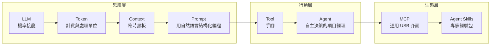
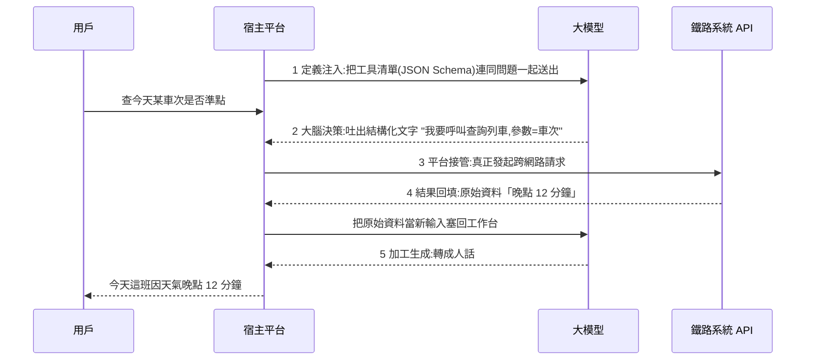

# AI 名詞地圖:從 Token 到 Agent Skills——三種分層框架對照(八概念演進鏈 / 四層技術全景 / 職場四層選型)

> 整理自 YouTube 頻道 **白白说大模型** 三支入門向影片,合併成一篇(三支講的是同一件事的不同切法):
> ① 〈讲透8大AI核心概念:看清大模型从“会说话”到“能办事”的演进脉络〉(2026-08-18,約 14.4 分鐘)
> ② 〈从Token到Agent:大模型底层技术全拆解〉(2026-09-18,約 18.9 分鐘)
> ③ 〈职场人专属选型指南:看懂AI的四层底层逻辑〉(2026-09-11,約 16.3 分鐘)
>
> ⚠️ 三片均無官方字幕,逐字稿以 CPU 版 Whisper 轉錄,可能有同音字誤差。片中無業配;③ 結尾有「選型避坑」的消費建議,屬作者個人立場。
> 📎 相關:[[function-calling-mcp-a2a]]、[[function-calling-mcp-cli-tool-evolution]]、[[context-engineering-processing-vs-thinking]]、[[building-claude-skills]]、[[ai-harness-explained]]

---

## 一句話總結

> **每一個新名詞都是為了補上一個名詞的致命缺陷。** LLM 缺乏干預現實的能力 → 工具;單步工具要人頻繁指引 → Agent;孤立的 Agent 缺通用連接 → MCP;通用 Agent 缺深度專業 → Agent Skills。看到任何新詞,先問:它補的是這條演化鏈的哪一環?

---

## 一、框架 1:八個概念的演進鏈(影片①)

### 思維層
1. **LLM**:不是檢索答案的知識庫,是「文字接龍生成器」。輸入「小貓坐在」,模型不查資料庫,而是計算下一詞機率(例:「墊子上」85%、「沙發上」10%、「地板上」5%),選機率最高者續寫。**這也是會一本正經胡說八道的原因**——目標是生成通順、符合機率的文字,不是提供客觀事實。(機率數字為影片的示意值。)
2. **Token**:切分後每塊對應一個數字編號,是最小處理與計費單位。**中英文切分效率差很大**:影片稱中文常耗英文的 **1.5–2 倍** token;降本招式:把冗長的背景描述先翻成英文再寫進系統提示詞。(⚠️ 「1.5–2 倍」依分詞器與文本而異,**未能逐一核實**;對照 [[token-saving-three-moves-context-control]]。2026-11-07 核實增補:影片①於 [3:27] 的投影片確實寫「人工智能」切分「數量為英文的 1.5–2 倍」,並寫降本作法「可節省近半 Token 消耗」——這是**畫面上的數字**,未以官方分詞器實測,仍標「未能核實」。)
3. **Context**:不是長期記憶,是教室裡的**臨時黑板**。每發一條新訊息,系統把之前所有歷史對話打包重抄一遍,讓模型看著黑板回答;視窗有上限,寫不下時最早的內容被擦掉,模型就「忘了最開始的要求」。
4. **Prompt**:本質是「用自然語言做結構化編程」。有效結構:**角色 → 業務場景(背景)→ 具體任務 → 輸出結構**(例:資深產品經理、三個專案進度數據、撰寫標準化週報、含本週進展 / 風險預警 / 下週計畫)。

### 行動層
5. **Tool**:給「只能提建議的思想家」裝上手腳。無工具時 AI 只給你 Excel 公式(字幕 [7:19] 寫「sial 的計算公式」;2026-11-07 畫面核實:同段投影片實際寫「Excel公式和分析步驟」,「sial」為同音誤聽,已更正為 Excel),你得自己貼進去;有工具時它會自動在後台呼叫 Python 執行引擎讀你的 xlsx、分析、畫趨勢圖、匯出 PDF 報告。
6. **Agent**:把「單步驅動」變成「**目標驅動**」。三亞五天自由行、預算 5000 元為例:任務拆解 → 選工具執行(查機票)→ 評估回饋(機票太貴導致超預算 → 自動調降酒店檔次)→ 交出完整行程單。對照:普通 AI + 工具 = 你給步驟(像微管理實習生);Agent = 你給目標(像把事交給成熟項目經理)。

### 生態層
7. **MCP**:類比早期手機各家充電線不同,今天統一 USB。A 廠模型連 B 廠資料庫不必各寫適配程式碼;只要遵守 MCP 就即插即用。
8. **Agent Skills**:通用 Agent 像全科門診醫生,遇到合約合規、財務審計只能打 60 分;把頂尖專家的經驗封裝成技能包(嚴密系統提示詞 + 行業 SOP + 特定工具組合 + 質檢標準),可升到 90+ 分。(2026-11-07 畫面核實:[11:22] 投影片標題為「08 / 智能体技能（Agent Skill）」(原文為簡體),圖上寫「准确率从 60 分跃升至 90 分」;這是影片的示意數字,沒有說明測量方法,不可當實測成績。)「Agent 賦予自主決策的**腦力**,Skill 賦予深度落地的**專業戰力**。」

### 整合
下達複雜目標時:最外層 Agent 接任務 → 載入對應 Skill(垂直 SOP 與檢查標準)→ 經 MCP 呼叫外部工具 → 真實資料被切成 Token、組成結構化 Prompt、排在 Context 黑板上 → 交給最核心的 LLM 做決策 → 指令逐層返回。

---

## 二、框架 2:四層技術全景 + 工具呼叫五步流(影片②)

影片②從底層往上講,最後總結成**四層**:

| 層 | 內容 | 解決的問題 |
|---|---|---|
| 結構層 | Transformer、分詞器 | 最底層的計算與文字接龍 |
| 容器層 | 上下文工作台、提示詞規則、外掛 RAG | 短期記憶與真實事實補充 |
| 橋樑層 | 工具呼叫(「動嘴與動手分離」)+ MCP | 讓困在黑盒子裡的腦子接通現實 |
| 編排層 | Agent 自主規劃 + 可掛載的 Skill 說明書 | 獨立承擔複雜長流程 |

### 關鍵機制 A:自回歸生成(為什麼文字一個字一個字蹦)
不是前端打字機特效,是底層物理法則:模型每次只預測「下一個概率最高的 token」,吐出後**追加回輸入末尾**,再用更長的句子預測下一個,直到算出代表結束的特殊符號。**沒有預先寫好的全局草稿**。(影片的例子:輸入古詩「登高壯觀天地間」,模型續出「大」「江」等。)

### 關鍵機制 B:分詞器(tokenizer)是翻譯官
編碼:先切碎(「深度學習改變軟體工程」→「深度 / 學習 / 改變 / ...」),再查字典給每塊一個整數 ID(影片的示意:深度=302、學習=814);模型吐出整數後再反向查表還原文字,解碼是單點還原、不需再切分。**Token ≠ 詞**,是統計學切分出的最小單位;粗估一個 token ≈ 大半個英文單詞,或約 1.5–2 個漢字(影片說法,依模型而異)。

### 關鍵機制 C:模型是「無狀態」的,連續記憶來自重送上下文
每次問答結束中間狀態立即清空;所謂「連續對話」是後台把**全局規則 + 所有歷史 + 環境工具資訊 + 新問題**打包重新攤在工作台上。**百萬 token 視窗的兩個現實代價**:① 注意力計算成本隨長度增長(影片稱「層倍往上翻」,實為接近平方成長,屬標準 Transformer 特性);② **注意力中間迷失**——像看長合約,頭尾記得住,中間關鍵細節一掃而過。(2026-11-07 核實增補:Liu et al., *Lost in the Middle: How Language Models Use Long Contexts*,TACL 2023 / arXiv 2307.03172 主張相關資訊位於輸入開頭或結尾時表現最好,位於中間時準確率明顯下降,長上下文模型也不例外;與影片說法方向一致。)

### 關鍵機制 D:RAG = 專屬圖書管理員
2000 頁設備故障手冊不整本砸給模型:先切成小段落存進向量庫;有人問「壓氣機葉片異常震動怎麼處理」時,管理員檢索出第 312 頁的兩張活頁紙,連同問題擺上工作台。結果:窗口小、成本低、必須基於抽出來的依據作答,「信口胡謅的毛病被治好」(⚠️ 更精確地說是**大幅降低**,不是根治,見 [[is-graphrag-needed-rag-variants-comparison]])。(2026-11-07 核實增補:Lewis et al., 2020(NeurIPS 2020 / arXiv 2005.11401)原文以預訓練 seq2seq 模型作為「參數化記憶」、以 Wikipedia 段落向量索引作為「非參數化記憶」,由檢索器取回段落供生成;影片「圖書管理員」比喻與此機制相符。)一句話:**上下文是桌面,RAG 是桌上放不下時挑關鍵頁碼的圖書管理員。**

### 關鍵機制 E:提示詞工程 = 縮小搜索範圍
隨口說「幫我出旅行建議」像對服務員說「隨便來點吃的」,機率空間散開、答案泛泛;給「資深戶外領隊 + 三天徒步方案 + 避開高難度攀登 + 表格交付」,角色、任務、約束、格式四面收口,像漏斗把發散機率收進極窄範圍。**不是修辭玄學,是用邏輯邊界封掉模型胡思亂想的可能。**
- **用戶提示詞**:前台用戶輸入,代表當下多變的需求。
- **系統提示詞**:開發者在後台寫死,**最高統治權,像憲法**:立人設、築安全防禦欄。例:你是中立的金融審核員,嚴禁給買賣建議——用戶再怎麼套話「明天全倉買黃金能發財嗎」,模型會轉去分析黃金市場流動性風險而非回答能或不能。

### 關鍵機制 F:工具呼叫「五步協同」(動嘴與動手分離)

大模型只有一種物理能力:吐出文字,**無法主動發起任何網路請求**。老闆(模型)決定「幫我看天氣」,助理(宿主平台)出門查、回來報告,老闆再用白話轉述。以「查某車次高鐵是否晚點」為例:

### 關鍵機制 G:MCP 與 Agent 迴圈、Skill
- **MCP**:各家(OpenAI、Anthropic、開源本地模型)工具呼叫格式各不相同,開發者每換模型就重寫適配,生態被割裂成孤島。MCP 是統一 Type-C 介面,工具寫一次、「像插 U 盤」插到任何支援的系統。(2026-11-07 核實增補:MCP 官方文件〈What is the Model Context Protocol (MCP)?〉原文寫「Think of MCP like a USB-C port for AI applications」,定義為連接 AI 應用與外部系統的開源標準;範圍不只工具,還含資料來源與工作流(提示詞模板),影片只講工具面,此處是補充。)
- **Agent 迴圈**:分析目標 → 規劃步驟 → 呼叫工具(Act)→ 觀察結果(Observe)→ 反思調整(Reflect)。影片範例:「檢查上月研發部門所有差旅報銷單,挑出單筆超 800 元的異常、算超標金額、起草通報郵件給財務」。第一輪規劃並讀表格;第二輪清洗過濾並核算;Observe 時看到「緊急專案,副總裁特批」→ Reflect 把該筆免責款項剔除;最後一輪自動草擬郵件**等待人類確認**。
- **Agent Skill**:本質是寫得清楚的 Markdown SOP 說明書,三層:**元數據層**(身份與觸發場景)、**指令層**(條件邏輯:情況 A 怎麼辦、B 怎麼辦)、**交付標準層**(最終排版格式)。外部文字形式存在,Agent 平時腦中乾淨,遇任務才臨時載入、做完卸載,既省運行成本,規則維護也像改文件。(對照 [[building-claude-skills]] §10。)(2026-11-07 核實增補:影片②字幕 [16:42] 前後切入的投影片(16:44 截圖確認)寫「Skill 并非底层硬编码,而是通过高度结构化文档预先编写的标准作业程序（SOP）」(原文為簡體,此處轉繁)、「以外置标准化文本形式存在,按需动态调取」,方向與 Anthropic 官方一致。但影片的「元數據/指令/交付標準」是**內容分類**;Anthropic 工程文章〈Equipping agents for the real world with Agent Skills〉講的是**載入層級**:啟動時只預載每個 skill 的 `name`/`description`(YAML frontmatter)到系統提示詞,觸發後才讀 `SKILL.md` 全文,附檔與腳本按需讀取。兩種切法不可混為一談。)

---

## 三、框架 3:職場人的 AI 四層選型(影片③)

由下往上像蓋房子:

| 層 | 內容 | 比喻 | 你需不需要花錢 |
|---|---|---|---|
| 能量層 | 算力與 token | 空氣與糧食 | 輕量文字工作(商務郵件、潤色講稿、會議記錄摘要、社群文案)**免費額度通常夠用**;跑幾千行程式、幾萬行財務報表深度比對、涉商業機密需專屬通道才值得付費 |
| 意識層 | 大模型 + 知識庫 | 核心大腦 | 要解決「幻覺」→ 私域知識庫(開卷考試) |
| 行動層 | 單項生成工具(文生文 / 圖 / 影片) | 雙手 | 可分擔約 80% 基礎執行工作(影片估計,**無數據**);重點是寫精準結構化指令 |
| 決策層 | 智能體 | 數位員工 | 重複性流程自動化最划算 |

### 三個實用觀念
1. **AI 突然回得慢或報「服務過載」**:多半是尖峰時段算力吃緊(工作日早上),不是軟體壞了,不必急著換工具。
2. **幻覺的根源**:模型認知完全來自餵給它的訓練資料,資料裡有謠言與口水貼,推理時就當真理(「垃圾進、垃圾出」)。**嚴肅業務問題(報銷流程、考勤制度、勞動法合規)不要直接問公開大模型**——它會拼湊各地各公司的通用規則。解法:把最新員工手冊、法規文件、業務說明書上傳到**私域知識庫**,要求只在文件寫明的範圍內作答,把「閉卷考試」變「開卷考試」。(⚠️ 這降低而非杜絕幻覺。)
3. **行動層的提示詞=給執行邊界劃範圍,不是背咒語**。文案例:風格嚴肅專業的商務風、500 字內、依「背景痛點 → 解決方案 → 核心價值」分段;海報例:比例 16:9、攝影棚主光源、居中特寫。

### 智能體的兩個短板(影片的警示,值得保留)
- **輸出中庸化**:自動化流水線的目標是流程穩定不出錯,成果通常是「大眾及格、中等水平」,難出顛覆性、極具個人靈性的創意。
- **認知剝奪**:把思考、梳理、判斷全盤甩給智能體,久了對底層核心業務流的掌控力和敏銳度會退化。**核心思考方向與最終決策權必須握在自己手裡。**(呼應 Addy Osmani 的「認知投降」議題)

### 選型對照表
- 核心工作是寫文案 / 做配圖 / 剪影片(單點執行)→ **行動層**:重點打磨提示詞、按使用頻率訂閱,別盲目買年費。
- 每天做資料整理、定時產報表、排班派單(高度重複工作流)→ **決策層**:建自己的自動化流水線,為省下的時間付費很划算。
- 企業級高階場景(高隱私、海量財稅資料、客製開發)→ **第一、二層**:本地私有庫,依高算力標準按需付費,資料安全與專業精準優先。
- 原則:**不要為花哨概念買單,只為 1:1 的效率付費**;裝一到兩款能融入核心工作流的工具用到極致就夠了。

---

## 四、三個框架怎麼對照

| 問題 | 八概念鏈 | 四層技術全景 | 職場四層 |
|---|---|---|---|
| 切分依據 | 「補哪個缺陷」的時間順序 | 技術從底到頂的堆疊 | 使用者要付什麼成本、用在哪 |
| LLM / 大模型 | 第 1 概念 | 結構層 | 意識層 |
| Token / 算力 | 第 2 概念 | 結構層(分詞) | 能量層 |
| Context / RAG / Prompt | 第 3、4 概念 | 容器層 | 意識層(知識庫)+ 行動層(提示詞) |
| 工具 / MCP | 第 5、7 概念 | 橋樑層 | (行動層的外延) |
| Agent / Skill | 第 6、8 概念 | 編排層 | 決策層 |

---

## 五、應用案例

**案例 1:面試被問「為什麼模型會編造、你怎麼處理」**
用框架 1 + 2 回答:LLM 是機率接龍,目標是通順而非真實 → 上下文只是黑板且有限 → 用 RAG 把真實依據放上桌並要求只依據它回答 → 嚴重業務再加驗證與人工審批([[graph-engineering-node-edge-state]] §十 的「現實錨點」)。

**案例 2:幫公司挑 AI 工具,避免被營銷號帶著買**
先分層:同事想買「一鍵做 PPT」會員 → 屬行動層單點工具,但你的真實工作是每週彙整 ERP 資料產週報 → 屬決策層的重複流程。結論:不買 PPT 會員,改用智能體 + 排程;若資料涉及客戶機密,再往下評估私域部署。

**案例 3:自己寫工具呼叫流程時的除錯順序**
結果錯 → 看第 2 步(模型有沒有吐出正確的工具名與參數)→ 看第 3 步(平台是否真的呼叫、參數有無校驗)→ 看第 4 步(回填的原始資料是否完整)→ 才懷疑第 5 步的文字加工。對照 [[reliable-structured-json-output-tool-use]]。

---

## 六、核實與評語

- **已核實的通用事實**:自回歸生成、無狀態 API 靠重送上下文維持對話、工具呼叫由宿主執行、System prompt 優先於 user prompt(通用做法),皆為業界共識,本文未逐項查官方文件。MCP 統一協定、注意力中間迷失、RAG 的參數化/非參數化記憶、Agent Skill 的載入方式已於 2026-11-07 查一手來源核實,見下節。
- **數字多為示意**:機率 85/10/5、token ID 302/814、「中文 1.5–2 倍」、「80% 基礎工作」皆未給出處,**未能核實**,不要當成實測數據。
- **影片②的「注意力成本層倍上升」**:應理解為**自注意力對序列長度的平方級複雜度**(標準 Transformer 特性),不是指數。
- **「模型能查天氣調系統」說法**:正確說法是**模型吐出呼叫請求,由宿主執行**——影片②自己有澄清,是這三片中最嚴謹的一處。
- **轉錄還原**:「sial」=Excel(2026-11-07 畫面 [7:19] 已核實)。其餘仍為推定:「兔」=Tool(土工具)、「圖SK馬」=工具 Schema、「Row」=Role、「sync」=Think、「acti」=Act、「副盤」=復盤/反思。(畫面 [16:40]–[16:42] 的 ReAct 投影片確認 Think / Plan / Act / Observe / Reflect 的英文標籤,「sync」「acti」的字幕寫法為誤聽;「副盤」未以畫面核實,仍為推定。)

---

## 七、延伸閱讀與深度補充(2026-11-07 核實增補)

以下為實際讀過一手來源後補的內容;影片沒講或講得不完整的部分才列出。

1. **注意力中間迷失的原始研究**——Liu et al., *Lost in the Middle: How Language Models Use Long Contexts*,TACL 2023(arXiv 2307.03172):<https://arxiv.org/abs/2307.03172>。摘要指出:相關資訊位於長輸入的開頭或結尾時表現最好,位於中間時準確率明顯下降,長上下文模型也不例外。對應影片② [5:36] 的說法,方向一致。**限制**:這是特定問答任務上的實驗結論,不等於「中間一定看不到」;設計上的對策(把關鍵資訊放頭尾、縮短上下文、用 RAG 篩選)是筆者的推論,仍需依任務實測。
2. **RAG 的原始架構**——Lewis et al., *Retrieval-Augmented Generation for Knowledge-Intensive NLP Tasks*,NeurIPS 2020(arXiv 2005.11401):<https://arxiv.org/abs/2005.11401>。論文把預訓練 seq2seq 模型的權重稱為**參數化記憶**,把以 Wikipedia 段落建立的稠密向量索引稱為**非參數化記憶**,由預訓練的神經檢索器取回段落後再生成。影片②「圖書管理員」比喻對應的正是「檢索 → 把段落放進上下文 → 生成」這條線。**補充**:論文實驗用的是 Wikipedia 段落索引與預訓練檢索器;今天的切塊策略、向量庫選型與論文設定不同,不要把論文的實驗結果直接套用到現在的 RAG 系統。
3. **MCP 的定位**——官方介紹頁〈What is the Model Context Protocol (MCP)?〉:<https://modelcontextprotocol.io/docs/getting-started/intro>。頁面寫「Think of MCP like a USB-C port for AI applications」,並說明 MCP 連接的不只是工具,還包含**資料來源**(本地檔案、資料庫)與**工作流**(專用提示詞)。影片②只講工具面;若要寫成「MCP = 工具協定」會窄化定義。
4. **Agent Skills 的載入層級**——Anthropic 工程文章〈Equipping agents for the real world with Agent Skills〉:<https://www.anthropic.com/engineering/equipping-agents-for-the-real-world-with-agent-skills>。文章描述三層漸進揭露:**啟動時**只把每個 skill 的 `name` 與 `description`(YAML frontmatter)預載入系統提示詞,足以讓模型判斷何時該用;**觸發後**才把 `SKILL.md` 全文讀入上下文;**需要時**才讀取附帶檔案,腳本可以不載入上下文直接執行。影片②的「元數據 / 指令 / 交付標準」三層是**內容分類**,與上述**載入層級**是不同的切法,寫筆記時不要混在一起。對照 [[building-claude-skills]]。
5. **Tool 與 Agent 的差別在於誰決定下一步**(影片①投影片 [7:19]–[7:21] 的對照):無 Tool 時 LLM 只給公式、使用者手動執行;有 Tool 時由 Tool Engine 執行 Python、讀本地 Excel、輸出 PDF。這一對照是**Tool 層**的差別;Agent 層的差別是 Agent 會自己依 Observe 結果改寫計畫(見 [[graph-engineering-node-edge-state]] 的狀態迴圈觀點)。

---

## 來源

- 〈讲透8大AI核心概念:看清大模型从“会说话”到“能办事”的演进脉络〉— 白白说大模型,2026-08-18:<https://www.youtube.com/watch?v=wiQgPk8BnhM>
- 〈从Token到Agent:大模型底层技术全拆解〉— 白白说大模型,2026-09-18:<https://www.youtube.com/watch?v=JNVK-fd2pH4>
- 〈职场人专属选型指南:看懂AI的四层底层逻辑〉— 白白说大模型,2026-09-11:<https://www.youtube.com/watch?v=Zez7CMkSZsI>

> 三片均無官方字幕,逐字稿以 CPU 版 Whisper 轉錄,可能有同音字誤差。
