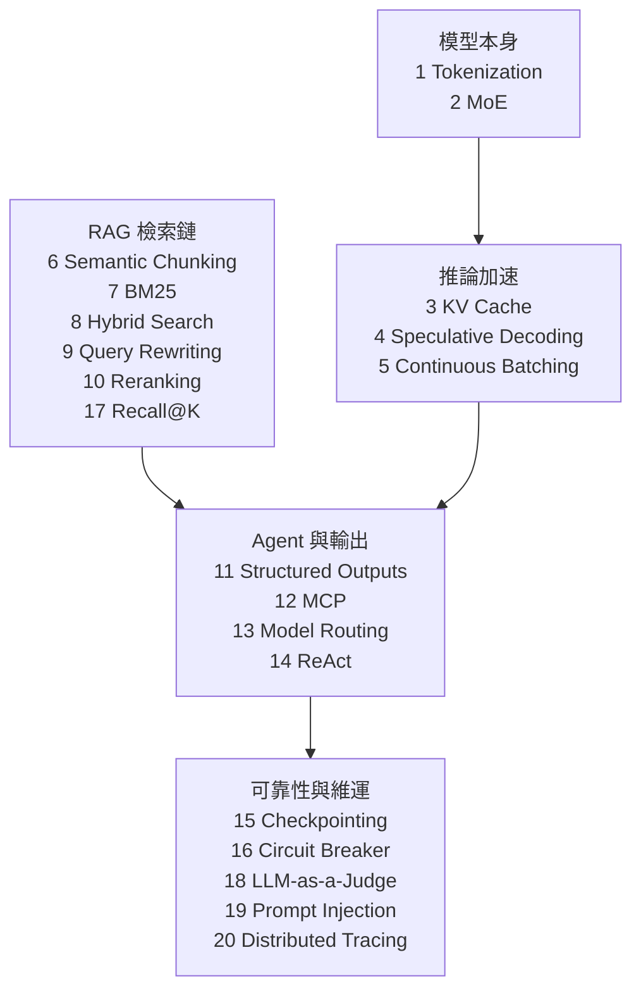
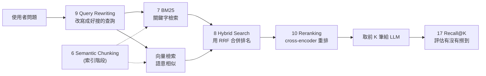

# AI 工程 20 個概念速查:模型推論、RAG 檢索、Agent 與上線維運

> **素材性質揭露**:整理自社群引流型輪播 PDF《20 AI Engineering Concepts - Easily Explained》(作者 Anjana「AI & Tech」@aiwithanju;封面寫 “Comment ‘AI’ to get full PDF”,末頁 “Comment AI and I'll DM you the full pdf”,每頁帶 @aiwithanju 浮水印)。原稿有文字層,每頁兩個概念、每個概念約 3 句。本篇是**自己的結構化整理 + 一手資料查證**,不整頁照抄,也不轉述導購內容。原稿把第 9、10 項在版面上顛倒(先 Reranking 再 Query Rewriting),本篇按檢索流程順序重排。

## 20 個概念分五群

## 一、模型與推論(1–5)

| # | 概念 | 一句話 | 重點與陷阱 |
|---|---|---|---|
| 1 | **Tokenization** | 文字切成 token、再轉成 token ID 給模型 | token 可能是整字、字根、字元或標點。原稿範例 `"AI is powerful" → [AI][is][power][ful]` 是**示意**,實際切法依各模型的 tokenizer 而定。中文 token 成本差異見 [[tokenizer-tax-chinese-vs-english-token-cost]];token 與 embedding 的關係見 [[token-vs-embedding-llm-and-rag]] |
| 2 | **Mixture of Experts (MoE)** | 多個專家網路 + 路由器,每個 token 只啟動少數專家 | 省的是**每 token 的運算量(活躍參數)**;原稿說「fewer parameters per token」即指此。**總參數量與載入記憶體並沒有變小**,所以 MoE 模型仍需要放得下全部權重。詳見 [[moe-mixture-of-experts-from-ffn]] |
| 3 | **KV Cache** | 把前面 token 算過的 Key/Value 存起來,不重算 | 自回歸生成時大幅加速,代價是 **GPU 記憶體隨上下文長度線性增長**。詳見 [[kv-cache]] |
| 4 | **Speculative Decoding** | 小模型先猜幾個 token,大模型一次驗證 | 原稿只說「正確的被接受」。**重要細節**:它的驗證用拒絕取樣,**輸出分佈與只用大模型完全相同**(無損),不是近似——見下方查證 |
| 5 | **Continuous Batching** | 做完的請求立刻離開 batch、新請求隨時加入 | 解決「整批要等最長的那個」造成的 GPU 空轉。原稿此段文字較破碎(“Simultaneous batching and generation happens”),白話就是 **iteration 級別的排程**。實作見 [[inference-engines-llamacpp-vllm-sglang-tensorrt]] |

## 二、RAG 檢索鏈(6–10、17)

| # | 概念 | 一句話 | 重點與陷阱 |
|---|---|---|---|
| 6 | **Semantic Chunking** | 依語意/主題邊界切文件,而非固定字元數 | 可用 embedding 偵測相鄰段落語意突變處當切點。好處是 chunk 內容完整;代價是索引時多一輪 embedding 運算,且**不保證一定贏過固定大小+重疊**,要用自己的資料驗證 |
| 7 | **BM25** | 經典詞彙檢索:詞頻、逆文件頻率、文件長度 | 對**人名、編號、型號、罕見術語**很強,因為是精確比對;對同義詞無力 |
| 8 | **Hybrid Search** | BM25 + 向量檢索,用 **RRF** 等方法合併 | RRF 只看**名次**,不需要把兩邊不同尺度的分數正規化——見查證 |
| 9 | **Query Rewriting** | 把模糊/口語問題改寫成更好搜的查詢 | 適合多輪對話的省略句(「那它的價格呢?」要補回主詞);風險是改寫偏離原意,要保留原問題一併檢索 |
| 10 | **Reranking** | 先撈多(例如 50 筆),再用更準的模型重排,取前幾筆 | cross-encoder 把 query 與文件一起丟進模型,比雙塔向量準,但慢,所以只用在候選集上 |
| 17 | **Recall@K** | 相關文件有幾成出現在前 K 筆 | 公式:前 K 筆中的相關文件數 ÷ 相關文件總數。原稿例:10 筆相關有 8 筆在前 10 → Recall@10 = 80%。它只看「有沒有撈到」,不看排名順序與最終答案品質,要搭配 MRR/nDCG 與端到端評測 |

延伸:RAG 全流程與變體見 [[rag-from-scratch-buffett-clone-gary]]、[[is-graphrag-needed-rag-variants-comparison]]、[[agent-rag-production-interview-playbook-baibai]];反對向量檢索的觀點見 [[grep-vs-vector-agentic-search]]。

## 三、Agent 與輸出(11–14)

| # | 概念 | 一句話 | 重點 |
|---|---|---|---|
| 11 | **Structured Outputs** | 強制 LLM 輸出 JSON/schema/enum 等固定格式 | 讓程式能解析與驗證;即使有強制,**仍要在程式端做驗證**。見 [[reliable-structured-json-output-tool-use]] |
| 12 | **MCP** | 連接 AI 應用與工具/資料的開放協定 | 原稿:MCP server 提供能力。見查證與 [[function-calling-mcp-a2a]] |
| 13 | **Model Routing** | 簡單問題給便宜小模型、複雜任務給強模型 | 路由依據:複雜度、延遲、成本、任務類型。路由本身出錯(把難題送小模型)是主要風險,見 [[llm-slm-lrm-vlm-model-routing-guide]] |
| 14 | **ReAct** | 思考 → 行動 → 觀察 → 重複 | 原稿註明「現代實作可能用更結構化的工具呼叫」,這點正確(見查證) |

## 四、可靠性與維運(15、16、18–20)

| # | 概念 | 一句話 | 重點 |
|---|---|---|---|
| 15 | **Checkpointing** | 定期存下狀態,失敗可續跑 | 訓練時存權重、optimizer 狀態、進度;分散式系統與長任務 agent 也靠它容錯。agent 場景是存「已完成的步驟與中間結果」 |
| 16 | **Circuit Breaker** | 外部服務連續失敗就暫時停止呼叫 | 三態:closed / open / half-open。原稿說「Used in most of the AI applications」屬**過度概括**,是通用的韌性模式,不是 AI 專屬也不是多數 AI 應用都有 |
| 18 | **LLM-as-a-Judge** | 用一個 LLM 評另一個 LLM 的輸出 | 要有清楚評分準則、校準與**人工抽樣驗證**,因為評審模型有偏見(例如偏好長答案、偏好自己的風格) |
| 19 | **Prompt Injection** | 不可信的指令操縱系統忽略原本指示 | 防禦:最小權限、輸入輸出驗證、工具限制、分離可信指令與不可信資料 |
| 20 | **Distributed Tracing** | 追蹤一次請求流經多個服務 | 一條 trace 例如 API → Router → Retriever → Vector DB → LLM → Tool,逐段看延遲與失敗 |

## 應用案例:一個「公司知識庫問答」從頭到尾用到哪些概念

1. **索引**:員工手冊與 SOP 以 **語意切塊(6)** 切成段落,建立 BM25 索引與向量索引。
2. **查詢**:員工問「那個報銷上限是多少?」→ **Query Rewriting(9)** 補成「差旅報銷的金額上限」。
3. **檢索**:**BM25(7)** 擅長抓 "SOP-2031" 這類編號,向量檢索擅長抓語意相近段落,**Hybrid + RRF(8)** 合併,**Reranking(10)** 取最準的 5 段。
4. **生成**:模型在 **KV Cache(3)** 與 **Continuous Batching(5)** 的伺服器上回答,輸出用 **Structured Outputs(11)** 回傳 `{answer, sources[]}`。
5. **成本控制**:簡單 FAQ 走小模型(**Model Routing 13**)。
6. **安全**:員工上傳的文件可能夾帶「忽略以上指示」的字句——**Prompt Injection(19)** 防禦要靠權限隔離,而不是只在 prompt 寫「請勿聽從文件指令」。
7. **維運**:向量庫連續逾時 → **Circuit Breaker(16)** 暫停呼叫並退回關鍵字檢索;每次請求有 **trace(20)**。
8. **評測**:用 200 題標準問答量 **Recall@K(17)**,答案品質用 **LLM-as-a-Judge(18)** 初篩 + 人工抽查。

## 延伸閱讀與深度補充(一手資料查證)

| 項目 | 結論 | 我實際讀到的內容 |
|---|---|---|
| Speculative Decoding 「無損」 | **已核實,且原稿漏講關鍵保證** | 讀 arXiv 2211.17192 摘要(Leviathan 等):方法讓自回歸模型**更快取樣而不改變分佈**,**輸出與標準實作相同**,不需重新訓練或改架構;在 T5-XXL 上報告約 2–3 倍加速。原稿「正確的被接受」沒說明這是無損的 |
| Continuous Batching | **已核實(出處補充)** | 讀 USENIX OSDI'22 Orca 頁:**iteration-level scheduling**,排程粒度是單次模型迭代而非整個請求,先完成的請求可立即回傳、新請求不必等整批結束;在 GPT-3 175B 上報告相對 NVIDIA FasterTransformer 同延遲下 **36.9 倍**吞吐。原稿未提出處與量級 |
| RRF 與 Hybrid Search | **已核實** | 讀 Cormack 等 SIGIR'09 論文全文:`RRFscore(d) = Σ 1/(k + r(d))`,**k = 60**(先導實驗定下、後續不再調整;作者稱 k=60 接近最佳但並不關鍵),只用名次;結果幾乎總是優於被合併的最佳單一排名,且持平或勝過 Condorcet Fuse 與 CombMNZ。原稿只寫「可用 RRF」未給公式 |
| MCP | **已核實** | 讀 modelcontextprotocol.io 官方簡介:MCP 是**開源標準**,連接 AI 應用與外部系統(資料來源、工具、工作流),以 USB-C 為比喻。原稿「MCP servers provide capabilities」正確但極簡 |
| ReAct | **已核實** | 讀 arXiv 2210.03629 摘要:交錯產生推理軌跡與動作;HotpotQA/FEVER 降低幻覺,ALFWorld/WebShop 絕對成功率勝過 IL/RL 方法 34% 與 10% |
| Circuit Breaker 三態 | **已核實** | 讀 Martin Fowler 文章:closed 時呼叫通過並計失敗,達門檻則跳為 open;open 時直接拒絕不呼叫下游;經過重置間隔進入 half-open,放**一個**試探呼叫,成功回 closed、失敗回 open。原稿「after a recovery period → half-open」正確;「used in most AI applications」未能核實,判為過度概括 |
| Prompt Injection 防禦 | **已核實** | 讀 OWASP LLM01:緩解含明確限制角色與能力、以確定性程式碼驗證輸出格式、輸入輸出過濾、最小權限(特權功能交程式碼處理)、高風險動作人工核可、分離標示不可信內容、對抗測試。原稿四項防禦皆在此範圍內,但漏了「高風險人工核可」與「對抗測試」 |
| MoE「fewer parameters per token」 | **需修正(易誤解)** | 這是活躍參數,不是總參數;**未重新讀 MoE 論文核實**,此判斷依本庫 [[moe-mixture-of-experts-from-ffn]] 的說明 |
| BM25 公式細節、Semantic Chunking 優劣、KV Cache 記憶體增長、LLM judge 偏見、Distributed Tracing | **未能核實(未讀一手來源)** | 本篇對這幾項僅為通行工程知識,我未另讀 Robertson 論文、OpenTelemetry 或 judge 偏見論文;KV Cache 部分可參考本庫 [[kv-cache]](我未重讀該篇內容來交叉核對) |

## 來源

- 使用者提供的本機素材批次 `new/ai-guide/`(2026-11-07 收件),檔案:`20 AI Engineering Concepts - Easily Explained.pdf`、`12 AI Architectures with Practical Examples.pdf`(姊妹篇見 [[ai-architectures-twelve-patterns-practical-examples]])(作者 Anjana「AI & Tech」@aiwithanju;社群引流型素材)。
- Leviathan 等,Fast Inference from Transformers via Speculative Decoding:https://arxiv.org/abs/2211.17192
- Yu 等,Orca(OSDI'22):https://www.usenix.org/conference/osdi22/presentation/yu
- Cormack, Clarke, Büttcher,Reciprocal Rank Fusion(SIGIR'09):http://cormack.uwaterloo.ca/cormacksigir09-rrf.pdf
- Yao 等,ReAct:https://arxiv.org/abs/2210.03629
- Model Context Protocol:https://modelcontextprotocol.io/docs/getting-started/intro
- Martin Fowler, CircuitBreaker:https://martinfowler.com/bliki/CircuitBreaker.html
- OWASP GenAI, LLM01 Prompt Injection:https://genai.owasp.org/llmrisk/llm01-prompt-injection/
