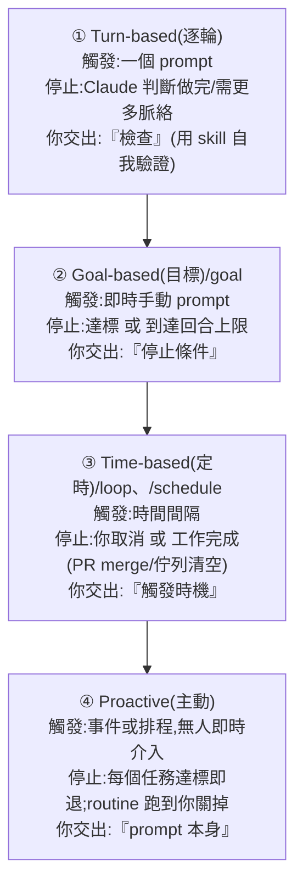
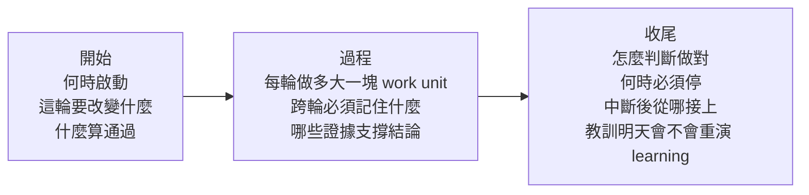
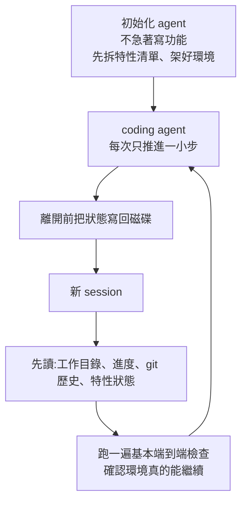
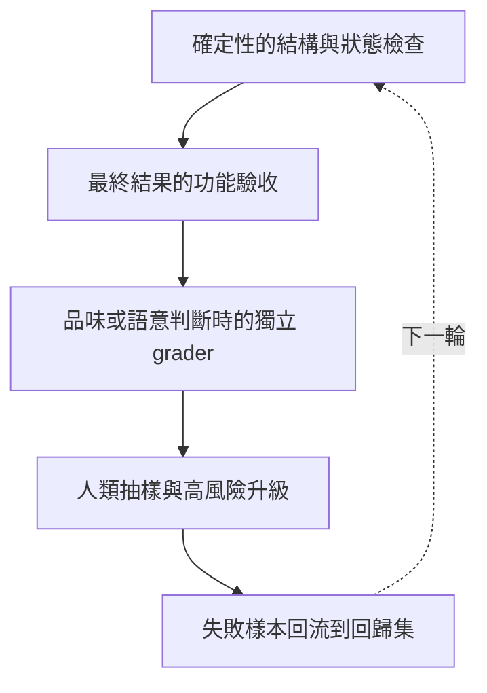

# Claude Code 官方定義的四種 Loop:Turn-based / Goal-based / Time-based / Proactive

> 整理自 Claude Code 團隊官方文章〈designing loops〉(作者 @delba_oliveira,發布於 @claudedevs,X:<https://x.com/claudedevs/status/2074208949205881033>)。近期 X 上一堆人在講「設計 loop 而不是寫 prompt」,但「loop 到底是什麼」各說各話。**這篇是 Claude Code 團隊的權威定義與分類**——正好替本庫既有的 loop 筆記([[loop-engineering]]、[[loop-engineering-when-and-how-gary-chen]]、[[loop-engineering-buzzword-critique]])定錨。
>
> **延伸來源**:YouTube「白白说大模型」〈别再让Loop多跑几轮了，未来是验证回路的！〉(2026-10-10,約 33 分鐘)以本文為主線,串起 Anthropic 的驗證回路、長程 agent harness、agent 評測三篇工程文章,以及 OpenAI 兩篇交叉驗證文章——整理在文末「延伸:從多跑幾輪到驗證回路」一節。
>
> **官方定義:loop = agent 反覆執行「工作循環」,直到滿足某個停止條件(stop condition)。** 不是所有任務都需要複雜 loop——**先從最簡單的解法開始,選擇性地用這些模式。**

---

## 一句話總結

Claude Code 團隊用四個維度給 loop 分類:**① 怎麼觸發、② 怎麼停止、③ 用哪個 Claude Code primitive、④ 適合哪種任務**。據此分成四種,你「交出去(hand off)」的東西逐級增加:



> 交得越多、自動化越深:**Turn-based 交出「檢查」→ Goal-based 交出「停止條件」→ Time-based 交出「觸發時機」→ Proactive 連「prompt 本身」都交出去。**

---

## ① Turn-based loops(逐輪循環 = agentic loop)

| | |
|---|---|
| **觸發** | 一個 user prompt |
| **停止** | Claude 判斷任務已完成、或需要更多脈絡 |
| **最適合** | 較短、非例行/非排程的任務 |
| **管控用量** | 寫具體的 prompt;用 skill 強化驗證以**減少回合數** |

**你送的每一個 prompt 都啟動一個由你主導每一輪的手動 loop**:Claude 收集脈絡 → 採取行動 → 檢查自己的工作 → 需要就重複 → 回覆你。這就叫 **agentic loop**。例如叫它做一個 like 按鈕:它讀你的 code、改、跑測試、交回它認為可行的成果;**然後你手動檢查、寫下一個 prompt**。

> **關鍵改進:把「你手動檢查的步驟」寫成 `SKILL.md`**,讓 Claude 能端到端自我驗證更多。重點是給它**能看/量測/互動結果的工具或連接器**;**檢查越量化,越容易自我驗證**。官方範例 `verify-frontend-change` skill:
> - 別只因「編輯成功」就回報 UI 改動完成;要像人類 reviewer 那樣驗證。
> - ① 起 dev server、在瀏覽器開改動頁 → ② 直接互動(點按鈕、確認狀態變化、截 before/after)→ ③ 檢查 console 零新錯誤/警告 → ④ 用 Chrome DevTools MCP 跑 performance trace、audit Core Web Vitals。
> - 任一步失敗就修好、從第 1 步重跑——**不交回「只驗證了一半」的工作**。

---

## ② Goal-based loop(/goal)

| | |
|---|---|
| **觸發** | 即時手動 prompt |
| **停止** | 目標達成 **或** 到達你設的最大回合數 |
| **最適合** | 有**可驗證退出條件**的任務 |
| **管控用量** | 設具體完成標準 + 明確回合上限(「試 5 次就停」) |

單一回合有時不夠,尤其複雜任務——agent 能迭代時表現更好。用 **`/goal` 定義「做完長什麼樣」**,延長 Claude 迭代的時間。**當你定義了成功標準,Claude 就不必自己判斷「夠好了沒」而提早結束**:每次 Claude 想停,一個 evaluator 模型會檢查你的條件,不符就送它回去繼續,直到達標或到達你定的回合數。這就是為什麼**確定性標準**(通過幾個測試、清過某個分數門檻)特別有效。

```bash
/goal get the homepage Lighthouse score to 90 or above, stop after 5 tries.
```

---

## ③ Time-based loop(/loop、/schedule)

| | |
|---|---|
| **觸發** | 指定的**時間間隔** |
| **停止** | 你取消,或工作完成(PR merge、佇列清空) |
| **最適合** | 例行工作,或與外部環境/系統對接 |
| **管控用量** | 設較長間隔,或**改成依事件反應**而非依時間 |

有些 agentic 工作是**例行的**:任務不變、只有輸入變(如每天早上摘要 Slack 訊息)。有些依賴外部系統,最簡單的對接就是**定時去檢查、對變化做反應**(如一個 PR 可能收到 review 或 CI 失敗)。

```bash
/loop 5m check my PR, address review comments, and fix failing CI
```

> **`/loop` 跑在你自己電腦上,關機就停。** 想搬到雲端,用 **`/schedule` 建立一個 routine**。

---

## ④ Proactive loops(主動循環)

| | |
|---|---|
| **觸發** | 一個事件或排程,**無人即時介入** |
| **停止** | 每個任務達標即退;**routine 本身跑到你關掉為止** |
| **最適合** | **定義良好、源源不絕的重複工作**:bug 回報、issue 分流、遷移、依賴升級等 |
| **管控用量** | 把 routine 路由到**更小更快的模型**,只在需要判斷時用最強模型 |

把上面的 primitive,加上 auto mode、dynamic workflows(research preview),**組合成長時運行的 loop**。例如處理進來的回饋:
- **`/schedule`** 跑一個檢查新回報的 routine;
- **`/goal`** 定義「做完」的樣子,用 skill 記錄如何驗證;
- **Dynamic workflows** 編排 agent 去分流每個回報、修好、review 修法;
- **Auto mode** 讓 routine 不停下來問權限。

```bash
/schedule every hour: check the project-feedback channel for bug reports.
/goal: don't stop until every report found this run is triaged, actioned, and responded to.
When fixing a bug, use a workflow to explore three solutions in parallel worktrees and have a judge adversarially review them.
```

---

## 維持程式碼品質(loop 的產出取決於「周邊系統」)

- **保持 codebase 本身乾淨**:Claude 會跟隨你 codebase 裡已存在的模式與慣例。
- **給 Claude 自我驗證的方法**:用 skill 把「你和團隊眼中的『好』」編碼下來。
- **讓文件容易取得**:框架/函式庫文件有最新的最佳實踐。
- **用第二個 agent 做 code review**:全新脈絡的 reviewer 偏見更少、不受主 agent 推理影響。可用內建的 `/code-review` skill 或 Code Review for GitHub。
- **別只修單一問題,要把它編碼進系統**:當某個結果不達標,不要只修那一個 issue——設法把它**沉澱成規則,改善所有未來的迭代**。

---

## 管控 token 用量(loop 要有清楚的邊界)

- **選對 primitive 與模型**:小任務不需要多 agent 或多 loop;有些任務用更便宜更快的模型即可。
- **定義清楚的成功與停止標準**:講清楚「做完」的樣子,讓 Claude 早點(但別太早)到達解答。
- **大規模跑之前先小規模試跑(pilot)**:dynamic workflows 可能 spawn 上百個 agent,先在一小片工作上估用量。
- **確定性工作用腳本**:跑腳本比逐步推理便宜(如 PDF skill 附一支填表腳本,每次直接跑,而非每次重新推導程式碼)。
- **routine 別跑得比需要的更頻繁**:間隔要匹配「你在盯的東西多久變一次」。
- **檢視用量**:`/usage` 按 skill / subagent / MCP 拆解近期用量;`/goal`(無參數)顯示目前回合數與 token;`/workflows` 顯示每個 agent 的 token 用量、且可隨時停掉某個 agent。

---

## 🚀 5 分鐘上手版(普通人版,零術語)

> 把官方那套濃縮成一般人 5 分鐘能學會、直接照做的方法論。

### 1. 一句話解釋什麼是 Loop
**Loop = 讓 AI 自己「做 → 檢查 → 沒好就重做」,一直到你定的「完成」條件為止,你不用每一步都盯著。**

### 2. 四種 Loop 一眼看懂
| Loop | 白話 | 你放手的是 |
|---|---|---|
| **Turn-based(逐輪)** | 你講一句、它做一輪,做完你檢查、再講下一句 | 幫它「自己檢查」 |
| **Goal-based(定目標)** | 你先講清楚「怎樣才算做完」,它自己重試到達標 | 「什麼時候可以停」 |
| **Time-based(定時)** | 每隔一段時間自動跑一次(每天早上、每 5 分鐘) | 「什麼時候開始做」 |
| **Proactive(全自動)** | 有事就自己觸發、自己做完,你只在關鍵時看一眼 | 連「要它做什麼」都先寫好 |

### 3. 每種 Loop:適合場景 / 最佳實踐 / 馬上上手案例 / 常見錯誤

**① Turn-based(逐輪)**
- **適合場景**:一次性、還在摸索的事(改個功能、查個東西、寫段文案)。
- **最佳實踐**:把「你每次都會手動檢查的步驟」寫下來變成一張清單,讓 AI 自己照著檢查完再交給你(越能量化越好,例如「跑得過測試」「沒有紅字錯誤」)。
- **馬上上手案例**:「幫我加一個讚按鈕,改完**自己在瀏覽器點一下確認會亮、截圖給我、確認 console 沒報錯**,都 OK 再說完成。」
- **常見錯誤**:只看到 AI 說「改好了」就相信——它常常「編輯成功」但根本沒真的驗證。**一定要它交出證據(截圖/測試結果)。**

**② Goal-based(定目標)**
- **適合場景**:你**很清楚「做完長什麼樣」、而且能被量化驗證**的事(分數、通過數、字數)。
- **最佳實踐**:把目標寫成一個**確定性條件 + 一個重試上限**,避免它自己覺得「差不多了」就早停,也避免無限燒錢。
- **馬上上手案例**:「把首頁的效能分數弄到 90 分以上,**最多試 5 次**,到了就停。」
- **常見錯誤**:目標寫得模糊(「弄好看一點」)——它無法判斷有沒有達標,不是提早亂停就是永遠停不下來。**目標要能用數字/是非題檢查。**

**③ Time-based(定時)**
- **適合場景**:**同一件事重複做、只有輸入在變**(每天摘要訊息),或要**盯著外部東西的變化**(PR 有沒有新意見、CI 有沒有掛)。
- **最佳實踐**:**間隔配合「它多久變一次」**別跑太勤;能「有事才觸發」就比「死板定時」更省。
- **馬上上手案例**:「**每 5 分鐘**檢查我的 PR,把 review 意見處理掉、修好壞掉的 CI。」/「**每天早上**幫我摘要昨天的群組訊息。」
- **常見錯誤**:間隔設太短、整天空跑燒錢;還有——**跑在自己電腦上,電腦一關就停**(要長期在背景跑得搬到雲端排程)。

**④ Proactive(全自動)**
- **適合場景**:**源源不絕、規則明確**的重複工作(客訴分流、bug 修復、例行升級)。
- **最佳實踐**:把前面三種組起來——**定時觸發 + 講清楚完成標準 + 讓它自己跑不要一直問你權限**;瑣碎判斷交給便宜快的模型,只在重要決策用最強的。
- **馬上上手案例**:「**每小時**去看回饋頻道有沒有新 bug,**把這次找到的每一則都分流、處理、回覆完才停**。」
- **常見錯誤**:還沒小規模試跑就開全自動、一次放出上百個 agent 燒爆帳單。**先拿一小部分工作試水溫,確認行為正常再放大。**

### 4. 直接套用的 Loop 設計模板
照著填四個空,就是一個能跑的 loop:

```
【觸發】什麼時候開始?  →（我手動叫它 / 每隔＿＿ / 一發生＿＿事就開始）
【任務】要它做什麼?    →（一句話講清楚,越具體越好）
【完成】怎樣算做完?    →（能被檢查的條件,例:測試全過、分數≥90、佇列清空)
【停止】上限在哪?      →（最多試＿＿次 / 最多跑＿＿分鐘 / 我喊停）
```

> 選哪一種?**先問自己三題**:① 我知道「做完長什麼樣」嗎?知道 → Goal-based。② 這事會定時/重複出現嗎?會 → Time-based;而且完全不用我插手 → Proactive。③ 都不是、還在摸索 → 就用最單純的 Turn-based。**能用簡單的就別上複雜的。**

---

## 應用案例 / 怎麼開始(官方總表)

| Loop 類型 | 你交出 | 什麼時候用 | 用什麼 |
|---|---|---|---|
| **Turn-based** | 檢查 | 你在探索或做決定 | 自訂驗證 skill |
| **Goal-based** | 停止條件 | 你知道「做完」長什麼樣 | `/goal` |
| **Time-based** | 觸發時機 | 工作發生在專案外、按排程 | `/loop`、`/schedule` |
| **Proactive** | prompt 本身 | 工作是重複且定義良好的 | 以上全部 + dynamic workflows |

- **從你已經在做的工作找起**:挑一個「**你是瓶頸**」的任務,問自己能交出哪一塊——**你能寫出驗證檢查嗎?目標夠清楚嗎?工作是按排程來的嗎?**
- **有想法就跑一次 loop、觀察結果**(它在哪裡卡住、在哪裡過度發揮),然後**不怕地去迭代它**。
- **和本庫其他 loop 筆記的關係**:這篇是**官方權威定義**,回答了 [[loop-engineering-buzzword-critique]] 抱怨的「loop 各說各話」;實務怎麼設計(Trigger/Verifiable Goal/Rubric/失控三坑)見 [[loop-engineering-when-and-how-gary-chen]];概念與 Boris 三階段見 [[loop-engineering]];把 loop 放進 harness+ops+eval 全景見 [[agent-harness-loop-llmops-eval-explained]]。四種 loop 的「交出去越多、自動化越深」正好對應那些筆記反覆強調的「人從操作者變系統設計者」。
- **驗證 skill 是關鍵可複用資產**:把「做完/好」的判準寫成量化、可自我驗證的 SKILL.md(如 `verify-frontend-change`),是讓 Turn-based 少跑回合、讓 Goal/Proactive 能自動停的共同基礎——呼應 [[cross-model-review-claude-codex-harness]](stop hook + skill 自建 harness)與 [[building-claude-skills]]。

---

## 延伸:從「多跑幾輪」到驗證回路(白白说大模型 2026-10-10)

> 整理自 YouTube「白白说大模型」〈别再让Loop多跑几轮了，未来是验证回路的！〉。該片無字幕,逐字稿以 CPU faster-whisper 轉錄,非官方字幕。
>
> ⚠️ **立場揭露**:作者在說明欄以「配套教程資料到主頁或公眾號回覆關鍵詞領取」導流,本筆記不轉述該資料。影片多處標為「官方」的說法,已逐一回查原文,差異處以「🔎」標出。

### A. 核心論點:重複本身不產生可靠性

官方定義裡真正吃重的是中間那個 **Until(直到)**——把「重複」和「停止」綁成一件事:

- 少了停止條件:agent 在已經能用的功能上反覆打磨,或把額度燒光,你事後才發現。
- 少了重複:退回一次性交付,複雜任務本來就要迭代,標準寫得再清楚也兌現不了。
- 練琴比喻:不開節拍器、不回放錄音,同一段譜彈一百遍,很可能一百遍都錯在同一小節,而且越彈越順手,錯誤跟著固化。

工程化的 loop 多出來的是**連接**:觸發、狀態、驗證、停止、恢復,以及人在哪一步介入。影片把穩定 loop 拆成九項,歸成三組問題:



兩項最容易被忽略:
- **Work unit 要小**:裝修不會說「這個月把房子做完」,而是「今天鋪哪一間地板,鋪完當場驗」。塊切得越大,出問題越難定位,返工越貴。
- **Learning**:一次失敗只修眼前這一個,下次換個樣子再來;寫成一條 Finding、一個可重跑的評測樣本、一次 skill 或 guard 更新,系統才真的往前挪一格。

**最常見的誤判是拿過程當結果**:稿子改十遍、每版改動都講得通,不代表最後那版能讀。模型自己說完成、JSON 合法、截圖好看、某位審閱者點頭——**任何單一信號都證明不了 loop 可靠**。

### B. 驗證回路:檢查 → 修復 → 從頭再檢查

Claude Code 團隊另一篇〈Building verification loops in Claude Code with skills〉(Delba de Oliveira,2026-07-22)把驗證回路定義為:agent 用測試、linter 或自訂檢查來檢查自己的工作,修掉失敗後才往下走,並可包成 skill 讓每個 session 自動套用。

- **關鍵在「再檢查」**:修復本身就是一次改動,會帶進新問題。所以回路的形狀是環,不是直線——任何一步失敗,修完要**回到檢查起點重走一遍**,而不是從卡住那步接著往下(配鑰匙比喻:齒形磨得再像,也得回去插鎖轉得動才算)。
- **信號分兩半**:型別檢查、linter、測試、runtime error 判準固定,交給工具;工具推斷不出來的,正是原本由人一遍遍手動做的驗收,也最該寫下來。

**檢查放在哪:四個落點是一條線,不是四個並列選項**(原文核對屬實):

| 落點 | 做法 | 適合 | 代價 |
|---|---|---|---|
| 手動呼叫 | 產出後自己跑檢查 skill | 跨工作流的檢查(資安掃描、無障礙稽核) | 要記得觸發 |
| 嵌入 | 把檢查寫進產生結果的那個 skill | 綁定單一工作流的檢查 | 只能改自己控制得到的 skill |
| 串接 | 一個 skill 收尾時呼叫下一個 | 端到端開發循環 | 彈性下降、token 可能變貴 |
| 每個 PR | 每次 PR 自動觸發 | 全團隊的品質門 | 還沒穩定的檢查不該太早推上去 |

**起步順序**(原文):挑本週手動做最多的那道後續檢查 → 先試內建 `/verify` skill → 用白話寫出理想檢查 → 用 skill-creator 或 SKILL.md 包成 skill → **拿新任務測試,確認真的會觸發** → 再實驗串接。

影片強調中間那步最容易被跳過:寫完、存成檔案,狀態是「**已寫好**」不是「**已生效**」,兩者之間隔著真實樣本——驗證在新任務上站住了,觸發範圍才配往外擴。

> 🔎 **補正**:影片說「官方」舉了「加一個按鈕,讓 agent 自己開瀏覽器點擊、確認狀態、檢查 console」的例子,並把「品味、互動意圖、不可逆改動仍由人判斷」歸為官方說法;這兩點在〈Building verification loops〉原文中**找不到**(原文只說把檢查編碼後,你的注意力可留給「沒有 skill 寫得下來的工作」)。按鈕例子可能出自〈designing loops〉或其他官方材料,這裡以影片說法記錄。

### C. 跨 session 的狀態傳輸層:先讀再做

長程 agent 在**離散的 session** 裡工作,窗口一關記憶就斷。Context compaction 壓的是長度、不是斷點——它把舊內容變短,卻沒變成可重新讀取的真相來源(遊戲比喻:腦中回想劇情 ≠ 存檔)。Anthropic 長程 agent harness 的做法是四樣外部記憶:

| 檔案 | 回答的問題 |
|---|---|
| init 腳本 | 環境怎麼跑起來 |
| 進度檔 | 做到哪了 |
| 特性清單 | 總共要做多少、每項什麼狀態 |
| git 歷史 | 已經動過什麼 |



- **交接前的恢復合約三條**:乾淨(不留垃圾)、可繼續(下一步接得上)、可回滾(走錯退得回來)。接力賽最容易掉名次的地方是交接區,不是直道。
- **邊界**:狀態寫進磁碟保證你**接得上**,不保證你**接得對**;衝突處理和真實驗證省不掉。

**三角色擴展**:Anthropic Labs 的 Prithvi Rajasekaran 在〈Harness design for long-running application development〉(2026-03)指出純 prompt 與單一 harness 都會碰到天花板,改拆成三個角色——**Planner** 把大任務切成可執行的小塊並定義交接方式、**Generator** 只在當前小塊內產出、**Evaluator** 用可評分標準獨立檢查並觸發修改。最關鍵的邊界:評估者不能只說「還行/不行」,**主觀品質要翻譯成可判分的維度**,失敗項才指得出來。

> 🔎 **補正(人名)**:影片 Whisper 轉出「Chris P. Rogers-Sakaran」,原文作者為 **Prithvi Rajasekaran**。

### D. 評測要先切兩刀

Anthropic〈Demystifying evals for AI agents〉一上來就切開兩樣常被混用的東西:

1. **切證據**:**Transcript / trajectory**(agent 怎麼想、調了哪些工具)解釋路徑;**Outcome**(環境是否變成正確狀態、產物能否用)才是拍板的依據。天氣預報推演再嚴密,也得推開窗看下沒下雨。
2. **切系統**:**Agent harness** 是跑活的執行環境(組織模型、工具、權限、上下文);**Evaluation harness** 跑評測任務、保存軌跡、記錄產物、呼叫 grader 判分。**執行系統不能兼任唯一裁判**——判卷人不能是答題人,因為它用的是作題時同一套標準,哪步想錯就會在哪步判錯,還判得理直氣壯。

**五層門禁**(每層都有天生的盲區,所以必須分層,而不是找一個更強的評分器打總分):



回到 Lighthouse 例子(「首頁 Lighthouse 分數做到 90 以上,最多 5 次」):每輪除了重測分數,也要檢查改動有沒有引入功能回歸——單一分數可被針對性優化(例如直接拿掉拖慢載入的邏輯,分數上去了,使用者要用的東西卻沒了)。讓 loop 退出的是**分數門 + 回歸門 + 撞到 5 次上限時把決定交回人**。

### E. 失敗變成能力:OpenAI 的兩篇交叉驗證

影片特別說明這兩篇不屬於 Anthropic 的四類 loop 分類,搬來是看與廠商無關的做法:

- **〈Harness engineering〉(Ryan Lopopolo,2026-02)**:agent 接手大量實作後,工程師重心移到設計環境、說清意圖、搭反饋回路,並讓能力與規則對 agent **可見、可執行**。agent 搞砸時該問的不是「再試一次會不會更好」,而是「**缺了哪種能力?agent 看得到嗎?能不能用工具或機械規則強制?**」——像事故調查。做法:倉庫知識成為可版本化的真相來源;給 agent 一張地圖而非一本千頁手冊;用架構檢查、linter、結構測試、定期清理把人的品味與不變量編進環境。
- **〈Building self-improving tax agents with Codex〉(2026-05-27,與 Thrive Holdings 合寫)**:三根柱子——①業務專家不離場(哪些錯重要、什麼算正確由他們決定);②讓生產系統自己長出證據(原文件、欄位來源、系統預測、專家最後改成什麼,整條 trace 留下);③把問題變成可做的工作(真實錯誤歸成 Finding → 編成定向 eval → 拆成範圍清楚的工程任務)。**候選修復要同時通過定向 eval 與回歸 eval,通過後仍由人決定是否上線。**

> 🔎 **未能核實**:OpenAI 稅務 agent 原文對自動抓取回 403,上述流程依影片與第三方摘要整理;第三方部落格提到的「準確率 6 週從 25% 到 97%」本筆記未能對照原文,不採用。

### F. 生產級 loop 的三類邊界

| 邊界 | 做法 |
|---|---|
| 停止 | 先看任務複雜度選 primitive 與模型,不是每件事都值得多 agent 或長 loop;開跑前寫清完成條件與停止條件 |
| 頻率 | 輪詢快慢跟著外部變化走;外面一天變一次,你五分鐘查一遍,九成查到同一個答案;能用 webhook / event 叫醒就別用鬧鐘 |
| 資源 | 持續看 usage;大批量執行前先小樣本試跑;確定性工作寫成腳本,判斷力留給真正需要判斷的地方 |

### G. 應用案例:把「每次都要手動點一下」變成驗證 skill

情境:前端專案,每次 agent 改完 UI,你都要開瀏覽器點按鈕、看狀態、翻 console。

1. **挑最常做的那道檢查**:本週手動做了 20 次「點新增按鈕 → 列表多一筆 → console 無 error」。
2. **白話寫出理想檢查**,存成 `.claude/skills/verify-add-item/SKILL.md`:

```markdown
---
name: verify-add-item
description: 修改清單頁或新增按鈕相關程式後,驗證新增流程端到端可用
---
1. 啟動 dev server(npm run dev),等待 http://localhost:3000 回應 200。
2. 開瀏覽器進清單頁,記下目前筆數 N。
3. 點「新增」按鈕,填入測試資料並送出。
4. 確認清單筆數變成 N+1,且新項目文字正確。
5. 讀 console:不可有 error 等級訊息。
6. 任何一步失敗:修正後從第 1 步重新走完整流程,不要只重跑失敗那步。
7. 連續 3 輪仍失敗:停下,回報失敗步驟與 console 內容,交給人判斷。
```

3. **拿新任務測**:故意請 agent 改按鈕樣式,看 skill 會不會被觸發、能不能抓出你事先埋的一個 console error。
4. **站住了才擴大**:先嵌入「改 UI」的 skill,穩定兩週後再考慮串接或掛到每個 PR。
5. **失敗回流**:每次 skill 抓到的新型錯誤,補一條到回歸檢查清單——這就是 E 節「失敗變成能力」的最小版本。

---

## 來源

- Claude Code 團隊,〈designing loops〉,作者 @delba_oliveira,發布於 @claudedevs(X):<https://x.com/claudedevs/status/2074208949205881033>
- 相關 Claude Code 官方文件:running agents in parallel、loop、schedule、goal、dynamic workflows。本文依使用者提供的文章全文整理;primitive 名稱(`/goal`、`/loop`、`/schedule`、auto mode、dynamic workflows〔research preview〕、`/usage`、`/workflows`、`/code-review`)與範例指令均取自原文。
- YouTube「白白说大模型」〈别再让Loop多跑几轮了，未来是验证回路的！〉(2026-10-10;該片無字幕,逐字稿以 CPU faster-whisper 轉錄,非官方字幕):https://www.youtube.com/watch?v=eoDylD3NYXc
- Claude Code 團隊〈Building verification loops in Claude Code with skills〉(Delba de Oliveira,2026-07-22):https://claude.com/blog/building-verification-loops-in-claude-code-with-skills
- Anthropic Engineering〈Harness design for long-running application development〉(Prithvi Rajasekaran,2026-03):https://www.anthropic.com/engineering/harness-design-long-running-apps
- Anthropic Engineering〈Effective harnesses for long-running agents〉:https://www.anthropic.com/engineering/effective-harnesses-for-long-running-agents
- Anthropic Engineering〈Demystifying evals for AI agents〉:https://www.anthropic.com/engineering/demystifying-evals-for-ai-agents
- OpenAI〈Harness engineering: leveraging Codex in an agent-first world〉(Ryan Lopopolo,2026-02):https://openai.com/index/harness-engineering/
- OpenAI〈Building self-improving tax agents with Codex〉(2026-05-27):https://openai.com/index/building-self-improving-tax-agents-with-codex
- Whisper 專有名詞還原:Lupin/Lupn 执念人→Loop Engineering;Graphin→Graph Engineering;安苏拉佩克/Ancelopec/AnsoPick→Anthropic;Cloud/Claw→Claude;TermVis/Trendbase/Cheron Bass→Turn-based;GoBest→Goal-based;TimeBest→Time-based;ProAxis→Proactive;Skidger→/schedule;路谱5M→/loop 5m;Virfication→Verification;Chris P. Rogers-Sakaran→Prithvi Rajasekaran;Ryan Lope Polo→Ryan Lopopolo;Demonstrifying Evoles→Demystifying Evals;长城→長程
