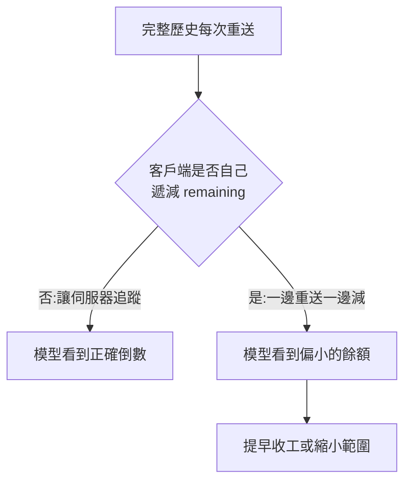

# Claude Task Budgets:給模型「整輪工作」的軟性 token 倒數,不是帳單上限

> 整理自 YouTube 頻道 **YAHA学堂**〈[别再让Claude偷跑用量!实测Task budgets防止截断与早停](https://www.youtube.com/watch?v=bniFQlzWVbc)〉(2026-10-04,約 11.3 分鐘,自動字幕)。
> ⭐⭐ 已逐項對照 [Anthropic 官方文件 Task budgets](https://platform.claude.com/docs/en/build-with-claude/task-budgets)核實(2026-11-07 再次讀取原文複核),**影片有一處支援模型清單過時**(見 §六)。字幕中「任劾/任務計算」=任務預算、「Cloud」=Claude、「Misos」=Mythos、「Sonet/Hackle」=Sonnet/Haiku,屬同音誤聽;「Sonete 4.0」[10:10] 推定為 Sonnet 4.6(以官方 Feature support 表為準)。

---

## 一句話總結

> **Task budget 是「告訴模型這整輪 agent 工作大約還有多少 token 可用」的軟性提示,伺服器端把倒數注入模型視野,模型據此安排優先順序並在快用完時收尾。它不是硬上限,不能取代 `max_tokens` 或你自己程式的費用控管。**

## 一、先分清四個旋鈕

| 設定 | 管什麼 | 範圍 |
|---|---|---|
| `effort` | 每一步想多深 | 單步推理 |
| `task_budget` | 整輪能鋪多大 | 跨多次請求的整個 agent 迴圈(**軟性**) |
| `max_tokens` | 單次請求最多生成多少 | 單次請求(**硬性**,到了截斷 `stop_reason: max_tokens`) |
| 自適應思考 | 依任務調整思考量 | 思考 token 也計入預算,預算見底時思考自動縮減 |

✅ 官方:兩個 token 上限互相獨立,「不要求誰一定比誰大」。xhigh/max 推理時,`max_tokens` 至少建議 **64k**(是建議值,不是每次都花這麼多)。

## 二、最容易算錯的地方:預算只扣「新內容」

客戶端每次都把完整歷史重送,但預算**不會重複扣**。官方範例(影片數字與官方完全吻合,✅):總額 100,000。

| 請求 | 客戶端送出的酬載 | 本次計入預算 | 剩餘 |
|---|---|---|---|
| 1 | 約 20 | 5,000(思考+工具呼叫) | 約 95,000 |
| 2 | 約 7,800 | 6,800(工具結果 2,800 + 生成 4,000) | 約 88,200 |
| 3 | 約 13,000 | 7,200(工具結果 1,200 + 報告 6,000) | 約 81,000 |
| 合計 | 約 20,820 | **19,000** | |



要點:倒數**只有模型看得到**——API 回應的 `usage` 沒有剩餘預算欄位,SDK 也沒有讀取入口。你可以加總自己的用量,但那不是伺服器倒數的鏡像,更不是帳單金額。

## 三、什麼時候才需要自己傳 `remaining`

- **完整歷史照常送**:省略 `remaining`,讓伺服器追蹤。
- **伺服器端 compaction(壓縮)**:本輪壓縮前已花的預算仍然算數,不會因為記錄變短就重發額度。
- **你自己的程式刪舊訊息、改寫成摘要**:伺服器不知道被拿掉的部分花了多少,要傳 `remaining = total − 已移出歷史的累計消耗`。官方範例:總額 128,000、移出內容共耗 45,000 → 傳 83,000。**摘要與仍在訊息中的內容不要再扣**;這個數字只在你替換歷史時更新,且**之後每次請求都要帶**,不是只在壓縮那次。
- **「一輪」的定義**:一則不含 tool_result 的使用者訊息開始新一輪;含 tool_result 的訊息(即使附一句「順便檢查 Dockerfile」)仍屬當前這輪,不會重發預算。⚠️ 新一輪不等於舊帳歸零:前幾輪歷史只要還留在上下文,倒數仍會算進去(官方標註 "Today")。

## 四、為什麼預算太小會讓 Claude「不幹了」

✅ 官方警告:預算明顯不足(例如給 20,000 token 做數小時的編碼任務)時,模型可能拒絕開始、大幅縮小範圍或早停並交部分結果。症狀像拒絕,根因是預算。

- 最低合法值 **20,000**,更低回 400 錯誤。但「最低能填」和「任務至少需要」是兩回事。
- 官方建議的調校法:**先不加預算**,用有代表性的任務跑出消耗分布(加總每次請求的 `output_tokens` 與追加的工具結果,**別把重送的歷史算進去**),從 **p99** 開始試,再上下調。p99 只表示樣本中約 99% 的任務不超過這個數,不保證未來 99% 成功。
- 影片的補充建議(個人經驗,非官方):評估時同時看「報告有沒有交完整、關鍵檢查有沒有做完」,不要只看用量下降;小修補與整庫重構不必共用預設額度。

## 五、軟性,所以硬線要自己守

> 模型看預算安排工作;程式管真正的停止條件。

- 預算可被超過(模型可能先把一個中斷代價更高的動作做完)。
- `max_tokens` 只截單次請求,一個任務可能請求很多次,所以也**不能單獨代表整項任務的費用上限**。
- 產品若要求總費用或總時間不得超過某線:應用程式自己統計、判斷、停止。

## 六、取得方式與官方核實(含影片需修正處)

- Messages API,放在 `output_config.task_budget`,欄位:`type`(固定 `"tokens"`)、`total`、可選 `remaining`;需 beta 標頭 **`task-budgets-2026-03-13`**(✅ 與影片「2026 年 3 月 13 日」一致)。
- ⚠️ **影片支援清單需修正**:影片 [10:01]–[10:10] 說支援 Fable 5/5.1、Mythos 5/5.1、Opus 4.7/4.8/5/5.5,不支援 Sonnet 5、Opus 4.6、Sonnet 4.6、Haiku 4.5。官方 Feature support 表(2026-11-07 讀取)為:Fable 5.1、Mythos 5.1、Opus 5.5、Opus 5、Fable 5、Mythos 5、**Sonnet 5.5、Haiku 5.5 皆為 Beta**、Opus 4.8、Opus 4.7 為 Beta;**Sonnet 5、Opus 4.6、Sonnet 4.6、Haiku 4.5 Not supported**。影片漏了 Sonnet 5.5 與 Haiku 5.5。以官方頁為準。另:官方 front matter 的 supportedModels 還列了 `claude-mythos-preview`,但 Feature support 表未列它,**此點未能核實**。
- ✅ **Claude Code 與 Cowork 未開放此參數**:官方原文「Task budgets are not supported on Claude Code or Cowork surfaces.」影片 [10:20] 的說法一致。Managed Agents 官方標為 Not available,改用 Session budgets。
- ✅ **快取影響**:官方原文:「the budget value participates in the rendered prompt, so a changed value does not match cache entries created under the old one」;倒數標記在伺服器端注入,每次請求都不同,若每次遞減 `remaining` 也會讓快取前綴失效。官方建議:初始請求設一次,讓伺服器倒數。(影片補一句「穩定配置也不保證全命中」,與官方一致。)

## 應用案例

1. **程式碼稽核 agent**:先跑 20 次不加預算的代表性稽核,取 p99(例如 7 萬 token)當 `total`;觀察是否仍涵蓋所有關鍵模組。若某次掃描花得少卻漏了模組,不要當成「優化成功」。
2. **自己寫 compaction 的長任務**:每次把最舊 30 則訊息改寫成摘要時,累計「被移出的訊息花了多少」,之後每個請求都帶 `remaining = total − 累計`;不要每輪再減一次。
3. **成本護欄**:`task_budget`(讓模型收尾得漂亮)+ `max_tokens`(防暴衝)+ 應用層累計費用上限(真正的硬線),三層分工。
4. **排查早停**:Agent 莫名拒做大任務,先看是否把預算設成 20k 之類的最低值,再去懷疑提示詞。

## 延伸閱讀與深度補充(2026-11-07 核實增補)

以下為實際讀過的官方 Task budgets 頁面原文重點,比影片多出的部分才列入:

1. **最小可跑範例(官方頁 Python 範例改寫)**:beta 標頭與 `output_config` 寫法如下。官方範例的 `max_tokens` 為 128000、`effort` 為 `high`、`total` 為 64000。
   ```python
   import anthropic

   client = anthropic.Anthropic()
   with client.beta.messages.stream(
       model="claude-opus-5-5",
       max_tokens=128000,
       output_config={"effort": "high", "task_budget": {"type": "tokens", "total": 64000}},
       messages=[{"role": "user", "content": "Review the codebase and propose a refactor plan."}],
       betas=["task-budgets-2026-03-13"],
   ) as stream:
       response = stream.get_final_message()
   print(response.usage)  # 官方:usage 沒有剩餘預算欄位,SDK 也無讀取入口
   ```
2. **壓縮後帶 `remaining` 的官方寫法**:已移出歷史的累計消耗為 45,000 時,`remaining = 128000 - 45000`。官方原文:「Pass the resulting `remaining` on every request, not only the one that compacts.」同時強調「Leave out anything still present in the messages you send, including any summary you added」,也就是摘要本身不要再扣;影片 [5:29]–[5:36] 的數字與官方完全相同。
3. **中途調整預算(影片 [10:29] 的說法,官方證實)**:官方「Changing the budget mid-conversation」一節:在下一個請求的 `output_config` 設新的 `task_budget` 即可,但新值會讓含該段的快取失效,官方仍建議「set the budget once on the initial request」。
4. **只是建議值,不是硬上限**:官方原文「Task budgets are a **soft hint, not a hard cap**」,並說「The enforced limit on total output tokens is still `max_tokens`」,超過 `max_tokens` 時 `stop_reason` 為 `max_tokens`。影片 [8:51] 的「軟性」判斷與此一致。
5. **可用平台(官方 Availability 表)**:目前皆為 Beta,包含 Claude API、Claude Platform on AWS、Claude Models on Google Cloud(Google managed)、Microsoft Foundry。影片未提這點。
6. **未能核實**:官方 front matter 的 `supportedModels` 列有 `claude-mythos-preview`,但 Feature support 表未列,無法確認它是否實際支援。

## 來源

- [别再让Claude偷跑用量!实测Task budgets防止截断与早停 — YAHA学堂](https://www.youtube.com/watch?v=bniFQlzWVbc)(2026-10-04;該片無官方字幕,使用自動字幕,可能有同音字誤差)
- [Task budgets — Claude API 官方文件](https://platform.claude.com/docs/en/build-with-claude/task-budgets)(核實範例數字、最低值、支援清單、快取、Claude Code 不支援)
- 延伸(本庫):[[claude-throttling-opus-4-7]]、[[agent-paid-api-cost-guardrails-mcp]]、[[token-saving-three-moves-context-control]]
