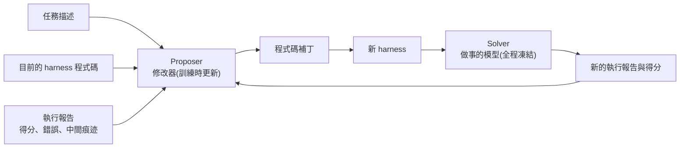

# Harness Learning:訓練一個「專門改 harness 的模型」,4B 學生贏過 35B 老師

> 整理自 YouTube 頻道 **Why QQ**〈[4B打赢35B老师 | 解读CMU新论文:Harness Learning](https://www.youtube.com/watch?v=RhmzLKU9xvY)〉(2026-10-13,約 9.6 分鐘,官方 zh-Hans 字幕)。
> ⭐⭐ **本文已直接讀取 [arXiv 2609.35738 原文](https://arxiv.org/abs/2609.35738) 核實**,補上影片沒講的模型名稱與一個會改變頭條觀感的細節:**「35B 老師」是 MoE 模型,每個 token 只啟用約 3B 參數**(見 §7)。
> 論文:Alvin Zhang、Xuecheng Liu、Zixuan Wang、Fahim Tajwar、Daman Arora、Ruslan Salakhutdinov、Daniel Khashabi、Yuda Song、Andrea Zanette,〈Harness Learning Enables Generalizable Test-Time Adaptation〉(v1 2026-09-28)。

---

## 一句話總結

> ⭐⭐⭐ **模型權重全程不動,變強的只有包在模型外面的那段程式。**
> 論文訓練一個 **Proposer** 專門讀執行報告、改 **harness** 程式碼,用強化學習把「改完之後的任務得分」當獎勵。
> 測試時所有模型凍結,**經驗被寫進程序,而「怎麼改程序」的手感被訓進了 Proposer 的權重**。

---

## 一、⭐⭐ 出發點:模型不動,harness 一調效果就差一倍

做 agent 的人都有這個經驗:模型不換,只調提示詞、工具、流程,效果能差出一倍。那麼:

1. 既然外部程式影響這麼大,**能不能專門訓練一個模型,讓它學會改這層程式?**
2. 這份經驗**能不能帶到沒見過的任務上?**

### Harness 是什麼

**Harness**(原意是馬具)在 agent 語境裡,指**包在模型外面的那層可執行程式**:它決定模型每次呼叫看到什麼上下文、能用哪些工具、拿到結果後往哪裡傳。你寫過的 ReAct 迴圈、檢索流程、答案校驗邏輯,全都是 harness。

> ⭐⭐ **論文的定義(已對摘要核實):「一個語言模型 agent 由它的模型與它的 harness 共同定義。」**
> 影片的白話版:**模型是腦子,harness 是工作方式。** 同一個模型換一套 harness,表現可以天差地別。

📎 harness 的基本概念見本庫 [[ai-harness-explained]];harness 工程的演進見 [[harness-engineering-evolution]]。

---

## 二、⭐⭐⭐ 架構:兩個模型,只有一個會學



| 角色 | 職責 | 權重 |
|---|---|---|
| **Solver** | 在 harness 裡實際解題 | **全程凍結** |
| **Proposer** | 讀「任務描述 + 目前 harness 程式碼 + 執行報告」,輸出一個程式碼補丁 | **只在訓練階段更新** |
| **Harness** | 被修改的對象 | **測試時唯一在變的東西** |

### ⭐⭐⭐ 最漂亮的一個類比:把整套流程寫成元學習

| 傳統機器學習 | Harness Learning |
|---|---|
| 梯度下降更新**權重** | Proposer 產生的**程式碼補丁** |
| 被適配的**模型** | 被適配的 **harness** |
| 外迴圈 | **用強化學習訓練 Proposer**,讓它越改越好 |
| 內迴圈 | **在新任務上反覆執行 → 看回饋 → 再改** |

> ⭐ 論文原文:「harness revisions playing the role of weight updates in gradient-based adaptation」。
> **測試時兩個模型全部凍結,經驗寫進了程式,沒碰任何參數。**

---

## 三、⭐⭐ 訓練方式:GRPO + 每次修改的即時得分

- **演算法:GRPO**(DeepSeek 訓推理模型用的同款)。同一個上下文下,Proposer 採樣多個候選補丁,各自打到 harness 上、跑一批評分題。
- **獎勵(已核實):** `r = 評分題平均得分 + 輔助獎勵`,輔助獎勵看**補丁是否合法、能否成功執行**。同組候選互相比較、算優勢、更新 Proposer。
- **獎勵只看「這一次修改」的即時得分**,不追蹤多輪之後的最終效果 —— 這個選擇後面引出了一個有趣的結果(§5)。
- **SFT 起點(已核實):** 監督微調的資料來自老師模型的成功修改,學生站在老師肩膀上,再用 RL 往上走。

---

## 四、⭐⭐⭐ 實驗結果(已對論文核實)

### 4.1 推理任務:Reasoning Gym

Reasoning Gym 有幾十種程式化生成的推理題(迷宮、數獨、幾何⋯⋯)。訓練只用其中一部分任務族,**測試在訓練時完全沒見過的任務族上**。

| 模型 | 21 個未見任務族的單次修改平均分 |
|---|---|
| 未訓練的 Proposer(4B) | **0.32** |
| ⭐ SFT + RL 之後(4B) | ⭐⭐ **0.62**(接近翻倍) |
| 35B 老師 | **0.56** |

> ⚠️ **影片自己也說了公道話:如果給老師八次機會、挑最好的那次(oracle best-of-8),老師還是更強。**
> **學生贏在穩定性,每一槍都更準。** 論文的措辭很克制:從執行結果中學習,**可以把「平均」修改品質抬到老師之上**。

### 4.2 ⚠️ 把五個困難任務族算回來,優勢縮小

影片引用 alphaxiv 的評注,本文已對論文表格核實:

| 範圍 | 4B 學生(Single-step RL) | 35B 老師 |
|---|---|---|
| 主圖:21 個未見任務族 | **0.62** | **0.56** |
| ⚠️ 全部 26 個未見任務族 | **0.528** | **0.501** |

被排除在主圖外的五個是 `knight_swap`、`letter_jumble`、`modulo_grid`、`sokoban`、`ab`。⭐ **優勢仍在,但從 0.06 縮到 0.027。** 影片也提醒算力與回饋量沒有完全對齊。

### 4.3 多跳問答:只在 HotpotQA 上訓練

- Proposer 只在 **HotpotQA** 上訓練,測試搬到沒見過的 **MuSiQue** 與 **2WikiMultihopQA**。
- 訓練過的 Proposer 在三個資料集上**全部持續提升**。
- ⚠️ **沒訓練的對照組越改越糟,把 harness 改壞,分數跌回起點以下。**

> ⭐⭐ **「會改和瞎改之間,隔著一個訓練過程。」**

### 4.4 ⭐⭐⭐ 複利:連續改,勝過獨立改很多次

| MuSiQue,相同的 80 次修改預算 | 平均 exact match |
|---|---|
| 80 次**獨立**修改(每次都從原始 harness 開始) | **0.15**(比原始 harness 好不了多少) |
| ⭐ **沿同一條鏈連續改 10 輪**(4 條鏈 × 10 輪 × 每輪 8 個提案) | ⭐⭐ **0.27** |

⭐ **本文補充(影片沒講):在兩個未見的 QA 基準上,RL Proposer 連續改出來的最終結果,平均都超過「80 個獨立提案裡挑最好的那個」(oracle best-of-80)。**

> ⭐⭐⭐ **「沿著一份上下文持續修正,勝過不斷重開對話。反饋閉環比廣撒網值錢。」**

---

## 五、⭐⭐⭐ 一個誠實的結果:專門訓練「連續改」沒有比較好

研究者另外訓練了**看多輪修改歷史**的 Proposer,理論上應該更會連續作戰。實際上:

| 設定 | 結果(已核實) |
|---|---|
| Reasoning Gym | 多步 RL 在標準題型上**較好**,在格式變化的題型上**較差** |
| QA | 兩者最終分數**幾乎相同** |
| ⭐⭐ 只訓單步的 Proposer | **測試時連續改十輪,表現穩定爬升** |

> ⭐⭐⭐ **「迭代改進的能力,能從單步訓練裡湧現。」** —— 省錢,也省算力。
> 論文自己的推測:如果有「連續修改」的監督示範,多步訓練也許能有更大收益。

---

## 六、⭐⭐⭐ Proposer 學到的修改模式(對寫程式的人最有參考價值)

| 任務 | 最常見的修改 | 白話 |
|---|---|---|
| **推理** | ⭐ **解釋器迴圈**:讓 Solver 把計算過程寫成程式碼,交給執行環境去跑 | **人腦推理,機器算帳**。(✅ 論文:老師的 SFT 修改中 **48%** 就是這種) |
| **問答** | ⭐⭐ **重新組織資訊流**:原始 harness 把檢索段落壓成摘要再回答,證據在壓縮中丟了;Proposer 改成**原始段落直接餵給回答呼叫,摘要只用來規劃下一輪檢索** | **先查管道,再調提示詞** |
| 問答(其他) | 加第三輪檢索;草稿答案不在檢索段落裡時重新搜尋 | — |

> ⭐⭐⭐ **它學會的是「資訊流設計」的經驗:哪裡的上下文被污染、哪裡的證據被截斷。**

📎 這與本庫 [[agentic-harness-engineering-observability-evolution]] 的結論同一個方向:**harness 演化的瓶頸常在「看得見什麼」,而不是能力。**

---

## 七、⭐⭐ 本文補充:模型名稱,以及「4B 打贏 35B」要怎麼讀

| 角色 | 推理任務 | 多跳問答 |
|---|---|---|
| Proposer | **Qwen3.5-4B** | **Qwen3-4B** |
| Solver | **Qwen3.5-4B** | **Qwen3-8B** |
| SFT 老師 | **Qwen3.6-35B-A3B** | — |

⚠️⚠️ **「35B」老師是 MoE(混合專家)模型,`A3B` 代表每個 token 只啟用約 3B 參數。**
所以「4B 打贏 35B」若以**每步實際參與運算的參數**來比,差距沒有標題聽起來那麼懸殊。這不影響論文的主結論(訓練過的修改器比沒訓練的穩得多),**但頭條數字的兩邊條件不完全對等**,引用時要說清楚。

---

## 八、⭐⭐⭐ 坐標:這是哪一種「遞迴自我改進」

很多人看到這裡會開始喊 RSI。影片的態度是冷靜:

> **「Harness Learning 是一種有限的遞迴自我改進。」**
> 遞迴確實存在:Proposer 改 harness,改完的 harness 成為下一輪的輸入。
> 但它被框在很清楚的邊界裡:**修改空間只有 harness、Solver 全程凍結、獎勵來自可驗證的程式化評分、測試時不做任何參數更新。**

影片借用 〈The Last AI Built by Humans〉(arXiv 2609.11873)的自主性分級定位它。本庫 [[rsi-recursive-self-improvement-anthropic]] §9.3 已讀過原文:

| 等級 | 意思 | Harness Learning |
|---|---|---|
| (基線)任務內改進 | 反思、重寫、重試,**改完不留狀態**(Self-Refine、Reflexion) | — |
| **L1** 執行自主 | 人定目標、方法、標準,AI 只負責執行更新 | — |
| ⭐⭐ **L2 策略自主** | **目標與評測外部固定,但 AI 自己診斷弱點、決定怎麼改** | ⭐⭐⭐ **在這裡** |
| L3 | AI 開始決定下一輪學什麼經驗 | — |
| L4 | 部署回饋持續改寫系統狀態 | — |
| L5 遞迴元改進 | 改進機制本身成為改進對象 | ❌ 沒碰 |

> ⭐⭐⭐ **目標、評分、保留規則全是外部固定;但改哪裡、怎麼改,由 Proposer 自己讀執行報告拍板 —— 教科書級的 L2。**
> 那訓練 Proposer 的 RL 外迴圈算不算更高層?**夠不上**:外迴圈是人設計的,訓完 Proposer 就凍結,它不會去改自己的訓練機制。
> **準確定位:L2 裡做得最扎實的一檔** —— 別人用提示詞求模型改 harness,它把這項能力訓進了參數。

⚠️ 小補正:影片說綜述「分成六檔」,是把「任務內改進」的基線也算進去;論文本身的自主性分級是 **L1–L5 五級**(見 RSI 筆記 §9.3)。

### 與「上半場」的對照

影片把這篇當成先前一期的下半場:翁家翌的 **Learning Beyond Gradients** 讓 Codex 不斷修改一個遊戲策略程式(影片說 Breakout 從 387 分改到 864 分滿分),證明**經驗可以存在程式裡**。

| | Learning Beyond Gradients | Harness Learning |
|---|---|---|
| 經驗存在哪 | **程式裡** | **程式裡 + Proposer 的權重** |
| 證明了什麼 | 程式碼可以是學習的載體 | **修改程式的策略本身也能被學習** |

📎 對照本庫 [[self-harness]](用提示詞讓 agent 改自己的 harness,不訓練)與 [[prime-agent-rlm-continual-harness]](harness 自己改自己的工程實作),Harness Learning 的差別在於**把「改 harness」這個動作做成可訓練的技能**。

---

## 九、⭐⭐ 社群聲音與論文自承的限制

| 來源 | 說法 |
|---|---|
| elvis(影片轉述) | 修改 harness 正在變成一門獨立的 AI 工程技能,整個產業都在往這個方向轉 |
| alphaxiv 評注(影片轉述,⭐ 數字已核實) | 算上五個困難任務族後優勢縮小到 0.528 對 0.501;算力與回饋量沒完全對齊 |

**論文自承的限制(已核實):** 修改提示是寫死的、Solver 固定、推理任務的監督只有一個老師。

**下一步方向(已核實):** 更強的老師;直接從懂 harness 設計的模型做 RL;**讓 Proposer 帶工具,自己檢查、測試設計**;Proposer 與 Solver 聯合訓練;更長的工具使用軌跡。

> ⭐ 影片的總結:這條路的終點是三種進化同時發生 —— **參數更新、程式更新、修改策略更新**。
> 「Agent 的進化正在從煉丹變成寫程式,又從寫程式變成訓練會寫程式的模型。」

---

## 十、⭐⭐⭐ 給工程師的三個結論(影片)

1. ⭐⭐⭐ **評估 agent 要把模型和 harness 分開看。** 很多問題換 harness 就能解決,輪不到微調。
2. ⭐⭐⭐ **執行報告是這套系統的命脈。** 你給修改器看什麼回饋,它就學會什麼改法 —— **日誌、得分、失敗痕跡的設計,直接決定改進的上限**。
3. ⭐⭐ **可靠性比峰值值錢。** 訓練後提升最明顯的是**失敗修改大幅減少**,而不是改出多驚艷的 harness。工程系統裡,不出錯比偶爾驚艷重要得多。

---

## 應用案例

### 案例 1|⭐⭐⭐ 不訓練也能用的做法:「連續改」取代「重開對話」

你在用 Claude Code 或 Codex 優化一條 RAG 流程,手上有 20 題評測集。

| 做法 | 對應論文 |
|---|---|
| ❌ 每次開新對話:「幫我改進這個檢索流程」,挑分數最高的那版 | 80 次獨立修改(0.15) |
| ✅ **同一個對話裡**:跑評測 → 把**得分、失敗題目、中間檢索結果**貼回去 → 請它改 → 再跑 → 再貼 | ⭐ 連續十輪(0.27) |

⭐ 關鍵是第二種做法每一輪都附上**執行報告**,而不是只說「再改好一點」。

### 案例 2|⭐⭐ 設計你的「執行報告」

如果你要讓 agent 自己改自己的流程,先設計好它每輪能看到的報告:

```text
## 本輪執行報告
- 整體分數:0.41(上一輪 0.38)
- 失敗題目(前 5 題):題號、預期答案、實際答案
- 每題的中間痕迹:檢索到的段落 ID、是否包含正確證據、回答呼叫實際收到的上下文長度
- 執行錯誤:Traceback 摘要(若有)
```

⭐ 論文的 QA 案例說明了為什麼「回答呼叫實際收到什麼」這一欄很重要:**證據是在摘要那一步被壓掉的,不看資訊流就找不到**。

### 案例 3|⭐ 先查管道,再調提示詞

答案錯了,先別急著改 prompt。照 Proposer 學到的兩個模式自查:
1. **計算是不是交給了模型的「腦算」?** 改成讓它寫程式碼交給執行環境跑。
2. **證據有沒有在壓縮、摘要、截斷時丟掉?** 改成原始段落直送回答呼叫,摘要只拿來規劃下一步。

---

## 重點回顧(TL;DR)

1. ⭐⭐⭐ **agent = 模型 + harness**;Harness Learning 訓練一個 Proposer 專門改 harness,**Solver 全程凍結、測試時不更新任何參數**。
2. ⭐⭐ **元學習類比:程式碼補丁扮演權重更新,harness 扮演被適配的模型。** GRPO 訓練,獎勵是改完後的即時得分加上「補丁能跑」的輔助分。
3. ⭐⭐ **21 個未見推理任務族:0.32 → 0.62,超過老師的 0.56**;⚠️ 算上全部 26 族是 0.528 對 0.501,老師給 8 次機會仍較強。
4. ⚠️⚠️ **「35B 老師」是 Qwen3.6-35B-A3B(MoE,每 token 約 3B 啟用參數)**,頭條對比兩邊條件不完全對等。
5. ⭐⭐⭐ **連續改 10 輪(0.27)勝過 80 次獨立修改(0.15)**,而且只訓單步的 Proposer 就能做到。
6. ⭐⭐ 學到的模式:**推理交給解釋器迴圈、問答修資訊流(原文直送回答)**。
7. ⭐⭐⭐ **定位是 L2 策略自主**:改哪裡、怎麼改由 AI 決定,評測與保留規則仍在人手裡;離 L5 還遠。

---

## 核實狀態

### ✅ 已核實(直接讀取 arXiv 2609.35738)

| 影片說法 | 結果 |
|---|---|
| 模型與 harness 共同定義 agent;修改扮演權重更新的元學習 | **屬實**(摘要原文) |
| RL 訓練 Proposer、獎勵是修改後的任務得分;測試時不更新參數 | **屬實** |
| 21 個未見任務族 0.32 → 0.62、老師 0.56、老師 best-of-8 仍較強 | **屬實** |
| 26 族 0.528 對 0.501 | **屬實**(論文表格) |
| HotpotQA 訓練、MuSiQue / 2Wiki 測試;MuSiQue 0.15 對 0.27、80 次預算 | **屬實** |
| 獎勵含補丁合法、可執行的輔助分 | **屬實** |
| 多步訓練沒有一致勝過單步;單步 Proposer 可連續改進 | **屬實** |
| 解釋器迴圈、原始段落直送回答 | **屬實**(老師 SFT 修改 48% 為解釋器迴圈) |
| 限制:提示寫死、單一老師、Solver 固定;未來方向含工具化 Proposer、聯合訓練 | **屬實** |

### ⭐ 本文補充(影片未提)

- 實際模型:Qwen3.5-4B / Qwen3-4B / Qwen3-8B,老師 **Qwen3.6-35B-A3B(MoE)**。
- RL Proposer 連續改出的最終結果平均超過 oracle best-of-80 獨立提案。
- 被排除在主圖外的五個任務族名稱。

### ⚠️ 未能獨立查證

- **作者所屬機構**:作者含 Salakhutdinov、Zanette(CMU)與 Khashabi(約翰霍普金斯),致謝列出兩校的運算資源;本文未逐一核對每位作者的機構。
- **翁家翌 Learning Beyond Gradients 的 Breakout 387 → 864 分** —— 未讀原文。
- **elvis 與 alphaxiv 評注原文** —— 未回溯(alphaxiv 引用的數字已對論文核實)。

---

## 來源

- ⭐⭐⭐ [4B打赢35B老师 | 解读CMU新论文:Harness Learning — Why QQ](https://www.youtube.com/watch?v=RhmzLKU9xvY)(2026-10-13,約 9.6 分鐘,官方 zh-Hans 字幕)
- ⭐⭐⭐ [Harness Learning Enables Generalizable Test-Time Adaptation — arXiv 2609.35738](https://arxiv.org/abs/2609.35738)(**一手素材;已讀 HTML 全文核實模型、數字、獎勵設計與限制**)
- [The Last AI Built by Humans: Toward Genuine Recursive Self-Improvement — arXiv 2609.11873](https://arxiv.org/abs/2609.11873)(L1–L5 自主性分級)
- 延伸:本庫 [[rsi-recursive-self-improvement-anthropic]](§9 RSI 分級)、[[self-harness]]、[[agentic-harness-engineering-observability-evolution]]、[[prime-agent-rlm-continual-harness]]、[[ai-harness-explained]]、[[harness-engineering-evolution]]
