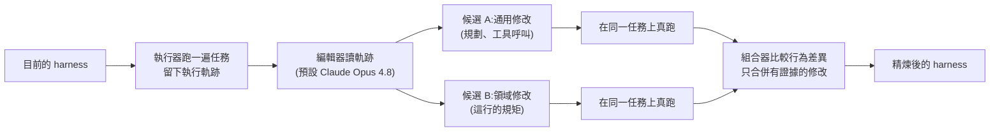

# Harness²:不換模型、不訓練,讓 agent 遞迴改自己的配置檔,弱模型反超強模型

> 整理自 YouTube 頻道 **Why QQ**〈[不换模型,反超Gemini!解读 Google Harness²](https://www.youtube.com/watch?v=EVHyF_dhWDo)〉(2026-10-21,約 9 分鐘,官方 zh-Hans 字幕)。
>
> ⭐⭐ **本文已讀論文與原始碼核實**:
> - 論文 [arXiv:2610.14224](https://arxiv.org/abs/2610.14224)(2026-10-09 v1)。
> - 實地 clone [google-research/harness2](https://github.com/google-research/harness2)(Apache-2.0,約 17.2k stars,2026-10-21 查詢),讀了 `README.md`、`docs/EXPERIMENTS.md`、`harness2/core/library.py`、`harness2/core/context.py`、`harness2/config.py`。
>
> 補正見第八節,重點有兩個:**Meta-Harness 並非全面落後**(論文表格中有一格領先);**repo 的經驗庫每次 sweep 都從空的開始**,而且按 domain 分開存。
>
> ⚠️ 所有分數都是**作者自報、尚無獨立複現**。立場:影片與說明欄沒有業配。

---

## 一句話總結

**Agent = 模型 + Harness;模型是凍結的,Harness 是可編輯的。** Google Cloud AI Research 與 Northwestern 的 Harness² 用兩層遞迴自動改 harness:在單一任務上「提議 → 探測 → 組合」,再把有證據支持的經驗存進經驗庫給下一個任務用。GLM-5 在 WorkBuddy-Bench 從 64.2 升到 75.7,超過原裝配置的 Gemini 3.5 Flash(72.4)。作者的金句:**「模型是租來的,Harness 是自己的。」**

---

## 一、Harness 的八個組件

Harness 直譯是馬具(韁繩、馬鞍那一套),在 agent 領域指**模型外面那層執行時腳手架**。論文把它拆成八個可編輯組件,每個都是一個真實檔案:

| 執行時角色 | 組件 | 範例檔案 |
|---|---|---|
| 建構上下文 | 系統提示詞 | `systemprompt.md` |
| | 護欄 | `guardrails.md` |
| | 長期記憶 | 一份 Markdown |
| | 技能 | `skills/*/SKILL.md` |
| 工具介面 | 工具說明 | `tool_guidance.md` |
| | 腳本 | 一組 Python 檔 |
| 委派編排 | 子代理 | 子代理定義 |
| 中介層 | 外掛 | TypeScript 中介層外掛 |

> 你寫過 `CLAUDE.md`,就已經在手工做 harness 工程了。

---

## 二、第一層:任務級遞迴(Propose–Probe–Compose)



**關鍵難題:** 真實工作沒有單元測試告訴你對錯。法律備忘錄、資料對帳,誰知道標準答案?

**Harness² 的解法:用行為對比取代答案驗證。** 它不知道哪個輸出是對的,但看得出「加了這條護欄後,agent 開始回讀檔案、開始跨表對帳」。

- 論文自承這種證據有局限:執行有隨機性,模型有自己的偏好。
- 所以**每個改動都要綁定一條具體觀察**;憑感覺的改動一律不合併。

---

## 三、第二層:改進級遞迴(名字裡的「平方」)

任務做完,系統回頭複盤整個修改過程:哪條改動有用、在什麼條件下有用、證據是什麼。這些經驗寫成記錄存進**經驗庫**,下一個任務的改進過程會參考它。

**原始碼裡的實際結構(`harness2/core/library.py`):**

```text
<root>/<run-tag>/<mode>/<domain>/INDEX.md
<root>/<run-tag>/<mode>/<domain>/harnesses/<task>/harness/<rel>   完整採用的 harness 樹
<root>/<run-tag>/<mode>/<domain>/harnesses/<task>/EXPERIENCE.md   為何採用 + 經驗
```

`EXPERIENCE.md` 的欄位是固定的:

```python
for f in ("cue", "lesson", "evidence", "confidence")
```

也就是「觸發線索、經驗、證據、信心」。⭐ 這正是影片說的「每條經驗都帶適用條件與證據記錄」。

⭐ **一個影片沒講的防呆:** 寫入經驗庫前,程式會呼叫 `assert_tree_has_no_grader_verdicts()`,掃描 harness 與 EXPERIENCE.md 有沒有評分結果的標記。有的話直接拋錯,避免把「評分器說對了」偷渡成下一個任務的證據。

**跨任務遷移:** 用 JobBench 累積的經驗庫輔助 WorkBuddy-Bench 的單步改進,Code / Web / Office 分別再 +0.6 / +0.5 / +2.9 分(✅ 論文)。

---

## 四、預算夠時:並行遞迴與順序遞迴

| 選項 | 行為 |
|---|---|
| `--k 1` | 一次 Propose–Probe–Compose |
| `--k K --mode parallel` | 探測 K 個通用候選與 K 個領域候選,產出 K 個組合 |
| `--k K --mode sequential` | 把精煉後的 harness 帶進下一輪,連續 K 步 |
| `--substrate cx` | 執行器改用 Codex(預設 OpenCode) |

**k = 5 時的額外增益(相對 k = 1,✅ 論文):**

- WorkBuddy-Bench:Gemini +3.3、GLM-5 +3.9。
- JobBench:Gemini +3.0、GLM-5 +4.2。
- LAB 部分通過率:GLM-5 +6.7 個百分點。
- Gemini 在 WorkBuddy-Bench 的總增益:72.4 → 80.8(+8.4)。

---

## 五、數據

**三個基準:** WorkBuddy-Bench(辦公、網頁、程式)、JobBench(專業工作)、LAB(Harvey 的法律基準)。每個配置跑三次取平均。

| 基準 | 模型(OpenCode) | 原始 | Harness² 一步 | 增益 |
|---|---|---|---|---|
| WorkBuddy-Bench | GLM-5 | 64.2 | **75.7** | +11.5 |
| WorkBuddy-Bench | Gemini 3.5 Flash | 72.4 | 77.5 | +5.1 |
| JobBench | Gemini 3.5 Flash | 31.5 | 36.0 | +4.5 |
| JobBench | GLM-5 | 20.6 | 24.2 | +3.6 |
| LAB 部分通過率 | GLM-5 | 59.6 | 71.4 | +11.8 |
| LAB 部分通過率 | Gemini 3.5 Flash | 79.9 | 81.9 | +2.0 |

- Gemini 在 WorkBuddy-Bench 的平均執行步數從 25.4 降到 21.9:**分數升了,活還幹得更快。**

**消融實驗(Gemini 3.5 Flash,k = 1):**

| 拿掉 | WorkBuddy-Bench | JobBench |
|---|---|---|
| 經驗庫 | −3.1 | −1.8 |
| 候選分範圍(通用 / 領域) | −2.9 | −3.7 |
| 組合機制 | −1.6 | −1.9 |

**弱模型反超強模型:** 改進後的 GLM-5(75.7)超過原裝 Gemini 3.5 Flash(72.4)。

**不挑模型:** 編輯器和執行器用同一個模型(k = 2)時,五個模型在所有基準上都有提升;例如 Claude Opus 5 在 WorkBuddy / JobBench / LAB 分別 +3.3 / +5.5 / +3.0。

---

## 六、具體案例:JobBench 的對帳任務

任務:把排期、場地、人力、預算檔案對帳成一套交付物。

- **原始 harness 43.1 分。** 典型毛病:數字從不跨檔核對,寫完的檔案從不回讀。
- **改進後加了四樣東西:**
  1. 一條流程護欄:盤點輸入、每個數字追溯到來源、寫完用腳本重新打開每個產出檔。
  2. 一個對帳技能。
  3. 一段工具說明:儲存格裡的數字常帶美元符號和逗號,算之前先清洗。
  4. 一個校驗腳本。
- **重跑 77.8 分(+34.7)。**

> 這四樣改動沒有一件是高深技術,全是工程師加班趟出來的經驗;只是這次寫經驗的是 agent 自己。

---

## 七、兩條路指向同一個判斷

| | Harness Learning(CMU,2026-09) | Harness²(Google,2026-10) |
|---|---|---|
| 經驗存在哪 | **訓進參數**:用 RL 把「改 harness」的能力訓進 4B 小模型 | **存在模型外部**:檔案與經驗庫 |
| 頭條 | 21 個沒見過的任務家族平均 0.62,超過 35B 老師的 0.56 | 弱模型配好 harness 反超強模型原裝 |
| 共同結論 | **模型凍結,能力照樣能漲;harness 是可以累積的工程資產** | |

CMU 那篇詳見 [[harness-learning-proposer-rl]](⚠️ 該文補正過:「35B 老師」是 MoE、每 token 只啟用約 3B 參數)。遞迴單位的另一種切法見 [[recursive-agent-harness-harness-recursion]]。

---

## 八、核實與補正

**✅ 已核實(論文 / repo):**

- 作者群主要是 Google Cloud AI Research,通訊作者用 Northwestern 信箱。
- 八個組件、兩層遞迴、Propose–Probe–Compose、並行 / 順序兩種模式、OpenCode 與 Codex 兩種執行器。
- 預設編輯器 Claude Opus 4.8(論文設定;⚠️ repo 程式碼本身不寫死,模型由 `.env` 的 `HARNESS2_IMPROVER_MODEL` 等變數決定)。
- 第五節表格中的主要數字、步數 25.4 → 21.9、消融三項、JobBench 案例 43.1 → 77.8 與四項修改、經驗庫跨基準遷移。
- 評測衛生:repo 明寫「執行器網路不受限、Codex 沙箱關閉」;**一次 Codex 驗證運行在沒被要求的情況下自己下載了 JobBench 任務的評分規則 `RUBRICS.json`**。官方建議在網路層封鎖 `huggingface.co`、`hf.co`、`github.com`、`raw.githubusercontent.com`。
- 論文附錄 F 的局限:遞迴預算越大推論成本越高、只測了有限預算區間、行為對比對執行隨機性與模型共同偏差敏感、不保證正確或可遷移。

**⚠️ 需修正 / 補充:**

- **Meta-Harness 並非全面落後。** 影片說離線搜尋的 Meta-Harness「花更多算力、分數反而更低」;但論文表格中,**Gemini 3.5 Flash + Codex 的 LAB 部分通過率是 Meta-Harness 領先(76.5 vs 75.6)**。整體趨勢仍是 Harness² 較優,但不是每一格都贏。
- **k = 5 在 WorkBuddy-Bench 的額外增益**:影片說 2.9–3.9,論文主表是 Gemini +3.3、GLM-5 +3.9。
- **經驗庫的範圍(讀原始碼才看得到):** 經驗庫**按 domain 分開存**,而且依 run 與 mode 劃分根目錄。程式註解原文:「each sweep starts every domain empty」。也就是說,開源版**不會在多次執行之間持續累積**一個全域經驗庫;跨基準遷移是論文另外做的實驗。

**❓ 未能核實:**

- 影片說「經驗庫還沒有過期淘汰與衝突合併機制」:論文局限段沒有這樣寫。原始碼只有 `retain()` / `forget()`(只保留當前任務之前的條目),**確實沒有衝突合併邏輯**,但這是本筆記讀碼的判斷,不是論文的自述。

---

## 九、三件今天就能做的事(影片建議)

1. **把配置當程式碼資產管**:`CLAUDE.md`、技能檔、校驗腳本進 git、寫 changelog、定期 review,不要隨手改完就丟著。
2. **建自己的經驗庫**:agent 翻車時,別只順手改一句提示詞;把**翻車原因、修法、生效條件、證據**寫成一條可重用的記錄。
3. **驗證比生成值錢**:案例中漲分最多的是護欄與校驗腳本,全是檢查類改動。

**別急著上頭的三個坑:**

1. **要錢**:每個候選都要真跑一遍,推論成本成倍漲;最佳預算怎麼分配還沒有答案。
2. **行為對比 ≠ 答案正確**:錯誤的經驗也可能進庫。
3. **評測衛生**:要複現,先把評分資料隔離(見第八節)。

---

## 十、應用案例

### 案例 1:把 Harness² 的 EXPERIENCE 格式套到自己的 Claude Code 專案

每次 agent 翻車,在 `docs/agent-lessons/` 新增一條:

```markdown
# 2026-10-22 報表對帳漏算

- cue: 任務涉及兩份以上含金額的 CSV / Excel
- lesson: 先把所有金額欄去掉 `$` 與千分位逗號再加總;寫完輸出檔要重新讀一次核對總額
- evidence: 10-21 的月報差 1,230 元,原因是 `"$1,230"` 被當成字串略過;加規則後重跑三次總額一致
- confidence: medium(只在財務報表任務驗證過)
```

再把通用的那幾條提升到 `CLAUDE.md` 的護欄區,並用 git 記錄是哪次翻車促成的。

### 案例 2:手動版 Propose–Probe–Compose

情境:你懷疑 `CLAUDE.md` 某條規則讓 agent 變慢。

1. **Propose**:準備兩個版本——A 刪掉該條,B 改寫成更具體的條件句。
2. **Probe**:用同一個任務、同一個模型,各跑三次,記錄步數、是否回讀檔案、是否出錯。
3. **Compose**:只保留「有可觀察行為差異」的那一版;沒有差異就不改。

### 案例 3:跑公開基準前先封網

用 Codex 當執行器跑 JobBench 前,在執行器主機的防火牆或 DNS 層封鎖 `huggingface.co`、`hf.co`、`*.hf.co`、`github.com`、`raw.githubusercontent.com`(安裝階段結束後再封),並把封鎖清單和結果一起報告。否則分數可能只是 agent 偷看了評分規則。

---

## 來源

- YouTube:Why QQ〈不换模型,反超Gemini!解读 Google Harness²〉 https://www.youtube.com/watch?v=EVHyF_dhWDo (2026-10-21,官方 zh-Hans 字幕)
- 論文:Xu et al.,〈Harness²: Recursive Agent Harnessing for an Open World〉,arXiv:2610.14224 https://arxiv.org/abs/2610.14224 (HTML 版 https://arxiv.org/html/2610.14224 )
- 原始碼:google-research/harness2 https://github.com/google-research/harness2 (Apache-2.0;已 clone 核實 `README.md`、`docs/EXPERIMENTS.md`、`harness2/core/library.py`、`harness2/core/context.py`、`harness2/config.py`)
- 專案網站: https://harness2.github.io
- 對照論文:CMU Harness Learning,arXiv:2609.35738 https://arxiv.org/abs/2609.35738
