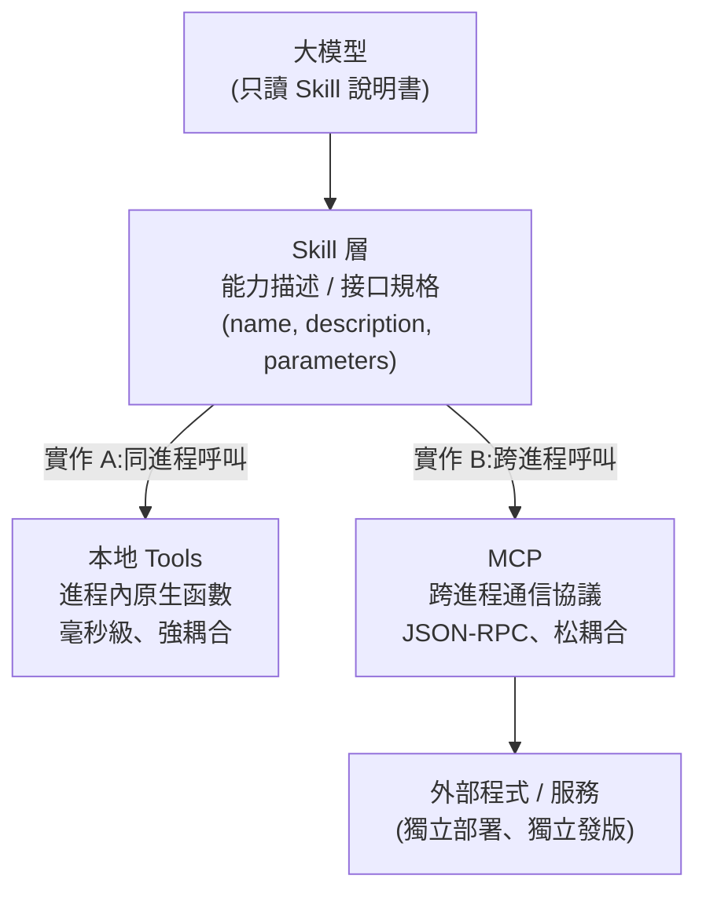
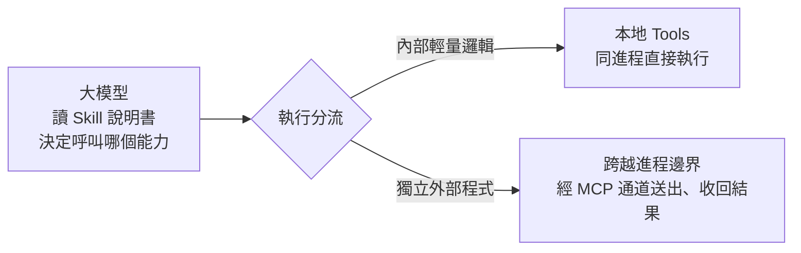
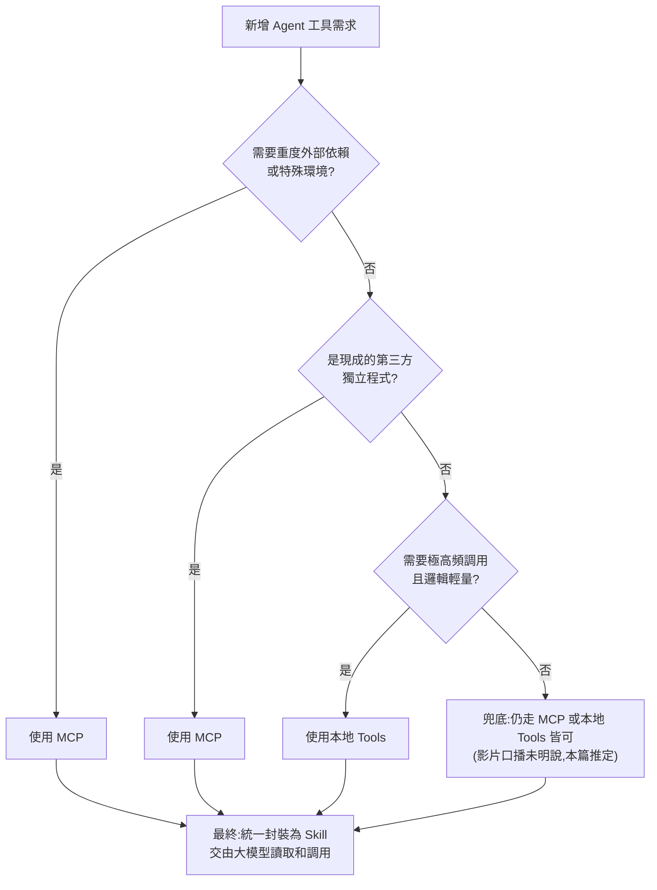

# MCP、Skill、本地 Tools 到底有什麼區別:三層分工與選型決策樹

> 整理自 YouTube 頻道 **白白说大模型**〈[別再搞混了！MCP、Skill、本地 Tools 到底有什麼區別？](https://www.youtube.com/watch?v=nuEYDFfDnOI)〉(2026-11-04,約 14.5 分鐘)。影片副標「拒絕死記概念,一節課講透 Agent 怎麼正確選工具」,主張三者**不是新舊替代,而是分層分工**,並給出一棵選型決策樹。
>
> ⚠️ **非官方字幕說明:** 該片無字幕,逐字稿以 CPU 版 faster-whisper(small,zh)轉錄取得,同音字誤差多(例如「tooth」「Scale」「大模形」)。本篇已以**影片畫面投影片**(0:05、0:40、5:30、8:20、8:50、11:00、11:57、13:00 共 8 張截圖)校正專有名詞與架構圖;數字與論點以一手來源(MCP 規格、Anthropic 官方文章)另行核實,結果見文末「核實與修正」。

## 一句話總結

**本地 Tools 管「在進程內快速把活幹完」、Skill 管「給大模型看的能力說明書」、MCP 管「跨進程接外部能力的標準插座」。** 三者不在同一層,不是非此即彼;選型時先問「這個能力需不需要跨進程」,再問「要不要統一包成 Skill 給模型用」。

這張圖是本文對影片架構的**重新畫法**:影片投影片 2.2 的 Skill 畫面,正是「LLM → Skill(JSON 規格)→ Implementation A(Local)/ Implementation B(MCP)」的結構。

---

## 1. 認知破局:為什麼「非黑即白」是錯的

影片開場把問題點得很直接:現在很多人寫 Agent,**明明本地一毫秒能算完的邏輯,非要包一個外部協議**,結果系統變慢。兩種極端最常見:

- **極端 A:全盤 MCP 化。** 每個小工具都做成 MCP 服務,一次簡單工具呼叫要在網路裡繞好幾圈,序列化、解析超時的錯誤滿天飛。
- **極端 B:全部塞進主程式。** 把很重的第三方函式庫、需要特定編譯環境的演算法都塞進 Agent,結果依賴衝突、一次記憶體溢出就把整個服務帶崩。

影片的判斷:**三者解決的根本不是同一個維度的問題**,就像不能問手機螢幕和充電線誰能替代誰。

## 2. 概念拆解:三者各自負責什麼

### 2.1 本地 Tools:在 Agent 內部最快地把活幹完

- **定位:** 直接寫在主程式碼裡的原生函數,和主服務跑在**同一個進程**、吃同一份記憶體。
- **典型場景(影片舉例):** 敏感詞過濾、把時間戳轉成年月日、驗證某個格式。幾十行程式,CPU 在記憶體內直接呼叫,幾微秒就跑完,**零上下文切換、沒有網路損耗**。
- **代價:** **強耦合**。工具程式碼與 Agent 主流程綁在一起,改一條政策規則也要改主工程、觸發整套發版流水線、重新打包、重啟服務。第三方用其他語言寫的成熟程式,也只能硬著頭皮重寫。

### 2.2 Skill:大模型眼中的「能力說明書」

- **定位:** **元數據規格 / 接口描述**。大模型不關心底下程式怎麼跑,它只讀這份描述,然後比對「哪一份能力最符合使用者需求」。
- **比喻:** 餐廳的**菜單**——寫明這道菜叫什麼、要加什麼調料、吃完會上什麼;廚房是用自家瓦斯還是隔壁飯館端來的,點菜的人不管。
- **投影片的寫法(影片 2.2):** 一段 JSON,包含 `name`(如 `search_data`)、`description`、`parameters`(如 `query: string`、`max_results: integer`)、`returns`。這個規格下面可以接 **Implementation A(Local)** 或 **Implementation B(MCP)**。
- **價值:** **完全解耦**大模型與底層工程實作——業務初期用本地函數跑,量大了改成遠端 MCP 服務,**Skill 描述與提示詞完全不用動**,模型甚至不知道後端換了。
- **執行成本:** 本身沒有執行延遲,因為它只是描述。

### 2.3 MCP:跨進程的標準插座

- **定位:** **通信協議**,本身不含任何業務演算法。它定義「組程式與外部獨立程式之間,請求該用什麼格式發、回包怎麼收」。
- **適用:** 音視頻轉碼要裝一整套複雜底層環境、或要接別人寫好的資料庫稽核服務——把它獨立部署成服務,再用 MCP 對話。既用上別人的能力,又不讓第三方依賴污染主環境。
- **代價:** 每次呼叫都要經過 **序列化 → 通道傳輸 → 反序列化 → 執行 → 再序列化回傳**,鏈路一長延遲必然上升;只要涉及網路或跨進程,就必須額外寫超時與熔斷機制,環境抖動時失敗風險比直接呼叫函數高得多,排查也更頭疼。

## 3. 三者對照表(影片投影片 8:50)

| 面向 | 本地 Tools | Skill | MCP |
|---|---|---|---|
| 定位與本質 | 進程內原生函數 | 元數據規範 / 接口 | 跨進程通信協議 |
| 延遲 / 執行速度 | 毫秒級,極低 | 無(僅為描述) | 較高(受網路 / IPC 影響) |
| 耦合度 | 強耦合(需改本體程式) | 完全解耦(大模型與底層) | 松耦合(獨立部署) |
| 核心價值 | 超高頻輕量執行 | 統一能力辨識標準 | 安全接入外部生態 |

> 投影片寫「毫秒級」,口播有時說「微秒」,二者不一致。影片**未給出任何量測數據**,本篇不採用具體數字(見「核實與修正」)。

## 4. 本片的核心論點:先分層,再選型

影片把三者放進一條**由內而外的呼叫鏈**:

影片給的三個比喻(值得記住,面試或評審時好用):

- **本地 Tools = 內臟器官**:提供最核心、最迅速的機體反應,保證運轉速度與性能底線。
- **Skill = 名片與說明書**:告訴大腦自己會什麼本領,讓大腦快速做決策,而不用關心底層怎麼跑。
- **MCP = 標準通用插座**:讓 Agent 隨時隨地安全接入整個外部生態的能力。

回答三者比較時,影片建議從四個角度講:**延遲、耦合、核心價值,以及它在分層中的位置**。

## 5. 選型決策:何時用本地 Tools、何時用 MCP

### 5.1 必須用本地 Tools 的情況

影片列了四個特徵:**邏輯輕量、不需要奇怪的外部環境、呼叫頻率極高、寫好後半年基本不改**。例子:字串拼接截取、業務狀態的簡單查詢、基礎數學計算。結論是「老老實實用原生本地函數最高效」,別為了顯得架構高級而套 MCP 外殼。

### 5.2 必須引入 MCP 的四個判定條件

投影片 4.2「必須引入 MCP 的四大核心決策條件」:

1. **環境隔離與依賴衝突**:需要極重或小眾依賴(如複雜的 C++ 編譯環境、特定 GPU 加速庫),硬塞進主程式會打架。
2. **三方生態複用**:已有成熟的第三方獨立程式或開源專案,改寫成本極高。
3. **獨立發布與生命週期管理**:工具需高頻獨立迭代、熱更新、彈性啟停,不能影響主服務。
4. **權限管控與系統容災**:需要沙箱隔離高危操作,確保外部工具異常當機時主進程仍平穩運行。

只要命中其中一條,就應該考慮 MCP。

### 5.3 完整決策樹(影片投影片 11:57)

> 注意:投影片本身的決策樹在「第三條否」之後直接連到「最終:統一封裝為 Skill」,沒有明確寫出第三條否的分支結果。上圖的「兜底」節點是本篇為了讓流程完整而補的**推定**,不是影片原文。

影片的關鍵提醒:**不論底層選了本地 Tools 還是 MCP,最頂層都統一包一層規整的 Skill**,交給大模型去讀取和呼叫。

### 5.4 反模式:通信風暴

影片特別警告一種危險反模式,稱為**通信風暴**:有些團隊為了追求架構前沿,把提取一個郵件地址、數一下字串長度這種微小功能,全部各自起一個微服務、全走 MCP 協議。結果是一次任務裡主服務要和幾十個微服務疯狂握手,排查時得在分散式鏈路追蹤日誌裡翻個底朝天,網路稍有抖動就整片爆錯超時。

健康的分層應該是:**面向大模型的那一層全部統一規範;簡單內置邏輯安心沉澱在本地;真正重依賴、需要隔離的才放到獨立微服務端。**

---

## 6. 應用案例

以下案例中,第 1 點是影片的舉例;第 2–4 點是**本文依影片框架的情境化示例**,並非影片原文。

1. **影片範例:資料檢索由本地遷移到遠端。** 業務初期,「資料檢索」Skill 底下先接一個本地快速函數;資料量暴增、需要搬到獨立機群時,把實作換成遠端 MCP 服務即可。Skill 的 `name` / `description` / 參數不變,提示詞不用改,大模型無感。

2. **情境示例:客服 Agent 的工具選型。** 需求拆成三個能力:
   - 「依訂單編號查狀態」→ 公司已有成熟的 Postgres MCP server,**三方生態複用**條件命中 → 用 MCP。
   - 「計算優惠券折扣」→ 純算術、每秒被呼叫很多次、邏輯輕量 → **本地 Tools**。
   - 「辨識使用者上傳的發票圖片」→ 需要 CUDA 與特定 OCR 模型,**環境隔離與依賴衝突**條件命中 → 獨立部署成 MCP 服務。
   - 三者最終都包成 Skill 描述,讓模型只看到統一的能力清單。

3. **情境示例:反模式的修正。** 某團隊把「抽出訂單備註中的電話號碼」「統計備註字數」各做成一個 MCP 服務。依影片建議,這兩個純字串操作應合併回本地 Tools,只把真正需要隔離的 OCR 服務留在 MCP。修正後每次任務的跨進程呼叫次數明顯下降,排查也只剩一條跨進程路徑。

4. **情境示例:新工具需求的評審問答。** 產品經理說「我們要接一個 PDF 轉 Markdown 的工具」。依決策樹:先問需不需要重度環境(PDF 解析常依賴大量系統套件 → 是)→ 直接 MCP;若只是把字串正規化,則走本地 Tools。評審時能說出「選 MCP 是因為依賴隔離,代價是多一次序列化與超時處理」,就是影片說的「說得出得到什麼、必須犧牲什麼」。

## 7. 本文與既有筆記的分工

- 與 [[function-calling-mcp-cli-tool-evolution]](白白說另一支影片,ReAct → Function Calling → MCP → CLI)互補:該篇講**演化史與 CLI 第三條路**,本篇講**同一時期的分層與選型**。
- 與 [[function-calling-mcp-a2a]] 不同軸:那篇的第三圈是 Agent 之間的 A2A,本篇不涉及。
- 與 [[building-claude-skills]] 的「Skill」是**不同概念**:見下文「名詞衝突」。
- MCP 的最新協議變動見 [[mcp-2026-07-28-stateless-rewrite]];MCP 上線後的工程坑見 [[mcp-server-first-build-four-pitfalls]]。

## 8. 延伸閱讀與深度補充(2026-11-07 核實增補)

### 8.1 名詞衝突:影片的「Skill」≠ Anthropic 的 Agent Skills

這是讀影片時最需要先釐清的一點。

- **影片的 Skill**:投影片上是一段 JSON 能力規格(`name` / `description` / `parameters` / `returns`),可由本地或 MCP 實作。概念上接近「工具定義 / 接口規格」。
- **Anthropic 的 Agent Skills**:一個目錄,裡面有 `SKILL.md`,開頭是 YAML frontmatter(必填 `name`、`description`)。啟動時把所有已安裝 skill 的 name / description 放進系統提示;模型判定相關才讀完整 `SKILL.md`;其引用的檔案與腳本**只在需要時**才載入。

依 Anthropic 官方工程文章的描述,Skills 是**三層漸進式揭露**(metadata → SKILL.md 本文 → 附屬檔案與腳本),並且被定位為 MCP 的**補充**而非替代:文章寫明將探索 Skills 如何補充 MCP server,讓 agent 處理「涉及外部工具與軟體的更複雜工作流程」。來源:[Equipping agents for the real world with Agent Skills](https://www.anthropic.com/engineering/equipping-agents-for-the-real-world-with-agent-skills)。

> 因此讀者若拿影片的「Skill 是說明書」去對 Claude 的 SKILL.md,會把兩個概念混在一起。影片的分層框架可以借用,但術語要區分。

### 8.2 MCP 的傳輸層:不等於「必然遠端」

影片把 MCP 描述為「跨進程、獨立服務」,這在規格上**只對一半**。MCP 規格(2025-06-18)定義兩種標準傳輸:

- **stdio**:客戶端把 MCP server **以子進程啟動**,透過 stdin / stdout 交換以換行分隔的 JSON-RPC 訊息(訊息本身不可含換行);規格並寫明「客戶端應盡可能支援 stdio」。
- **Streamable HTTP**:server 作為獨立進程,用 HTTP POST / GET 加可選的 SSE 串流;規格要求驗證 `Origin` 標頭以防 DNS rebinding,本地執行時應只綁定 127.0.0.1。

來源:[MCP Specification 2025-06-18 · Transports](https://modelcontextprotocol.io/specification/2025-06-18/basic/transports)。

**補充判讀:** 本地 stdio 型 MCP server 與主程式**仍是兩個進程**,所以隔離性與序列化成本存在;但它**不必走網路**。影片的決策樹把「獨立部署的遠端服務」與「本地子進程 MCP」混在同一個 MCP 分支,實務上選 stdio 還是 HTTP,會直接影響延遲與部署方式。

### 8.3 影片未談、但更常見的成本:工具定義吃掉上下文

影片的 MCP 成本只講延遲與序列化。Anthropic 工程團隊另一篇文章指出,更容易爆的其實是**上下文 token**:多數 MCP 客戶端會把所有工具定義預先載入上下文,接上大量工具時,agent 在讀到請求前就要處理數十萬 token;中間結果也會經模型來回傳遞(文中以 2 小時會議逐字稿為例,約多耗 5 萬 token)。文章的建議包括:把 MCP server 呈現為程式碼 API、用**漸進式揭露**只載入需要的工具定義,或用 `search_tools` 之類的搜尋工具按需取得描述;文中報告一個案例從 **150,000 token 降到 2,000 token**(文章稱節省 98.7%)。同時文章也提醒:執行模型產生的程式碼需要安全沙箱、資源限制與監控,這些都是額外的工程負擔。

來源:[Code execution with MCP](https://www.anthropic.com/engineering/code-execution-with-mcp)。

**與影片的關係:** 影片的決策樹以「延遲與耦合」為主軸;若工具數量多,**上下文成本**可能比單次延遲更先成為瓶頸,決策樹應再加一個判準:「同時掛的工具數與定義長度是否會擠壓上下文」。這是本篇的補充推定,影片未提及。

### 8.4 關於「微秒 vs 毫秒」與具體延遲數字

影片的延遲數字(本地「幾微秒」、「毫秒級」、MCP「較高」)**沒有附量測條件**。MCP 規格本身只定義協議、不承諾效能;本次查證未找到可靠的官方跨進程延遲基準。因此本篇**不引用具體倍數**。若要在設計文件中寫延遲預算,建議自己在目標環境量測:本地函數呼叫、stdio 子進程、HTTP 遠端三種路徑各跑一組同樣的小請求。

## 9. 核實與修正

| 項目 | 狀態 | 說明 |
|---|---|---|
| 投影片標題與三者定位(本地 Tools / Skill / MCP) | 已核實(畫面) | 0:05 封面、2.2 Skill、3.3 MCP、對照表 8:50 |
| 「tooth」「Scale」「SQL」「本地兔子」 | 需修正 | 逐字稿同音誤聽,依投影片應為「本地 Tools」「Skill」 |
| 「大模形」「大模行」「組程序」「進城」「解偶」「延持」「核新價」 | 需修正 | 依畫面與語境修為「大模型」「主程式」「進程」「解耦」「延遲」「核心價值」 |
| 「全線隔離和融災」 | 需修正 | 投影片 4「權限管控與系統容災」 |
| 「決策術」 | 需修正 | 投影片為「Agent 工具選型架構決策樹」 |
| 「通信風暴」 | 已核實(畫面口播一致) | 作者提出的工程反模式,屬觀點,未附量測 |
| MCP 的 stdio / Streamable HTTP 兩種傳輸 | 已核實 | 見 8.2,來源為 MCP 規格 2025-06-18 |
| MCP 每次呼叫需序列化與反序列化 | 已核實(定性) | JSON-RPC over stdio / HTTP,規格已定義 |
| 「Skill 是元數據規格、無執行延遲」 | 已核實(定性) | 與 Anthropic Agent Skills 的 SKILL.md 機制不同,見 8.1 |
| Anthropic Skills 是 MCP 的補充而非替代 | 已核實 | 見 8.1 來源 |
| 150,000 → 2,000 token(98.7%) | 已核實(來源原文) | 見 8.3,出自 Anthropic 工程文章;為該文個案數字,不代表一般情況 |
| 本地 Tools「微秒級」、MCP「較高」之具體數字 | 未能核實 | 無可靠量測來源,見 8.4 |
| 決策樹第三條「否」的分支 | 未能核實(投影片未寫) | 本篇補「兜底」為推定 |
| 「先中後清先外後內」的排序口播 | 未能核實 | 逐字稿無法確定原意;決策樹實際順序是先判斷外部依賴 |

## 10. 應用案例小結

- **選型第一問:** 這個能力需不需要跨進程?需要就評估 MCP,並先算好序列化與超時成本。
- **選型第二問:** 它是不是高頻、輕量、不需要環境隔離?是就用本地 Tools,別套 MCP 外殼。
- **無論選哪條路,** 最頂層都包一層 Skill 描述,讓模型只看統一的能力清單;並留意不要把微小功能各自做成微服務(通信風暴)。
- **名詞要分清:** 影片的 Skill 是能力規格,Claude 的 Agent Skills 是「SKILL.md 目錄 + 漸進式揭露」;兩者不要混用。

---

## 來源

- 白白说大模型,〈[別再搞混了！MCP、Skill、本地 Tools 到底有什麼區別？](https://www.youtube.com/watch?v=nuEYDFfDnOI)〉,YouTube,2026-11-04,約 14.5 分鐘。**該片無字幕,逐字稿以 CPU 版 faster-whisper 轉錄取得,非官方字幕**;投影片畫面已逐張讀取校對。
- [Equipping agents for the real world with Agent Skills](https://www.anthropic.com/engineering/equipping-agents-for-the-real-world-with-agent-skills)(Anthropic 工程文章,讀取於 2026-11-07;文章發布日期未能從原文核實)
- [Code execution with MCP](https://www.anthropic.com/engineering/code-execution-with-mcp)(Anthropic 工程文章,讀取於 2026-11-07)
- [MCP Specification 2025-06-18 · Transports](https://modelcontextprotocol.io/specification/2025-06-18/basic/transports)(讀取於 2026-11-07)
