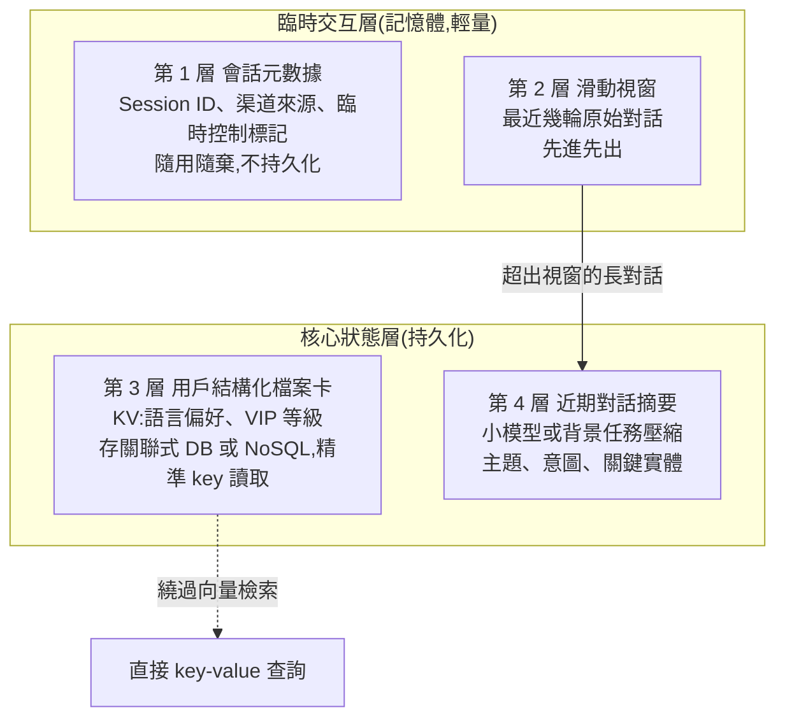
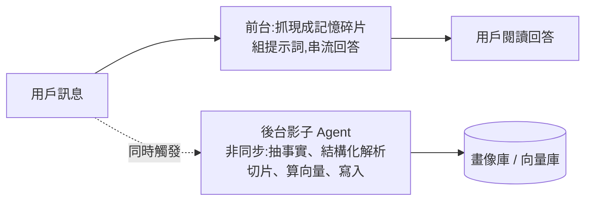

# Agent 長期記憶分層設計:別把一切丟進向量庫(四層記憶 + LVP + 雙時間戳 / 三層記憶 + 影子 Agent)

> 整理自 YouTube 頻道 **白白说大模型** 兩支主題相近的影片,合併成一篇:
> ① 〈為什麼「向量資料庫+RAG」治不好大模型 Agent 的「老年痴呆」?〉(2026-08-14,約 14.7 分鐘)——四層記憶、LVP、雙時間戳、程序性記憶;
> ② 〈長期 Agent 怎麼記住關鍵事?記住事實、模糊召回與動態更新的完整工程方案〉(2026-10-21,約 14.3 分鐘)——三層記憶、動態拼裝提示詞、影子 Agent、衝突清洗。
>
> ⚠️ 兩片都是**工程方法論**,沒有引用論文或官方文件;文中的「核實」一節標明哪些是業界通用概念、哪些是作者主張。
> ⚠️ 兩片都以面試題 / 履歷加分為包裝,片中**無業配或課程推銷**。
> 📎 相關:[[agent-memory-eight-strategies-window-to-memoryos]]、[[agent-memory-survey-forms-functions-dynamics]]、[[mem0-memory-architecture-teardown]]、[[memharness-memory-reconstructed-not-replayed]]、[[markdown-agent-memory]]、[[agent-project-resume-enterprise-grade]]

---

## 一句話總結

> **長期記憶的難點不是「怎麼存」,是「怎麼扔、怎麼找」。**
> 把「必須 100% 精準的事實」「模糊的情境」「短期對話」「歷史狀態」「可重用的經驗」分開放在不同儲存媒介,各用最適合的讀寫方式;再用「只追加的帳本 + 策略層 + 派生視圖」處理隱私與審計,用「雙時間戳」處理新舊事實衝突。

---

## 一、兩堵牆:為什麼「全塞進 prompt」與「全丟向量庫」都會崩

| 做法 | 問題 |
|---|---|
| 把全部歷史塞進 context | 每輪都重新計費,聊到上百輪帳單暴增;且資訊密度被稀釋,模型反而忽略最新那句(lost in the middle) |
| 一律做成向量丟進向量庫 | **語意相似 ≠ 精準匹配**(下一節);**向量庫沒有時間觀念**(再下一節) |

### 盲區 1:語意相似度不能代表強一致性的精準匹配

影片用「取件碼」比喻:快遞取件碼錯一位就拿不到包裹。納稅人識別號、設備序號、身分證號、優惠券代碼都屬於這類——**錯一個字元整個業務流就崩**。向量檢索卻可能覺得「稅號 A 和稅號 B 看起來差不多」而撈出相近 ID,等於用模糊匹配解決精確問題。

### 盲區 2:時間維度——「住杭州」與「住成都」同時被撈出

T1 用戶說「下個月搬去杭州」,T2 說「改去成都了」,兩條都被寫進向量庫。查「現在住哪」時兩句語意高度相似,**同時被召回塞給模型**,模型分不清哪個是現在進行時,要嘛亂猜、要嘛用過期資訊決策。第二支影片用「北京→上海」講同一件事,並稱之為「人格分裂」。

---

## 二、方案 A:四層記憶(影片①)

重點:

- **第 3 層完全繞過向量檢索**,用 key-value 精準讀,「從物理層面杜絕向量匹配的噪聲」。
- **第 4 層不存原文**,存壓縮後的摘要,既保留長期語意走向,又壓低 token 成本。
- 設計三維度:**讀寫策略**(依資料易變性分流)、**狀態管理**(分清過去完成時與現在進行時)、**經驗復用**(把零散對話固化成標準操作流程)。

---

## 三、方案 B:三層記憶(影片②),與四層的對照

| 層 | 內容 | 格式 | 容錯率 | 讀法 |
|---|---|---|---|---|
| 短期記憶 | 最近幾輪原始對話 | 滑動視窗 | — | 原樣餵給模型,解決語氣承接與代詞指代(「它的底盤調校呢?」的「它」) |
| 實體畫像記憶 | 身分、偏好、禁忌 | 結構化鍵值 / 卡片 | **零** | 精準 key 查詢 |
| 長期情景記憶 | 情緒、經歷、故事 | 切片後的向量 | 可模糊 | 向量相似度「模糊聯想召回」 |

對應關係:B 的「短期」≈ A 的第 2 層;「實體畫像」≈ A 的第 3 層;「長期情景」是 A 沒有明講的向量層(A 的第 4 層是摘要)。兩者結論一致:**不要再糾結「用向量庫還是關聯式資料庫」——各司其職**。

### 關鍵例子:花生過敏不能放進向量庫

用戶第 1 輪說「我是嚴格素食者,且對堅果嚴重過敏」。若只存成向量,哪天檢索漏掉或分數稍低沒召回,AI 就可能推薦含堅果的菜——**這是安全問題**。正確做法:背景程式抽成 `{飲食偏好: 純素, 健康禁忌: 堅果過敏}` 這種結構化資料,第 1000 輪也 100% 讀得到。

### 動態拼裝提示詞(像樂高)

四個模組合成一份運行時上下文:**系統提示詞(人設與規則)→ 第二層畫像資料 → 第三層動態撈出的情景切片 → 第一層滑動視窗原樣貼最下面**。第 100 輪被問「幫我規劃下週末聚餐」時,模型能回:「考慮到你對堅果過敏,避開網紅堅果甜品店;記得你上次提過創業壓力大,去吃清淡的日料?」——前半來自畫像插槽、後半來自情景向量召回。

---

## 四、工程落地的四個機制

### 1. 影子 Agent:前台快出、後台慢寫(影片②)

同步做「抽取結構化實體、切塊、呼叫 embedding、寫向量庫」會讓 TTFT(首字延遲)拉到數秒甚至十幾秒。解法:

比喻:像人睡覺時大腦整理白天的記憶。**前台只負責快出,後台負責沉澱**。

### 2. LVP:Ledger / Policy / Views 三件套(影片①)

> 轉錄原文為「LVP 工程股價」「Lager」「Wills 視圖」,依上下文還原為 **Ledger(帳本)/ Policy(策略)/ Views(視圖)**;「股價」為「框架/架構」的同音誤聽。

| 元件 | 角色 | 重點 |
|---|---|---|
| **L = Ledger 不可變帳本** | 用戶每句輸入、工具呼叫、動作,都以事件單向追加 | **只增不改**,永不覆蓋,任何決策可回溯 |
| **P = Policy 控制策略** | 像「攔截網」:定義什麼場景能寫、什麼規則能讀、遇隱私資料怎麼攔 | 在帳本與模型之間 |
| **V = Views 任務派生視圖** | 專供大模型讀取的狀態卡片 | 依當前任務從帳本動態提取、聚合 |

**隱私合規情境**:用戶要求注銷帳號、擦除剛輸入的機密或銀行卡號。傳統做法硬改底層帳本,成本高又破壞審計完整性。LVP 做法:**帳本不動、只給最高權限的安全審計系統看;Policy 在生成 View 時自動脫敏,把敏感欄位換成「已遮蔽」標記**——Agent 拿到的上下文安全合規,審計鏈完好。

### 3. 雙時間戳:解決「杭州 vs 成都」(影片①)

每條事實記錄貼兩個標籤:

- **系統時間(交易時間 transaction time)**:寫入資料庫的絕對時刻,只增不改,對應 created_at。
- **業務時間(有效時間 valid time)**:這條事實在真實世界成立的區間 `[valid_from, valid_to)`。

流程(影片原話三步):
1. **舊狀態封存**:收到「搬去成都」時不刪「住杭州」,而是把它的 `valid_to` 改為搬遷發生的那一刻。
2. **新狀態開啟**:新增「住成都」,`valid_from` = 當下。
3. **查詢**:查詢器自動帶「當前時間」過濾,只命中有效區間包含現在的那條。杭州記錄仍在庫裡(可審計),但不會被撈出。

### 4. 動態更新:矛盾識別 + 遺忘衰減(影片②)

「記憶不能是一坛死水」。後台引擎要:**增量寫入吸收 → 面對衝突時覆寫(北京改上海)→ 過時雜訊遺忘退火(幾個月前無意義的閒聊切片定期衰減)→ 再掛載回新互動**。影片②用的是「更新舊值」,影片①用的是「封存舊值並保留歷史」——**兩者可以並存**:畫像卡只要最新值,審計 / 回溯需求則用雙時間戳。

---

## 五、程序性記憶:讓 Agent 越用越聰明(影片①)

比喻:學開車。新手每個動作都要推理(該踩離合嗎?),熟練後變成肌肉記憶。

做法:Agent 首次解決高頻複雜任務(如排查自動扣費異常、處理複雜退票規則)時,**系統悄悄擷取成功的決策軌跡與工具呼叫鏈,優化提煉後封裝成可復用的 skill**。下次遇到同類任務,直接載入固化流程、跳過昂貴的推理,省 token 且更穩定。

📎 這與 [[building-claude-skills]]、[[agent-skill-three-layer-run-do-verify]] 的「skill = 程序性知識」同一個概念,差別在這裡強調的是**自動從成功軌跡沉澱**,而非人工撰寫。

---

## 六、三條底層法則(影片②總結)與四步路徑(影片①總結)

**影片②的三條法則**
1. **分層存儲,各司其職**:短期視窗保鮮、實體卡片保真、向量切片保全,物理上獨立,避免互相污染。
2. **精準檢索,動靜分離**:強事實走結構化 key-value(毫秒級、100% 命中);模糊情境才走向量相似度。「該精確的務必精確,該模糊的再交給機率。」
3. **動態更新,保持潔淨**:增量寫入、衝突覆寫、遺忘退火、動態掛載形成循環。

**影片①的建置路徑**:明確痛點(別迷信向量庫)→ 四層防線分流 → 動態骨架(LVP + 雙時間戳)→ 最後才做程序性記憶的自我進化。

---

## 七、應用案例

**案例 1:電商客服 Agent**
- 第 3 層(畫像卡):會員等級、收貨地址、慣用語言 → KV 精準讀。
- 訂單號、優惠券碼:**絕不走向量檢索**,查訂單 DB。
- 第 4 層(摘要):上週的退貨糾紛壓成「主題=退貨、意圖=要求補償、實體=訂單 #…」。
- 搬家改地址:舊地址 `valid_to` 封存,新地址開啟;客服查詢自動只取當前有效地址。

**案例 2:長期陪伴型生活管家**
- 過敏、宗教飲食禁忌放畫像卡(容錯率為零);創業壓力、失戀心情切片進向量庫做模糊召回。
- 回應延遲靠影子 Agent:使用者看回答的同時,後台抽取新事實。

**案例 3:金融 / 醫療合規場景**
- 用 Ledger 完整保留所有事件作審計;Policy 對身分證號、卡號脫敏;被要求刪除個資時,改變的是 View 的輸出規則與權限,不是物理刪帳本(實際法規如何要求,需另依當地法律,影片未涉及)。

---

## 八、核實與評語

### 業界通用概念(可信,但本文未逐一查證原始文件)
- **雙時間(bitemporal)模型**:valid time 與 transaction time 是時態資料庫的標準概念(SQL:2011 也有時態表支援),屬通用資料庫知識,非影片獨創。
- **Event sourcing / append-only ledger** 作為審計底座、**滑動視窗、摘要壓縮、KV 畫像 + 向量混合**,均為常見做法。
- 「lost in the middle」現象在文獻中有記載(見 [[is-graphrag-needed-rag-variants-comparison]] §4 對 lost-in-the-middle 的處理)。

### 作者主張 / 未驗證
- **LVP 並非業界標準術語**(未查到公認出處,推定為作者自行歸納的名稱);其概念上類似 event sourcing + CQRS(帳本 = 事件流、視圖 = 讀模型),但「Policy」層作為記憶讀寫與脫敏的閘道,是作者的設計包裝。**未能核實**是否來自某個開源專案。
- 「年薪 30 萬 vs 60 萬的分水嶺」、「90% 跑不下去的 Agent 項目死於記憶太好」:**行銷性修辭,無數據**。
- 「token 費用呈指數上升」:嚴格說,全量重送歷史的**累計成本約隨輪數平方成長**(每輪成本線性增長),並非指數;影片用語偏誇張。(本文判斷)

### 缺口(影片略過)
- 如何**判斷**新舊事實衝突(實體對齊、哪個屬性是單值、哪個可多值)沒講;「住北京」改「住上海」容易,但「喜歡咖啡」vs「最近戒咖啡」要不要覆蓋?
- 影子 Agent 寫入失敗或與下一輪對話競態(下一輪已開始但上一輪畫像尚未寫完)的處理沒講。
- 遺忘機制的具體衰減函數 / 重要性評分沒講。

---

## 來源

- 〈为什么“向量数据库+RAG”治不好大模型Agent的“老年痴呆”?〉— 白白说大模型,2026-08-14:<https://www.youtube.com/watch?v=XQXMSc0L5DA>
- 〈长期Agent怎么记住关键事?记住事实、模糊召回与动态更新的完整工程方案〉— 白白说大模型,2026-10-21:<https://www.youtube.com/watch?v=ydxlle8MNu4>

> 兩片均無官方字幕,逐字稿以 CPU 版 Whisper 轉錄,可能有同音字誤差。已還原的誤聽:「相量庫 / 項量庫」→向量庫、「RG」→RAG、「記忌 / 記忍」→記憶、「數損 / 數捷」→資料、「教驗」→校驗、「Lager」→Ledger、「Wills」→Views、「股價」→架構、「炒剁寻真」→「大海撈針 / 中間迷失」現象(推定為 lost in the middle;逐字稿現版找不到原詞,使用者聽原片未確認)、「TTFT」為首字延遲。
