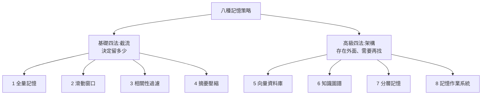

# Agent 記憶實作八種策略:從全量記憶、滑動窗口到 MemoryOS

> 整理自 YouTube 頻道 **白白说大模型**〈[Agent记忆实现方案详解:一期讲透8种Memory策略,从窗口到MemoryOS](https://www.youtube.com/watch?v=msrADZcUS60)〉(2026-10-29,約 12 分鐘)。
>
> 該片無字幕,**逐字稿以 CPU faster-whisper 轉錄、非官方字幕**,專有名詞已還原(見末節)。
>
> 立場:說明欄只有「配套教程籽料」與公眾號領取引流,無付費內容可轉述;本筆記只依影片講述整理。影片是入門概念梳理,**沒有實測數據**。
>
> 相關:記憶的形態與功能見 [[agent-memory-survey-forms-functions-dynamics]];向量檢索的實際流程見 [[rag-from-scratch-buffett-clone-gary]]。

---

## 一句話總結

> **大模型本身無狀態,所有「記憶」都得靠把過去的資訊在對的時間、以對的格式重新塞回 context。** 八種做法分兩組:前四種是「截流」(控制留多少),後四種是「架構」(把記憶存在外面、需要再找回來)。成熟系統是**疊加**,不是互相取代。記憶工程的本質不是儲存工程,而是**上下文工程**。

---

## 一、先建立底層認知

- 模型每次推論只看得到這一次輸入的 context,沒有隱藏狀態或意識流;「模型 + 上下文」才構成一次對話裡的記憶。
- 所以記憶方案要解決的是同一件事:**什麼值得記(Memory)、什麼可以忘(Forget)、什麼時候找回(Retrieve)、怎麼用更少 token 表達更多(Compress)。**
- 常見誤解:「接個向量資料庫就好」。真正搭長期記憶後才發現:哪些對話該留、哪些該忘、何時翻舊記憶、context 爆了怎麼辦——**核心不在存多少,在管不管得好**。

---

## 二、基礎四法:截流

| # | 策略 | 做法 | 優點 | 代價 | 適合 |
|---|---|---|---|---|---|
| 1 | **全量記憶** | 原封不動保留全部對話,每次整段送給模型 | 無遺忘、無資訊損失 | 對話越長 token 與成本越高,最終撞上 context 上限 | 短對話、一次性問答 |
| 2 | **滑動窗口** | 只保留最近 N 輪 | 長度可控、成本穩、實作簡單 | **只認時間先後,不管內容重不重要** | 線上客服、即時問答 |
| 3 | **相關性過濾** | 依相關性、重要性、與當前任務的匹配度給每條記憶打分,決定去留 | 把「時間驅動的遺忘」變成「價值驅動的遺忘」 | 一旦誤刪關鍵資訊,Agent 會**不知不覺失憶,表面一切正常、難以發現** | 任務導向、資訊雜訊多 |
| 4 | **摘要壓縮** | 讓模型把長對話做成摘要,再進下一輪 context | 幾萬 token 壓成幾千 | 壓縮必然損失資訊,省得越多細節丟得越多 | 長對話、成本敏感 |

重點:1、2 是在「資訊完整度 vs 成本」之間取捨;3、4 把「留多久」變成「值不值得留」。**四者共同上限:資訊一旦滑出視窗、被過濾或被摘要壓沒,就再也找不回來。**

---

## 三、高級四法:架構

### 5. 向量資料庫

流程:內容經 embedding 存入向量庫 → 需要時語意檢索取 Top-K → 塞回 context。最大改變是**不再把全部歷史塞進上下文,而是需要什麼找什麼**。

影片的澄清:向量庫解決的是**長期記憶的存取方式**,不是記憶本身;接入後要調的細節(embedding 準不準、怎麼切塊、Top-K 取多少、取回的完整性、相關性有沒有跑偏)**工作量往往比接入本身大得多**。

### 6. 知識圖譜

動機:向量相似度不擅長表達複雜邏輯關係。做法:對話進來 → 抽取實體與關係 → 存圖資料庫 → 查詢與推理 → 交給模型。例:「張三是專案負責人;專案 A 屬於公司 B;公司 B 的客戶是李四」這種鏈式關係,單靠文字相似度很難精準表達。

優勢:從文字語意相似升級成**實體與關係網路**的查詢。局限:建置複雜、實體關係抽取成本高、動態維護難(資料一變圖就要跟著動)。

### 7. 分層記憶

類比人類:工作記憶(當前處理的事)+ 長期記憶。設計:**短期用滑動窗口、長期用向量庫或知識圖譜,按需組合再送進 context**。細分可到四層:工作記憶、情景記憶、語意記憶、長期記憶。核心:**按資訊的性質分層存放,而不是單純按時間堆放**。

### 8. 記憶作業系統(MemoryOS 類)

記憶管理從資料庫問題變成**資源調度問題**。類比電腦:

| 電腦 | Agent |
|---|---|
| RAM | context window(當前活躍記憶) |
| Disk | 長期記憶庫(持久化) |
| 作業系統(換入換出) | Memory Manager |

Agent 要自己判斷「此刻哪些記憶該放進工作區」。影片提到之前的 MemGPT 就是把這個想法系統化。

---

## 四、怎麼選:五個 Level

| Level | Agent 類型 | 組合 |
|---|---|---|
| 1 | 簡單 Chatbot | 全量記憶或滑動窗口 |
| 2 | 長對話 Agent | 滑動窗口 + 摘要壓縮,控制 context 長度 |
| 3 | 知識型 Agent | 短期窗口 + 向量庫,具備長期記憶 |
| 4 | 複雜企業級 Agent | 短期記憶、摘要、向量庫、知識圖譜全用上,並做分層管理 |
| 5 | 長期運行 Agent | 加 Memory Manager:寫入、召回、壓縮、淘汰、換入換出、優先級排序整套調度 |

選型隨業務複雜度**逐級疊加**,不可能一步到位。

---

## 五、應用案例

### 案例 1:客服機器人該選哪一級

線上客服每通對話短、周期短 → Level 1–2:**滑動窗口 + 摘要**就夠,別一開始就上向量庫與圖譜。

### 案例 2:企業內部知識助理

員工問「去年報銷政策怎麼改?」→ Level 3:向量庫存制度文件,語意檢索 Top-K。上線後把時間花在**切塊大小、Top-K、檢索是否跑偏**的調校(參考 [[rag-from-scratch-buffett-clone-gary]] 的 R、A、G 排查順序)。

### 案例 3:專案管理 Agent 的關係查詢

「張三負責哪些客戶相關專案?」這類多跳關係 → 知識圖譜補向量庫的短板;資料常變就要規劃圖的更新機制,否則舊關係會誤導推理。

### 案例 4:自己檢查「相關性過濾」有沒有悄悄失憶

過濾後記憶的缺失不會報錯。做法:準備 10 個必須記得的事實(使用者偏好、已承諾事項),定期對 Agent 抽問;答不出就檢查過濾打分規則。

---

## 六、核實與補充

**✅ 已核實(論文原始頁):**

- MemGPT:〈MemGPT: Towards LLMs as Operating Systems〉(arXiv 2310.08560,2023-10 提交),提出以作業系統式的階層記憶做「虛擬上下文管理」,讓 LLM 看似擁有超出 context window 的記憶。
- MemoryOS:〈Memory OS of AI Agent〉(arXiv 2506.06326,2025-05-30 提交),以作業系統記憶管理為靈感,分短期、中期、長期三層,並有層間更新機制;程式碼在 BAI-LAB/MemoryOS。

**⭐ 影片沒講、值得補的:**

- 八種方案是**教學上的整理分類**,不是業界公認標準;實務上多為組合。
- 影片沒給任何效果或成本數字;各策略何時值得、命中率與延遲,要自己用評測集量。
- 本庫已有幾個實際記憶系統可對照:[[mem0-memory-architecture-teardown]]、[[supermemory-memory-layer]]、[[memharness-memory-reconstructed-not-replayed]]。

**⚠️ 保留:** 影片把 MemoryOS 稱作「記憶作業系統」類別的代表,具體機制(影片未展開)以論文為準;「面試高頻考點」為講者說法。

---

## 字幕還原

「Asian / AZEN / A者」→ Agent;「大母親」→ 大模型;「上下紋 / 上加文」→ 上下文;「香料數據庫 / 相當數據庫 / 下落數據庫」→ 向量資料庫;「知識土埔 / 知識圖符」→ 知識圖譜;「Inventing」→ embedding;「LAY OS / Leaos」→ 記憶作業系統(MemoryOS);「MEMGDP」→ MemGPT;「電腦的 RM」→ RAM;「內操的系統」→ 作業系統;「權量記忍」→ 全量記憶;「撤離」→ 失憶(推定);「選行」→ 選型。

---

## 相關筆記

- [[agent-memory-survey-forms-functions-dynamics]]:記憶的形態、功能與動態(論文綜述)。
- [[mem0-memory-architecture-teardown]]、[[supermemory-memory-layer]]:實際記憶層產品拆解。
- [[rag-from-scratch-buffett-clone-gary]]:向量檢索的完整流程。
- [[grep-vs-vector-agentic-search]]:不一定要向量庫,agent 也可 grep。

---

## 來源

- YouTube:白白说大模型〈Agent记忆实现方案详解:一期讲透8种Memory策略,从窗口到MemoryOS〉 https://www.youtube.com/watch?v=msrADZcUS60 (2026-10-29;無字幕,逐字稿以 CPU faster-whisper 轉錄、非官方字幕)
- MemGPT 論文: https://arxiv.org/abs/2310.08560
- Memory OS of AI Agent 論文: https://arxiv.org/abs/2506.06326
