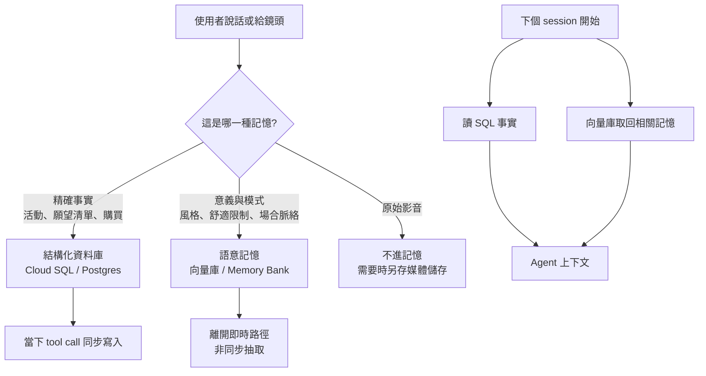

# Agent 長期記憶怎麼分:事實進 SQL、理解進向量庫、原始影音不進記憶(Google Cloud Tech)

> 來源影片:[AI Agent Memory Architecture: Structured SQL, Semantic Vector Search & Memory Bank](https://www.youtube.com/watch?v=8C4bh59FtsI)(Google Cloud Tech,2026-10-28,12 分 26 秒,講者 Annie)。
> ⚠️ **廠商內容:** Google Cloud 官方頻道,示範產品是 Google 自家的 Agent Platform Memory Bank(舊稱 Vertex AI Agent Engine Memory Bank)、Cloud SQL、AlloyDB。影片自己也說「架構不綁產品」,我把產品細節與通用設計分開寫。
> 逐字稿:影片無字幕(僅有自動字幕被 429 擋住),以 `whisper_transcribe.py`(large-v3-turbo)轉錄,非官方字幕;下文時間點皆來自帶時間逐字稿。**我沒有截圖核對畫面**(這集以講解與開場示範為主),專有名詞以說明欄、官方文件與示範 repo 對照。

## 1. 一句話

長期記憶先問「這是哪一種記憶」,不要一股腦倒進同一個資料庫:

| 種類 | 例子 | 該放哪 | 怎麼取 | 何時寫 |
|---|---|---|---|---|
| 事實(facts) | 週四有晚宴、買了藍外套、願望清單 | 結構化資料庫(SQL) | 查詢,要**精確**的那一列 | 發生當下立刻寫(tool call) |
| 理解(understanding) | 偏好簡單不浮誇、怕熱、想有自信時穿深色 | 向量庫 / 語意記憶 | 以語意**回想**,可以是相近的 | 累積足夠訊號後,離開即時路徑非同步抽取 |
| 原始感知 | 攝影機畫面、音訊波形 | 通常**不進記憶**;要留另放(重播、稽核、除錯、訓練資料) | — | — |

影片的三個重點([10:26 起](https://youtu.be/8C4bh59FtsI?t=616)):session 開始時**兩邊都讀**;事實**一發生就寫**;理解**等有足夠脈絡、知道什麼值得記**才寫。

## 2. 影片逐點重述

1. **短期記憶像 RAM**:session 內有用,結束就沒了([1:09](https://youtu.be/8C4bh59FtsI?t=59),原話 "it is like RAM")。真正的設計問題不是「能不能全存」,而是「什麼值得帶進下一次」。
2. **事實是精確的、理解是意義**([1:25 起](https://youtu.be/8C4bh59FtsI?t=75)):事實有 ID、日期,可新增修改刪除;理解是「從行為學到的關於你的模式」。「知道你的行事曆」跟「知道你」是兩回事。
3. **兩者不要放同一處**([2:33 起](https://youtu.be/8C4bh59FtsI?t=143)):問「週四行程是什麼」不要「相似的記憶」,要那一筆。資料庫該回傳真正的列。
4. **理解放向量庫,但向量庫只是類別**([3:12 起](https://youtu.be/8C4bh59FtsI?t=182)):可用 pgvector、AlloyDB,在 Google Cloud 上的託管選項是 Memory Bank。差別:純向量庫要自己寫抽取邏輯,Memory Bank 幫你從過去 session 抽、並隨時間更新。
5. **常見錯誤:什麼都塞向量庫**([4:28 起](https://youtu.be/8C4bh59FtsI?t=258)):相似度適合模糊問題,但答案必須精確時很危險。「我買過什麼」應該查資料庫,「我晚宴通常喜歡什麼」才用語意記憶。
6. **原始感知不等於記憶**([5:23 起](https://youtu.be/8C4bh59FtsI?t=313)):不必永遠記每個像素或波形,要記的是抽出的意義,例如「她又戴那頂黑帽子」「使用者說這場晚宴很正式」。
7. **開場讀取**([6:35 起](https://youtu.be/8C4bh59FtsI?t=385)):session 開始先從資料庫讀結構化事實(近期場合、願望清單、個人資料),再向量庫搜相關理解(風格偏好、舒適限制、常用色),所以 agent 不是從零開始。
8. **寫入分兩軌**([7:39 起](https://youtu.be/8C4bh59FtsI?t=449) 事實、[8:02 起](https://youtu.be/8C4bh59FtsI?t=472) 理解):「把這件西裝外套加進願望清單」→ 立刻寫 DB;「我今天也許喜歡黃色」不等於整個風格變黃,理解要有較強訊號(使用者解釋原因、跨 session 重複)才寫。
9. **抽取時機與延遲**([8:42 起](https://youtu.be/8C4bh59FtsI?t=512)、[9:36 起](https://youtu.be/8C4bh59FtsI?t=566)):Memory Bank 支援在 session 中途觸發生成;提早抽取的好處是短對話產生較乾淨的記憶、使用者提早離開也已保存。但抽取要模型讀對話、推論意義,比寫 DB 慢,即時語音 agent 不能被它卡住。規則不是「等 session 結束」,而是「**抽取要離開熱路徑**」,在 turn 後或 session 後非同步跑。示範裡:事實同步寫、理解 session 後非同步抽成語意記憶([9:53 起](https://youtu.be/8C4bh59FtsI?t=583))。

## 3. 延伸:官方文件核實(影片沒細講的 Memory Bank)

以下我讀了 Google 官方文件內文([Generate memories](https://docs.cloud.google.com/gemini-enterprise-agent-platform/scale/memory-bank/generate-memories)、[Fetch memories](https://docs.cloud.google.com/gemini-enterprise-agent-platform/scale/memory-bank/fetch-memories)、[Memory Bank overview](https://docs.cloud.google.com/agent-builder/agent-engine/memory-bank/overview))。

### 3.1 「從對話抽出要記的」實際怎麼運作 ✅已核實

- **兩段式:先抽取(extraction)再整併(consolidation)。** 抽取只保留「符合你設定的 memory topic 至少一項」的資訊(文件原話:Only information that matches at least one of your instance's memory topics will be persisted)。
- **整併** 把新抽到的內容拿去跟**同 scope** 的既有記憶比,檢查是否重複或矛盾。每筆結果有動作:`CREATED`(新概念)、`UPDATED`(既有記憶涵蓋類似概念,內容可能改或不變)、`DELETED`(既有記憶被新資訊推翻而刪除)。預設只比對每筆記憶的**最新一版**,可用 `revisions_per_candidate_count` 增加比對歷史;也可 `disable_consolidation` 只抽不併。
- 這正好回答影片「理解要有判斷、不要被一句話洗掉」的問題:整併階段負責去重與解決矛盾,但**怎樣才算「強訊號」仍取決於你設的 topic 描述與模型**,文件沒有給「出現幾次才算」的門檻。
- **Topics:** 託管 topic 預設有 `USER_PERSONAL_INFO`、`USER_PREFERENCES`、`KEY_CONVERSATION_DETAILS`、`EXPLICIT_INSTRUCTIONS`;自訂 topic 要給 label 與 description,官方建議再附 few-shot 範例。每次請求可用 `allowed_topics` 限縮。
- **Scope:** 一個 dict(例如 `{"user_id": "123"}`),只有 scope 完全相同的記憶才會互相整併;用 Sessions 當來源時預設為 `{"user_id": session.user_id}`。建立後 scope 不能改。
- **多模態:** 生成時只使用文字、inline 檔案與 file data;**function call 與 response 會被忽略**。→ 我的推論:tool 寫進 SQL 的結果不會被 Memory Bank 當來源(但也代表它看不到 tool 結果);文件沒直接談這個設計。
- 文件**沒有**寫每次請求事件數上限(未能核實有無限制)。

### 3.2 觸發時機:影片說的「中途抽取」對應哪個 API ✅已核實

| API | 行為 |
|---|---|
| `GenerateMemories` | 立刻送資料並生成,可在 session 結尾或中途定時呼叫。是長時間運算,預設客戶端會阻塞輪詢直到完成;設 `wait_for_completion=False` 可背景執行。官方原話:正式環境的 agent 通常應把記憶生成放在背景非同步 |
| `IngestEvents` | 持續餵事件串流;Memory Bank 會緩衝,依事件量或時間觸發生成,預設在背景處理 |

→ 這就是影片講的「抽取離開熱路徑」的官方根據。

### 3.3 取回:精確範圍查詢 vs 相似度搜尋 ✅已核實

- `RetrieveMemories` 預設是**依 scope** 取回:只回傳 scope 完全相同的記憶。**不給相似度參數就回該 scope 的全部記憶**(分頁每頁最多 100 筆)。
- 相似度搜尋是同一個 API 的可選模式:拿查詢字串(例如最後一句使用者話)跟每筆記憶的 fact 比嵌入向量,**`top_k` 預設為 3**,依歐氏距離由近到遠排序並附 `distance`。
- 可用 `filter`(system fields:`create_time`、`update_time`、`fact`、`topics`)與 metadata `filter_groups`(OR of ANDs;**只適用於 scope 取回與清除,不適用相似度搜尋**)縮小範圍。`ListMemories` 不依 scope 過濾,官方說不適合低延遲取回。
- 啟示:**即使在 Memory Bank 這種「語意」記憶,取回方式也有「精確列舉全部」與「相似度前 k」兩種**,取捨跟 [[grep-vs-vector-agentic-search]] 談的一致:語料小時,全部載入(等同 inline)比 top-3 相似度更不會漏。

### 3.4 資安與合規(影片沒提) ✅已核實(僅 overview 頁)

支援 VPC Service Controls、CMEK、資料落地、HIPAA、Access Transparency、Access Approval;記憶生成使用生成式模型,ML 處理發生在其所用模型端點的區域內。CMEK 限制:部署在 Agent Runtime 的 agent 只支援單一區域端點(不支援 `us`/`eu` 多區域)。

## 4. 延伸:示範程式碼逐段讀(`cuppibla/fashionmind`)

說明欄的 `g.dev/ai/fashion-mind` 轉址到 [github.com/cuppibla/fashionmind](https://github.com/cuppibla/fashionmind)(Apache-2.0)。我 clone 下來(快照最後提交日 2026-04-21)讀了實作,以下是**實際程式碼**而非影片說法。

### 4.1 架構(讀自 `architecture.mmd`、`backend/`) ✅已核實

- 技術:Google ADK(`google-adk>=1.0.0`)、Gemini Live(預設 `gemini-live-2.5-flash-native-audio`)、FastAPI WebSocket、Cloud SQL(SQLAlchemy models:`User`、`Occasion`、`WishlistItem`、`PurchaseHistory`、`Product`)、Vertex AI Memory Bank。
- **事實軌:** `add_to_wishlist`、`mark_purchased`、`add_occasion` 是 ADK tool,agent 聽到就當回合寫入 SQL;`get_user_context` 每次 session 重查。
- **理解軌:** Memory Bank 設定在 `memory_bank_config.py`:兩個託管 topic(`USER_PREFERENCES`、`USER_PERSONAL_INFO`)+ **五個自訂 topic**:`style_identity`、`signature_items`、`comfort_constraints`、`event_context`、`visual_style_markers`,每個都寫了英文 description;生成模型 `gemini-2.5-flash`、嵌入模型 `gemini-embedding-001`(皆可由環境變數覆寫)。
- **對應影片:** 影片說的「風格偏好、怕熱、常戴黑帽子」就是這五個自訂 topic 的具體化。自訂 topic 的 description 就是你控制「什麼值得記」的地方。

### 4.2 開場讀取:作者踩到 top_k=3 的坑 ✅已核實(程式碼註解)

`main.py` 的 `_prefetch_memory` 註解寫:ADK 的 `memory_service.search_memory()` 預設 `top_k=3` 且不開放調整,所以他們**直接呼叫 Vertex AI API,省略 `similarity_search_params` 取回該使用者全部記憶**,再組成文字塞進 `startup_context`(system prompt 的 Runtime Context)。這與 §3.3 文件一致。`architecture.mmd` 標註這步約 1500 ms(作者自己標的數字,我沒實測)。

- 實務含義:**示範用的是「整包載入」而不是「依問題搜尋」**。影片說「搜向量庫找相關理解」,程式碼實作更接近「全部讀出來」。記憶量小時成立,記憶累積到數百上千筆就會膨脹 prompt,需要改回相似度搜尋或加 `filter`。
- prompt 明確規定:session 開頭資料已在 Runtime Context,**不要**呼叫 `get_user_context`(省工具往返延遲)。

### 4.3 寫入:實際比影片說的「session 後」更複雜 ✅已核實(讀碼),觸發頻率 ❓未驗證

- `agent.py` 註冊 `after_agent_callback=add_session_to_memory`:在背景 `asyncio.create_task` 呼叫 `memory_service.add_session_to_memory(session)`,失敗重試 3 次(間隔 1、2 秒),**不阻塞音訊**。
- `main.py` 在 WebSocket **斷線**時,把逐字轉寫(transcript turns)合成 `Event` 塞進 session 再存一次(註解說明原因:live 音訊 session 的事件不含文字,需補寫)。
- 我**沒有**實際執行這個 repo(需 GCP 專案與 Gemini Live),所以「callback 在 live 模式是否每回合觸發、重複存會不會重複消耗生成」是**未能核實**。文件上 `GenerateMemories` 以 Sessions 為來源時,不給時間範圍就會納入全部事件,整併階段負責去重。
- 設計取捨(程式註解):session 用 `InMemorySessionService` 而不是 `VertexAiSessionService`,因為後者每個音訊事件都 `append_event`,會加 Vertex 往返延遲並導致 OAuth 重新整理失敗。**也就是說「即時語音要避免任何雲端往返在熱路徑」是作者實際踩過的限制,不只是原則。**

## 5. 評論:影片對的、省略的、要小心的

**對且實用**
- 「事實精確、理解近似」這條分界線,是實作 agent 記憶最容易踩雷的點。把活動日期、訂單塞進純向量庫,檢索到「相似但錯的那筆」的風險是真的(精確查詢與語意檢索的取捨,見 [[grep-vs-vector-agentic-search]])。
- 「抽取離開熱路徑」有官方 API 支撐(§3.2)與作者踩坑佐證(§4.3)。

**影片沒講、你要補的**
1. **兩邊矛盾時誰贏?** 事實庫寫「已買藍外套」,語意記憶說「想買藍外套」,影片沒給衝突規則。Memory Bank 整併只在自己的 scope 內處理矛盾;跨 SQL 與向量庫的一致性要自己設計(例如事實變更時用事件通知語意庫、讀取時以 SQL 為準)。
2. **記憶污染與隱私。** 「理解」是模型推論出的個人側寫(體質、情緒、自信),比事實更敏感。需要使用者可檢視、可刪除的介面;文件有 CMEK/IAM Conditions,但「推論出的敏感屬性」是否該存,屬於產品決策。
3. **取回成本隨量增加。** 見 §4.2:整包載入不可無限擴張。
4. **「沒有向量庫也能做」。** 小規模時,理解記憶其實可以用 Markdown 檔加 grep(見 [[markdown-agent-memory]]、[[mem0-memory-architecture-teardown]]、[[supermemory-memory-layer]] 的不同路線);影片的二分法(SQL vs 向量)只是常見做法,不是唯一解。

## 6. 應用案例

- **客服 agent:** 訂單、退貨期限、方案等級放 SQL(精確),使用者「不喜歡電話聯絡、偏好簡短回覆」放語意記憶;通話錄音放物件儲存做稽核,不進記憶。
- **公司內部知識庫(Team KB):** 對應到我們的設計,「claim 的 id、適用範圍、有效期」是結構化事實,「同義說法/別名」屬於讓語意相近的詞也能被找到。換言之把精確欄位放可查詢結構、把模糊問法交給別名與檢索層,是同一個原則。
- **個人助理:** 行事曆與待辦(事實,同步寫)、「我喜歡早上開會、不喜歡被追問細節」(理解,累積後抽取)。

## 7. 核實狀態總表

| 項目 | 狀態 | 依據 |
|---|---|---|
| 影片主張(事實/理解/原始感知三分、兩軌讀寫) | 已逐段對逐字稿 | 帶時間逐字稿 |
| Memory Bank 抽取+整併(CREATED/UPDATED/DELETED) | ✅ 已核實 | 官方 Generate memories 全文 |
| `GenerateMemories` 背景執行、`IngestEvents` | ✅ 已核實 | 同上 |
| `RetrieveMemories` 預設 top_k=3、省略參數回全部、每頁 100 | ✅ 已核實 | 官方 Fetch memories 全文 |
| 示範 repo topic 與模型設定、top_k 繞法、背景儲存重試 | ✅ 已核實 | clone 讀碼 |
| 延遲約 1500 ms | ❓ 作者標註,未實測 | `architecture.mmd` |
| callback 在 live 模式的實際觸發頻率與重複消耗 | ❓ 未能核實 | 未執行 repo |
| Memory Bank 計價、GA/預覽狀態、單次事件數上限、配額 | ❓ 未能核實 | 所讀頁面未載明 |
| ADK `search_memory` 的 top_k=3 不可調 | ⚠️ 僅引用 repo 註解 | 未讀 ADK 原始碼 |
| 前一集示範影片(t8sAL_LQRtk)、影片末段延伸內容 | 未讀 | — |
| 畫面中的圖/投影片 | 未截圖核對 | — |

## 8. 字幕還原(Whisper 辨識疑點)

| 原字幕 | 推定 | 依據 |
|---|---|---|
| ClubSQL / Club SQL | Cloud SQL | 說明欄與官方名稱 |
| structure memory | structured memory | 上下文 |
| curate the database | query the database | 上下文(5:03) |
| roles(資料庫的) | rows | 上下文(3:01) |
| the code open works | the cold open works(指開場示範) | 上下文(7:23) |
| 等 both memory systems | load both memory systems | 上下文(10:27) |

## 來源

- 影片:[Google Cloud Tech — AI Agent Memory Architecture](https://www.youtube.com/watch?v=8C4bh59FtsI)(逐字稿由 CPU 版 Whisper large-v3-turbo 轉錄,非官方字幕)
- 示範程式:[cuppibla/fashionmind](https://github.com/cuppibla/fashionmind)(Apache-2.0,clone 讀碼後已刪)
- 官方文件:[Memory Bank overview](https://docs.cloud.google.com/agent-builder/agent-engine/memory-bank/overview)、[Generate memories](https://docs.cloud.google.com/gemini-enterprise-agent-platform/scale/memory-bank/generate-memories)、[Fetch memories](https://docs.cloud.google.com/gemini-enterprise-agent-platform/scale/memory-bank/fetch-memories)
