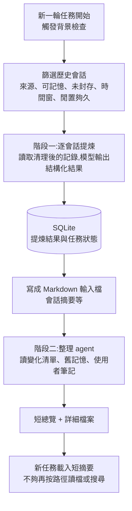

# Codex 本地跨會話記憶:兩階段流水線、v1 與 v2 差異(01Coder 影片 + 原始碼核實)

> 來源影片:01Coder(小木頭)〈彻底搞懂智能体记忆:Codex Memory 底层架构与设计全拆解〉,2026-11-11 上傳,長度 24:09。
> 影片連結:https://youtu.be/fNDRs-gEX0E
> 字幕:YouTube 自動字幕 `zh`(真人語音辨識,非機器翻譯),帶時間。
> 標示:說明欄有頻道會員、知識星球等自家推廣連結,**無第三方業配**。影片以自建測試專案「松果更新台」示範,本地實驗用 Codex CLI 0.161.0,**實跑 v2,v1 只用原始碼講**。
> 核實方式:把 `openai/codex` 固定在影片指定的 commit `25f4940d4affcf8c60f96ffec5e3752e1f590b8a`(說明欄提供),讀 `codex-rs/memories/`、`codex-rs/ext/memories/`、`codex-rs/config/src/types.rs`,下面標「已核實/需修正/未能核實」。
> 範圍:只講 Codex 本地跨會話記憶,不含 ChatGPT 網頁版記憶。

## 一句話結論

Codex 的記憶不是「把舊對話丟進去」。它是兩階段背景流水線:**第一階段逐個歷史會話提煉**(存 SQLite),**第二階段跨會話整理成 Markdown 檔**;新任務只先讀一份上限約 2,500 tokens 的短摘要,不夠再查檔。記憶可能漏、可能錯,需要硬規則的事要寫進 `AGENTS.md`。

## 1. 為什麼聊天已存了還要生成記憶

影片 [1:39](https://youtu.be/fNDRs-gEX0E?t=89) 起區分三種東西:

| 機制 | 做什麼 | 服務誰 |
|---|---|---|
| 會話歷史 | 完整保存目標、失敗嘗試、工具結果、使用者糾正 | 之後「繼續同一個對話」 |
| 上下文壓縮(compaction) | 對話太長時壓縮 | 當前任務繼續走 |
| 跨會話記憶 | 從舊會話提煉有用資訊 | 之後的**新**任務 |

## 2. 整體流程

## 3. 何時開始、哪些會話被選中

影片 [3:48](https://youtu.be/fNDRs-gEX0E?t=218) 把兩件事分開看:

- **啟動事件**決定「什麼時候檢查」:有輸入的新一輪任務(turn)成功開始。
- **篩選條件**決定「誰被選中」:來源允許、允許生成記憶、未封存、更新時間在窗內、**已閒置夠久**、搶到處理權;[4:38](https://youtu.be/fNDRs-gEX0E?t=268) 起說當前會話不納入候選。
- 功能開關、資料庫可用、剩餘額度、單次處理數量也會影響。

**原始碼核實(`config/src/types.rs`)——影片沒給的預設值:**

| 設定 | 預設 | 說明 |
|---|---|---|
| `min_rollout_idle_hours` | 6 | 註解寫「> 12h recommended」 |
| `max_rollout_age_days` | 10 | 只看近 10 天的會話 |
| `max_rollouts_per_startup` | 2(範圍 1–128) | 每次啟動最多處理幾個 |
| `min_rate_limit_remaining_percent` | 25 | Codex 額度剩餘不足就不跑 |
| `max_raw_memories_for_consolidation` | 256(範圍 1–4096) | 階段二最多吃幾份 |
| `max_unused_days` | 30 | 超過 30 天沒被用到的記憶不入階段二 |
| `generate_memories` / `use_memories` | true / true | 生成與讀取各一個開關 |
| `dedicated_tools` | false | 專用記憶工具預設關閉 |

> 已核實(預設值)。⚠️ `MemoriesToml` 註解寫「Fresh profiles default to v2 … existing v1 profiles default to v1」,但 `Default` 實作的 `version` 是 `V1`,實際落在哪一版取決於載入邏輯,**我沒追到載入端,未能核實**;以自己安裝版本為準。

## 4. 階段一:模型看得到會話的哪些內容

影片 [5:19](https://youtu.be/fNDRs-gEX0E?t=309) 起:

- 排除 developer 角色訊息與模型內部推理記錄;AGENTS、skill 說明有清理規則;使用者訊息裡程式附加的上下文依標記處理。
- 單條普通 JSONL 記錄超過 1 MB 可整條跳過([5:57](https://youtu.be/fNDRs-gEX0E?t=347));原文仍在會話檔,只是這次提煉看不到。所以**長文字可能沒進模型**。
- 保留 user / assistant / tool 來源,模型才分得出「需求、建議、已確認的進度」([6:32](https://youtu.be/fNDRs-gEX0E?t=382))。
- 輸出用 JSON Schema 限制欄位;格式可程式檢查,**內容準不準仍靠模型**([7:06](https://youtu.be/fNDRs-gEX0E?t=416))。

**原始碼核實(`memories/write/src/`):**

- 單條記錄上限 `MAX_RECORD_BYTES = 1024 * 1024` ✅ 與影片一致。
- 影片沒提:整份會話讀取另有 `MAX_ROLLOUT_BYTES = 8 MiB`、每列 `MAX_ROW_BYTES = 10,000`、工具輸出 `TOOL_OUTPUT_TOKENS = 2_000`。這些是常數,我只確認存在,未逐行追語意。
- 影片沒提:階段一輸入佔模型有效輸入窗的 `CONTEXT_WINDOW_PERCENT = 70`,模型資訊缺時退回 `DEFAULT_ROLLOUT_TOKEN_LIMIT = 150_000`。
- 影片沒提:**送進模型前與模型輸出後都會 `redact_secrets`**(`phase1.rs`、`phase1_output.rs`),所以密鑰會先被遮蔽。
- 階段一推理強度 `Low`,階段二 `Medium`;階段一並行上限 8。

## 5. 為什麼中間要有 SQLite

影片 [7:25](https://youtu.be/fNDRs-gEX0E?t=435) 起:SQLite 管「結果與狀態」(誰處理、失敗怎麼重試、處理到哪次更新),Markdown 管「給整理 agent 讀與搜尋」。

並行協調:搶任務用**租約(lease)**,認領與提交用短資料庫操作,模型長呼叫期間靠狀態與有效期協調,提交時再確認仍有權限([8:29](https://youtu.be/fNDRs-gEX0E?t=499));同一會話之後有新內容,會因更新時間不同而重新提煉。

> 已核實:`JOB_LEASE_SECONDS = 3_600`、`JOB_RETRY_DELAY_SECONDS = 3_600`、階段二心跳 `JOB_HEARTBEAT_SECONDS = 90`;README 載明失敗任務有 retry backoff,結果分 `succeeded` / `succeeded_no_output` / `failed`。

## 6. v1 與 v2 差在哪

| | v1 | v2 |
|---|---|---|
| 階段一輸出 | 會話摘要、短名、**供整理的記憶內容(raw_memory)** | 會話摘要、短名 |
| 取向 | 整理出**可複用知識** | 保存**準確任務歷史**並指路 |
| 階段二產物 | 短總覽、詳細知識手冊、按需 skills | 一份短總覽(含任務入口與檔案路徑) |
| 記憶目錄 | `memories` | `memories_v2` |

- v1 階段一提示要求只留「有依據、值得複用」的內容(偏好、驗證過的方法、關鍵路徑、失敗經驗),沒有就可回空([9:31](https://youtu.be/fNDRs-gEX0E?t=561)–[10:13](https://youtu.be/fNDRs-gEX0E?t=603))。
- v1 階段二維護三類:短總覽、知識手冊、按需 skills([11:23](https://youtu.be/fNDRs-gEX0E?t=673))。
- v2 先依來源類別分配有限輸入空間,選完再恢復原順序([12:50](https://youtu.be/fNDRs-gEX0E?t=760));提示要求準確記「誰說了什麼」、區分「已做」與「仍在討論的提議」([13:14](https://youtu.be/fNDRs-gEX0E?t=784))。

> 已核實:`phase1_output.rs` 有 `raw_memory`、`rollout_summary`、`rollout_slug` 三欄(v1)與 v2 只用後兩欄的分支;`consolidation.md` 提到 `MEMORY.md`、`memory_summary.md`、`skills/<skill-name>/`(v1);v2 `consolidation_v2.md` 目標是 `memory_summary.md`,且寫明追蹤每個結論狀態為 proposed / completed / superseded / uncertain、不得發明偏好。
> v2 的 `stage_one_system_v2.md` 有一句關鍵:使用者說「改之前先給我看計畫」,只能寫成「使用者要求先看計畫」,**不能**寫成「使用者偏好先看計畫」。這正是影片「範圍不被放大」示範的來源。

## 7. 階段二:為什麼還要跨會話整理

影片 [15:27](https://youtu.be/fNDRs-gEX0E?t=917)–[16:30](https://youtu.be/fNDRs-gEX0E?t=980):任務有新進展、使用者會糾正、多次會話可能為同一結論補依據。程式先同步輸入檔,和**上次成功整理**的檔案比對,把新增、修改、刪除寫成變化清單(diff);整理 agent 先讀 diff,再按需讀摘要、舊記憶、筆記。檔案沒變且格式合規就**跳過模型整理**。

**重要限制**([16:39](https://youtu.be/fNDRs-gEX0E?t=989)):整理 agent 禁止打開原始 JSONL rollout。階段一漏掉的資訊,階段二沒有自動回原文補的路。

**原始碼核實(`write/README.md`、`phase2.rs`):**
- 整理只在「搶到全域唯一的階段二鎖」後進行;記憶根目錄用 git 當基準(`~/.codex/memories/.git`),diff 寫成 `phase2_workspace_diff.md`,上限 `MAX_BYTES = 4 MiB`。
- 子 agent **無核准、無網路、僅本地寫入**,且關閉 collab 避免遞迴委派;成功後重設 git 基準,diff 檔先刪掉,不留舊內容。
- 階段二挑選記憶的排序:先看 `usage_count`,再看最近 `last_usage` / `generated_at`;沒被用過者以產生時間代替。這代表**常被讀到的記憶更容易留下**,影片未提。
- 「禁開原始 rollout」在 v2 提示(`consolidation_v2.md`)已核實;**v1 `consolidation.md` 我搜不到同樣字句,未能核實 v1 是否有此禁令**,影片說「兩個版本都有」這點先打折扣。

## 8. 新任務怎麼讀記憶

- 開關(`use_memories`)開、摘要檔存在且非空,就讀選定版本的短摘要加使用提示([17:25](https://youtu.be/fNDRs-gEX0E?t=1035))。
- 短摘要上限約 2,500 tokens([17:51](https://youtu.be/fNDRs-gEX0E?t=1061));其他說明與後續讀取內容另計。
- 已開始的對話,新檔何時進來,要看何時重新載入上下文([18:05](https://youtu.be/fNDRs-gEX0E?t=1075))。
- 讀取順序:摘要夠用就直接用 → 需要原話、先後順序、更多證據才讀對應任務摘要 → 不知道讀哪個才搜尋([14:52](https://youtu.be/fNDRs-gEX0E?t=882))。
- 簡單改寫就直接做;對舊記憶裡「成功過的指令」,要再核對當前檔案、設定與依賴([19:22](https://youtu.be/fNDRs-gEX0E?t=1152))。

> 已核實:`ext/memories/src/lib.rs` 定義 `MEMORY_TOOL_DEVELOPER_INSTRUCTIONS_SUMMARY_TOKEN_LIMIT = 2_500`,`prompts.rs` 以 `truncate_text` 截斷 `memory_summary.md`;v1/v2 各有自己的讀取模板(`read_path.md` / `read_path_v2.md`)。

### 範圍被保住的示範

[18:49](https://youtu.be/fNDRs-gEX0E?t=1119) 起,同一段舊對話有兩類要求:「三部分格式」適用該專案之後所有發布說明;「先給計畫」只適用那次討論。實驗中摘要保留了這個區別,專案格式也沒被寫成全域使用者偏好。影片強調:這是一次明確表達範圍的結果,**每次提煉仍可能出錯**([19:18](https://youtu.be/fNDRs-gEX0E?t=1148))。

## 9. 怎麼糾正舊記憶

影片 [19:52](https://youtu.be/fNDRs-gEX0E?t=1182) 起:使用者說「記住這個 / 之前記錯了 / 忘掉那個」,模型把變更範圍與依據寫成**筆記**,下次整理時 agent 結合舊記憶與筆記更新(示範把格式由三部分改為四部分),原始聊天仍單獨保存。

專用工具路徑:`add_ad_hoc_note`,兩個參數 `filename`、`note`([20:12](https://youtu.be/fNDRs-gEX0E?t=1202))。

> 已核實:`ext/memories/src/tools/mod.rs` 註冊四個工具 `add_ad_hoc_note`、`list`、`read`、`search`;`dedicated_tools` 預設 `false`。提示另提供「用檔案操作追加筆記」的路徑,走哪條視會話設定。影片說「四個專用工具」「預設關閉」皆吻合。

## 10. 版本切換與設定

影片 [21:02](https://youtu.be/fNDRs-gEX0E?t=1252):

| 設定 | 生成 | 讀取 |
|---|---|---|
| v1,`dual_write` 關 | v1 | v1 |
| v1,`dual_write` 開 | v1 + v2 | v1 |
| v2 | v2 | v2 |

> 已核實:`MemoriesToml` 註解「Generate both versions while v1 is selected; v2 runs alone after cutover」與表格一致。

記憶目錄是空的先查:功能有沒有開、會話有沒有允許生成(`generate_memories`)、有沒有達到第 3 節的篩選條件(尤其**閒置 6 小時**與每次只處理 2 個)。桌面應用可由個人化設定與聊天中的 `memories` 指令控制,實際選項以安裝版本為準。

## 11. 額外消耗

影片 [21:54](https://youtu.be/fNDRs-gEX0E?t=1304) 把消耗分三塊:階段一讀會話並產摘要;階段二可能多次讀寫檔;當前任務放入短摘要與查到的詳情。降低消耗的機制:檔案沒變就跳過整理、額度不足暫緩、每次處理數量限制。

**影片自己的限制聲明**([22:33](https://youtu.be/fNDRs-gEX0E?t=1343)):本期**沒有測量**固定開銷增加多少,也沒測後續工作的淨收益,要在自己的場景評估。因此「記憶划不划算」這個問題,影片**沒有給答案**,本筆記也沒有。

> 補充:`min_rate_limit_remaining_percent` 預設 25,代表剩餘額度低於 25% 時背景記憶就不跑,這是原始碼裡直接保護額度的設計。

## 12. 影片說得準 vs 影片沒說

| 項目 | 結果 |
|---|---|
| 單條記錄超過 1 MB 可整條跳過 | ✅ 已核實 |
| 短摘要上限約 2,500 tokens | ✅ 已核實 |
| 租約概念 | ✅ 已核實(3,600 秒) |
| 階段一輸出三項(v1)/ 兩項(v2) | ✅ 已核實 |
| 四個專用工具、預設關閉 | ✅ 已核實 |
| 版本與 `dual_write` 組合 | ✅ 已核實 |
| 階段二禁開原始 rollout | v2 ✅;v1 **未能核實** |
| 啟動觸發點(新 turn 開始) | 未讀 `start.rs`,**未能核實**;`README` 寫「root session 開始時」,兩者描述不同 |
| 預設版本 | 註解與 `Default` 實作不一致,**未能核實** |
| 影片沒提 | 密鑰遮蔽、預設閒置 6 小時/年齡 10 天/每次 2 個/額度 25%、30 天未用淘汰、按使用次數排序、階段二子 agent 無網路 |

## 應用案例

1. **記憶目錄一直是空的**:先查 `generate_memories`,再想到預設每次啟動只處理 2 個、會話要閒置 6 小時以上。剛結束的對話當天本來就不會被提煉。
2. **舊記憶把個案寫成全域規則**:對 Codex 明說「哪一條、適用哪個專案」,讓它寫成筆記。不要只說「忘掉」。
3. **團隊必須遵守的規則**(例如發布說明格式、禁止動某目錄):寫進 `AGENTS.md` 或版本管理文件,不要依賴記憶。影片結尾 [23:19](https://youtu.be/fNDRs-gEX0E?t=1389) 也這樣建議。
4. **自己做 agent 記憶元件時的借鏡**:階段一與階段二分開、結果入資料庫、輸入檔與上次比 diff、租約防重複、整理者不碰原始記錄。對照 [[markdown-agent-memory]] 的純 Markdown 路線與 [[supermemory-memory-layer]] 的「好記憶要會忘」,Codex 這套用「30 天未用淘汰 + 使用次數排序」做遺忘。
5. **懷疑記憶有錯時的排查順序**:長文字是否超過 1 MB 被略過 → 階段一摘要有沒有漏 → 階段二是否因 diff 沒變而跳過 → 新任務是否只讀了被截斷的短摘要。

延伸對照:Claude 的做法見 [[claude-memory-dreaming-four-layers-gary]];Codex 作為開放 harness 見 [[codex-as-a-platform-open-agent-harness]]。

## 來源

- 01Coder〈彻底搞懂智能体记忆:Codex Memory 底层架构与设计全拆解〉:https://youtu.be/fNDRs-gEX0E (YouTube 自動字幕 `zh`,非官方人工字幕;時間點取自帶時間逐字稿,連結提前 10 秒)
- Codex 開源倉庫:https://github.com/openai/codex
- 影片指定的原始碼版本:https://github.com/openai/codex/tree/25f4940d4affcf8c60f96ffec5e3752e1f590b8a(本機 shallow fetch 該 commit,讀 `codex-rs/memories/README.md`、`codex-rs/memories/write/src/{lib,phase1,phase1_output,phase2,rollout_input}.rs`、`codex-rs/memories/write/templates/memories/{consolidation,consolidation_v2,stage_one_system_v2}.md`、`codex-rs/ext/memories/src/{lib,prompts}.rs`、`codex-rs/ext/memories/src/tools/mod.rs`、`codex-rs/config/src/types.rs`,讀完已不留副本)
- 影片的實驗專案「松果更新台」為作者為實驗構造,本筆記未獨立重跑。
