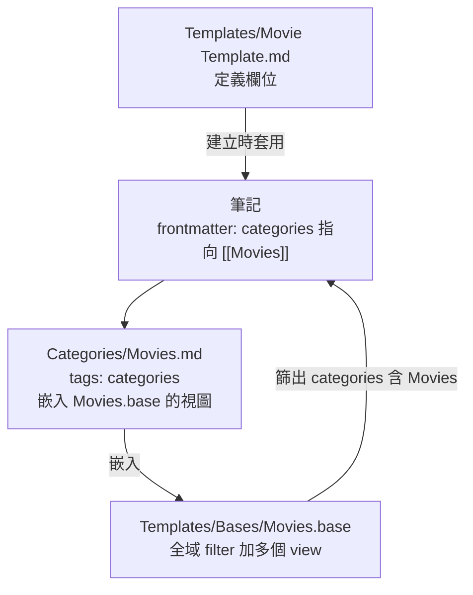

# kepano 的 Obsidian vault 格式(categories + Bases 三件套)與部門導入規劃草案

> 來源:使用者轉交另一個 Claude 對話的研究交接文件(Part 1 格式整理、Part 2 部門導入規劃)。
> 兩份原稿是 claude.ai artifact(需登入),我讀不到,**只依交接文內嵌的文字整理**;原稿連結列在來源。
> 核實:我另外讀了 stephango.com/vault 全文、`kepano/kepano-obsidian` 倉庫(2026-01-08 版 `4736973`)、Obsidian 官方授權部落格與 Sync 說明/FAQ。Part 1 逐條標「已核實/需修正/未能核實」。
> ⚠️ **Part 2 是提案,尚未定案**(交接文自己註明),我只核實其中的事實陳述,**沒有評估設計好壞**。

## 一句話結論

kepano 的做法是:**不用資料夾分主題,每則筆記靠 `categories` 屬性指向一個分類頁,再用 Bases 產生各種視圖**。每個分類需要三個檔案:範本、分類頁、`.base`。交接文的部門方案是把這套搬到團隊,但它在幾處和 kepano 原則、和本庫另一篇 Obsidian + Claude Code 筆記互相牴觸,**列在第 6 節,等使用者決定**。

## 1. 核心理念與 8 條個人規則

- File over app:vault 只是一個 `.md` 資料夾;由下而上、維護成本低。
- 找東西靠 Quick Switcher、反向連結、內文連結。
- kepano 自己的 8 條規則:不拆成多個 vault;不用資料夾做組織;不用非標準 Markdown;分類和標籤用複數;大量使用內部連結;日期用 `YYYY-MM-DD`;用 7 分評分;每週只留一個 to-do list。

> 已核實(stephango.com/vault)。倉庫 README 也自稱「in no way dogmatic, just one example」,意思是**拿你喜歡的部分,不必照單全收**。

## 2. 資料夾

| 位置 | 內容 | 命名 | 核實 |
|---|---|---|---|
| 根目錄 | 自己寫的:日記、文章、evergreen、會議、專案 | 自由;碎片想法 `YYYY-MM-DD HHmm 標題` | ✅ |
| References/ | 外部事物:書、電影、地點、人 | 精確標題 | ✅(文章列書、電影、地點、人;**Podcast 在倉庫有 `Podcasts.base`**,文章未列) |
| Clippings/ | 別人寫的文章 | 文章標題 | ✅ |
| Daily/ | 每日筆記 | `YYYY-MM-DD.md` | ✅ 命名;**「不在裡面寫字、只用來被連結」文章沒寫,未能核實** |
| Templates/(含 Bases/) | 範本、`.base` | `X Template.md` | ✅(倉庫 `Templates/Bases/*.base`) |
| Attachments/ | 圖片、PDF 等 | — | ✅ |
| Categories/ | 分類總覽頁 | 複數 | ✅ 且**只出現在可下載的 vault**,他自己的 vault 放根目錄 |

Attachments、Daily、Templates 在他的 vault 中**從檔案導覽隱藏**(文章)。

## 3. 三層架構:一個分類三個檔

**倉庫實物核實(`kepano-obsidian`):**

- `Templates/Movie Template.md`:`categories: ["[[Movies]]"]`、`cover`、`genre: []`、`director`、`cast: []`、`runtime`、`rating`、`year`、`last: {{date}}`、`imdbId`、`via`,與交接文**完全一致**。
- `Categories/Movies.md`:`tags: [categories]`,內容是 `## Favorites` 加 `![[Movies.base#Favorites]]`、`## Last seen` 加 `![[Movies.base#Last seen]]`。✅
- `Movies.base` 全域 filter:`categories.contains(link("Movies"))` 與 `'!file.name.contains("Template")'` ✅。views 含 All、To-watch(`last.isEmpty()` 且 `rating.isEmpty()`)、Favorites(`note.rating > 6`)、Last seen 等 ✅。
- 情境視圖:`Movies.base` 內有 `list(director).contains(this)`,嵌在人物頁就會列出他的作品 ✅(`Shows.base` 也有)。
- `Related.base`:`LinksOverlap > 2` 或互相連結才列入,用 `this.file.links` 與 `file.links` 的交集算相關度 ✅。交接文說「依連結重疊數推薦相關筆記」正確。
- 這三件套是**倉庫的實際做法**;文章本身沒有「三層」這個說法,那是整理者的歸納。

## 4. Properties、命名、日記

**Properties**(stephango.com/vault 與 `types.json`):

- 跨類別共用屬性名(如 `genre` 通用所有媒體);範本可疊加(Person 與 Author 可加在同一則筆記)✅。
- 名字要短(`start` 而非 `start-date`)✅;**有可能放多個連結或值時,預設用 list 型別**✅。
- 型別集中在 `.obsidian/types.json` ✅。⚠️ 實際型別名稱是 `multitext`、`date`、`number`、`text`、`tags`、`aliases`,**不是叫 `list`**。
- 「值盡量用連結」:文章**沒有明說**,只是 list 型別的建議隱含此意,**交接文寫成規則,需修正為「隱含」**。倉庫範本裡 `director` 是空欄,`["[[Ridley Scott]]"]` 只是交接文的舉例。

**命名與日記:**

- 日期一律 `YYYY-MM-DD`;分類與標籤一律複數;References 用精確標題 ✅。
- 獨立筆記用 `YYYY-MM-DD HHmm` 前綴加可選標題 ✅。
- Fractal journaling:一天內把想法寫成獨立筆記 → 每隔幾天彙整 → 每月、每年回顧 ✅。**「每年用 40 題範本」文章片段沒出現,未能核實。**
- 每隔幾個月用隨機筆記熱鍵加淺層本機圖譜重訪舊筆記、補連結,**他明確說不想用語言模型自動化**(「I do not care to do so」)✅。
- 「第一次提到就加連結、空連結是刻意留下的線索」:屬於交接文的描述,我沒在文章摘要中看到逐字對應,**未能核實**。

**7 分評分**:7 Perfect、6 Excellent、5 Good、4 Passable、3 Bad、2 Atrocious、1 Evil ✅;理由是「10 太細」。

**Obsidian 設定**(來自倉庫 `.obsidian/`,**文章本身沒寫設定值**):

| 外掛 | 設定 | 核實 |
|---|---|---|
| templates | 資料夾 `Templates` | ✅ |
| daily-notes | 資料夾 `Daily`,範本 `Templates/Daily Note Template` | ✅ |
| zk-prefixer | 格式 `YYYY-MM-DD HHmm`,資料夾 `/`,範本 `Templates/Journal Template` | ✅ |

## 5. Part 2:部門導入規劃草案(提案,未定案)

> 以下是交接文原文整理,**我沒有改設計**。標 ✅/❌ 的只是對事實陳述的核實。

**類別**(共用欄位 `status`、`owner`、`project`、`feature`、`topics`、`created`):

| 類別 | 位置 / 檔名 | 專屬欄位 |
|---|---|---|
| Meetings | 根目錄 `YYYY-MM-DD 會議名` | type, date, people, issues |
| Knowledge | 根目錄,標題寫成一句結論 | topics, last_reviewed, stale_after |
| Projects | 根目錄 `PRJ 名稱` | start, end, goal, members |
| Features | 根目錄 `FEAT 名稱` | priority, release, tracker, spec |
| Issues | 根目錄 `ISSUE 一句話症狀` | severity, tools, tracker, root_cause, resolved |
| Tools | `References/Tools/` | url, version, maintainer, rating |
| People | `References/People/` | team, role, expertise |
| Decisions | 根目錄 `DEC 決策` | date, decided_by, alternatives |

- `status` 值:idea → active → blocked → done → archived。
- 與 kepano 差異:`References/` 下多一層;根目錄檔名加前綴;Knowledge 加 `stale_after`。
- 連結方向:frontmatter 只寫單向,反方向由 Bases 產生。Meeting → Feature / Project / Decision / People / Issues;Project → Feature;Issue → Feature / People(owner) / Tools / Knowledge;Knowledge → Tools(topics)。
- `Issues.base` 範例用 `list(feature).contains(this)` 與 `list(tools).contains(this)`,語法與倉庫 `list(director).contains(this)` 同型 ✅(**我沒實際在 Obsidian 內跑這份 base**)。

**團隊同步事實核實:**

| 陳述 | 結果 |
|---|---|
| Obsidian 自 2025-02-20 起商業授權改選購,公司內使用不必付費 | ✅ 官方部落格:2025-02-20「Starting today, the Obsidian Commercial license is optional」 |
| Sync 共用 vault 最多 20 人 | ✅ FAQ:「up to 20 people」 |
| 每人都要有自己的訂閱 | ✅ 「All collaborators must have an active Sync subscription」 |
| 沒有地端版本 | ✅ 「does not have an on-premises solution at this time」 |
| **沒有細部權限** | **未能核實**:我讀的 teams/sync 與 FAQ 都沒提;「Manage users」「Limitations」兩節內容未取得 |
| **不能即時共編** | **未能核實**:同上,頁面沒說有或沒有 |

**導入步驟(約六週,提案)**:第 1 週 fork kepano-obsidian、刪個人類別、建八個類別三件套;第 2–3 週只推會議紀錄並連結人、Feature、Issue;第 4 週把最常出現的空連結建成正式筆記;第 5 週從舊 wiki 搬 10–20 篇;第 6 週全部門推廣,之後每季清過期知識。已有 issue tracker 時,tracker 是狀態唯一來源,Obsidian 只放設計理由、調查過程與關聯。建議用內部 Git 同步(Obsidian Git 外掛),範本與 Base 修改走 PR。

## 6. 衝突與待使用者決定(我沒有自己決定)

1. **資料夾 vs categories**:kepano 規則是「不用資料夾做組織」。Part 2 的 `References/Tools/`、`References/People/` 多一層子資料夾,等於部分回到資料夾分類。要不要保留?
2. **檔名前綴**:Part 2 用 `PRJ`、`FEAT`、`ISSUE`、`DEC` 前綴,kepano 用 `categories` 屬性區分、檔名保持精確標題。前綴能讓 Quick Switcher 快速過濾,但違背原做法。
3. **連結方向**:Part 2 說「frontmatter 只寫單向,反方向由 Bases 產生」。本庫另一篇 [[obsidian-claude-code-cross-project-vault-agentcrew]] 的作者則請 AI 加 **wikilink 雙向連線**。兩種策略不同,維護成本與 AI 讀取行為不同。
4. **用不用 LLM 自動整理**:kepano 明確說不想用語言模型自動化、整理靠人;AgentCrew 做法是 AI 全包(自述沒親手打字)。部門方案若要讓 Claude Code 讀寫,要決定哪些步驟允許 AI 寫入。
5. **Part 2 的 `Daily`、日記相關設計**:交接文沒給部門版本是否保留 Daily 與 fractal journaling,需確認。
6. **這篇放哪**:交接文說「整理進目前的 Obsidian 知識庫」,但本倉庫(Knowledge)是 Markdown 筆記庫、**不是 Obsidian vault**,我放進 `memory-retrieval`;若你說的是另一個 vault,請告訴我路徑。
7. **交接文自己列的待確認**:部門人數、資料能否放外部雲端、現在用哪個 issue tracker、舊知識放在哪、誰當 vault 管理員。這些會決定 Sync 或 Git 哪個合適。

## 應用案例

1. **從單一分類開始**:先只做 Meetings 三件套(`Meeting Template.md`、`Categories/Meetings.md`、`Meetings.base`)。倉庫的 Meeting 範本欄位是 `type`、`date`、`org`、`loc`、`people`、`topics`,`Meetings.base` 有 `Person` 視圖用 `list(people).contains(this)`,嵌在人物頁就列出此人參加過的會議。
2. **Issue 與 Feature 互相帶出**:在 Feature 頁嵌 `![[Issues.base#Feature]]`,就能看到該功能的未解決問題,不必在 Feature 裡手寫反向連結。
3. **用 Related.base 補連結**:每週開一次 Related 視圖,看哪些筆記連結重疊超過 2 個卻沒互連,再決定要不要補。
4. **團隊知識過期**:Knowledge 類別的 `stale_after` 加 Bases filter,每季列出已過期筆記,逐篇確認。
5. **想讓 AI 協助又守住 kepano 原則**:讓 Claude 只做「提議連結清單」,由人決定要不要加,對應第 6 節第 4 點。

延伸:AI 讀寫 vault 的做法見 [[obsidian-claude-code-cross-project-vault-agentcrew]];Karpathy 的 LLM Wiki 見 [[llm-wiki-karpathy]];Claude 蓋知識庫見 [[self-improving-knowledge-base-claude-cowork]]。

## 來源

- 交接文件(使用者轉交,另一個 Claude 對話產出,2026-11-14 收到),原稿 artifact(需登入,我未讀取):
  - https://claude.ai/artifact/6JA6s13pbmsoKfLchWvo7Z (kepano 格式整理)
  - https://claude.ai/artifact/6N2hcEADMVAxzDd9irB6a1 (部門導入規劃)
- Steph Ango〈How I use Obsidian〉:https://stephango.com/vault
- kepano-obsidian 倉庫:https://github.com/kepano/kepano-obsidian (本機 shallow clone 讀 `Readme.md`、`Templates/Movie Template.md`、`Templates/Meeting Template.md`、`Templates/Bases/{Movies,Meetings,Related}.base`、`Categories/Movies.md`、`.obsidian/{types,templates,daily-notes,zk-prefixer}.json`,讀完已刪除)
- Obsidian 商業授權改為選購:https://obsidian.md/blog/free-for-work/
- Obsidian Sync 團隊共用 vault:https://obsidian.md/help/teams/sync
- Obsidian Sync FAQ:https://obsidian.md/help/sync/faq
