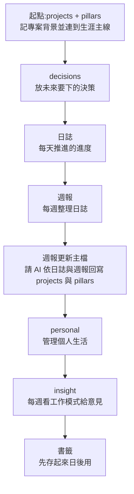

# Obsidian + Claude Code 跨專案知識庫:讓 AI 讀、寫、連結,庫自己長大(AgentCrew Academy)

> 來源影片:AgentCrew Academy(Dustin)〈AI 一直忘記?我用 Obsidian + Claude Code 蓋了會自己長大的知識庫〉,2026-05-12 上傳,長度 24:14。
> 影片連結:https://youtu.be/EhMKfG1dvnI
> 字幕:頻道提供的**人工字幕**(zh-TW),帶時間。
> ⚠️ **作者推廣自家產品**:說明欄與結尾推「15 分鐘導入診斷」表單、L1 入門班 / L2 綜合實戰班(agentcrew.cc)與 Facebook 社團。影片本身沒有第三方業配,教學內容免費。
> 時效:影片拍於 2026-05,講 Claude「4.6 版」上下文 20 萬或 100 萬 token;現行模型已更新,下文只引用影片原意。
> 核實:讀了 Obsidian 官方 CLI 說明頁與 `obsidianmd/obsidian-skills` 倉庫(2026-11-11 的版本 `3981277`,plugin 版本 1.2.0)。結果寫在「標示」與第 7 節。

## 一句話結論

跨專案記憶的做法是:**把知識庫放在一個 Obsidian vault(本機 Markdown),用 `wikilink` 把不同資料夾的檔案連成網,再裝 Obsidian 官方 skill 讓 Claude Code 透過 CLI 讀寫**。結構不要一次設計完,從 `projects` 加 `pillars` 兩個資料夾開始,需要才長出新的。

## 1. 要解的問題

影片 [0:18](https://youtu.be/EhMKfG1dvnI?t=8) 起用 90 秒講原因:

- 上下文視窗再大也會被模型回答、工具呼叫、思考 token 慢慢塞滿;接近滿時表現下降,會忘記前面說過的、開始亂答([0:50](https://youtu.be/EhMKfG1dvnI?t=40) 起)。
- 所以要把長期有用的東西寫成文件:模板、SOP、專案進度、工作慣例([1:08](https://youtu.be/EhMKfG1dvnI?t=58))。
- 問題:傳統資料夾是**樹狀**,文件被關在單一專案裡。問 AI「我這週有哪些專案、哪些待辦」,它停在某個專案資料夾就看不到其他專案的背景([1:27](https://youtu.be/EhMKfG1dvnI?t=77)–[2:12](https://youtu.be/EhMKfG1dvnI?t=122))。

## 2. 為什麼選 Obsidian

影片 [2:12](https://youtu.be/EhMKfG1dvnI?t=122) 起列出四點:

| 優點 | 說明 |
|---|---|
| 樹狀 + wikilink | 保留資料夾,又能讓不同層級的文件互相連線;AI 讀到連線就能跨過去讀相關文件 |
| 本機純 Markdown | 資料在自己電腦,Obsidian 停止維護也能帶走(對比 Evernote、Notion 要匯出或存在別人雲端) |
| 成熟社群與開源外掛 | 可變資料庫、待辦儀表板、專案管理 |
| 自由 | 結構全由你決定,影片只示範作者自己的一種用法 |

> 外掛數量:影片說「快 3,000 個」([22:56](https://youtu.be/EhMKfG1dvnI?t=1366)),我沒去查外掛目錄,**未能核實**。

## 3. 安裝與接線的三步

| 步驟 | 影片做法 | 核實後要注意 |
|---|---|---|
| 1 | 安裝 Obsidian、建立 vault([3:39](https://youtu.be/EhMKfG1dvnI?t=209)) | 一個資料夾就是一個 vault |
| 2 | 對 Claude Code 說「請幫我安裝 Obsidian CLI」([3:48](https://youtu.be/EhMKfG1dvnI?t=218)) | ⚠️ 見下方「需修正」 |
| 3 | 在 vault 資料夾開 Claude Code,**用計劃模式**說明目的([4:59](https://youtu.be/EhMKfG1dvnI?t=289)) | 見第 4 節 |

### 需修正:Obsidian CLI 不是請 Claude 去裝的東西

- 影片說版本要 **Obsidian ≥ 1.12.4**(說明欄)。現行官方說明頁寫「**1.12.7+**」。**需修正,以現行文件為準**。
- 官方做法:**Settings → General → 打開 Command line interface**,照提示註冊。CLI 隨安裝程式附帶,Windows 會多一個 `Obsidian.com`、macOS 建 `/usr/local/bin/obsidian` 符號連結、Linux 複製到 `~/.local/bin/obsidian`。
- 官方 skill 還特別警告:**不要裝同名但無關的 npm 套件 `obsidian-cli`**。若請 AI「幫我安裝 Obsidian CLI」,它有可能裝錯。
- 使用 CLI 時 **Obsidian 程式必須在執行**;沒開的話,第一個指令會把它啟動。

## 4. 用計劃模式設計知識庫

影片 [5:00](https://youtu.be/EhMKfG1dvnI?t=290) 的提示詞:「這個資料夾是我的跨專案管理知識庫。請調查我電腦裡所有使用 Claude Code 的專案背景,上網找結合用法,並問我需求的問題,幫我規劃知識庫的計劃。」

作者拆出三個關鍵動作([5:30](https://youtu.be/EhMKfG1dvnI?t=320)–[6:16](https://youtu.be/EhMKfG1dvnI?t=366)):

1. **請它讀跟目標相關的資料**(各專案的記憶、進度、背景)。
2. **請它上網找用法**(你不知道怎麼結合,就讓它查)。
3. **請它問你問題**(補上你漏掉的偏好)。

計劃模式的好處:它不直接動手,先給計劃,你看懂了再放行([6:16](https://youtu.be/EhMKfG1dvnI?t=366))。示範中它派出多個 agent 調查,並問「這個知識庫的定位」「要做到總覽 dashboard、知識索引、拉進重要記憶,還是每日進度整合」,作者選 Index Only,看不懂的選項可選 check with me 再討論([9:30](https://youtu.be/EhMKfG1dvnI?t=560)–[10:44](https://youtu.be/EhMKfG1dvnI?t=634))。

## 5. 作者自己的 vault 結構

影片 [6:40](https://youtu.be/EhMKfG1dvnI?t=390)–[8:12](https://youtu.be/EhMKfG1dvnI?t=482)(**作者自述,真實 vault 因隱私未展示,只講結構**):

| 區塊 | 放什麼 |
|---|---|
| 第一層主軸 | 生涯目標、待辦總和、每週例行事項 |
| personal | 稅務策略、家人行程、個人財務與規劃 |
| pillars | 生涯主軸(如 GMAT 教學、Claude Code 課程、AI 顧問) |
| 日誌 | 每完成一個任務,請 Claude 自動寫進日誌 |
| 週報 | 請 Claude 整理該週日誌:各任務花多少時間、專案進度、下週推進 |
| projects | 正在推進的具體專案 |
| 書籤 | 平常看到、可能跟專案有關的網頁,先存起來 |

**為什麼這不等於單純樹狀**([8:15](https://youtu.be/EhMKfG1dvnI?t=485)–[9:21](https://youtu.be/EhMKfG1dvnI?t=551)):每個檔案內都加了連結與標籤(「跟課程計劃有關」「跟個人財務有關」),AI 讀到一個檔案就會順著連線找相關專案或生涯主線,不會只看到所屬子資料夾。

### 示範用的 vault 與 `CLAUDE.md`

[11:04](https://youtu.be/EhMKfG1dvnI?t=654) 起:第一層有一個 `CLAUDE.md`,**AI 找內容時優先讀它**,內容是寫給 AI 看的:vault 的主人是誰、名稱、結構、各區塊用途。示範中 `L2 Phase 1 交付` 這份專案檔用 wikilink 連回「課程業務」,AI 先讀到哪一邊都能補上另一邊的背景([12:04](https://youtu.be/EhMKfG1dvnI?t=714)–[12:43](https://youtu.be/EhMKfG1dvnI?t=753))。

### 結構取決於你要管什麼

[13:27](https://youtu.be/EhMKfG1dvnI?t=797)–[14:45](https://youtu.be/EhMKfG1dvnI?t=875):這次示範選的是「管理專案重要資訊」,Claude 規劃出的結構就不同,變成放**決定(decisions)、過去 debug 紀錄、跨專案共同模式(patterns)**,並建 dashboard 彙整所有專案狀態。作者的結論:Obsidian 只是平台,結構靠你和 AI 探索。

## 6. 知識庫怎麼長大(作者的演進順序)

影片 [15:23](https://youtu.be/EhMKfG1dvnI?t=913)–[18:04](https://youtu.be/EhMKfG1dvnI?t=1074):

每一步都來自一個實際痛點:背景固定但**決定有階段性**;每日進度要看;日誌太零散所以要週報;日誌週報一直前進但**主檔不動**,所以每週讓 AI 依日誌回寫主檔。

### 維護成本:幾乎不是你在做

[19:06](https://youtu.be/EhMKfG1dvnI?t=1136)–[19:55](https://youtu.be/EhMKfG1dvnI?t=1185):擔心連線很難維護?作者說大多數是 AI 在讀、AI 在建。直接說:「請你按照語義幫我判斷哪些檔案有關係,幫我加上 wikilink 雙向連線」。連線加得合理、充足,AI 讀每個檔案時就能順著連過去,「在恰好的時刻讀到恰好多的上下文」。

## 7. 讓 Claude 讀寫 vault:Obsidian 官方 skill

影片 [19:58](https://youtu.be/EhMKfG1dvnI?t=1188) 起:對 Claude Code 說「請上網找官方 Obsidian skill 並安裝」。skill 是教 AI 固定工作流的技能手冊;裝好後打 `/obsidian` 接著講需求,如「讀知識庫找這個專案背景」「看昨天進度」「把剛完成的事寫進日誌」「重整 Obsidian」([21:14](https://youtu.be/EhMKfG1dvnI?t=1264))。作者說:知識庫建立至今他沒有親手打過一個字([22:00](https://youtu.be/EhMKfG1dvnI?t=1310))。

### 讀倉庫核實(`obsidianmd/obsidian-skills`)

- **倉庫位置**:影片說明欄寫 `kepano/obsidian-skills`;我 clone 後 `plugin.json` 的 repository 已是 `https://github.com/obsidianmd/obsidian-skills`(官方組織)。**說明欄舊連結仍可 clone,但現行標準位置是 `obsidianmd/`**。
- **內含 7 個 skill**:`obsidian-cli`、`obsidian-markdown`、`obsidian-bases`、`json-canvas`、`defuddle`、`obsidian-headless`、`knap`(我只讀了前幾行,未深入)。影片只講到 CLI 與筆記建立這一部分。
- **安裝方式**(README,影片沒講):
  - `claude plugin marketplace add obsidianmd/obsidian-skills`
  - `claude plugin install obsidian@obsidian-skills`
  - 或手動把 `plugins/obsidian/skills/` 複製到 vault 根目錄的 `.claude/skills/`。
  - 也支援 Codex、Cursor、OpenCode。
- **`obsidian-cli` skill 的重要規則**(影片沒提,都跟「AI 自動寫入」的風險有關):
  - CLI **失敗時也回傳狀態碼 0**,所以必須讀輸出才能判斷成功與否。
  - `content=` 內的 `\n`、`\t` 會被轉成換行與 Tab 且無法跳脫,所以含反斜線的文字(LaTeX `\theta`、路徑 `C:\notes`)會被改壞,**超過約 4 KB 的內容改直接寫檔**。
  - 檔名含點要寫副檔名,否則被當成副檔名開頭。
  - 改名與搬移用 `rename`、`move`,**不要用檔案系統的 `mv`**,這樣 Obsidian 才會更新連結。
  - `delete` 預設進垃圾桶,沒有使用者要求不加 `permanent`。
  - 有多個 vault 時用 `vault=` 指定,放第一個參數;`--json`、`--copy` 等放指令**後面**。
  - 常用指令:`read`、`create`、`append`、`search`、`daily:append`、`property:set`、`backlinks`、`tasks`。
- **`obsidian-markdown` skill**:專管 Obsidian 的語法(wikilink、embed、callout、properties),假設標準 Markdown 已知。這正是「自動連結不會寫錯」的來源。
- **`obsidian-headless`**:只做 Sync 與 Publish,不需桌面程式,beta,要訂閱;**讀寫筆記不靠它**。

## 8. 額外外掛(影片 [22:46](https://youtu.be/EhMKfG1dvnI?t=1356) 起)

| 外掛 | 用途 |
|---|---|
| Templater(影片說「模板外掛」) | 定義模板,新筆記照模板 |
| Dataview | 把筆記變資料庫式查詢 |
| Tasks | 跨文件、跨專案管理待辦 |

不知道裝哪些就問 Claude Code,讓它先讀你的文件、問你問題、上網查;看不懂就說「用白話文說明」。

## 9. 影片說得準 vs 要修正

| 項目 | 結果 |
|---|---|
| 樹狀 + wikilink 讓 AI 跨資料夾讀 | 方法合理;**效果沒有量化數據**,只是作者用一年的經驗 |
| CLI 需 Obsidian ≥ 1.12.4 | **需修正**:現行官方頁寫 1.12.7+ |
| 「請 Claude 幫我安裝 Obsidian CLI」 | **需修正**:官方是在設定中開啟,隨安裝程式附帶;無關的 npm `obsidian-cli` 別裝 |
| 官方 skill 網址 `kepano/obsidian-skills` | 倉庫現為 `obsidianmd/obsidian-skills` |
| skill 教 AI 用 CLI、換行、路徑、建立筆記 | ✅ 已核實(`obsidian-cli` 與 `obsidian-markdown`) |
| 外掛快 3,000 個 | **未能核實** |
| 「我沒親自打過一個字」 | 作者自述,**無法核實**;且 AI 全自動寫入的風險見第 7 節 |
| 上下文接近滿時表現明顯下降 | 常見經驗說法,影片未附資料 |

## 應用案例

1. **一人多專案顧問**:每個客戶一份 `projects/客戶名.md`,用 wikilink 連到 `pillars/顧問業務.md`。問 AI「這週哪些客戶有待辦」,它能跨客戶彙整。
2. **每日收工儀式**:完成任務後說「/obsidian 把剛完成的事寫進今天日誌」,週五再說「整理本週週報並回寫 projects 主檔」。
3. **踩坑經驗庫**:仿示範的 decisions / debug / patterns 三個資料夾,把每次排查的原因與解法存成筆記,下次同類問題 AI 先讀。
4. **想先試水**:只建 `projects` 與 `pillars` 兩個資料夾,每個專案一頁,三週後依痛點再加日誌或週報。
5. **自動寫入前先備份**:因為 CLI 失敗也回 0、`\n` 會被轉換,建議 vault 放進 git 或定期備份,重要筆記改完用 `backlinks` 與直接讀檔抽查。

本庫對照:純 Markdown 記憶的做法見 [[markdown-agent-memory]];Karpathy 的 LLM Wiki 見 [[llm-wiki-karpathy]];用 Claude 蓋會自我改進的知識庫見 [[self-improving-knowledge-base-claude-cowork]];經驗知識化 skill 見 [[project-cairn-experience-to-knowledge-skill]]。

## 來源

- AgentCrew Academy〈AI 一直忘記?我用 Obsidian + Claude Code 蓋了會自己長大的知識庫〉:https://youtu.be/EhMKfG1dvnI (頻道人工字幕 zh-TW;時間點取自帶時間字幕,連結提前 10 秒)
- Obsidian 官方 CLI 說明:https://obsidian.md/help/cli (原 https://help.obsidian.md/cli 已 301 轉址)
- Obsidian 官方 skills:https://github.com/obsidianmd/obsidian-skills (影片說明欄連結為 https://github.com/kepano/obsidian-skills;本機 shallow clone 後讀 `README.md`、`plugins/obsidian/plugin.json`、`skills/obsidian-cli/SKILL.md`、`skills/obsidian-headless/SKILL.md`、`skills/obsidian-markdown/SKILL.md` 開頭,讀完已刪除副本)
- Obsidian:https://obsidian.md
- Claude Code:https://claude.com/claude-code
