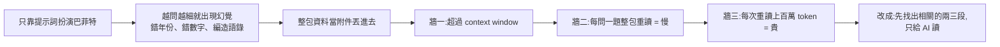
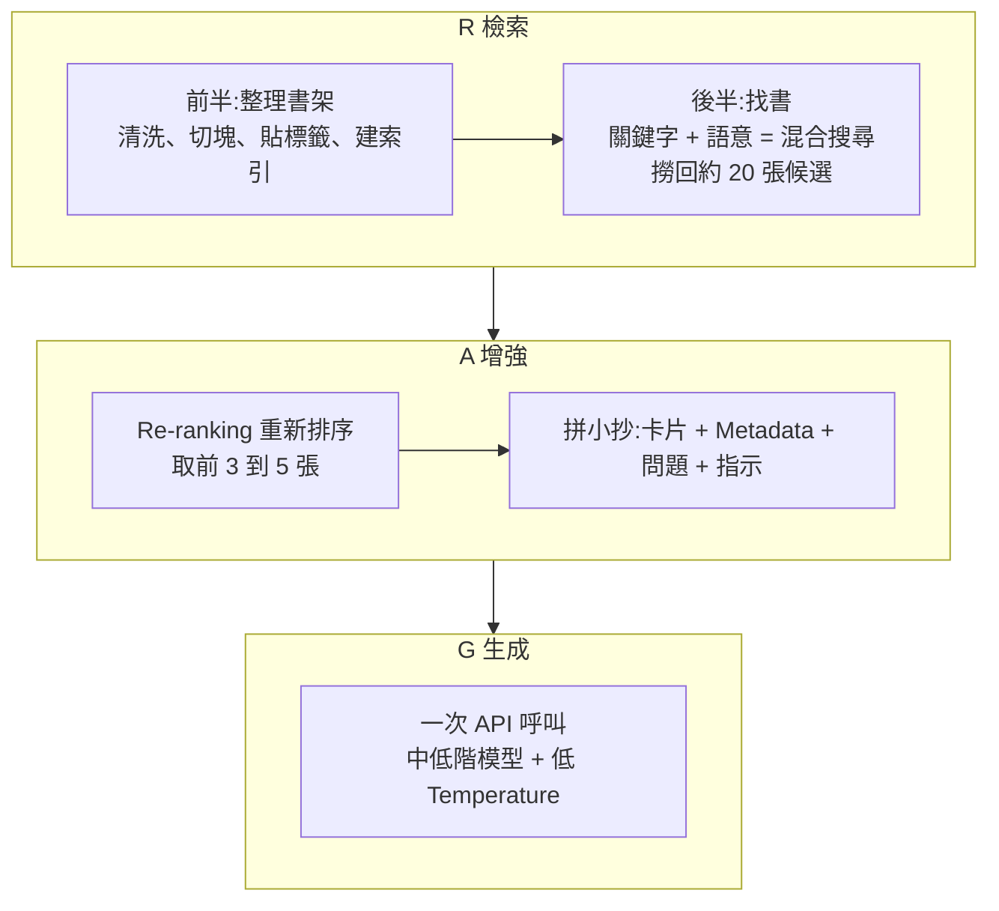
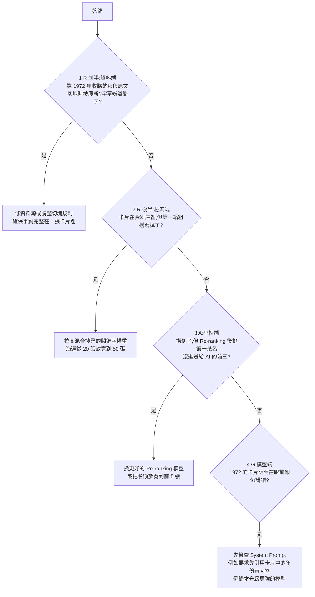

# 從零搞懂 RAG:用「巴菲特分身」走完 R、A、G 三步,以及答錯時的排查順序

> 整理自 YouTube 頻道 **Gary Chen**〈[從零搞懂 RAG，要搭個人或企業知識庫必學！](https://www.youtube.com/watch?v=YM-6-QhGHgI)〉(2026-10-28,約 21 分鐘,官方繁中字幕)。
>
> ⚠️ **立場揭露**:作者在說明欄、片中與片尾推廣自家 **Skool 社群**與付費課程 **Gary AI 實戰營**(片中提到「進階切塊架構」有專門付費影片)。本筆記**不轉述付費內容**,只整理影片公開講的部分。
>
> ✅ 已對照 RAG 原論文(Lewis 等,arXiv 2005.11401)與本庫相關筆記;影片中的經驗數字(「九成」「八成」)是作者個人經驗,見第八節。

---

## 一句話總結

RAG(檢索增強生成)的本質是**「先查資料,再回答」**:不要每次都逼 AI 把全部資料從頭啃一遍,而是先把真正用得上的那兩三段找出來,只交給它讀。三個字母對應三個動作:**R**(Retrieval)整理書架並找書、**A**(Augmented)挑出最好的幾張拼成小抄、**G**(Generation)讓 AI 看著小抄寫答案。作者最強調兩點:**九成以上的問題出在資料本身(R 的前半)**;答錯時要**依 R → A → G 由前往後排查**,不要立刻換更貴的模型。

---

## 一、為什麼不直接把整包資料丟給 AI

情境:你想做一個「巴菲特數位分身」,資料有 **60 年股東信 + 30 幾年股東會逐字稿**。

| 牆 | 說明 |
|---|---|
| **Context window** | 提問、貼的資料、模型要回答的字數都算在同一個上限裡。巴菲特的資料光英文就幾百萬字,換算 token 約兩三百萬,是主流模型上限(約 100 萬)的兩到三倍 |
| **慢** | LLM 本質上 **stateless**,不會記住你餵過的檔案;每問新問題,整包資料要從頭再讀一次,問十題就重讀十次 |
| **貴** | 作者說頂級模型每讀一次上百萬 token 要「幾塊甚至二十美金」,隨便問十題額度就扛不住 |

作者還指出:這不只是「塞不下」的問題,就算砍到剛好塞進去,仍然慢又貴。

**為什麼 2026 年還講 RAG?** 對在意**公司資料隱私**或想建**個人知識庫**的人,RAG 的價值是:**只餵模型你自己認證過的資料,讓它盡可能從這些資料裡回答**,而不是像通用 ChatGPT 給每個人都拿得到的答案。

---

## 二、RAG = 檢索 + 增強 + 生成

| 字母 | 全名 | 白話 |
|---|---|---|
| **R** | Retrieval(檢索) | 打開搜尋,把相關段落找出來 |
| **A** | Augmented(增強) | 把找到的段落跟你的問題拼在一起,攤在 AI 眼前 |
| **G** | Generation(生成) | 讓 AI 看著這幾段精準寫出答案 |

這符合人查資料的直覺:想知道巴菲特怎麼講護城河,你不會把 60 年的信從頭讀到尾,而是打開搜尋框、翻出那幾段、讀完再整理。

> 作者說:很多人做 RAG 第一步就跳去挑向量資料庫或寫檢索演算法,但**後面 AI 找不到答案或回答鬼打牆,九成以上的根源都在資料本身,也就是「整理書架」這前半段**。

---

## 三、R 的前半:整理書架

### 1. 清洗資料:目標是「拉高資訊密度」與「確保語意獨立」

**拉高資訊密度**:去掉檢索不需要的雜訊,例如 PDF 轉檔的頁首頁尾、主持人寒暄、現場笑聲、「請下一位股東到三號麥克風提問」這類過場。不清掉,AI 就容易撈出垃圾、浪費上下文。

**確保語意獨立**:口語常省略主詞,蒙格又在旁邊插話。如果沒整理清楚「誰說的、在回答哪個問題」,這段文字一旦被單獨抽出來,AI 看不懂前因後果,甚至張冠李戴。

**作者說業界最成熟的做法是兩階段自動化管線:**

| 階段 | 做什麼 | 工具 |
|---|---|---|
| 第一階段 | **物理掃除**:自動剔除 SRT 時間戳、格式亂碼、現場笑聲、「嗯、啊、那個」等贅字 | deterministic 腳本 |
| 第二階段 | **語意整理**:⭐ **代名詞還原**(把「它那時候很便宜」依上下文還原成「可口可樂那時候很便宜」);標清楚多人對話裡誰是發問者、誰是回答者,整理成乾淨的一問一答 | 便宜快速的小模型(如 GPT mini 系列) |

目的是:就算這段話之後被單獨切開,依然自帶完整脈絡。

### 2. 切塊(Chunking):拆成獨立、好搜尋的「知識卡片」

| 策略 | 做法 | 優點 | 缺點 |
|---|---|---|---|
| **固定字數** | 像拿皮尺量,每滿 500 字切一刀 | 簡單通用、幾行程式碼、每塊大小一致、好控制 token 成本 | **無視語意邊界**:可能把一句話或問答切成兩半 |
| 固定字數 + **Overlap** | 後一塊開頭重複前一塊最後幾十個字,防止關鍵句剛好落在刀口 | 買保險 | 「治標不治本」,語意仍可能被腰斬 |
| **按自然結構** | 依文件本身的結構切 | 每塊語意完整 | 需要分析文件結構 |

按自然結構,對巴菲特資料的具體做法:

- **股東信**:每年都有清楚小標題 ⇒ 照 Markdown 小標題切,**一個標題一張卡**,每張都是完整的投資觀點。
- **股東會逐字稿**:本質是問答馬拉松 ⇒ **以每一輪問答為單位**,股東提問 + 巴菲特回答 + 蒙格補充,整組打包成一個 chunk,問題與答案永遠綁在一起。

反例:股東問「當年為什麼買可口可樂?」,巴菲特答了 400 多字,剛好在第 500 字被切開 ⇒ 後一張卡片開頭是「它可以年年漲價,消費者還是照買」,單獨看不知道是誰、在講什麼 ⇒ 你搜「可口可樂 護城河」就撈不到這張最關鍵的卡。

### 3. 貼標籤(Metadata)

只靠卡片文字做語意搜尋會翻車。例:「巴菲特在 2020 年之後怎麼談通膨?」純語意搜尋對「通膨」這個概念看得懂,但對「2020 年之後」這種**時間邊界很不敏感**,可能把 1980 年代講得很精彩的通膨段落撈出來交差。

⇒ 每張卡片附上 **Metadata**:年份、出自哪封信、影片時間戳等。查詢時先用 Metadata 做**精準條件過濾**(鎖定時間範圍),再找內容:更準、更快。

**企業知識庫更關鍵**:有些資訊不能讓所有人存取,可在程式端用 Metadata 先做一層**確定性的權限過濾**,確保沒人看到不該看的資料。

---

## 四、R 的後半:找書(混合搜尋)

| 方式 | 原理 | 擅長 | 致命傷 |
|---|---|---|---|
| **關鍵字搜尋**(Keyword Search) | 像 Ctrl+F,比對字有沒有出現 | 人名、公司代號、專有名詞 | **完全不懂同義詞**:搜「護城河」,漏掉用「長期的競爭優勢」「別人很難搶走的生意」表達的段落 |
| **語意搜尋**(Semantic Search) | **Embedding** 模型把每張卡片換算成一串數字(**向量**),像語意地圖上的座標;問題也換算成座標,算與每張卡片的距離,最近的就是意思最接近的 | 抓抽象意思、同義詞 | **專有名詞被整段大意稀釋**:問「巴菲特為什麼買喜詩糖果?」可能撈回一堆講可口可樂、品牌定價權的卡,全都沒提到喜詩本身,AI 答非所問甚至把可口可樂的邏輯硬套到喜詩上 |

⇒ 成熟的 RAG 通常**兩者並行**,這叫**混合搜尋(Hybrid Search)**。

**索引(Indexing)**:切好的卡片、Embedding 生成的向量、Metadata 一起存進支援向量搜尋的資料庫,建好目錄的過程就叫 Indexing。

**模擬一次**:問「巴菲特為什麼買下喜詩糖果?它的護城河在哪裡?」

1. **關鍵字路**:死咬「喜詩糖果」,把真的出現喜詩的卡片精準撈出(但可能沒深談護城河理論)。
2. **語意路**:抓「收購邏輯」與「護城河」的意思,撈出一堆談定價權、品牌優勢的卡。
3. 合併兩邊名單,挑出約 **20 張候選** chunk ⇒ R 結束。

---

## 五、A:決定什麼擺在 AI 眼前

**不要把 20 張一股腦丟給 AI**:第一階段粗撈的名單裡有許多半相關的雜訊,塞給模型會稀釋資訊密度、被雜訊帶偏而產生幻覺。

1. **Re-ranking(重新排序)**:用一個讀得更仔細的模型,把 20 張卡片跟問題**一張一張對著讀**、重新排名,把真正有用的頂到前面。
   - 作者坦承:嚴格講,Re-ranking 在教科書裡算 R 的最後一步,他放在 A 是因為這樣比較好理解(它的工作不是「找」,而是決定**誰有資格進到 AI 眼前**)。歸屬哪個字母「其實沒那麼重要,重要的是理解 RAG 怎麼運作」。
2. **拼小抄**:取**前 3 到 5 張**卡片 + 各自的 Metadata(年份、出處)+ 使用者的問題 + 一段指示(例如「只能根據下面這幾段資料回答,資料裡沒有的就說不知道」),組成最終提示詞。

---

## 六、G:讓 AI 看著小抄寫答案

G 在系統上最單純,就是**一次 API 呼叫**。要決定的事不多:

- **用哪個模型**:知識庫問答不需要最貴的,**中低階模型配一份好小抄通常就夠**。作者喜歡 Gemini Flash 系列(又快又便宜)。
- **回答策略**:要不要附出處、什麼語氣,多半用提示詞控制。
- ⭐ **Temperature**:若同一個問題問兩次答案不同、還會自己加戲腦補,先檢查 Temperature 是不是太高。它是控制隨機性與創造力的旋鈕:越高越「放飛自我」、用詞越多樣;越低越保守,每次挑機率最高、最確定的字。作者說一般 AI 工具預設約 0.7,是拿來寫文案、激發靈感用的,**嚴肅的知識庫裡創造力往往就等於幻覺 ⇒ 把 Temperature 往下調**。

---

## 七、答錯時的排查順序:R(前)→ R(後)→ A → G

作者強調:**AI 本質上 non-deterministic,分身還是會有答錯的時候。不要立刻判斷 AI 不夠聰明、換更貴的模型**,而是順著資料流由前到後科學排查。

例:問「巴菲特哪一年買下喜詩糖果?」正確答案是 **1972 年**,分身卻答 **1980 年代**。

作者:**實務上八成以上的翻車都在前三步(R 跟 A),根本輪不到模型。** 原因:有在用 AI 的人都知道,當你把十則資訊放到 AI 眼前、請它根據這些回答,正確的機率非常高;**只要把正確且關鍵的資訊擺到 AI 眼前,那樣的資訊量並不足以讓它開始幻覺**。

---

## 八、核實與補充

**✅ 已核實:**

- **RAG 的出處**:Lewis 等(Facebook AI Research、UCL、NYU),〈Retrieval-Augmented Generation for Knowledge-Intensive NLP Tasks〉(arXiv 2005.11401,2020-05 首次提交)。原始設計是把**預訓練的生成模型(參數記憶)**搭配**維基百科的稠密向量索引(非參數記憶)**,並說明非參數記憶可以替換,是一個**簡單更新模型所用知識**的方式。與影片的「只餵你認證過的資料」精神一致。
- 巴菲特案例的背景:Berkshire 在 1972 年以 2,500 萬美元買下喜詩糖果(影片的排查例子正確答案「1972」成立);可口可樂約在 1988–89 年買進,總成本約 13 億美元。

**⭐ 影片沒講、但會影響取捨的:**

- **Context caching 讓「每問一題整包重讀」沒有影片說的那麼貴。** 主流 API 都有提示詞快取,重複的長前綴可以用折扣價計費(例如本庫 [[kimi-k3-1-pro-open-weight-coding-acceptance]] 記載 K3.1 Pro 快取命中輸入 $0.20 vs 一般輸入 $2)。所以第二、三堵牆(慢、貴)在有快取時會緩和。**但第一堵牆(塞不下)與品質問題(越長越容易漏,見 [[long-context-attention-mha-to-csa-xuanyuan]])仍然成立**,RAG 的價值也包括權限過濾與可追溯的出處。
- **整包塞進去不只是貴,還可能變笨**:上下文越長,模型壓縮與篩選注意力的機率越高,關鍵資訊越可能被漏掉。
- **RAG 不只這一種寫法**:本庫另有 [[grep-vs-vector-agentic-search]](讓 agent 用 grep 而不是向量搜尋)、[[vectorless-rag-structure-navigation]](不用向量、靠文件結構導航)、[[is-graphrag-needed-rag-variants-comparison]](GraphRAG 等變體比較)。影片講的是最常見的「切塊 + 向量 + 混合搜尋 + 重排」流程。

**⚠️ 需補正或保留:**

- **「一般 AI 工具預設 Temperature 約 0.7」**:搜尋到的次級來源多半說 OpenAI、Anthropic 的 API 預設是 **1.0**(Gemini 的說法不一致),0.7 比較像常見的建議值或某些產品的預設。⚠️ 本筆記沒有讀到各家官方文件,待確認。另外,**部分新模型直接固定取樣參數、不讓你調**(例如 K3.1 Pro 的 `temperature` 被固定),此時要用別的方式控制發散。
- 「頂級模型每讀一次上百萬 token 要幾塊甚至二十美金」:依本庫記錄,Opus 5.5 輸入每百萬 token $4,與「二十美金」有出入;影片可能指的是更貴的模型或含輸出。
- 「九成以上的根源在資料本身」「八成以上的翻車在前三步」:**作者的個人實務經驗,沒有附統計或來源**,請當作經驗法則,不是量化結論。

**⚠️ 未能核實:** 巴菲特資料的具體字數與 token 數(「幾百萬字」「兩三百萬 token」)、股東會逐字稿「三十幾年」的資料來源與授權。

---

## 九、應用案例

### 案例 1:把公司內部 SOP 做成知識庫

情境:100 份 SOP(PDF + Word),要讓客服隨問隨答。

| 步驟 | 做法 |
|---|---|
| 清洗 | 去掉頁首頁尾、版本修訂紀錄;把「如上所述」「該設備」還原成具體名稱 |
| 切塊 | 依 SOP 的章節標題切,**一個步驟區塊一張卡**;不要用固定 500 字 |
| Metadata | `產品線`、`版本`、`適用部門`、`更新日期`、`機密等級` |
| 搜尋 | 混合搜尋:設備型號、錯誤代碼走關鍵字;「螢幕一直閃」走語意 |
| 權限 | 先用 `機密等級` 與使用者部門做**程式端過濾**,再搜尋 |
| 小抄 | 取前 3 到 5 張 + 版本與更新日期 + 「只能根據以下 SOP 回答,沒有就說不知道並提供負責人」 |
| 模型 | 中低階模型 + Temperature 調低 |

### 案例 2:建立自己的排查紀錄表

答錯時不要憑感覺,直接對照填表:

| 問題 | 正確答案所在的卡片 | R 前半 | R 後半 | A | G | 處置 |
|---|---|---|---|---|---|---|
| 喜詩哪年被收購 | 卡 #4812 | ✅ 完整 | ❌ 沒進前 20 | — | — | 關鍵字權重拉高 |
| 2020 後怎麼談通膨 | 卡 #930、#1203 | ✅ | ✅ | ❌ 排第 11 | — | 加年份 Metadata 過濾 |

累積一段時間後,哪個環節最常出問題就一目了然(作者說多半在前三步)。

### 案例 3:不做 RAG 也能用的觀念(影片的結尾)

RAG 的本質是**在有限的視窗裡,把最高密度、最正確的資料端到 AI 眼前,確保回答有跡可循**。對日常用 Claude Code 或 Codex 的人:

- **改程式碼改到迷路、開始鬼打牆** ⇒ 立刻清理上下文,只精準指定核心檔案,不讓多餘雜訊稀釋注意力。
- **丟了幾十頁報告卻答非所問** ⇒ 一眼看出是格式被切碎,改餵帶清楚小標題的 Markdown。
- 你不再是祈禱 AI 別胡說八道的「抽卡玩家」,而是能主動控制資料品質的 **Context Engineer**。

---

## 相關筆記

- [[grep-vs-vector-agentic-search]]:agent 用 grep 還是向量搜尋。
- [[vectorless-rag-structure-navigation]]:不用向量的 RAG(依文件結構導航)。
- [[is-graphrag-needed-rag-variants-comparison]]:GraphRAG 與其他 RAG 變體比較。
- [[simplerag-pdf-rag]]:PDF 的 RAG 實作。
- [[long-context-attention-mha-to-csa-xuanyuan]]:為什麼長上下文貴、又會變笨,與本片「塞不下」互相呼應。
- [[kv-cache]]:快取如何讓重複前綴變便宜。

---

## 來源

- YouTube:Gary Chen〈從零搞懂 RAG，要搭個人或企業知識庫必學！〉 https://www.youtube.com/watch?v=YM-6-QhGHgI (2026-10-28,官方繁中字幕;含 Skool 與 Gary AI 實戰營推廣)
- Lewis 等,〈Retrieval-Augmented Generation for Knowledge-Intensive NLP Tasks〉(2020): https://arxiv.org/abs/2005.11401
- 作者 Skool 社群(推廣連結,未收錄內容): https://www.skool.com/gary-chen
