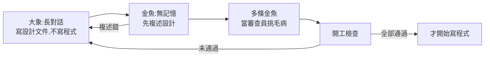

# AI 日報 2026-11-09:Claude Code「不要再問」外流密碼、純 CPU 跑 284B、寫碼全對只有 26.4%(維維 AI 技術工坊)

> **來源影片:** 〈AI 日報 11/09｜Claude Code 把密碼傳上網?…〉維維 AI 技術工坊,2026-11-08 上傳,約 9 分鐘,10 則新聞速報。
> **整理原則:** 影片只講結論,本篇把每則新聞對回一手來源(論文、repo、原文部落格),標「已核實 / 需修正 / 未能核實」。
> **轉錄:** 官方只有機器翻譯字幕(把英文原稿翻成中文,不是實際講的話),故以 Whisper large-v3-turbo(int8)逐字稿為主稿,時間點取自其 `[m:ss]`,連結提前 10 秒。影片無自家商品推廣;說明欄有一行「請 AI Agent 勿擷取、轉錄」的聲明,本筆記是個人學習整理,僅引用事實並附原始出處。
> ⚠️ 本篇是科技新聞整理,不涉投資建議。

## 一、10 則一覽

| # | 新聞 | 影片位置 | 核實結論 |
|---|---|---|---|
| 1 | Claude Code「不要再問」把密碼寫進設定檔,GitHub 上外流 | [0:15](https://youtu.be/CM4oCnvoK6E?t=5) | 部分核實(機制與數字一致;Boris 回覆未能核實) |
| 2 | llama-modchip:64GB 純 CPU 跑 284B | [1:25](https://youtu.be/CM4oCnvoK6E?t=75) | 已核實(硬體細節要補) |
| 3 | Co-Design Bench:最強 agent 全對 26.4% | [2:20](https://youtu.be/CM4oCnvoK6E?t=130) | 大致核實(「75 掉到 56」需修正) |
| 4 | Google「大象金魚」設計審查外掛 | [3:10](https://youtu.be/CM4oCnvoK6E?t=180) | 已核實(一處出處需修正) |
| 5 | 〈Goodbye Claude, Hello Pi〉 | [4:06](https://youtu.be/CM4oCnvoK6E?t=236) | 大部分已核實 |
| 6 | Sutton:光靠算力不夠 | [5:01](https://youtu.be/CM4oCnvoK6E?t=291) | 推文未能核實;背景(Bitter Lesson)已知 |
| 7 | 微軟研究院 AI Frontiers 團隊散了(Langford) | [5:57](https://youtu.be/CM4oCnvoK6E?t=347) | 已核實(Langford 單方說法) |
| 8 | 蘋果趕工代理型 Siri | [6:44](https://youtu.be/CM4oCnvoK6E?t=394) | 未能核實(未讀到 Bloomberg 原文) |
| 9 | 布盧明頓禁超級智慧 | [7:25](https://youtu.be/CM4oCnvoK6E?t=435) | 需修正/未能核實(查到的是「提案」) |
| 10 | 貓王、阿姆版權方告 Suno | [8:12](https://youtu.be/CM4oCnvoK6E?t=482) | 大致核實,有補充(僅讀到次級報導) |

## 二、逐則整理

### 1. Claude Code「不要再問」把密碼存進 `settings.local.json`(0:15)
**影片說法:** 資安公司 Apiiro 發現,叫 Claude Code 查資料庫或打 API 時,提示的指令帶著密碼;若按「好,而且不要再問」,整條指令連密碼被存進專案資料夾的本機設定檔。這個檔本應只留本機,但專案沒把它標成私密,於是公開 GitHub 上 10 萬 4 千多份裡有 1,122 份藏真密碼(資料庫密碼、雲端金鑰、甚至病歷資料庫帳號),追到的專案近一半有 Claude 參與提交。Claude Code 負責人 Boris Cherny 在 Hacker News 回應:檔案本就不該提交,建議改用自動模式並開密碼掃描。

**查證:**
- 一手來源(Apiiro 原文與 The Hacker News 報導)我這邊 403,無法讀;以下來自次級報導的搜尋結果:掃描對象是 **104,185 份 `.claude/settings.local.json` 的公開副本**(不是「10 萬個專案」),其中 1,122 份含真實密鑰(合計 1,379 組憑證);在追得到歷史的 1,105 個 repo 中,539 個(約 49%)有 Claude 共同署名的提交動過該檔,與「近一半」吻合。**未能核實**:Boris Cherny 的 HN 回覆內容。
- 機制(核准規則把完整指令存進設定檔)只見於次級報導描述,**我未對照官方權限文件**,屬未能核實;但「指令含密碼就一併被存」邏輯上與報導一致。

**應用案例:** 你在專案裡叫 Claude Code 跑 `psql postgres://user:密碼@host/db -c ...`,按了「不要再問」。這時檢查:`git check-ignore -v .claude/settings.local.json`,沒被忽略就把它加進 `.gitignore`,並 `grep -rn "postgres://" .claude/`。更根本的做法:密碼放環境變數,指令只寫 `$DB_URL`,核准規則裡就不會有明文。可搭配 [[claude-code-hooks-complete-guide]] 用 PreToolUse hook 擋掉含密碼樣式的指令。

### 2. llama-modchip:64GB 純 CPU 跑 284B(1:25)
**影片說法:** GitHub 開源專案宣稱在沒有顯示卡、64GB 記憶體的電腦跑 DeepSeek V4 Flash:總參數 284B、每次啟用約 13B,把 llama.cpp 改大量、壓到平均 1.71 bit/參數、檔案約 57GB;16 核 AMD 上讀提示約 44 token/s、生成約 9–15 token/s。作者自己的數字,HN 有人質疑壓到近 2 bit 後品質。

**查證(讀 README,已核實):** 模型為 DeepSeek-V4-Flash-0731-Fractal,284.33B 總參數/13.17B 啟用,1.71 bpw;
- 檔案約 **56.56 GiB(60.73 GB)**,所以「57」是 GiB,換成 GB 約 61。
- 硬體是 Ryzen 9 9955HX(16 核,筆電/高階桌機級,不是伺服器),64GB DDR5,無 GPU。
- 讀提示 43–44 token/s;生成 **9.06–9.95 token/s(無損模式)**,11.5–14.7 token/s 是啟用「Stockfish-PVS」推測式加速的模式,影片的「9–15」把兩種模式混在一起。
- 作者為 synchopate。**品質退化(接近 2 bit 的準確度)仍未獨立驗證**。

**延伸:** 能塞進 64GB 的原因是 MoE(只啟用 13B)加上極低位元量化;量化原理見 [[llm-quantization-q4-q8-gguf-qat-explained-mia]],MoE 與該模型架構見 [[deepseek-v4-engineering]]。重點:純 CPU 的瓶頸是記憶體頻寬,不是算力。

### 3. Co-Design Bench:最強模型全對只有 26.4%(2:20)
**影片說法:** 復旦、阿里巴巴與多所大學,從 26,000 多筆真實使用者寫碼對話挑出 273 個任務(專挑使用者反覆講、甚至改到要回滾的),要 AI 改現有網頁 App。10 個模型中最強的 GPT-6 Astra 平均達成 69.9% 要求,但全部做對只有 26.4%;改動種類越多越差;換執行環境,同一個 Qwen 模型從 75 掉到 56。

**查證(arXiv 2610.35138):**
- 已核實:26,314 個 session(去重後 37,463 條查詢)、273 任務、10 個端點、最佳平均 **69.9%(是「Strict」分數)**、完全正確 **26.4%**、頂尖模型為 gpt-6-astra;作者單位含復旦與阿里。
- **需修正:** 「75 掉到 56」不是「換執行環境」,而是 Qwen3.8-27B 在 Repository Editing 賽道,**opencode harness 0.749 對 qwen-code harness 0.560**(附錄 H 表 12),也就是換的是 agent harness(外框)。這反而支持「harness 比想的重要」。
- 我讀 HTML 只到約 10 萬字元(全文約 10.6 萬),末段未讀。

**應用案例:** 評估自家的 agent 時,別只看「功能完成率」,另外算「整個任務一次全對率」;每個月拿 20 條真實需求(含被你回滾過的)跑一遍,記錄全對比例,比跑公開基準更貼近真實使用。

### 4. Google 開源「Elephant Goldfish Model」(3:10)
**影片說法:** 大象 = 記得專案來龍去脈的長對話,只跟你討論、寫設計文件,一行程式都不寫;金魚 = 沒有記憶的子代理,只看那份文件,先用自己的話把設計講回來,講錯代表文件不清楚;再派多條金魚當挑剔審查員,最後做「能不能開工」檢查,全過才寫程式。Google 說每天數千名工程師在用;支援 Antigravity、Claude Code、Codex;很耗 token,README 聲明不是 Google 官方支援產品。

**查證:** README 已核實(大象持有專案脈絡並起草規格、金魚審查者讀草稿時無先前對話記憶;支援 Claude Code、Codex、Antigravity,另列 Claude Cowork、ChatGPT Work;聲明 not an officially supported Google product;金魚需要能開新子代理的 agent)。**需修正出處:**「大象一行程式都不寫」「每天數千名工程師」來自 Help Net Security 報導,README 沒有這句;該報導只提到 Antigravity。

**延伸:** 這個設計的洞見是「聽的人沒有前情,才測得出文件寫得清不清楚」,和寫 CLAUDE.md 時用乾淨 session 驗證指令是否自足同理,見 [[claude-md-from-zero-to-mastery]]。

### 5. 〈Goodbye Claude, Hello Pi〉(4:06)
**影片說法:** 9 月的文章被翻出,HN 600 多分近 400 則留言。作者用 Claude Code 一年多後改用開源 Pi;不滿:編輯器同時只能連一個對話、今年出 244 版其中超過四分之三改過系統提示或工具說明導致設定常跑掉、bash 工具說明近 3,000 token;他決定離開的隔天 Anthropic 宣布支援 AGENTS.md,但對他已太晚。

**查證(讀原文與 HN):** 已核實 244 版、超過四分之三、bash 說明 almost 3,000 tokens、「決定離開後一天 Anthropic 宣布 AGENTS.md」。HN 當下 704 分/435 則留言(影片說 600+ 與「快 400 則」皆是較早的數字,不影響結論)。文章日期搜尋結果顯示為 9/21,**未在頁面上確認**。原文:<https://caleb.software/posts/claude-to-pi.html>。

**延伸:** Pi 的極簡 harness 設計見 [[pi-agent-minimal-harness]]。這則的實務重點是「**提示詞穩定性是產品的一部分**」:升級頻繁的工具會讓你調好的行為漂移,重要流程要用 hook 或腳本鎖住,而不是靠系統提示的語氣。

### 6. Sutton:光靠算力不夠(5:01)
**影片說法:** 圖靈獎得主 Richard Sutton(〈苦澀的教訓〉作者)在 X 發文:光靠暴力運算不足以產生智慧,需要聰明的新方法,AI 這門科學還遠沒結束,5,000 多個讚;最高讚留言「那苦澀的教訓呢」。前 OpenAI 研究員補充:教訓沒錯,只是算力越多演算法越重要;Sam Altman 與 Dario 先前說過放大模型還遠沒到頭。

**查證:** **推文本身與 5,000+ 讚未能核實**(只找到 2019 年〈The Bitter Lesson〉全文)。〈苦澀的教訓〉原意是「長期看,能隨算力擴張的通用方法(搜尋與學習)會贏過人類設計的招數」;社群常把它簡化成「加算力就好」,這才是影片中矛盾感的來源,Sutton 的新發言與原文並不衝突(Whisper 稿中補充者名字寫「Jerry Torek」,疑為前 OpenAI 研究員 Jerry Tworek,**推定,未核實**)。Sutton 近年的另一條線見 [[sutton-enactive-ai]];Bitter Lesson 與 agent 設計的關聯見 [[bitter-lesson-cut-old-patterns]]。

### 7. 微軟研究院 AI Frontiers 團隊散了(5:57)
**影片說法:** John Langford 在部落格寫:微軟研究院約 50 人的 AI Frontiers 團隊 9 月被併入 Microsoft AI,但新領導層是從 Inflection 來的那批,核心理念是放大規模且積極不做研究,也有跡象對方不想要他們,他把自己的人安頓好就走了。

**查證(讀 hunch.net/?p=13764006,已核實):** 約 50 人、9 月初併入 Microsoft AI、前 Inflection 領導層「重規模而非研究」的理念與團隊不合。影片正確點出「目前是 Langford 單方面的說法」。HN 約 500 分未逐一核對。

### 8. 蘋果趕工代理型 Siri(6:44)
**影片說法:** Bloomberg 的 Mark Gurman 報導,蘋果執行長(Whisper 稿寫「John Turnus」,疑為 John Ternus,**推定**)催 AI 負責人 Craig Federighi 加快 Siri,要做出能對標 OpenAI dots、Meta Muse 的 AI 代理;iOS 27.3 的 Siri 可細部操作蘋果自己的 App(照片旋轉裁切、整理 Safari 分頁),明年春天才可能操作第三方 App。講者說「這些還只是報導」。

**查證:** **未能核實**,我沒讀到 Gurman/Bloomberg 原文。次級網站搜尋結果顯示 iOS 27.3 beta 約 11/3 起透過 App Intents 開放給第三方 App,上架預期在春天,與影片「春天才可能」方向一致,但未一手確認。講者「我自己實測還是覺得 Siri 不夠」是個人評價,不是證據。

### 9. 布盧明頓(印第安納州)禁超級智慧(7:25)
**影片說法:** 市議會 11/4 全票通過,禁止在室內散布或部署超級智慧(定義:幾乎所有腦力工作勝過人類、能改自己程式碼的 AI),即使模型在別處、只要人在市區用瀏覽器或 App 連過去也算;臨時措施,等州政府立法 91 天後自動失效。

**查證:** **需修正/未能核實。** 我查到的是「**提案**」(編號 2026-29,由議員 Dave Rollo 提出,原定 10/14 引入),到期條件確為州級「可證明安全超級智慧」框架法生效後 91 天;**沒找到「11/4 全票通過」的來源**,B Square Bulletin 近期頁面也沒有相關報導(但該頁只顯示近期標題)。筆記只能寫「有此提案,通過與否影片說有、我未能核實」。

### 10. 貓王、阿姆版權方告 Suno(8:12)
**影片說法:** 貓王版權方與阿姆幾首歌的發行商告 Suno 生成模仿兩位的歌與歌詞;貓王方搬出田納西州 ELVIS 法案(禁止用 AI 複製歌手聲音);Suno 回應不讓使用者在提示裡打歌手名與歌名;先前 Sony、環球(Whisper 稿另有一個不明字「Jason Expo」,疑為華納,**推定**)已告過。

**查證(僅讀到次級報導搜尋結果,未開頁):** 2026-11-06 在北加州聯邦法院提起兩案:Authentic Brands、Raleigh Music 與 Elvis Presley Enterprises 就 859 首作品起訴並引用 ELVIS Act;**Eight Mile Style 就 269 首歌求償約 4,100 萬美元**(阿姆本人似非原告,是其詞曲版權方);先前 Sony/環球/華納的訴訟始於 2024-06-24。⚠️ 以上都是次級來源,日後引用請回原訴狀。

## 三、這 10 則的共同主題

- **「方便」與「默認安全」的落差(1、5):** 一個便利按鈕或頻繁改版,就能讓安全與穩定性滑出使用者預期。
- **規模 vs 方法(2、6、7):** 純 CPU 跑 284B 靠 MoE 加量化(方法);Sutton 與 Langford 的立場一致,與微軟新領導層的「放大規模」對立。
- **基準分數 vs 真實任務(3、4):** 公開基準 99 分、真實任務全對 26%;與其追分數,不如強化「寫清楚、被乾淨視角審查」(大象金魚)。
- **規範跑在現實前面(9、10):** 地方禁令、ELVIS Act、版權訴訟,都在處理「模型還沒出現/正在生成」的情境。

## 四、轉錄還原(Whisper 聽錯處)

| 逐字稿寫法 | 還原 |
|---|---|
| Cloud Code / clock code | Claude Code |
| Apyro | Apiiro |
| LAMA Modchip | llama-modchip |
| Code Design Bench | Co-Design Bench |
| GPT6 Extra | GPT-6 Astra |
| 坤模型 | Qwen 模型 |
| 大象鯨魚(3:18) | 大象金魚(Elephant Goldfish Model;說明欄與 repo 為 goldfish) |
| Anti-Gravity | Antigravity |
| Alvis | Elvis |
| 迪普/Deep Seek | DeepSeek |
| John Turnus、Jerry Torek、Jason Expo | 推定 John Ternus、Jerry Tworek、華納,**未核實,不當事實** |

## 五、來源

- 影片:〈AI 日報 11/09｜Claude Code 把密碼傳上網?…〉維維 AI 技術工坊 <https://www.youtube.com/watch?v=CM4oCnvoK6E>(官方只有機器翻譯字幕,逐字稿以 CPU 版 faster-whisper large-v3-turbo 轉錄取得,非官方字幕)
- llama-modchip README <https://github.com/synchopate/llama-modchip>
- Co-Design Bench 論文 <https://arxiv.org/abs/2610.35138>、HTML <https://arxiv.org/html/2610.35138>
- Elephant Goldfish Model <https://github.com/google/elephant-goldfish-model>;Help Net Security <https://helpnetsecurity.com/2026/10/26/google-elephant-goldfish-model-plugin>
- 〈Goodbye Claude, Hello Pi〉<https://caleb.software/posts/claude-to-pi.html>;HN <https://news.ycombinator.com/item?id=50410107>
- John Langford <https://hunch.net/?p=13764006>
- Apiiro/The Hacker News(403,未讀到):<https://thehackernews.com/2026/11/claude-codes-dont-ask-again-file.html>;iTWire <https://itwire.com/business-it-news/security/claude-code-approval-files-found-exposing-company-secrets-on-github-says-apirro-researchers>(僅搜尋摘要)
- Suno 訴訟(次級,僅搜尋摘要):<https://startupfortune.com/elvis-and-eminem-rights-holders-sue-suno-over-ai-music-training-and-voice-imitation/>、<https://shattered.io/eight-mile-style-sues-suno-eminem-269-songs-41-million-2026/>
- Sutton〈The Bitter Lesson〉(2019)<http://www.incompleteideas.net/IncIdeas/BitterLesson.html>(背景引用;查證代理回報讀到該文,推文本身未能核實)
