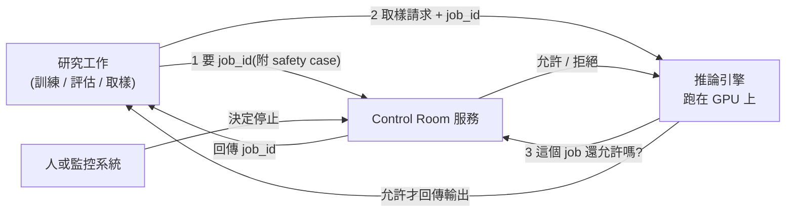

# AI 早報週報(2026-11-05 至 11-10):Gemini Omni 1.2 Flash、GPT-6 Cyber、METR 的 2 倍加速、Claude Dreams、OpenAI Control Room、TPU 8tx(橘鸦 Juya + 一手來源核實)

> **來源頻道:** 橘鸦 Juya(`@imjuya`,每日「AI 早報」短影片)。本篇併整 6 支:`UoLqNKs0_n0`(11/05)、`aZ4ISFax7z8`(11/06)、`r9lFf4d6JJY`(11/07)、`Qire06L93oM`(11/08)、`bHFlbVUR26E`(11/09)、`Oi55T8LtTSI`(11/10)。
> **讀了什麼 / 沒讀什麼:** 只有 11/06 那支(`aZ4ISFax7z8`)讀了自動字幕;其餘 5 支**只讀說明欄**(逐條標題與來源連結),沒有讀逐字稿。說明欄裡的條目只是標題,**未標「已核實」的條目一律只是頻道的新聞標題,不代表我查過**。下面核實的 8 條都是**直接讀官方原文**(Google、OpenAI、METR、Anthropic、Fireworks、Google Cloud blog)。
> **立場:** 說明欄與字幕沒有業配或聯盟連結;資訊型頻道,沒有自家產品。
> **形式:** 早報本來就是「每天十幾二十條標題」,不逐日一篇;本篇挑**有官方原文可核實、而且對工程選型有意義**的條目,其餘留標題索引。
> 相關既有筆記:[[claude-fable-5-2-1000-agents-os-fermat-harness-why-qq]](11/10 頭條 Fable 5.2 的完整核實)、[[openai-linux-kernel-948-lpe-agent-pipeline-why-qq]](948 個 Linux 本地提權)、[[rsi-recursive-self-improvement-anthropic]](METR 評估的脈絡)。

## TL;DR

1. **Gemini Omni 1.2 Flash**(11/06 條):影片 15 秒、價格降 30%;✅ Google 官方文章屬實。
2. **GPT-6 Cyber**(11/06 條):ExploitGym 48.5%(前代 32.1%)、「不越界」99.93%;✅ OpenAI 官方屬實;⚠️ 同一頁說 948 個是「**提權 exploit**」,11/05 早報標題寫成「**補丁**」,兩者不是同一件事。
3. **METR:Anthropic 能力增速約 2 倍**(11/06 條):✅ METR 原文屬實,但**證據大半被 Anthropic 遮蔽、不確定範圍 1.3–3 倍**,不是定論。
4. **Claude Dreams**(11/07 條):✅ 官方工程文原文;核心是「讓記憶在背景整理」,不是新模型。
5. **OpenAI Control Room**(11/10 條):✅ 35 秒內可叫停研究工作;機制是「推論引擎每次出字前先問 Control Room」,**故障時預設停止輸出**。
6. **Google TPU 8tx / 8i Max**(11/10 條):✅ 四套系統同一年;8tx 主打機密推論、8i Max 主打超長上下文。
7. **Fireworks 資安事件更新**(11/10 條):✅ 官方 11/09 更新:帳務資訊外洩、少數客戶的密鑰、資料集與未完成模型受影響。
8. **Images 2.6**(11/05 條):✅ 速度 +50%、GIF 動畫、API 新增 SVG 匯出與 `complexity` 參數。

## 1. 核實過的八條

### 1.1 Gemini Omni 1.2 Flash(11/06 早報,Google 11/05 發布)

| 早報說法 | Google 官方原文 | 判定 |
|---|---|---|
| 發布 Gemini Omni 1.2 Flash | 在 Gemini API 與 Gemini for business 全面可用(GA),Google Vids 與 Flow 也提到 | ✅ |
| (說明欄只有標題,沒有細節) | **原生 15 秒**影片(1.1 版為 10 秒),時長可 3–15 秒、以 1 秒為單位 | 補充 |
| | **價格比 Omni 1.1 降 30%**,720p 為**每秒 $0.07** | 補充 |
| | 多輪對話式編輯、參考圖/音訊/最長 3 秒動作片段的參照一致性、更自然的對話與唇形同步 | 補充(官方自述,**未獨立實測**) |
| | 先 360p/720p 草稿、再升 1080p/4K 的省錢流程 | 補充 |

> 實務解讀:「改一個細節用追問、不用整段重生」直接降成本;但官方的「更一致」是自述,沒有量化指標,要用自己的素材測。

### 1.2 GPT-6 Cyber(11/06 早報,OpenAI 11/05 發布)

OpenAI 官方原文逐項對照:

| 項目 | 官方數字 | 備註 |
|---|---|---|
| ExploitGym | **48.5%**,GPT-5.6 Cyber 為 32.1%(官方稱「相對提升 51%」) | 48.5 ÷ 32.1 ≈ 1.51 ✅ |
| 網頁滲透(不給原始碼) | 召回 **40.3%**,GPT-6 Astra 為 32.0% | 官方自建新評測 |
| RemoteExploitBench(GitLab、PostgreSQL、Jenkins 的已知漏洞,受控環境) | GPT-6 Astra(搭 Daybreak Blue)**拒絕 100%**,GPT-6 Cyber **完成 95%**,唯一失敗是遠端 exploit 沒跑通 | 官方自建 |
| ExploitGym Honeypot(「越界」測試,靈感來自 Hugging Face 事件) | 不給部署提示時 **99.93%** 沒去打範圍外服務(前代 94.49%);給提示時 **100%** | 官方自建 |
| 實際成果 | **948 個 Linux 提權 exploit**、**81 個 Firefox 先前未知的高嚴重度漏洞**;Mozilla 已修補其中許多 | 官方說法 |
| 風險分級 | 依 Preparedness Framework 列為 **Critical**(前代 GPT-5.6 Cyber 為 High) | 官方 |
| 存取 | Daybreak Blue(驗證過的防守方、較少拒答)與 Daybreak Red(更深的 exploit 開發與授權測試) | 官方 |

⚠️ **補正:** 11/05 早報標題是「OpenAI 称自主流程为 948 个 Linux 内核漏洞**生成补丁**」,但 GPT-6 Cyber 官方頁寫的是「develop **948 privilege escalation exploits** in Linux」,另外才說「also helped develop candidate patches」。**948 這個數字對應的是 exploit(提權利用),不是補丁。** 948 的完整脈絡見 [[openai-linux-kernel-948-lpe-agent-pipeline-why-qq]];⚠️ 11/05 那條的來源連結我沒讀,所以不判斷標題錯在哪,只標出「與 GPT-6 Cyber 頁面不一致」。

> 注意口徑:以上所有評測(ExploitGym、RemoteExploitBench、Honeypot、網頁滲透)都是**OpenAI 自建**,系統卡我沒讀。

### 1.3 METR:Anthropic 能力增速約 2 倍(11/06 早報)

早報標題:「METR:Anthropic 能力增速约为此前 2 倍」。METR 原文(2026-11-05)〈Independent Assessment of AI R&D Acceleration at Anthropic in October 2026〉:

- 評估期間:**2026-08-12 至 10-29**,METR 人員在 Anthropic 做高權限評估。
- 主結論(主觀):截至 2026 年 10 月,Anthropic「**很可能**」以約 **2 倍**於 2024-03 到 2025-10 期間的速率,在**明確定義的任務**上提升模型能力;**高度不確定**,「若真實值是 1.3 倍或 3 倍也不意外」。
- 客觀數據:2025-10 之後,以 AECI(Anthropic 版 Epoch Capabilities Index)衡量,增速約為此前的 **1.9 倍**(95% 信賴區間 **1.5–2.8 倍**),「相當於去年一年做了約兩年的歷史進度」。
- 原因:**多數加速「很可能」來自大量以 AI 做 AI 研發**,但不確定性大;METR 確信加速**不是**來自訓練算力擴大加速。
- 瓶頸:未看到未來 12 個月內演算法、訓練算力、實驗算力或資料的明顯瓶頸,但「我們對各瓶頸的判斷多次因取得更詳細資料而改變,因此信心不高」。
- ⚠️ **最重要的限制:Anthropic 遮蔽了 METR 認為最具資訊量的證據的「大多數」**;理由是「移除可能加速其他 AI 開發者的機密資訊」。METR 自己寫「公眾因此得更依賴 METR 的判斷,這不理想」、「本報告沒有達到『證據透明』」。
- METR 也列了高估與低估的可能:低估(近期增速更高、AI 研發進一步自動化、AECI 低估真實影響);高估(非 AI 因素、AECI 偏重可驗證任務、2023–2025 早期增速偏低)。

> 引用這份報告時要寫「METR 主觀結論約 2 倍、範圍 1.3–3 倍、證據大半遮蔽」,不能寫成「Anthropic 進步速度變 2 倍」。

### 1.4 Claude Dreams(11/07 早報)

早報標題「Anthropic 介绍 Claude Dreams:后台整理记忆,现处研究预览」,對應官方工程文〈Components of agent memory〉(2026-11-06)。官方說法:

- **Dreaming** = 趁 agent 閒置時回頭看日誌或逐字稿,修正錯誤、寫新筆記、建立新的記憶表示(例如 wiki)或決定下次會話預載什麼;概念借用「睡眠時海馬迴重播」與 Letta 與 UC Berkeley 提出的 sleep-time compute。
- 官方評測一(Stainless 內部文件,約 35 萬檔、4.2 億 token,25 題):請 Opus 5 agent 跑 **128 個會話**建 wiki;從 2 個會話擴到 128 個,評分標準通過比例由 **13% 升到 48%**;「**wiki + 搜尋**」從 54% 升到 61%,而「**只有搜尋**」是 53%;wiki + 搜尋每題省約 2 萬 token。
- 評測二(併購文件,24 題):用 wiki 得 **87%**,只用搜尋 73%(僅限「需跨多份文件合成」的題目);⚠️ 在另一個 LAB 任務(條件可從單份文件找到)**wiki 沒有明顯增益**;另一任務 wiki **長得比原始檔還大**(官方引用 Borges 地圖寓言形容「抽象了等於沒抽象」)。
- 官方提醒:晉升到「預載層」要小心,**錯的筆記會被帶進每個會話**,預載層必須維持精簡;Claude Code 的 auto memory 只載入 `MEMORY.md` 前 200 行或 25KB,也是同個道理。

> ⚠️ 官方本身也把「Dreams」放在研究預覽;數字是官方自建評測。與既有記憶筆記的關係:[[agent-memory-survey-forms-functions-dynamics]](記憶形式與功能的學術綜述)、[[agent-long-term-memory-layered-design-baibai]](分層設計)、[[supermemory-memory-layer]](主動遺忘),可視為「分層 + 背景整理」在官方的實作與評測。

### 1.5 OpenAI Control Room(11/10 早報)

早報:「OpenAI 发布 Control Room,35 秒内可叫停研究中的模型任务」。官方原文:

- 它是**研究基礎設施**上的集中式系統,連接所有研究推論工作負載(訓練與評估的 agent 取樣、資料處理等),配合**錯位監控**系統,**決定介入後 35 秒內停止或暫停輸出**。
- 機制:工作負載啟動先向 Control Room 要一個 `job_id`(每個做 agent 推論的研究工作都須對應一份**已核准的 safety case**);之後每次取樣都帶 `job_id` 去問推論引擎;**引擎在回應前先向 Control Room 確認該 job 是否仍被允許**,被停止的 job 會被拒絕。**不依賴工作負載程式碼自己檢查**。
- 設計:「**即使其他系統失效也能運作,Control Room 自己掛掉時也停止模型輸出**」(fail-closed)。
- 範圍:已部署在研究基礎設施;對外服務(external serving)本來就比較集中,已有快速下架部署的營運能力。

> 對你的專案的啟發:**把「停止」做在資源閘門(推論引擎),不是做在工作負載自己的程式裡**;且預設失效即停止。[[agent-sandbox-microvm-snapshot-iaa]] 與 [[claude-fable-5-2-1000-agents-os-fermat-harness-why-qq]] 的「全隊停下等人檢查」是同一思路的不同層。

### 1.6 Google TPU 8tx 與 8i Max(11/10 早報)

早報:「Google 发布 TPU 8tx 和 8i Max,一年内 TPU 系统达四款」。Google Cloud blog 原文(2026-11-09):

| 系統 | 官方定位與數字 |
|---|---|
| TPU 8t / 8i(4 月 Cloud Next) | 8t 訓練,最高 **2.7 倍**訓練效能;8i 即時推理,推論**性價比好 80%**(對前代) |
| **TPU 8tx** | 機密與安全推論(也適合小規模訓練);與 TPU 8t **同晶片**、搭第 5 代 AMD EPYC 主機;資料與模型權重在使用中仍受硬體層保護;低延遲 Boardfly 網路,延遲比 8t **最多低 2 倍**、性能損失「近乎零」 |
| **TPU 8i Max** | 把兩顆 TPU 8i 封裝在同一組件:**2 倍運算、2 倍 SRAM、2 倍 HBM 頻寬**(對 8i);同機櫃尺寸容納兩倍矽,**每平方英尺與每瓦的運算密度更高** |
| 整體 | 同一年共四套 TPU 系統;TPU 客戶「近 100 家」;上月開源 **TorchTPU**,PyTorch 與 Hugging Face 模型不必改程式即可跑 |

⚠️ 以上全是 Google 自述的相對數字,沒有第三方實測。

### 1.7 Fireworks 資安事件更新(11/10 早報)

Fireworks 官方公告(2026-11-09 更新,承接 2026-10-09 的初版):

- 初版只知 Fireworks 自存的密鑰(如評測工作用)被存取;**之後發現帳戶與帳務資訊受影響**;**少數帳戶**另有密鑰、資料集與**未完成模型**受影響。
- 證據指向以賣 LLM 存取 token 為目的的**金錢動機犯罪組織**(所謂 **LLMjacking**);公告引用 Google Threat Intelligence Group 與 Mandiant 11/02 的 LLMjacking 部落格。
- 經過:託管 Fireworks 研發機器的**第三方雲端供應商 10/23 發生資安事件**,10/24 未授權者藉此進入開發機並跑未授權工作負載;**當天偵測**,10/25 後未再偵測到成功存取。
- 受影響資料:資源中繼資料、帳務資訊(帳單/運送地址、發票與付款紀錄、餘額與額度使用);**信用卡號不存於 Fireworks,未受影響**;推論、Training SDK 與 Nexus(預設零資料保留)**未偵測到影響**。
- 處置:撤換憑證與服務帳號、網路隔離、收緊資料儲存與分析存取、強化日誌;並**停用自助資料集功能**(原文在該句被截斷,我只讀到前半)。與 Palo Alto Networks Unit 42 合作調查,已通報執法單位。調查仍在進行。

> 實務:LLM 平台的風險不在模型,在「研發機器 + 第三方雲」的供應鏈;若你是 Fireworks 客戶,依公告的「通知與建議處置」換金鑰。

### 1.8 OpenAI Images 2.6(11/05 早報,OpenAI 11/04 發布)

| 早報 | 官方原文 | 判定 |
|---|---|---|
| 支援動畫 GIF | ✅ GIF 動畫 | ✅ |
| 提速 50% | "50% faster than before";API 有兩個模型 **GPT-Image-2.6 Flare**(低品質最快約 **6 秒**、版面改善)與 **Sunburst**(中/高品質、更強編輯一致性) | ✅ |
| (早報沒提) | API 新增**圖像標註(image markup)**、**SVG 匯出**、**`complexity` 參數**(控制規劃量,小修改建議低 complexity);ChatGPT、Codex 與 API 全面可用 | 補充 |
| (早報沒提) | 官方稱每週 **40 億張**圖、平均每天超過 **5 億張** | 官方自述 |

## 2. 其餘條目索引(**僅頻道標題,未核實**)

| 日期 | 條目(頻道標題原意) |
|---|---|
| 11/05 | 騰訊混元 Hy4 正式版;Cat Wu 加入 OpenAI;Claude Code 調整遊戲限制(提現遊戲不再被拒、複刻原作仍禁);Antigravity CLI 1.5.0;Claude 桌面版新增 Storage 面板;Ripple-65B Preview;Cognition SWE-2 Flash;字節 Axion 1.0 開源;月之暗面開放 Kimi K3.1 Pro 權重;Anthropic 與 Claude 合作首次測得細菌來源 vault 結構;DeepSeek 談開源安全;Artificial Analysis 改按任務總時長衡量;OpenAI 收購 Pierre;OpenAI 與 Mazda 設計研究;印度 ChatGPT 周活超過美國;Meta 收購 Conductor;ChatGPT 五檔家庭訂閱傳聞 |
| 11/06 | OpenAI GPT-Live 外呼 API;Kimi 托管智能體;Cursor Live Apps;DeepSeek Harness 日活 154 萬並將建官方插件市場;混元 Hy4 調用激增、WorkBuddy 十倍擴容;**Claude 個人理財測試版**(美國逐步開放);**Claude Code 被指洩漏用戶郵箱、官方加入發送前確認檢查**;Vals AI 稱在多家實驗室模型發現重大安全問題;美國民主黨議員呼籲禁止人工超級智能;OpenAI 社區契約(自擔園區用電) |
| 11/07 | Qwen 海報預熱新旗艦;MNN-Pocket-0.3B 離線;**Claude Duet 的 Claude Code 會話功能**;Cursor 語音聊天;Amp Spaces;Meta Muse 專用模型與 Spaces;Anthropic 報告「AI 可讓部分科研產出翻倍」;Physical Superintelligence 稱證明量子計算猜想;OpenAI 與 Ligo 生物實驗分析基準;台積電傳考慮進入記憶體業務 |
| 11/08 | **OpenAI dots 可用驗證碼代用戶登入**;OpenCode Browse(控制你真實的瀏覽器);OpenCode 擴容;Cua Driver Bench;Anthropic 須應訴 Claude Max 宣傳誤導指控;OpenAI CFO 稱仍考慮 2027 上市;Anthropic IPO 估值遭質疑、下週啟動路演 |
| 11/09 | WorkBuddy 將返還積分差額;OpenAI 員工詢問是否增設 Pro 50 檔位;黃仁勳承認對妻子不忠並道歉;DeepSeek Harness 負責人回應插件作者;GPT-6.1 Sol 連續 3 次參與活體小鼠腦手術、定位誤差減半;報道稱 Anthropic 34 億美元買燃氣發電機組;DeepMind 高管預告未來幾週發布科學成果;Grok Bot 額度消耗加快 |
| 11/10 | **Fable 5.2 / Mythos 5.2**(完整核實見 [[claude-fable-5-2-1000-agents-os-fermat-harness-why-qq]];官方限時優惠「高階訂閱最多 3 次重置」與官方公告的「1 至 3 次 Fable 重置」一致);字節 Seedream 5.5;阿里雲 Token Plan 調整;OpenAI dot 可連多台電腦;Meta Muse Ember;Adventists AI 開源全雙工語音 Sophon-Realtime v1;美團 LongCat-2.5(MIT);Inkling 2 Small 在 OpenRouter 免費;OpenAI Agents API 三項新功能(prompt cache 可保留 12 小時);AI Studio 可用自然語言生成 Google Maps 應用;Ollama 使用情況頁;OpenCode 安卓;Grok Bot 重置額度;Antigravity Knowledge Work 介面;釘釘千問辦公 2.0;NVIDIA 與韓國主權 AI |

## 3. 這週的三條主線(我的整理,非頻道觀點)

1. **「怎麼讓 agent 停下來」變成基礎設施**:OpenAI Control Room(引擎層閘門、35 秒、fail-closed)、Anthropic 的 1,000-agent 實驗(分類器一攔,全隊停等人工)、GPT-6 Cyber 的「越界」評測(Honeypot)—— 三家都在量化「不越界」。
2. **資安 agent 進入「分級供應」**:GPT-6 Cyber(Daybreak Blue / Red)與 Claude Mythos 5.2(驗證計畫)都是**依身分分級開放**;對應 11/05 的 Linux 948 與 Firefox 81。
3. **記憶從「存」走向「整理」**:Claude Dreams 的背景整理 + 預載層;與既有的記憶筆記是同一條脈絡。

## 4. 應用案例

### 案例 1:用早報當雷達,而不是當資料庫

1. 每天掃一次標題,只把「對你的專案有官方文件」的條目丟進待查清單(例:你在用 Gemini API 做影片 → Omni 1.2 Flash 的 15 秒與 30% 降價)。
2. 查官方原文,比對「早報標題 vs 原文」是否一致(本週就抓到 948 是 exploit 不是補丁)。
3. 只有通過這步的才寫進團隊文件。

### 案例 2:引用 METR 這種報告時的寫法

寫:「METR 在 2026-11-05 的評估中,以主觀判斷認為 Anthropic 在明確任務上的能力提升速度約為先前的 2 倍(範圍 1.3–3 倍),**且 Anthropic 遮蔽了多數關鍵證據**。」不寫:「Anthropic 進步變兩倍」。

### 案例 3:把 Control Room 思路搬到自己的 agent 平台

- 每個 agent 工作啟動先登記 `job_id`(含責任人與用途)。
- 呼叫模型的**閘道**(不是 agent 程式)每次放行前查 `job_id` 狀態。
- 狀態服務掛掉 → **預設拒絕**,而不是放行。
- 演練:真的按一次「停止」,量測從決定到輸出停止的秒數(OpenAI 的目標是 35 秒內)。

## 5. 核實總表

| 項目 | 狀態 | 備註 |
|---|---|---|
| Omni 1.2 Flash(15 秒、降 30%、$0.07/秒 720p) | ✅ | Google 官方 |
| GPT-6 Cyber 數字(48.5% / 32.1% / 99.93% / 948 / 81) | ✅ | OpenAI 官方;評測皆為官方自建,系統卡未讀 |
| 948「補丁」vs「exploit」 | 🔶 | 早報標題與 GPT-6 Cyber 頁面不一致,11/05 來源連結未讀 |
| METR 約 2 倍 | ✅ / 🔶 | 原文屬實;證據大半被遮蔽、範圍 1.3–3 倍 |
| Claude Dreams 評測數字 | ✅ | Anthropic 工程文;官方自建評測 |
| Control Room 35 秒 | ✅ | OpenAI 官方 |
| TPU 8tx / 8i Max | ✅ | Google Cloud blog;相對數字為自述 |
| Fireworks 事件 | ✅ | 官方公告;「停用自助資料集」句子被截斷 |
| Images 2.6 | ✅ | OpenAI 官方 |
| 第 2 節條目 | ❓ | 只有頻道標題,未核實 |
| 逐字稿 | ❓ | 只讀 11/06 一支的自動字幕,其餘讀說明欄 |

## 來源

- 頻道影片(橘鸦 Juya):
  - 11/05 https://www.youtube.com/watch?v=UoLqNKs0_n0
  - 11/06 https://www.youtube.com/watch?v=aZ4ISFax7z8
  - 11/07 https://www.youtube.com/watch?v=r9lFf4d6JJY
  - 11/08 https://www.youtube.com/watch?v=Qire06L93oM
  - 11/09 https://www.youtube.com/watch?v=bHFlbVUR26E
  - 11/10 https://www.youtube.com/watch?v=Oi55T8LtTSI
- Google:Gemini Omni 1.2 Flash https://blog.google/innovation-and-ai/technology/developers-tools/introducing-gemini-omni-1-2-flash/
- OpenAI:GPT-6 Cyber https://openai.com/index/introducing-gpt-6-cyber ;Images 2.6 https://openai.com/index/introducing-images-2-6/ ;Control Room https://openai.com/index/control-room
- METR:https://metr.org/blog/2026-11-05-anthropic-ai-rd-acceleration-assessment/
- Anthropic:Components of agent memory(Claude Dreams)https://anthropic.com/research/components-of-agent-memory ;Fable 5.2 公告 https://www.anthropic.com/claude-fable-and-mythos-5-2
- Google Cloud:TPU 8tx 與 8i Max https://blog.google/innovation-and-ai/infrastructure-and-cloud/global-network/tpu-8i-max-and-8tx/
- Fireworks:https://fireworks.ai/security/bulletins/october-2026-security-incident-update
