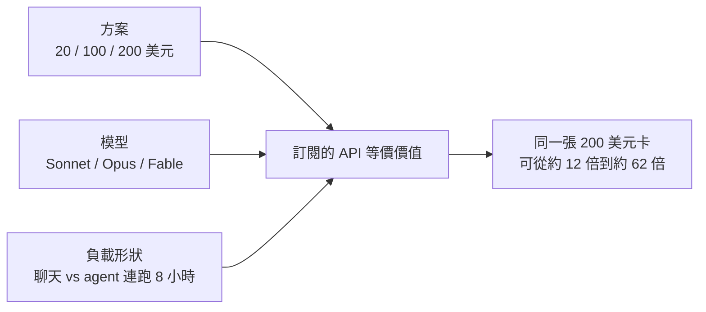
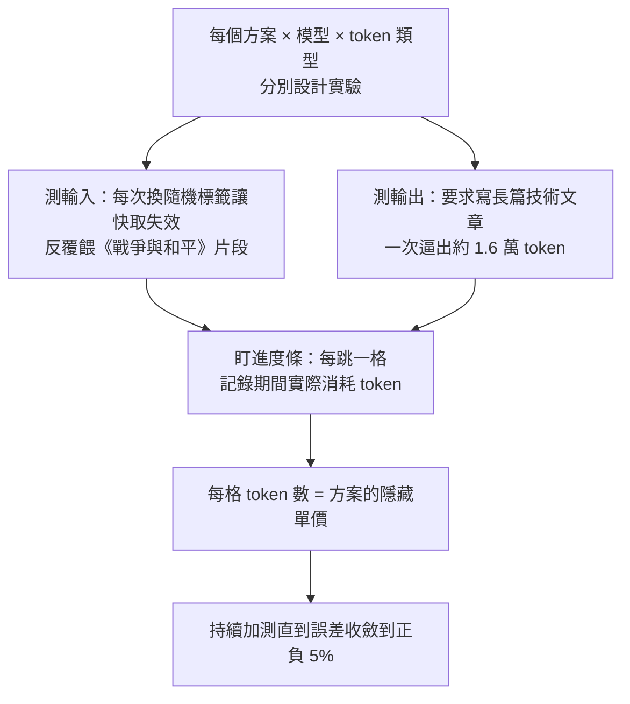
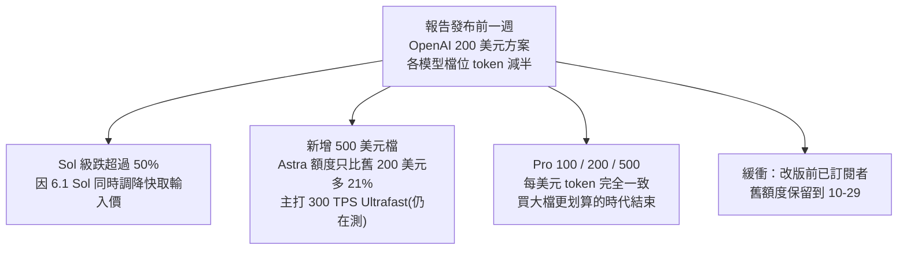
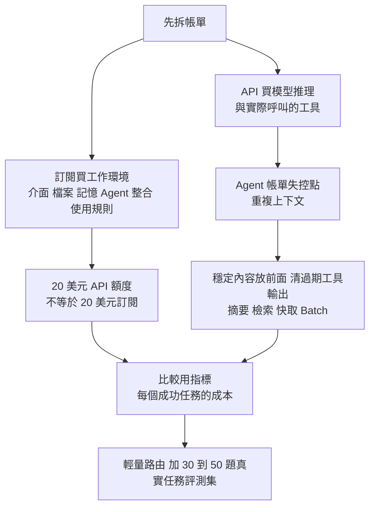

# 同樣 200 美元，Claude 訂閱值 OpenAI 的五倍？SemiAnalysis 訂閱額度實測與「補貼算力」的生意

> 整理自 YouTube「Why QQ(为什么叫QQ)」〈Claude VS OpenAI 200美元，差5倍｜10分钟看清AI订阅〉(2026-10-10，約 10 分鐘，官方簡中字幕)。
>
> ➕ 2026-11-01 增補第 9 節:Why QQ〈[AI订阅怎么选？别再乱买](https://www.youtube.com/watch?v=bs0IXxThe3o)〉(2026-10-31)——帳單兩層拆法、每個成功任務的成本、輕量路由與 30 天審計,並對照 Anthropic 官方價格頁核實。影片導讀 **SemiAnalysis 2026-10-05** 的報告〈Anthropic subscriptions offer 5x…〉(作者 Andrew Megalaa、Max Kan、Dylan Patel)，並加上作者自己的選型建議。
>
> ⚠️ **立場與材料性質**：影片說明欄註明「觀點部分含筆者判斷，僅供參考」。SemiAnalysis 報告**部分段落付費**(Cursor、Cognition 等第三方方案與底層 Tokenomics Model 資料)，本筆記只核對公開段落；影片中有幾個數字在公開段落找不到，下文「核實結果」逐一標出。
>
> 🔎 數字均為報告發布時(2026-10 初)的快照，**訂閱額度隨時會變**，這正是本文的核心論點之一。

---

## 一句話總結

**訂閱值多少，不看標價，看「方案 × 模型 × 負載」三元組。** 跑 agentic 編程這種重負載，Claude 中檔模型(Opus 5.5)的訂閱 API 等價價值約為 OpenAI 中檔(GPT-6.1 Sol)的五倍——但一半差距是 OpenAI 剛把額度砍半造成的；而且訂閱本質上是廠商**用最貴的推理算力貼錢買增長**，補貼收窄是大方向。

---

## 1. 用量條背後的隱藏單價

API 價格表把輸入、輸出、快取讀取精確標到每百萬 token；到了訂閱，只剩 Claude Code / Codex 裡一根 0–100% 的進度條(5 小時一格、7 天一格，用完就鎖)，加一句「比 Plus 多 20 倍」的宣傳語。影片指出 OpenAI 後來連這句倍數宣傳都拿掉了——**倍數看不見，廠商砍額度時你就沒有參照物**。

### SemiAnalysis 的量測方法

**插曲**：三個相同帳號中有一個額度低了約 20%，向廠商查證後對方承認那個帳號被分進一個小規模 A/B 測試——**廠商可以靜默調整你的額度**，而這套方法靈敏到抓得出來。

---

## 2. 訂閱是用最貴的算力買增長

| 指標 | 訂閱 | API |
|---|---|---|
| 占 Anthropic 總收入 | 約 10% | 其餘 |
| 占推理算力 | **超過 40%**(影片說 42%) | 其餘 |
| 每 MW 算力收入(影片數字) | 約 1,600 萬美元 | 約 1.03 億美元 |
| 毛利率(影片數字) | 約 50% | 約 92% |

綜合下來，訂閱把 Anthropic 每 MW 的混合收入拉低約 **3,600 萬美元**。

### 用滿與用不滿的毛利率(報告假設 API 毛利率 92%)

| 情境：200 美元 Claude 方案 | 全跑 Opus 5.5 | 全跑 Fable 5.1 |
|---|---|---|
| 100% 用滿 | **約 -369%** | 約 1% |
| 20% 平均利用率 | 約 6% | 約 80% |

用滿 Opus 時，廠商每收你 1 美元要倒貼近 4 美元算力。訂閱賭的是**大多數人用不滿**：用不滿的人補貼用得滿的人，而用得滿的恰恰是最忠誠、產出最高的開發者——砍額度砍的就是這批人。

---

## 3. 同一張卡，內部差五倍

200 美元 Claude 方案跑 agentic 負載時的 API 等價價值(影片引用)：

| 模型 | 一個月額度約等於 | 倍數 |
|---|---|---|
| Sonnet 5.5 | 12,529 美元 | 約 62.6 倍 |
| Opus 5.5 | 11,726 美元 | 約 58.6 倍 |
| Fable 5.1 | 2,485 美元 | 約 12.4 倍 |

- 聊兩句天和讓 agent 連跑八小時，消耗結構完全不同：後者 **96% 以上是快取讀取**。宣傳頁的「20 倍用量」對 agent 使用者幾乎沒有參考意義。
- **旗艦對旗艦**：200 美元檔 GPT-6 Astra 約 2,897 美元、Fable 5.1 約 2,485 美元，看似接近；但 **Fable 在 Claude 方案中最多只能用掉總額度的一半**——用完 2,485 美元卡裡還剩一半給其他模型，Astra 跑完 2,897 美元則直接見底。
- **真正的差距在中檔**：Opus 5.5 對 GPT-6.1 Sol(兩家的日常主力)，Claude 20 / 100 / 200 美元各檔的 API 等價價值都約為 OpenAI 的五倍。

---

## 4. 五倍有一半是 OpenAI 自己砍出來的

- 改版前 OpenAI 是「越貴越划算」：Pro 100 每美元價值約 Plus 的 2 倍，Pro 200 再約 2 倍(合計約 4 倍)。
- 影片另提 OpenAI 發給老用戶一次性 62,500 usage credits(官方口徑約 2,500 美元、年底到期)。
- SemiAnalysis 判斷 OpenAI 基本躲過大規模反彈：一半靠 DevDay 的正面新聞蓋過，一半靠一個月緩衝。**10-29 一到，被保護的重度用戶會同時撞上新額度。**

### 兩家降補貼的不同姿勢

| | Anthropic | OpenAI |
|---|---|---|
| 做法 | **漸進**：模型越高端，訂閱內 API 等價價值壓得越低；Fable 壓到約 12 倍並限用一半額度 | **核選項**：不分模型，所有檔位一刀切到接近 Fable 的水準 |
| 使用者體感 | 「新模型耗得比較快，老模型沒變」 | 「我什麼都沒做，下個月額度少一半」 |
| 其他 | Opus 5.5 降價後 Max 方案 token 增約 20%、Pro 增約 50%(報告指出不足以完全抵銷降價)；Fable 5.1 發布時未調高額度；據影片，Anthropic 原本也計畫砍訂閱，曾被社群罵回去 | 6.1 Sol 發布時額度沒跟著調，API 等價價值又降約 30% |

SemiAnalysis 認為：若使用者只用 Fable，Anthropic 訂閱業務現在就有軟體級利潤率。

---

## 5. 中國廠商：補貼還在燒

報告也測了智譜 GLM、月之暗面 Kimi、MiniMax：算力不占優的中國廠商**訂閱補貼反而還在**，而且檔位越高每美元價值越高——與 OpenAI 砍完後的扁平結構正好相反。平均每美元 API 等價價值「比 OpenAI 現在的約 12 倍略低」。影片另舉 MiniMax Token Ultra 約 23.4 倍、智譜 GLM Coding Max 約 11.6 倍。

---

## 6. 反方：token 效率

OpenAI 負責 Codex 的 Tibo(Thibault Sottiaux)一方的說法是：OpenAI 模型完成任務用的 token 更少，單看 API 等價價值會失真。SemiAnalysis 也承認此算法會放大貴模型的優勢，且業界沒有可靠的 token 效率資料。影片稱改用原始 token 數比較，五倍會縮到約兩倍半。

作者的判斷：**額度減半是實測事實，效率優勢還停在口頭主張**——一個可驗證、一個不可驗證。

---

## 7. 核實結果

| 類別 | 項目 |
|---|---|
| ✅ 已核實(SemiAnalysis 公開段落) | 報告日期 2026-10-05；訂閱約占收入 10%、推理算力超過 40%；每 MW 混合收入拉低約 3,600 萬美元；200 美元檔 Fable 5.1 約 2,485 美元且只能用一半、Astra 約 2,897 美元見底；OpenAI 200 美元檔各模型 token 減半、舊額度保留至 10-29；500 美元檔 Astra 只多 21%、主打 300 TPS Ultrafast；Pro 100/200/500 每美元一致；改版前 Pro 100 約 Plus 2 倍、Pro 200 再約 2 倍；Sol 級跌超過 50% 與快取輸入降價有關；毛利率 -369% / 1% / 6% / 80%；正負 5% 收斂方法；A/B 測試帳號額度低約 20%；中國廠商平均略低於約 12 倍 |
| 🔎 需注意 | 報告標題與開頭寫「約 5 倍」，但內文另一處寫「約 4 倍」，報告本身前後不一致；影片只講 5 倍。額度減半是由 Tibo **宣布**的，影片把他的發言描述為對報告的「回應」，公開段落未見這種框架 |
| ❓ 未能在公開段落核實 | 42% 這個精確數字(公開段落寫「超過 40%」)；每 MW 1,600 萬 / 1.03 億美元與 50% / 92% 毛利率的對照(92% 是報告的計算假設)；62,500 usage credits；MiniMax 23.4 倍、GLM 11.6 倍；改用原始 token 數後縮為約 2.5 倍；Sonnet 5.5 / Opus 5.5 的 12,529 / 11,726 美元。這些可能在付費段落或其他報導中，本筆記未獨立查證 |

---

## 8. 應用案例

### 案例 1：四步檢查自己的訂閱值不值

作者給的選型框架，配上具體做法：

1. **看負載形狀**：打開 usage 面板，看一週消耗中快取讀取占比。若 96% 以上，你是 agentic 重度使用者，「20 倍用量」這類宣傳與你無關。
2. **查真實扣費比例**：同一張卡，聊天負載和 agent 負載的價值能差三倍。用自己的典型任務跑一個 5 小時視窗，記下進度條跳幾格、做完多少事。
3. **把額度當政策，不當產品**：它是快照。OpenAI 一週砍半、Anthropic 被輿論逼退過、帳號還可能被 A/B 測試。
4. **保持工作流可遷移**：prompt、工具鏈、專案結構至少能在兩家之間切換。下次任何廠商調價，五分鐘內就能判斷影響。

### 案例 2：小團隊預算試算

三人團隊每天用 Claude Code 跑 agent 約 6 小時，主力模型 Opus 5.5：

- **只看標價**：3 × 200 美元 = 600 美元/月，看起來和 OpenAI 同檔一樣。
- **看三元組**：依報告，中檔模型下 Claude 訂閱的 API 等價價值約為 OpenAI 的 4–5 倍；若把主力換成 Fable 5.1，等價價值只剩約五分之一，且只能用一半額度。
- **決策**：日常用 Opus / Sonnet 吃訂閱，Fable 只留給少數困難任務(參考 [[model-routing-compute-allocation]])；同時保留一份可切到 Codex 的設定，作為 10-29 之後或下次調價的備案。

### 案例 3：別把「進度條」當單位

一位開發者發現同樣的任務，這週比上週多跳兩格。在下結論「模型變笨/變貪吃」之前，先檢查：是否換了模型(Fable 耗得快)、快取是否失效(換了專案或 system prompt)、還是方案本身被調整。SemiAnalysis 的方法提醒我們：**進度條是廠商定義的單位，隨時可以重新定義。**

---

## 相關筆記

- [[fable-5-1-usability-over-capability]]：Fable 5.1 本身的定位與使用體驗，對照本文「Fable 在訂閱內被壓到約 12 倍、限用一半」。
- [[gpt-6-astra-token-efficiency-and-harness]]：GPT-6 Astra 的 token 效率論點，正是本文第 6 節 OpenAI 的反方主張。
- [[openai-devday-2026-dots-sol-codex]]：OpenAI DevDay 2026，即報告所說「蓋過砍額度消息」的那場發表。
- [[llm-api-relay-stations]]：API 中轉站，另一種壓低 token 成本的路徑與風險。

---

## 9. 增補(2026-11-01):「AI 訂閱怎麼選」——把帳單拆成兩層,再用每個成功任務的成本比

> 來源:Why QQ〈AI订阅怎么选？别再乱买〉(2026-10-31,約 9 分鐘,官方 zh-Hans 字幕)。📌 立場:說明欄未見業配或聯盟連結;片中兩度請觀眾「打在公屏」,屬互動話術。與第 1–8 節(SemiAnalysis 的「同價差五倍」)互補:前者談**訂閱本身值不值**,這支談**怎麼決策**。

### 9.1 影片的五個論點

1. **看變更先看作用域,別只看標題的數字。** 10 月 29 日 OpenAI 撤回 Pro 200 的減配:低額度者的 Work 與 Codex 額度翻倍追平;Pro 100、Pro 500 也拿到 Work 與 Codex 兩倍;Plus 不在內;GPT-6 Pro 的 Chat 訊息限制另算。
2. **API 額度福利有門檻:** 影片稱符合條件的 Pro 100/200/500 每個計費週期可領 100/200/500 美元 API Credits(Business Standard 每席 20 美元、Premium 100 美元、工作區月封頂 500 美元),需主動啟用、綁自己的 API Organization、訂閱至少已付費 7 天、週期結束過期不結轉,**不提高 ChatGPT 或登入版 Codex 上限,用 API Key 跑 Codex 也不能用**。
3. **打包不等於批發價:** 10 月 12 日 X Subscription 把 Grok、Grok Bot、Cursor、X Premium 併成一個套餐;Grok 與 Cursor 共享**每週刷新的同一個 Grok 模型額度池**;Premium 以上仍可選 Claude、GPT 等第三方模型,但**從第一次呼叫起就按 API 標價用預付餘額另付**。天天在 Cursor 跑 Claude 的人,30 美元只買到一部分工作流,模型帳還在後面。
4. **Agent 帳單最容易失控的是重複上下文:** System Prompt、專案規範、工具定義、歷史訊息、程式碼片段與終端輸出,每一步請求都整段重新進入;連跑 50 次,重複部分蓋過新增問題。處理:穩定內容放前面、過期工具輸出及時清、長對話做摘要、檢索只回傳相關程式碼、**先看請求日誌再談換便宜模型**。
5. **指標改用「每個成功任務的成本」:** 分子 = 模型費 + 工具費 + 人工審核與修復時間,分母 = 通過驗收的任務數。便宜模型反覆改錯測試、漏邊界條件,省的 token 費會被你修半小時吞掉;貴模型也不自動划算。任務要有明確驗收(測試通過、Schema 合法、人工無需返工)。

### 9.2 落地做法(影片建議)

- **輕量路由:** 分類、抽取、格式轉換走低價模型;常規改碼與摘要走中檔;複雜除錯與架構決策才上前沿模型。**升級條件要寫進規則**(測試連續失敗、上下文超預算、工具呼叫異常就切換或停止)。
- **小評測集:** 選 30–50 個自己 repo 的真實任務,每週跑一遍,記成功率、延遲、重試次數、審核分鐘數。
- **30 天審計:** 列出每個訂閱的使用頻率、獨有功能、重疊額度、遷移成本,再決定保留或替換。高頻工作台留訂閱,零散任務走 API,兩邊都記錄真實用量。
- **遷移成本別漏:** 鑑權、日誌、重試、限流、評測、資料權限都得有人維護;只比價的人漏掉的是原本由產品承擔的工程勞動。
- **團隊要有可遷移路徑:** 關鍵工作流依賴列清單;模型能換,但倉庫上下文、權限、評測與稽核紀錄也要能搬走。

### 9.3 核實結果

| 狀態 | 項目 |
|---|---|
| ✅ 已核實(Anthropic 官方價格頁,2026-11-01) | Claude Sonnet 5.5:輸入 $2、輸出 $10 / MTok;快取寫入 5 分鐘 $2.50、1 小時 $4,**快取讀取 $0.10**;Batch API 輸入與輸出皆五折;Claude 4.6 以後(**Haiku 5.5 除外**)在 1M 上下文內維持標準單價;**Haiku 5.5 另有分檔**(提示 100K 以內:輸入 $0.10、輸出 $0.50、快取讀取 $0.01;超過 100K:輸入 $0.50、輸出 $2.50、快取讀取 $0.05);Claude 4.7 以後使用新 tokenizer,**同一段文字約多 30% token**,視內容而定 |
| ✅ 算式吻合(依本庫既有筆記單價) | 500 萬輸入加 100 萬輸出:Sol($2/$10)= $20 ✅、Luna($0.10/$0.50)= $1 ✅、Sonnet 5.5($2/$10)= $20 ✅;Grok 4.7($2/$6)= $16 吻合,但 Grok 單價在本庫 [[rsi-recursive-self-improvement-anthropic]] 標⚠️未核實。**影片自己也聲明:無快取、工具、長上下文加價,也不含成功率,只能當費率示例,不是採購結論**。另:GPT-6.1 超過 272K 輸入整個請求加價(輸入與快取輸入 2 倍、輸出 1.5 倍),見 [[gpt-6-astra-token-efficiency-and-harness]] §12 |
| ✅ 5 分鐘快取「命中一次就划算」 | 以 Sonnet 5.5 算:寫入 $2.50 + 讀取 $0.10 = $2.60,低於兩次完整輸入的 $4.00 ✅;1 小時寫入 $4 需更多次複用才回本,與影片一致 |
| ✅ X Subscription 層級 | 2026-10-12 推出,層級 Free / Plus $8 / Premium $30 / Super $100 / Ultra $200,Grok 與 Cursor 共用額度,既有訂閱者可暫留舊方案;官方「Premium 相當於過去分買合計約 $90」的對照有多家報導。⚠️ 以上來自二手報導([inside.com.tw](https://www.inside.com.tw/article/42627-x-subscription-grok-cursor-premium-bundle-plans-from-8-usd)、[Free Press Journal](https://www.freepressjournal.in/tech/x-launches-unified-subscription-bundling-grok-cursor-and-premium-all-details)),X 官方頁面未直讀。影片自己也提醒「新舊額度不完全等價,別急著 90 減 30」 |
| ⚠️ 部分核實 | **OpenAI 與 Cursor:** 多家報導確認 OpenAI 提議 **11 月 12 日**結束直接供應模型給 Cursor(SpaceX 收購 Cursor 後),且**終止日尚未經雙方確認**,與影片「提出的過渡日期、尚未確認最終日」一致([Tom's Guide](https://www.tomsguide.com/ai/openai-is-leaving-cursor-in-november-here-are-your-3-options)、[TheNextWeb](https://thenextweb.com/news/openai-ends-cursor-contract-spacex-acquisition-eu-switching-rules))。「自己的 OpenAI API Key 只覆蓋 Cursor 的本地 Chat 與 Agent、不覆蓋 Tab、Auto、雲端 Agent」只找到一份指南類來源,**未對照 Cursor 官方文件,未能核實** |
| ❓ 未能核實 | **10 月 29 日 Pro 200 撤回減配、額度翻倍**與**每週期 100/200/500 美元 API Credits** 的具體條件(7 天、綁 API Organization、過期不結轉、Business 席位金額):搜尋只找到 4 月推出 Pro $100(Codex 5 倍)、Pro $200(20 倍)的報導,以及 9 月起暫停新註冊 Pro $200 的第三方說法,**沒有找到 10 月底調整的第一手或多家來源**,當作影片轉述。 GPT-6.1 Terra 的 $10(=約 $1/$5)沒有在本庫找到單價來源。|

### 9.4 應用案例:一個人怎麼做 30 天審計

情境:你同時付 ChatGPT Plus、Claude Pro、Cursor,每月合計約 60 美元。

1. **記錄:** 30 天內每次用 AI 前先寫一行:任務類型、用哪個產品、有沒有用到該產品獨有功能(語音、Deep Research、雲端 Agent、Tab 補全)。
2. **拆兩層:** 把任務分成「只要模型」(批次摘要、格式轉換、分類)與「需要工作環境」(讀 PDF、長期記憶、雲端 Agent)。第一類改走 API 的低價模型並開快取與 Batch;第二類才留訂閱。
3. **建 30 題評測集:** 從自己真實任務挑 30 題,各家模型各跑一遍,記錄是否通過驗收、花了多少錢、你修了幾分鐘。算「每個成功任務的成本」,而不是看哪家每百萬 token 便宜。
4. **設路由與升級條件:** 低價模型連續兩次測試失敗就升級中檔;單次請求超過預算就停下請求確認。
5. **看 Cursor 這類中介產品的風險:** 若你的工作流依賴 Cursor 內的 OpenAI 模型,先查 11 月 12 日前後官方公告,並準備一條備用路徑(換模型或直接用 Codex)。

⚠️ 本節為科技產業資訊整理,**不構成任何購買訂閱的建議**;各家方案與額度隨時變動。

---

## 來源

- YouTube「Why QQ」〈Claude VS OpenAI 200美元，差5倍｜10分钟看清AI订阅〉(2026-10-10)：https://www.youtube.com/watch?v=9BvovCrgmnI
- SemiAnalysis〈Anthropic subscriptions offer 5x…〉(2026-10-05，部分付費)：https://newsletter.semianalysis.com/p/anthropic-subscriptions-offer-5x
- YouTube「Why QQ」〈AI订阅怎么选？别再乱买〉(2026-10-31,官方 zh-Hans 字幕):https://www.youtube.com/watch?v=bs0IXxThe3o
- Anthropic 官方價格頁(第 9 節核實用,2026-11-01):https://platform.claude.com/docs/en/about-claude/pricing
- X Subscription 報導:https://www.inside.com.tw/article/42627-x-subscription-grok-cursor-premium-bundle-plans-from-8-usd
- OpenAI 與 Cursor 合約報導:https://www.tomsguide.com/ai/openai-is-leaving-cursor-in-november-here-are-your-3-options
