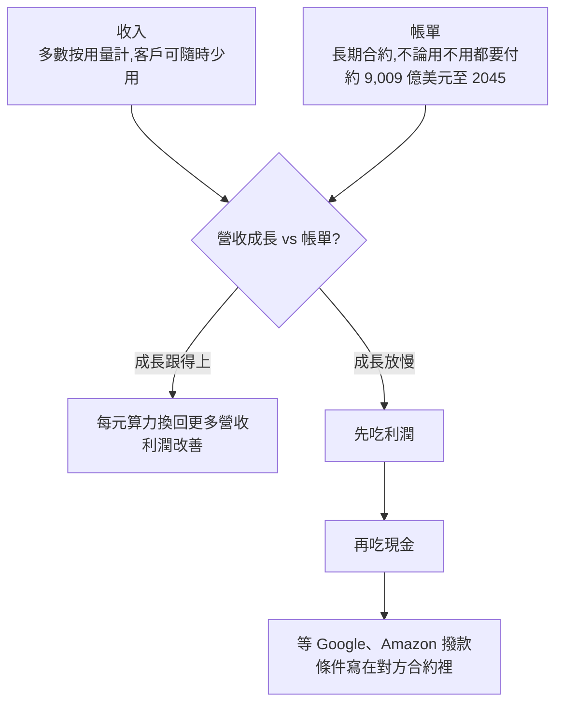

# Anthropic 上市:9,009 億美元算力帳單,成長跑得贏嗎(Agent 煉金術士 + 招股書 424B4 核實)

> 整理自 YouTube 頻道 **Agent 煉金術士**〈[Chamath 團隊研究三個月:Anthropic 的成長跑得贏帳單嗎?](https://www.youtube.com/watch?v=jyCPA0zR68Q)〉(2026-11-19,8 分 56 秒,官方字幕,時間點取自帶時間逐字稿)。影片依 Social Capital 研究文章與 Anthropic 上市說明書(SEC 424B4)整理。
>
> ⚠️ **非投資建議。** 本文整理財務結構與影片論點,不預測股價,不構成買賣建議。
> 立場:說明欄無業配;片尾 [8:38](https://www.youtube.com/watch?v=jyCPA0zR68Q&t=518s) 為頻道自我介紹。
> **核實方式:我下載了 SEC 424B4 原文(約 14 MB HTML,以文字搜尋讀取相關段落)逐項對照;Social Capital 全文是付費牆,只讀到免費預覽。**
> 與舊筆記 [[anthropic-s1-ipo-claude-code-unit-economics]] 的差別:那篇讀的是 10 月的 S-1(沒能讀原文),本篇讀的是定案的 424B4,並聚焦「固定帳單 vs 浮動收入」。

## 一、一句話

Anthropic 的收入大多**隨用量浮動**,算力帳單卻是**寫死的長期合約**(約 9,009 億美元,至 2045 年)。第三季每一塊錢營收所需的算力成本第一次回升(48% → 58%),季增率從 144% 掉到 47%。影片的結論:明年只要年化營收守住 810 億就付得起,但 2030 年前平均每年要付約 1,060 億,**營收不能只維持,必須繼續長**。

## 二、影片重點與查證(對照 424B4)

| 時間 | 影片說法 | 查證 |
|---|---|---|
| [0:30](https://www.youtube.com/watch?v=jyCPA0zR68Q&t=20s) | 長期合約約 9,009 億美元,一路付到 2045,不管用多少都要付;未來 12 個月約 707 億 | ✅ 424B4:承諾支出約 $900.9 billion,其中約 $451.6 billion 在 2030/12/31 前、其餘多在 2031–2045;約 $70.7 billion 在 2026/9/30 後 12 個月內到期;含 take-or-pay 條款 |
| [0:53](https://www.youtube.com/watch?v=jyCPA0zR68Q&t=43s) | 10 月底年化營收約 810 億美元 | ✅ 424B4:Run-Rate Revenue 約 $81 billion(2026/10/31),比 9/30 多 $10 billion。⚠️ 定義:近 28 天用量費×13 加訂閱月費年化,**是推算值,不是已入帳營收** |
| [1:04](https://www.youtube.com/watch?v=jyCPA0zR68Q&t=54s) | 還有沒寫死金額的合約,估 1,500 億美元以上沒算進去 | ✅ 424B4:未列入的其他算力/基礎設施安排估 $150–175 billion;另有一批未來額外算力估 $125–150 billion(影片沒提第二批) |
| [1:15](https://www.youtube.com/watch?v=jyCPA0zR68Q&t=65s) | 收入大多按用量,少有長期合約 | 與 424B4 風險因素方向一致(帳單為固定義務);我沒逐句對到「少有長期合約」原文 |
| [1:43](https://www.youtube.com/watch?v=jyCPA0zR68Q&t=93s) | 電力與資料中心合約 20 年、金額逐年調升、燃料漲價成本無上限由它承擔 | ✅ 424B4:部分專用電力與資料中心安排初始 20 年,含年度調升、take-or-pay 與「uncapped fuel cost pass-throughs」 |
| [2:11](https://www.youtube.com/watch?v=jyCPA0zR68Q&t=131s) | 一份合約違約,其他借款可能提早到期,連鎖反應 | ✅ 424B4:商業合約違約可能觸發 A&R 信貸協議與可轉換票據的 cross-default,導致債務加速到期 |
| [2:43](https://www.youtube.com/watch?v=jyCPA0zR68Q&t=153s) | 一年多前每賺一塊要花兩塊五算力,今年 Q2 不到五毛 | ✅ 424B4:算力與基礎設施費用占營收比 251%(2025 Q1)→ 48%(2026 Q2)→ 58%(2026 Q3) |
| [2:52](https://www.youtube.com/watch?v=jyCPA0zR68Q&t=162s) | 人事成本占營收 58% → 10%;每位員工帶進超過 660 萬美元 | ✅ 424B4 季度表:人事費用占營收 58%(2025 Q1)→ 41% → 35% → 40% → 27% → 16% → **10%(2026 Q3)**;每員工 TTM 營收超過 $6.6 million(去年同期 $1.4 million)。⚠️ 影片「58%」指的是一年半前(2025 Q1),不要與算力費用占比 Q3 的 58% 混淆 |
| [3:04](https://www.youtube.com/watch?v=jyCPA0zR68Q&t=174s) | 員工五倍多、季營收 86 倍 | ✅ 424B4:headcount 超過五倍,2026 Q3 營收是 2024 Q4 的 86 倍 |
| [3:36](https://www.youtube.com/watch?v=jyCPA0zR68Q&t=206s) | 季增率 Q2 144% → Q3 47% | ✅ 424B4 季度營收:2026 Q1 $4,731M、Q2 $11,555M、Q3 $16,956M;Q2 比 Q1 +144.2%、Q3 比 Q2 +46.7%。Social Capital 預覽同樣為 144% → 約 47% |
| [3:54](https://www.youtube.com/watch?v=jyCPA0zR68Q&t=224s) | 新模型降價少收約 6 億;臨時買 50 億短期算力,比長約貴很多 | ✅ 424B4:約 $600 million 來自新模型降價與合約折扣;Q3 含 $5.0 billion 短期承諾算力,成本「明顯高於」長約 |
| [4:20](https://www.youtube.com/watch?v=jyCPA0zR68Q&t=260s) | Q2 剛賺錢,Q3 又虧 5 億多 | ✅ 424B4:Q3 營業虧損 $567 million,Q2 營業利益 $974 million。⚠️ 影片沒說 Q3 虧損同時含 $2.0 billion 與捐贈配對相關的非現金費用;調整後營業利益 Q3 為 $2.5 billion(Q2 $2.2 billion),調整後利潤率 19% → 15% |
| [4:25](https://www.youtube.com/watch?v=jyCPA0zR68Q&t=255s) | 若每季營收停在 Q3,一年約 678 億,比明年 707 億少;2030 前平均每年約 1,060 億 | ✅ Q3 營收 $16,956M × 4 = $67.8B;2030 年前 $451.6 billion ÷ 約 4.25 年(2026/10 到 2030 年底)≈ $106B/年 |
| [4:58](https://www.youtube.com/watch?v=jyCPA0zR68Q&t=288s) | 含上市募資手上約 2,324 億美元現金與短期投資 | **未能核實**(我搜尋 424B4 沒找到這個數字) |
| [5:35](https://www.youtube.com/watch?v=jyCPA0zR68Q&t=325s) | 雲端平台銷售占比 2023 年 11% → 今年前三季 44%;巨頭抽成,成長越快抽越多 | ⚠️ **需補正**:424B4 為 2023 年 11%、2024 年 32%、**2025 年 47%**、2026 前九個月 44%;去年同期前九個月為 48%。也就是占比**今年略降,不是持續上升**;「抽成越來越多」是影片推論,占比沒有上升 |
| [5:55](https://www.youtube.com/watch?v=jyCPA0zR68Q&t=345s) | Microsoft 賣給它的算力合約至少 472 億美元 | ✅ 424B4:至少 $47.2 billion、最多 $49.2 billion,2026/11 至 2033/6,不論實際用量 |
| [6:20](https://www.youtube.com/watch?v=jyCPA0zR68Q&t=380s) | 上市同時 Google、NVIDIA、Broadcom 等再出 260 億美元買新股 | ✅ 金額:私募 $26.0 billion Class N 股,價格同 IPO 價 $83.00;⚠️ **買方不只三家**:Google 約 $10.0 billion、AMD 約 $2.5 billion、Broadcom 約 $1.0 billion、Micron 約 $1.0 billion,另有 Microsoft、NVIDIA、TSMC Partners 等 |
| [6:36](https://www.youtube.com/watch?v=jyCPA0zR68Q&t=386s) | 付給四大供應商約 4,400 億美元 | **未能核實**(沒找到四家合計) |
| [6:48](https://www.youtube.com/watch?v=jyCPA0zR68Q&t=398s) | 七位創辦人持股約 13%、投票權 61%;一股特別股拿走一半以上投票權 | 投票權 ✅:424B4 創辦人合計約 **61.1%**(含透過 Founder LLC;不含則 11.0%);Class F 一股 = 總投票權 **50.1%**。**13% 經濟持股未能核實**(這裡只確認投票數字) |
| [7:02](https://www.youtube.com/watch?v=jyCPA0zR68Q&t=412s) | Amazon、Google 合計約 28%,拿到的是無投票權股票 | ✅ 無投票權部分:424B4 說 Class N 無投票權,兩家各持逾 5%;**28% 合計未能核實**。⚠️ 424B4 也註明 Class N 轉讓給非關係人時會轉成 Class A(有票) |
| [7:20](https://www.youtube.com/watch?v=jyCPA0zR68Q&t=430s) | 9 月底到 10 月底年化營收多 100 億;Q3 營收 80% 以上來自半年內新模型 | ✅ 424B4:run-rate 多 $10 billion;「六個月內發布的模型版本」占 Q3 營收逾 80% |
| [8:05](https://www.youtube.com/watch?v=jyCPA0zR68Q&t=475s) | 明年年化營收守住 810 億就夠付 707 億 | 算術正確(81 > 70.7),但是用「年化」推算值對「已承諾支出」,不含利息與其他現金需求 |

### 2.1 影片沒提、招股書有的資訊

- **Q3 虧損含 $2.0 billion 非現金費用**(捐贈配對計畫),所以 5 億多營業虧損不全是算力貴造成,調整後營業利益其實是正的($2.5 billion,15%)。
- 季度營收(百萬美元):2025 Q1 376、Q2 787、Q3 1,382、Q4 2,040;2026 Q1 4,731、Q2 11,555、Q3 16,956。
- 九個月合計:營收 $33.2 billion(去年同期 $2.5 billion),營業虧損 $1.3 billion(去年同期 $5.2 billion)。
- 另有約 $451.2 billion 的租賃義務(預計 2026–2028 陸續開始、租期不到一年至 20 年,加權平均約 10 年),與上述承諾口徑不同,**我沒確認兩者是否重疊**,不要直接相加。
- 雲端平台占比 2025 全年 47% 為高點,今年小幅回落。

## 三、我的判讀

1. **帳單數字可信**:9,009 億、707 億、2030 前 4,516 億、take-or-pay、20 年電力約、cross-default 都在原文。影片抓重點很準。
2. **「成長 vs 帳單」框架有效,但別把年化營收當現金**:run-rate 是推算值;帳單是承諾支出,兩者不同口徑。
3. **有三處需修正或保留**:雲端平台占比並非單向上升(2025 為 47%,今年 44%)、創辦人持股 13% 與合計 28% 等經濟持股、現金 2,324 億與四家 4,400 億我沒在原文找到而未能核實、Q3 虧損含 $2.0 billion 非現金費用。
4. **關鍵分歧點正確**:Q3 營收逾 80% 來自半年內新模型,代表要不斷推新模型,而新模型要更多算力,這個循環才是風險的核心。
5. 與舊筆記 [[anthropic-s1-ipo-claude-code-unit-economics]] 對照:S-1 階段的承諾約 5,180 億,到定案說明書變成 9,009 億,規模在幾週內大幅增加。

## 四、應用案例

**案例一:看財報時分開「承諾」與「收入」口徑**
讀任何 AI 公司的上市文件,先列兩欄:固定義務(take-or-pay、租賃、最低採購)與浮動收入(用量計費)。再算「若收入停在最近一季」能否付得起未來 12 個月義務,就是影片 4:25 的壓力測試。

**案例二:自己的雲端預算也有同樣結構**
團隊若簽了一年期保留實例(固定)而業務是流量型(浮動),把「用量下降 30%」代入,看固定帳單占營收比,避免重蹈「案子少、分期照繳」。

**案例三:查核社群摘要中的百分比**
遇到「占比一路上升」這類說法,回原文看每個期間的值,就像本篇發現 44% 其實比 2025 年 47% 低。

**案例四:用 `run-rate` 當早期訊號,不當結論**
run-rate 一個月多 100 億很亮眼,但要同步看調整後利潤率(19% → 15%)與算力費用比(48% → 58%)。

## 五、相關筆記

- [[anthropic-s1-ipo-claude-code-unit-economics]] — 10 月 S-1 階段的單位經濟與承諾
- [[google-amazon-q3-2026-selloff-nick]] — Google、Amazon 作為 Anthropic 股東的財報面
- [[us-stocks-five-risks-2026q4-hike-treasury-midterm]] — 2026 Q4 美股風險全貌
- [[rsi-recursive-self-improvement-anthropic]] — Anthropic 的模型迭代與算力需求
- [[all-code-is-slop-lauren-tan-deterministic-checks-agent-alchemist]] — 同頻道另一支(agent 工程)

## 六、來源

- Agent 煉金術士〈Chamath 團隊研究三個月:Anthropic 的成長跑得贏帳單嗎?〉:https://www.youtube.com/watch?v=jyCPA0zR68Q (官方字幕)
- Anthropic, PBC 424B4 公開說明書(SEC,已下載文字比對關鍵段落):https://www.sec.gov/Archives/edgar/data/2130357/000162828026074944/anthropicpbc-424b4.htm
- Social Capital Research〈Anthropic〉(付費牆,只讀到免費預覽):https://research.socialcapital.com/p/anthropic

## 相關筆記

- [[palo-alto-applied-compute-own-your-ai-open-weight-rl-agent-alchemist]] — Palo Alto 買 Applied Compute:自訓開放權重模型與訓練+監督合一
- [[commanding-heights-ai-moat-distribution-payment-rails-agent-alchemist]] — 同主題:模型價格每年下降、價值留在入口與付款軌道的論點(Commanding Heights)