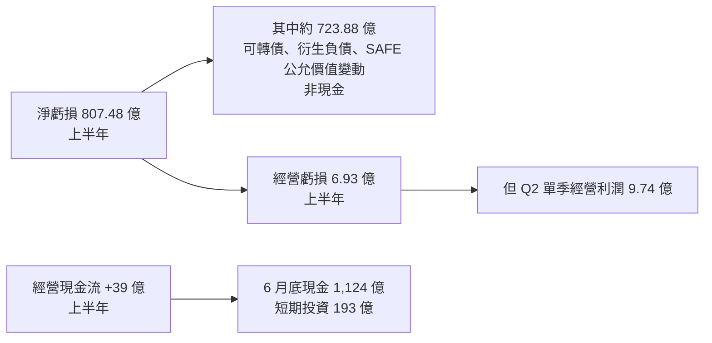

# Anthropic S-1 從工程師視角讀:807 億虧損、經營現金流轉正,與 Agent 的單位任務成本

> 整理自 YouTube 頻道 **Why QQ(為什麼叫 QQ)**〈[Anthropic IPO： 807亿亏损真相，现金流却转正](https://www.youtube.com/watch?v=0hIA9sJg4CA)〉(2026-10-27,約 10 分鐘,官方簡中字幕)。
>
> ⚠️ **核實限制**:S-1 原文在 SEC EDGAR 上([連結](https://www.sec.gov/Archives/edgar/data/0002130357/000162828026067168/anthropicpbc-sx1.htm)),但檔案超過 10 MB、SEC 又要求宣告聯絡資訊的 User-Agent,本筆記**沒能直接讀原文**,只用搜尋摘要與報導交叉比對。部分數字和**先前流出的草稿版**報導不一致,見第七節。
>
> ⚠️ **非投資建議。** 本文不預測股價,只整理財報結構與工程啟示。

---

## 一句話總結

**淨虧損 807.48 億美元**和**第二季經營利潤 9.74 億美元**可以同時成立:虧損裡約 723.88 億是可轉換票據、衍生負債與 SAFE 的**公允價值變動**(估值上升造成的會計計量),不是同額現金流出;上半年**經營現金流是正的 39 億**。讀這份報表要把**淨虧損、經營結果、現金流**分成三行看。對工程師更有用的是:Claude Code 坐在「企業為任務付費、Anthropic 為推理付帳、工程師為結果驗收」的交叉口,**每個任務成本、失敗路徑與權限邊界**才是這門生意能否持續的關鍵。

---

## 一、時間與基本事實

| 項目 | 影片說法 |
|---|---|
| 公開提交 S-1 | **2026-10-26** |
| 交易所 / 代號 | 納斯達克 / **ANT** |
| 發行價區間、股數 | 仍空著,上市**尚未完成** |
| 11 月中旬上市、1.5–2 兆美元估值 | 媒體報導的**發行預期**,不是事實 |

⭐ 影片提醒:招股書的數字各有日期,**半年、季度、前九個月不能混在一起比**。

---

## 二、收入曲線

| 期間 | 收入 |
|---|---:|
| 2023 全年 | 4,100 萬美元 |
| 2024 全年 | 3.86 億美元 |
| 2025 全年 | 45.85 億美元 |
| 2026 上半年 | **162.86 億美元** |
| 2026 Q2 | 約 116 億美元 |

半年已超過上一年全年,但**兩個期間不能直接當同口徑增速**。

**錢從哪來:** 企業按 token 用量買模型服務;個人買 Pro / Max 訂閱。Claude Code 進入開發流程後,模型呼叫和真實工作綁在一起,**帳單越來越像雲端服務**:讀程式碼、產生補丁、跑工具,每一步都在消耗 token。

---

## 三、單位經濟:每 1 美元算力換回多少收入

| 指標 | 2025 Q1 | 2026 Q2 |
|---|---:|---:|
| 每 1 美元算力對應收入 | 0.40 美元 | **2.08 美元** |
| 算力與基礎設施費用 | — | 約 56 億美元 |
| 調整後經營利潤率 | — | 19% |
| GAAP 經營利潤 | — | **9.74 億美元**(首個盈利經營季) |

⚠️ 影片提醒「管住聯想」:**2.08 只描述收入和算力費用的比例**;19% 也不能代替淨利率,人員、銷售等費用都還在帳上。

工程上的啟示:**模型能力之外,推理優化、快取和排程也能改變商業結果。** 你在自己專案也能做同類核算:把每次呼叫費用歸到任務,看收入或節省的工時能不能覆蓋它。

---

## 四、三張表要分開看

| 一行 | 數字(上半年) | 怎麼讀 |
|---|---:|---|
| 淨虧損 | −807.48 億 | 大部分是估值上升造成的會計計量,不是燒掉的現金 |
| 經營虧損 | −6.93 億 | 本業接近打平,Q2 已轉正 |
| 經營現金流 | **+39 億** | 實際收到的錢比付出的多 |

⚠️ 正的經營現金流**不保證每季都如此**:收付款時間會影響單一期間,長期合約還要繼續兌現,後面還要看資本支出。

---

## 五、長期算力合約與客戶結構

### 算力承諾(影片數字)

| 對象 | 承諾 |
|---|---|
| Microsoft 相關 | 至少 449 億美元 |
| Google | 約 1,145 億美元 |
| Amazon | 至少 1,100 億美元 |

- 期限跨多年;部分條款**實際用量不足時仍要補足付款**,不能隨意取消。
- 這些是**未來承諾**,不能全塞進當期成本。比較像一份容量規劃:需求成長夠快,提前鎖算力能保障供給;不如預期,固定付款會壓縮調整空間。
- 供應商同時是**投資方與基礎設施夥伴**,融資、採購與容量決策綁得更緊。做技術選型時這層依賴也要登記。

### 客戶

- 截至 9-30:**超過 11,900 家**客戶過去 12 個月各貢獻至少 10 萬美元;**超過 1,900 家**達 100 萬美元。
- 前五大客戶占前九個月收入約 25%,**沒有單一客戶超過 10%**。
- 但招股書也提醒:很多大客戶**沒有長期合約**或合約很快到期,可以隨時減少支出。**客戶數成長與收入穩定是兩件事。**
- DoorDash 客戶案例:主要產品上線時間縮短一半以上、每月使用 Cowork 的員工超過 7,000 人。影片:這是公司提供的案例,**適合當線索,不宜當獨立生產率實驗**。

### 治理結構

- 七位共同創辦人透過一股 **Class F** 股票掌握 **50.1% 投票權**,這股**沒有經濟權益**。
- **長期利益信託(LTBT)** 能選出董事會多數席位。
- ⇒ 普通股東可以投資,但很難改變公司路線。影片的建議:**選供應商時保留自己的退出方案。**

---

## 六、Agent 跑一次任務,帳本上有好幾行

| 環節 | 成本來源 |
|---|---|
| 讀取倉庫 | 輸入 token |
| 規劃、寫補丁 | 輸出 token |
| 測試失敗後帶上下文重試 | 再一輪輸入 + 輸出 |
| 子 agent 並行 | 縮短等待,但增加呼叫量 |

**成本失控常見原因**:上下文反覆膨脹,或一個測試失敗觸發整輪重來。

**做法**:每次任務掛一個 **trace ID**,記錄快取命中、模型呼叫、工具耗時、重試次數、人工接管。這些日誌還能指導**模型路由**:簡單分類走低預算通道,複雜遷移留給更強模型。

**安全也要進入「完成定義」**:招股書用很長篇幅披露濫用、程式碼破壞、欺騙、極端傷害等風險(影片提醒:這是**可能情境**,不能讀成都已發生)。

- Agent 能不能直接讀生產密鑰?誰能批准寫入權限?
- 工具呼叫有沒有日誌?失敗後能否回滾?
- 評測集要加入**越權請求、惡意倉庫說明、帶毒工具輸出**。正常任務跑通只代表功能可用,生產准入還要過安全測試。

---

## 七、核實與補正

**✅ 與報導一致:**

- 2023 / 2024 / 2025 淨虧損 15 億、83 億、420 億美元,2026 上半年 807 億美元,且包含可轉換票據、衍生負債與 SAFE 的公允價值變動。
- 2026 上半年收入約 163 億(Q1 約 47.3 億、Q2 約 115 億)。
- 七位共同創辦人透過 Founder LLC 掌握 50.1% 投票權。
- 長期算力承諾總計約 **5,180 億美元**、約八成不可取消;Google 合約寫明「實際支出不足須補差額」,Amazon 類似。

**⚠️ 與草稿版報導不一致(本筆記無法判定哪個是最終版):**

| 項目 | 影片(10-26 公開版) | 9 月草稿版報導(Reuters 等) |
|---|---|---|
| Google 承諾 | 約 1,145 億 | 至少 1,111 億 |
| Microsoft 承諾 | 至少 449 億 | 314 億 |
| 客戶集中度 | 前五大約 25%,單一客戶都不到 10% | 約 25% 來自**兩家**客戶 |
| 2025 全年收入 | 45.85 億 | 46 億(四捨五入) |

另有報導指出還有對 **Broadcom 約 1,612 億美元**的承諾(影片沒提)。

**⭐ 報導提到、影片沒講:** Anthropic 對雲端夥伴通路的收入以**總額法(gross)**認列,和同業比較時要注意口徑。

**⚠️ 未能核實:** 每 1 美元算力收入 0.40 → 2.08、Q2 經營利潤 9.74 億、調整後經營利潤率 19%、經營現金流 39 億、現金 1,124 億、客戶數 11,900 / 1,900、DoorDash 案例、代號 ANT 與 10-26 提交日。

---

## 八、應用案例:在團隊裡落地一張 Agent 驗收面板

影片建議先放**五項指標**:

| 指標 | 怎麼算 |
|---|---|
| 任務合併週期 | 從接單到合併的時間 |
| 一次驗收通過率 | 第一次提交就通過的比例 |
| **人工接管次數** | ⭐ 只能加一個指標時先加這個 |
| 合入後缺陷率 | 上線後發現的缺陷 ÷ 合併任務數 |
| 每個成功合併任務的總成本 | (模型 + 工具 + 重試 + 審查工時) ÷ 成功合併任務數 |

**具體做法:**

1. 先用一張表記錄 **20 個真實任務**,樣本不必漂亮,口徑要能重現。
2. 任務分類:缺陷修復、遷移、新功能。
3. **每週看分布,不只看平均**:少數超長任務可能吃掉大部分預算,也可能恰好是最有價值的工作。
4. **按模型版本留快照**:升級後如果成功率提高、重試也增加,就能直接判斷這次升級划不划算。
5. **保留失敗樣本**:只看成功案例,會漏掉 agent 在陌生依賴、舊程式碼、不完整需求上的額外成本。

**降低供應商鎖定:**

- 把模型呼叫包在內部介面後面。
- 保存**可跨模型執行的驗收集**。
- 給提示詞和工具 Schema 做版本管理。

⇒ 價格、容量或政策變了,可以換實作,不必重寫整條業務鏈。

**以後看 AI 編程新聞先問四件事:任務成了多少?花了多少?失敗誰兜底?供應商能不能換?**

---

## 相關筆記

- [[ai-compute-token-economics]]:算力與 token 經濟學。
- [[ai-subscription-api-equivalent-value-semianalysis]]:訂閱與 API 等值價值的比較。
- [[agent-harness-dead-data-flywheel-katz]]:harness 成本差距與「花多少錢」是 harness 吃不掉的三件事之一。
- [[rsi-recursive-self-improvement-anthropic]]:Anthropic 的 IPO 與安全表態互相糾纏(§9 一帶)。

---

## 來源

- YouTube:Why QQ〈Anthropic IPO： 807亿亏损真相，现金流却转正〉 https://www.youtube.com/watch?v=0hIA9sJg4CA (2026-10-27,官方簡中字幕)
- SEC EDGAR,Anthropic, PBC Form S-1(本筆記未能直接讀取): https://www.sec.gov/Archives/edgar/data/0002130357/000162828026067168/anthropicpbc-sx1.htm
- AI News Weekly,〈Anthropic S-1 Shows $16.3B H1 Revenue, 25% From Two Customers, and $80.7B Non-Cash Loss〉(草稿版報導): https://aiweekly.co/alerts/anthropic-s-1-shows-163b-h1-revenue-25-from-two-customers-and-807b-non-cash
- BusinessDay(Reuters),〈Anthropic plans $518bn AI infrastructure spend, 80% non-cancellable〉: https://www.businessday.co.za/world/international-companies/2026-09-29-anthropic-plans-518bn-ai-infrastructure-spend-80-non-cancellable/
- Forkast,〈Anthropic's S-1 is here: the $518 billion commitment is the real story〉: https://forkast.news/anthropics-s-1-is-here-the-518-billion-commitment-is-the-real-story/
