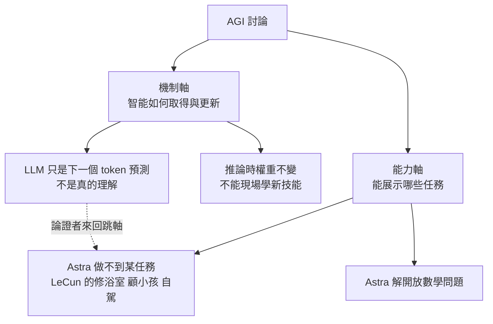

# Astra 解出十個數學開放問題,然後呢?用「機制」與「能力」兩條軸看 AGI 之爭

> 整理自 YouTube 頻道 **Caleb Writes Code** 兩支影片:〈OpenAI Astra new model explained..〉(2026-08-04,約 9.2 分鐘)與〈AGI, are we there yet..〉(2026-09-09,約 9.3 分鐘)。兩支主題相連:前者談 Astra 的數學成果,後者把「是否達到 AGI」拆成兩條軸討論。
>
> **立場揭露:** 前片含 Zo(Zo Computer,雲端常駐 agent)業配,後片含 Micro Center 業配,本文**不轉述**。
>
> **逐字稿說明:** 兩片皆無官方字幕,逐字稿以 CPU 版 Whisper 轉錄,可能有同音字誤差。已還原的人名:Yen LeCoum → Yann LeCun;Francois Shirley → François Chollet;Mario(from Anthropic)→ Dario Amodei;Boris Sherney → Boris Cherny(兩者皆經使用者 2026-11-07 確認);Demis Hasabis → Demis Hassabis;RKGI3 → ARC-AGI-3;Zou / Zoho → Zo。
>
> **整理日期:** 2026-11-06。

---

## TL;DR

1. **事實層:** OpenAI 在 2026-08-01 公布未發布的內部模型 Astra 解出十個數學 / 理論電腦科學開放問題,**每個結果附 Lean 檔**(公開 repo `openai/ten-proofs`,Apache 2.0)。「約 2,000 美元」是以 Sol API 價格估算的**算力成本**,不是獎金。
2. **講者的分析:** 這不證明 AGI,但改變了成本結構 —— **人類瓶頸從「解題」移到「選題與驗證」**,與寫程式的轉變同型。
3. **AGI 之爭的兩條軸:** **機制**(智能怎麼取得與更新)與**能力**(能展示什麼任務)。大家在兩軸間來回跳,所以永遠吵不完。
4. **機制軸:** 模型權重在推論時不變;ARC-AGI-3 上 99.9% 的分數**有很大部分是 harness 的功勞**,可視為「系統層早期 AGI 跡象、模型層尚未」。
5. **能力軸:** 用「修不了浴室、不會顧小孩」之類任務清單否定 AGI 是弱論證;該量的是**遷移、推理、適應**。
6. 講者結論:定義之爭沒那麼重要,重要的是**管理期待** —— 第一個 AGI 可能比現有的一些專用 AI 還弱,也不會一夜改變一切。

---

## 1. 十個開放問題:真正證明了什麼

### 已核實的事實(對第三方報導)
- 公布日 2026-08-01(部分二手來源寫 8/2);模型 Astra 當時未發布。
- 每個結果附機器可驗證的 Lean 證明(**已核實**:OpenAI 結果頁畫面 [3:55] 寫明「formalized each argument in a Lean certificate」)。證明放在 GitHub `openai/ten-proofs`(Apache 2.0,二手資料;repo 本身未能直接讀取核對)。
- 清單包含高維球堆積密度的新上界、對 Connes rigidity conjecture 的否證、Ehrhart 體積猜想的證明、三個 Erdős 問題等(第三方列舉;**完整十題見下方「延伸閱讀」**)。
- 約 2,000 美元是「用 GPT-5.6 Sol API 價格折算 token」的**估計**(**已核實**:畫面 [3:55] 原文 "would cost roughly $2,000 at Sol API rates"),約每題 200 美元;不含失敗嘗試。
- 「Noam Brown 承認團隊嘗試過其他重要問題但沒成功」:**未能核實**。我查到的報導提到 OpenAI 嘗試其他問題未成功,但未見歸於 Brown 的原話;失敗率未公開;同行審查仍在進行。

### 影片說法的修正與補充
- 影片把球堆積講成「證明最大密度」。更準確:這次是**高維堆積密度的一般上界**(1978 年以來首次改進),**給出天花板,不是更好的堆法**。講者說「26 頁、Lean 認證」與「OpenAI 團隊整理成手稿」大致吻合第三方描述,但頁數我沒獨立核到。
- 講者的**警語是對的且被證實**:$2,000 不含失敗嘗試與沒走通的題目,等於**單一路徑成本**;同時大量人力仍花在選題、轉成可驗證敘述、評估結果。
- 「數學只是智能的一個領域:邊界清楚、常有已知目標,AI 容易發揮」—— 講者的判斷,合理但屬觀點。

### 講者要你想的兩件事
1. **LLM 只是隨機鸚鵡嗎?** 當模型產出需要深層理解的新結果,這個論點的適用邊界在哪?
2. **角色轉移:** 人類負責引導與脈絡化,AI 做工作,人類驗證 —— 在程式開發已經發生。Lean 的價值就在於**驗證成本低且可機器執行**;沒有這種驗證器的領域,瓶頸會更痛。可對照 [[agent-verification-before-scale-lauren-tan-reaction]]。

---

## 2. AGI 之爭:兩條軸

講者背景鋪陳:Penrose(1980s)主張人類理解本質上非演算法、無法由電腦產生 —— 講者形容他是「鬆散套用 1930 年代數學定理」(這是講者的評價,Penrose 的論證有大量反駁,此處只記觀點)。現今模型架構雖借用神經科學詞彙,**實際與人腦並不相像**,所以「若接近 AGI,AGI 不需要複製人類智能的機制」。

### 機制軸:Chollet 的標準

François Chollet 的觀點(講者轉述):**能否在新情境取得新技能**。Astra 與 Fable 這類模型在實驗室訓練數月、發布 checkpoint,**智能烙在參數裡、推論時基本不可變**,所以依他的定義還沒達到。ARC-AGI 就是量測「現場學會沒人說明的規則」。

### ARC-AGI-3 99.9% 與 harness

講者:Astra 在 ARC-AGI-3 可到 99.9%,但**模型本身並沒有學到東西**;不同 harness 下分數差很大。harness 提供上下文管理、較長記憶、執行環境與錯誤復原 —— 這些智能要素在模型層單獨看不到。把模型接上 Codex 這類 harness(skills、資料庫的 MCP、終端機、迴圈),等於**把模型架構目前做不好的部分外包給手寫程式**。

結論:不能說模型本身達到 AGI,但「模型 + harness」整體有早期跡象,harness 是**權宜之計(stop gap)**。

**ARC Prize 官方說法(已核實,[ARC Prize 部落格](https://arcprize.org/blog/astra)):** 標準 harness(max)62.7%、成本 $26,098;Provider Adapter harness(high)99.9%、成本 $18,817;adapter 的 max 為 98.6%。99.9% 來自 high 設定而非 max。ARC Prize 明言「we are not claiming that it is AGI」,並說飽和此基準「would not be proof of achieving AGI」。因此影片「harness 是功勞之一」與 ARC Prize 的立場一致;但「系統層是 AGI 早期跡象」是講者的判斷,ARC 並未這樣說。畫面 [3:11] 為 ARC-AGI-3 互動遊戲截圖(Level 3/7)。二手報導另有 66%、98.6%、99.99% 等不同數字,**未定**,以官方頁為準。

這點與本庫既有整理一致,且有更細的數字:[[gpt-6-astra-token-efficiency-and-harness]] §2(換 harness 分數差 37 個百分點)與 [[arc-agi-3-agentic-benchmark]]。

### Bitter Lesson 的推論

harness 是人手工寫規則與程式;若 Sutton 的「苦澀教訓」成立,**今天 harness 裡的一部分結構,終將被學習到的行為取代**。講者引用 Claude Code 創作者 Boris Cherny 把 harness 視為取捨:工程工作可把模型能力延伸約 10–20%(**此數字講者轉述,我未找到原始出處**)。

### 能力軸:Tim Urban 的 ANI → AGI → ASI

Tim Urban(Wait But Why,2015 年 1 月系列文 *The AI Revolution*,距今約 11 年)把 ANI/AGI/ASI 三分法普及開來。**需修正:** 一說此三分法源自 James Barrat 2013 年的書《Our Final Invention》,Urban 是普及者而非原創者(來源:[Medium 整理文](https://medium.com/ai-revolution/where-are-we-currently-three-calibers-of-ai-8c72a9974bc1),未逐字核對原書)。ANI 是窄智能,AGI 是「跟人一般聰明、而非某個專長」。因此:
- **用任意任務清單(修浴室、洗衣、顧小孩)證明「還沒 AGI」是弱論證** —— 通用智能的核心是**遷移、推理、適應**,而非各任務都最強。
- 反過來說,**第一個 AGI 可能在某些窄任務上還輸給 ANI**。

### 為什麼還是得談 AGI

即使 Dario Amodei(人名已經使用者確認;但「AGI 是行銷詞」的說法**未能核實**)認為 AGI 是行銷詞(講者語氣諷刺:他同時說「資料中心裡的天才之國」),AGI 帶著**經濟權重**:資金分配、公司估值、資料中心支出、人才招募。Demis Hassabis 曾說 2030 年前達到 AGI 約五成機率(**已核實,次級來源**:Lex Fridman 訪談與 2026 年 1 月 Davos 報導皆為「50% by 2030」;部分報導措辭為「5 至 10 年」,見 [OfficeChai](https://officechai.com/ai/theres-a-50-chance-that-einstein-level-ai-systems-will-be-created-in-5-years-googles-demis-hassabis))。講者也引 Jensen Huang「OpenAI 用 NVIDIA 晶片實現了 AGI,重點是用 NVIDIA 晶片」(**未能核實原話**)。各家定義不同 ⇒ 各家會在不同時間點「達成」。

**風險:** 兩次 AI 寒冬都由過度承諾與交付不足造成;一再「五年後」只會重蹈覆轍。

---

## 3. 核實狀態

### 已核實
- Astra 十題公布日(2026-08-01)、Lean 證明公開(畫面 [3:55] 官方頁)、成本口徑(畫面 [3:55]:Sol API 價格折算的 token 成本)。
- Hassabis「2030 年 50%」(次級來源,見上文)。
- ARC-AGI-3 高分受 harness 影響 —— 本庫 [[gpt-6-astra-token-efficiency-and-harness]] §2 有 ARC Prize 官方部落格為據。

### 需修正
- 球堆積「證明最大密度」→ 實為一般上界改進(1978 以來首次)。
- 畫面 [4:49] 出現的是 Chapter 1「Exponential Growth Rate of the Cohn–Elkies Sphere Packing Linear Program」;「26 頁」**未能核實**(無法讀取 OpenAI PDF 全文,見延伸閱讀)。
- 「$2,000 是 OpenAI 花的費用」→ 是以 Sol 價格折算的 token 成本估計。
- Tim Urban 三分法的「原創」→ 普及者;一說源自 James Barrat(見上文)。
- 「99.9% 證明模型能力/AGI」→ ARC Prize 明言不是 AGI 證明,且 99.9% 來自 adapter harness 的 high 設定。

### 未能核實(以影片轉述看待)
- LeCun「2030 年沒人會用 LLM」的原話與 LinkedIn 留言;Chollet 訪談內容。
- Boris Cherny「harness 延伸 10–20%」;Amodei「AGI 是行銷詞」;Jensen「OpenAI 實現 AGI」。
- Noam Brown 承認失敗嘗試(歸屬未能核實);影片「26 頁」證明頁數(OpenAI PDF 本環境無法讀取全文)。
- Astra 在 8/4(影片日)被講成「傳聞中的 GPT-6」—— 之後已正式發布為 GPT-6 Astra(見既有筆記)。

---

## 延伸閱讀與深度補充(2026-11-07 核實增補)

**Astra 十題完整清單**(依 OpenAI 整理稿的鏡像 [alphaxiv 2607.ten-advancements](https://www.alphaxiv.org/abs/2607.ten-advancements.md) 摘要,已讀到):高維球堆積、二元與球面碼(binary and spherical codes)、非 sofic 群(non-sofic groups)、Connes rigidity conjecture 的否證、算術電路複雜度、量子平行重複(quantum parallel repetition)、最近向量問題(closest vector problem)、Ehrhart 體積猜想、多色 Ramsey 數、第十題(鏡像標題為 "Compactness and degeneracy";另一則二手報導寫作 extremal number conjectures,**未定**)。

**球堆積:主定理與 1978 年的關係(已讀鏡像摘要,未能讀原 PDF)**
- 畫面 [4:49] 的章節標題為 Chapter 1「Exponential Growth Rate of the Cohn–Elkies Sphere Packing Linear Program」;摘要寫 lim sup Δ_d^{1/d} ≤ lim LP_d^{1/d} = √(e/2π)(Δ_d 為最大球堆積密度,LP_d 為 Cohn–Elkies 線性規劃給出的上界)。
- 換算指數:α* = ½·log₂(2π/e) ≈ 0.6044,即密度上界 ≈ 2^{−(0.6044+o(1))d};原文引用的 Kabatiansky–Levenshtein(1978)指數為 0.59905576…。兩者之差很小,但方向是**上界變得更緊**。
- 背景:Cohn 與 Zhao(2014,[arXiv:1212.5966](https://arxiv.org/pdf/1212.5966))證明 Cohn–Elkies 界「永遠不弱於」KL 界,但未決定指數是否改進;2020 年 Afkhami-Jeddi、Cohn、Hartman、de Laat、Tajdini 有此猜想。
- **判讀:** 這是「天花板」的改進,不是更好的堆法;OpenAI 公告本身、同行審查與 arXiv 版本**均未能核實**(本次搜尋找不到 arXiv 版)。影片說的「證明最大密度」仍是錯的。

**ARC-AGI-3 harness 差異(已讀 [ARC Prize 官方部落格](https://arcprize.org/blog/astra))**
- 標準 harness:模型可保留自選的筆記(visible notes),Astra(max)62.7%。
- Provider Adapter harness:保留模型不透明的推理狀態、長對話做 compaction,Astra(high)99.9%、(max)98.6%。
- 同一模型、差 37 個百分點 ⇒ 分數的「模型」部分與「harness」部分難以切開,這正是影片「模型層沒學到東西、harness 才有記憶與復原」論點的數據支撐。
- 相關對照:[[gpt-6-astra-token-efficiency-and-harness]] §2。

**Hassabis 與 Urban(次級來源)**
- Hassabis:Lex Fridman 訪談與 2026 年 1 月 Davos 報導皆為「約 50%,2030 年前」;他對「真正的 AGI」門檻很高(列出的報導來源:[OfficeChai](https://officechai.com/ai/theres-a-50-chance-that-einstein-level-ai-systems-will-be-created-in-5-years-googles-demis-hassabis))。
- Urban:2015 年 1 月系列文預測中位數專家時間為 AGI 2040、ASI 2060;Luke Muehlhauser(2015)反駁「每個 ANI 進步都會累積成 AGI」。2026 年的評論認為 ANI/AGI/ASI 三分法已不貼近現況。

**未讀到、不要引用的東西**
- OpenAI 的 `ten-proofs-oai.pdf` 在本環境無法讀取文字(PDF 壓縮串流),所以「26 頁」「Lean 檔逐條對應」「repo 內容」未能親自核對。
- 第三方 DEV 文章稱 2026-08 初 repo 僅一個 commit、且無外部人士公開編譯;這是快照,之後狀況**未核實**。

## 應用案例

### 案例 1|評估「AI 解了某某難題」的新聞

三步:**(1) 有沒有機器可驗證的產物(如 Lean)?** 有則可信度高。**(2) 成本是單一路徑還是含失敗?** 問失敗率。**(3) 人類在選題與轉述上投入多少?** 若你的領域沒有驗證器,不要照搬這個結論。

### 案例 2|公司內部「該不該說我們有 AGI」的措辭

用兩條軸寫決策文件:機制 —— 模型是否能在使用期間更新?(多半否,靠記憶層 / harness 補);能力 —— 在**你的任務分佈**上遷移與適應表現如何?用你自己的評測集,不要拿通用清單。

### 案例 3|把 harness 當成「可被取代的腳手架」來設計

依苦澀教訓,harness 規則越寫越多不是好事。設計時**標記哪些是為了彌補今天模型的缺陷**(例如手動 context 壓縮、固定重試次數),每次換新模型就重測能不能拿掉。可參考 [[claude-sonnet-5-5-release-effort-migration]] 的遷移思路。

---

## 來源

- YouTube:[OpenAI Astra new model explained.. — Caleb Writes Code](https://www.youtube.com/watch?v=O1JMZvgFxKE)(2026-08-04)—— **該片無官方字幕,逐字稿以 CPU 版 Whisper 轉錄,可能有同音字誤差**;含 Zo 業配,未納入。
- YouTube:[AGI, are we there yet.. — Caleb Writes Code](https://www.youtube.com/watch?v=noPuRPDiY6k)(2026-09-09)—— **該片無官方字幕,逐字稿以 CPU 版 Whisper 轉錄,可能有同音字誤差**;含 Micro Center 業配,未納入。
- 核實用:
  - [OpenAI says its next model, Astra, has solved ten open problems in mathematics — The Next Web](https://thenextweb.com/news/openai-astra-model-ten-math-proofs-non-sofic-groups)
  - [OpenAI Astra: Ten Open Math Problems Solved with Machine-Checkable Proofs — Better Stack](https://betterstack.com/community/guides/ai/openai-astra)
  - [Astra ten open problems, Lean proofs — Pasquale Pillitteri](https://pasqualepillitteri.it/en/news/9274/astra-ten-open-problems-lean-proofs)
  - [OpenAI's GPT-6 Astra on ARC-AGI-3 — ARC Prize](https://arcprize.org/blog/astra)
- 2026-11-07 核實增補(已開啟):
  - [ARC Prize — Astra on ARC-AGI-3](https://arcprize.org/blog/astra)(已讀全文)
  - [OpenAI「Ten Advances」整理稿 PDF](https://cdn.openai.com/pdf/ten-proofs-oai.pdf)(本環境無法讀文字)
  - [alphaxiv 鏡像 2607.ten-advancements](https://www.alphaxiv.org/abs/2607.ten-advancements.md)(摘要與第一章,未讀完)
  - [Cohn & Zhao, Sphere packing bounds via spherical codes(arXiv:1212.5966)](https://arxiv.org/pdf/1212.5966)(摘要層級)
  - [OfficeChai — Hassabis 50% 報導](https://officechai.com/ai/theres-a-50-chance-that-einstein-level-ai-systems-will-be-created-in-5-years-googles-demis-hassabis)(次級)
  - [Medium — ANI/AGI/ASI 三分法來源說明](https://medium.com/ai-revolution/where-are-we-currently-three-calibers-of-ai-8c72a9974bc1)(次級)
  - [TNW — OpenAI Astra ten math proofs](https://thenextweb.com/news/openai-astra-model-ten-math-proofs-non-sofic-groups)(次級,已讀)
  - 影片畫面:[3:55] OpenAI 結果頁(五題與 $2,000 字樣)、[4:49] 球堆積章節、[3:11] ARC-AGI-3 遊戲截圖(O1JMZvgFxKE [3:55]、[4:49]; noPuRPDiY6k [3:11])
- 本庫相關:[[gpt-6-astra-token-efficiency-and-harness]]、[[arc-agi-3-agentic-benchmark]]、[[agent-verification-before-scale-lauren-tan-reaction]]、[[claude-sonnet-5-5-release-effort-migration]]

> ⚠️ 數學成果的二手描述可能不準,**最終以 OpenAI 公告與 `openai/ten-proofs` repo 為準**;同行審查仍在進行。
