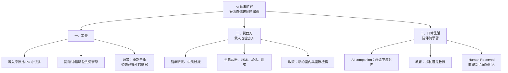
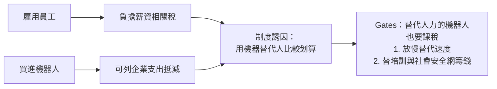
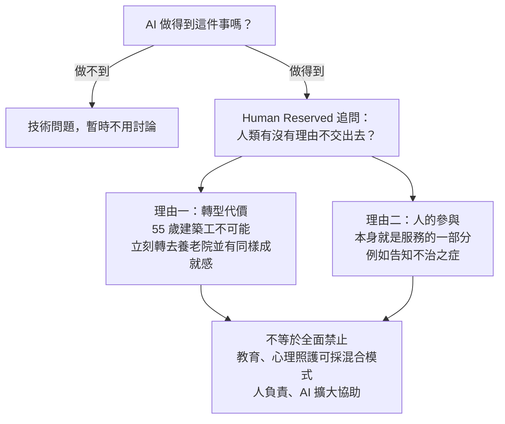

# Bill Gates〈AI 動盪時代〉長文導讀：工作、機器人稅、雙面刃、陪伴與「Human Reserved」

> 整理自 YouTube「Gary Chen」〈Bill Gates 發長文警告世人：AI 將帶來最動盪的時代，我們準備好了嗎？〉(2026-10-10，約 12.7 分鐘，官方繁中字幕)。影片導讀 Bill Gates 於 **2026-08-26** 在 Gates Notes 發表的近 6000 字長文 *The turbulent AI era is here*，並穿插作者引用的幾份研究與反方觀點。
>
> ⚠️ **立場揭露**：作者在說明欄推廣自家 Skool 社群(「查看完整文章還有提示詞模板」)與付費「AI 實戰營」，本筆記不轉述付費素材。作者自述「頻道沒有意識形態，單純分享觀點」；影片中「機器人稅難以執行」「按風險分級管理」等段落是**作者補充的反方/延伸論點，不是 Gates 原文主張**，下文會分開標示。
>
> 🔎 **補正說明**：影片引用的研究數字已逐一對照原始論文，差異處以「🔎 補正」標出。

---

## 一句話總結

**AI 的好處和傷害會同時到來，而且速度快過政府和社會的準備。** Gates 的核心不是「AI 好或壞」，而是：工作、公共安全、日常生活三條戰線都需要**現在就設計制度**，包括重新平衡勞動與機器的稅負、建立跨部門/跨國的新機構，以及畫出一塊「即使 AI 做得到，人類也選擇保留」的 **Human Reserved** 領域。



---

## 為什麼值得讀：寫文章的人是誰

- **1975 年創辦 Microsoft**，Windows 與 Office 定義了個人電腦時代——他不只搭上上一波科技浪潮，而是掀起浪潮的人。
- **2008 年後轉向 Gates Foundation**，長期投入全球醫療、疫苗、教育、農業與貧窮問題。
- 也就是說，他同時看過「技術如何創造巨大生產力與財富」，以及「世界各角落實際怎麼運作」。由這樣的人說「我們沒準備好」，分量不同。

---

## 一、工作：這次 AI 來適應人，不是人去適應 AI

### 1.1 為什麼這次比 PC 革命快

| | 個人電腦革命 | AI 革命 |
|---|---|---|
| 明顯改變工作方式所需時間 | 約 20 年 | Gates 認為會快很多 |
| 前置條件 | 硬體降價、軟體開發、員工學操作、公司重做流程 | 直接跑在**已有的手機與電腦**上 |
| 學習門檻 | 要學一套指令/介面 | 自然語言，直接說要做什麼 |
| 誰適應誰 | 人適應機器 | AI 可看訓練影片、讀公司既有資料——**AI 適應人** |

過去每波技術革命後，市場上還會留下大量「要靠人動腦」的工作；**這次 AI 連動腦本身都能替代**。AI 客服已經存在，等機器人能靈活地看、聽、移動，建築、餐旅等體力工作在未來十年也會受衝擊。

### 1.2 最擔心的是初階與中階職位

公司通常會先把**規則清楚、結果可被人檢查**的任務交給 AI，而這正是新人用來累積經驗的工作。作者補充親身觀察：很多客戶公司已經不再招初階工程師與初階 PM。

### 1.3 但「重新分配」可能比「消失」更常見

| 研究 | 發現 | 意涵 |
|---|---|---|
| 國際勞工組織(ILO)調查 | 多數工作較可能是**內容被重新分配**(一部分交給 AI)，而非整份消失 | 「增強」比「取代」常見 |
| 客服人員研究(Brynjolfsson、Li、Raymond) | AI 把資深同事的回答方式變成新人可參考的提示 | 同一工具可**裁人**，也可**縮短新人學習期** |
| Daron Acemoglu 總體模型 | 未來十年 AI 帶來的總要素生產力增幅**不超過 0.66%** | 個人產出變快 ≠ 整體經濟同比例成長 |

> 🔎 **補正(客服研究數字)**：影片說「五千名客服、平均約 15%、資淺者近 30%」。原論文 *Generative AI at Work*(QJE 2025)樣本為 **5,179 名**客服人員，平均每小時解決問題數提升 **14%**，新手與低技能者提升 **34%**。方向一致，數字略有出入。
>
> 🔎 **補正(Acemoglu)**：0.66% 指的是**十年累計的總要素生產力(TFP)上限**，Acemoglu 本人的中位估計更低；不是「GDP 只多 0.66%」。

**結論**：AI 能力在提升，但工作會消失多少、又會長出多少新需求，目前沒有人能給出答案；**最後是哪一種結果，取決於公司怎麼重新設計工作**。

### 1.4 政策：重新平衡勞動與機器的課稅(Gates 主張)

現行制度本身就在鼓勵用機器替代人：



他的理由：一旦更多人失業或工時下降，政府所得稅收入減少，需要協助的人卻變多，錢必須從某處來。

**作者補充的反方觀點(非 Gates 原文)：**

- 「替代人力」很難定義：醫療模型幫醫生省兩小時，用掉的 token 算輔助還是替代？辦公軟體多一顆 AI 按鈕，要對哪段使用量課稅？
- 企業可以靠改名、拆分服務、搬到其他地區規避。
- 另立 AI 專屬稅不僅難執行，也可能壓低投資與創新。
- 結論：稅制爭議不是一句「該課/不該課」能結束，要看會不會連有益用途一起壓到。

---

## 二、同一個 AI，為什麼既能救人也能害人

| 好的一面 | 壞的一面 |
|---|---|
| 讀大量論文，幫研究者找到人類漏掉的細節、挑出更值得做的實驗 | 把網路上零散的炸彈、生物武器、電腦病毒資料，整理成**更容易理解與執行的步驟** |
| 協助辨識中風、心臟病發，讓沒有專科醫師的小醫院更快反應 | 聲音模仿、影像偽造；**大量產生不同版本，逐一測試哪種最容易騙到人** |
| 替公司找出系統漏洞 | 替攻擊者找出**同一個**漏洞 |

日常生活中大家最先碰到的，可能不是好處，而是**詐騙、深偽與假消息**。醫院、銀行、供水、電網、福利平台一旦出事，最先承擔後果的是等手術的病人、帳戶被鎖的客戶、靠補助過活的人。

### 2.1 Gates 的建議：建立新的國內與國際制度

類比 911 之後美國政府為國安大幅重組，但 AI 的牽涉範圍比單一國安議題更廣，現有機構不是為這種風險設計的。兩個難處：

1. **國內：部門各管一塊拼不出完整答案。** 勞工部門懂失業但不懂生物安全；商業監管機關懂市場集中，卻不熟兒童與 AI companion 的問題。
2. **跨國：比核武管制更難。** 核武有特殊材料、濃縮設施、大型基地可追蹤，各國也有避免核戰的共同利益；模型訓練的核查能力目前弱，各國對「該限制什麼」也沒有共識。

就算各國同意「暫停發展」，也得先回答四個問題，否則暫停只是把問題往後延：


### 2.2 作者補充：按風險分級、分層負責(非 Gates 原文)

比起籠統地「管理 AI 發展」，有人主張先講清楚**管哪個風險、在哪一層介入**：

| 對象 | 對應要求 |
|---|---|
| 最強的前沿模型 | 能力測試、事故通報 |
| 醫療 AI | 臨床驗證、責任歸屬 |
| Deepfake 影片 | 標示來源、管住平台上的散播 |
| 一般辦公工具 | 聚焦隱私與資料使用 |

新規則先在有限範圍試行，再依結果調整，不必第一天就用同一套限制包住所有 AI。

---

## 三、日常生活：陪伴、學習與 Human Reserved

### 3.1 AI companion：永遠不反對你的朋友

Gates 談到自己的成長經驗：小時候朋友不多，是在母親幫助下才慢慢學會和不同的人相處。他懷疑如果當年有一個**永遠有空、永遠不生氣、總用他最舒服的方式回應**的 AI companion，自己還會不會願意踏出舒適圈。

- **吸引力是真的**：凌晨三點沒朋友在線、心理師無法即時回覆時 AI 在；對行動不便者或孤獨長者，它可能是少數接觸外界的管道。
- **風險也是真的**：一段永遠不反對你、不要求妥協、不會受傷離開的關係，你練到的是「相處」，還是在養一個應聲蟲？孩子可能少掉面對摩擦、承擔後果、理解他人的機會；大人則可能遇到衝突就找 AI 取暖，形成惡性循環。

> 🔎 **補正(陪伴研究)**：影片引用的「一千多名使用者」研究為 Stanford 團隊針對 **1,131 名 Character.AI 使用者**的調查(另有 244 人捐出約 41 萬則對話)。發現線下社交圈較小者更常以聊天機器人作陪伴，而**以陪伴為目的、高強度使用、高度自我揭露**與較低幸福感相關。這是**相關性研究**，不能推論「用 AI 導致孤單」；研究者也指出單純「使用強度高」本身不必然有害，關鍵在動機與是否有真人支持。

### 3.2 教育：拐杖還是教練

- 一份約六百人的調查發現，**越常用 AI 的人批判思考分數越低**，年輕人尤其明顯(相關性，非因果)。
- 高中數學實驗更具體：一般 GPT 工具直接給答案，學生**當下做題變好**，但拿掉工具後**考試比從沒用過 AI 的學生更差**。

> 🔎 **補充(高中數學實驗，影片沒講的關鍵對照組)**：此為 Bastani 等人在土耳其近千名高中生的田野實驗(PNAS 2025，〈Generative AI without guardrails can harm learning〉)。
>
> | 組別 | 練習時表現 | 拿掉 AI 後考試 |
> |---|---|---|
> | GPT Base(類 ChatGPT，直接給答案) | +48% | **比對照組差 17%** |
> | GPT Tutor(提示詞設計成只給提示、不給答案) | +127% | **與對照組無顯著差異** |
>
> 也就是說「同樣是 GPT-4，加上教學護欄就不傷學習」——這正好是影片「AI 可以是拐杖，也可以是教練」這句話最有力的證據。

差別不在有沒有 AI，而在**它有沒有拿走學生本來必須練習的思考**。老師可以用 AI 看全班卡在哪、把時間花在一對一；學生自學時也能用 AI 得到解釋。

### 3.3 Human Reserved：做得到，也選擇保留給人

Gates 在文中提出他很喜歡的概念 **Human Reserved**——類比**自然保護區**：我們明明有能力在森林蓋房子、修道路，卻選擇不開發，因為失去的代價太大且可能拿不回來。

它問的不是「AI 永遠做不到什麼」，而是「**即使 AI 做得到，我們還是不願意失去什麼？**」



- **轉型代價**：不能因為機器能接手建築工作，就要一位做了一輩子的 55 歲工人改去養老院上班，還期待他立刻適應並得到同樣的成就感。
- **人的參與即服務**：機器可以把檢查結果念出來，但告訴病人得了治不好的病時，誰在現場接住情緒、說明還有哪些選擇、負起責任——這些本身就是照護的一部分。(外媒報導指出，Gates 原文也以父親罹患阿茲海默症期間的照護為例，認為那份照護「沒有機器人能夠、也不應該取代」。)

---

## 還沒有答案的問題

Gates 自己也承認，真正執行時還有很多問題沒有答案：

1. AI 幫企業省成本、增利潤後，政府要不要從新收益中拿一部分支付再培訓與社會安全網？不這麼做，錢從哪來？
2. 真的課稅，會不會拉高 AI 使用成本，連原本能降價、創造新需求的應用也一起拖慢？
3. Human Reserved 怎麼畫線？保留整個職業，還是只把**高風險決定與最終責任**留給人？界線畫在哪，會怎麼影響成本、工作機會與服務品質？

作者用「想像 2036 年」收尾：醫療也許更便宜、教育更個人化、一人完成一個團隊的工作不再稀奇；同時有些工作真的消失、更多人習慣 AI 陪伴。到時有人會說 Gates 太悲觀，有人會說社會準備太晚。

---

## 應用案例

### 案例 1：團隊主管——別讓 AI 吃掉新人的學習階梯

某 10 人產品團隊導入 AI 後，主管發現「寫測試、整理會議紀錄、初版需求文件」都能交給 AI，於是暫停招初階 PM。依本文邏輯，這正是 Gates 擔心的「規則清楚、可檢查的任務先被拿走」。

**改法**(參考客服研究的「把資深經驗變成新人提示」)：
- 保留 1–2 個初階職缺，但工作改成「**用 AI 產出初稿 + 由資深者 review 並說明為什麼改**」，把 review 紀錄沉澱成團隊 prompt/checklist。
- 衡量指標從「新人產出量」改為「新人多快能獨立判斷 AI 初稿的對錯」。
- 結果：省下的是重複勞動，不是整條人才梯。

### 案例 2：家長與老師——把 ChatGPT 從「拐杖」改成「教練」

國中生用 AI 寫數學作業，成績變好、段考變差，這正是 Bastani 實驗中 GPT Base 組的模式。照 GPT Tutor 組的做法，給孩子用的系統提示可以這樣寫：

```text
你是數學家教。規則：
1. 絕對不要直接給最終答案或完整解題過程。
2. 先問學生他目前的想法與卡住的步驟。
3. 每次只給一個提示，提示要指向「下一步該想什麼」，而不是「下一步怎麼算」。
4. 學生算出答案後，請他用自己的話解釋為什麼對，再指出他推理中最弱的一環。
```

再搭配「每週一次不用 AI 的小測驗」檢查是否真的學會。

### 案例 3：個人——幫自己畫一份 Human Reserved 清單

拿 Gates 的兩個理由檢查自己的工作與生活：

| 事情 | AI 做得到嗎 | 我要保留嗎 | 理由 |
|---|---|---|---|
| 週報彙整 | 做得到 | 交出去 | 無轉型代價、無人際價值 |
| 對下屬給績效回饋 | 能寫草稿 | **保留最終對話** | 人的參與本身就是服務 |
| 和家人吵架後的和解 | 能給建議 | **保留** | 練習摩擦與妥協，避免「找 AI 取暖」循環 |
| 孩子的睡前故事 | 做得到 | 視情況 | 陪伴本身是目的 |

這張表的重點不是答案，而是逼自己在「做得到」之後，再問一次「要不要交出去」。

### 案例 4：政策討論——用「四個問題」檢驗任何暫停/管制提案

看到「應暫停前沿 AI 開發六個月」這類提案時，直接套 2.1 節的四問：觸發條件是什麼？重啟條件是什麼？誰判斷？怎麼核查？答不出任何一題，就是 Gates 說的「只是把問題往後延」。

---

## 相關筆記

- [[ai-skills-no-raise-nash-bargaining]]：學了 AI 卻沒加薪——從議價力角度看 AI 對個人薪資的影響，可與本文「初階職位先受衝擊」對照。
- [[claude-fable-72-hours-model-dependency]]：同作者談政府以國安為由下架模型的事件，是本文「新機構/國安重組」的一個真實案例。

---

## 來源

- YouTube「Gary Chen」〈Bill Gates 發長文警告世人：AI 將帶來最動盪的時代，我們準備好了嗎？〉(2026-10-10)：https://www.youtube.com/watch?v=68sqg_knJqk
- Bill Gates, *The turbulent AI era is here*(Gates Notes，2026-08-26)：https://www.gatesnotes.com/a-turbulent-ai-era-and-critical-choices-to-make
- Redmond Magazine〈Bill Gates Says Some Jobs Should Be Off Limits to AI〉(2026-08-27)：https://redmondmag.com/articles/2026/08/27/bill-gates-says-some-jobs-should-be-off-limits-to-ai.aspx
- HCAMag〈Bill Gates calls for human-reserved jobs as AI reshapes work〉：https://www.hcamag.com/asia/news/general/bill-gates-calls-for-human-reserved-jobs-as-ai-reshapes-work/587627
- Bastani et al.〈Generative AI Without Guardrails Can Harm Learning: Evidence from High School Mathematics〉(SSRN / PNAS 2025)：https://papers.ssrn.com/abstract=4895486
- Wharton Knowledge〈Without Guardrails, Generative AI Can Harm Education〉：https://knowledge.wharton.upenn.edu/article/without-guardrails-generative-ai-can-harm-education
- Zhang et al.〈The Rise of AI Companions: How Human-Chatbot Relationships Influence Well-Being〉(arXiv)：https://arxiv.org/abs/2506.12605
- Stanford HAI〈AI companions may worsen loneliness for vulnerable users〉：https://hai.stanford.edu/news/ai-companions-may-worsen-loneliness-for-vulnerable-users-stanford-study-finds
- Brynjolfsson, Li & Raymond〈Generative AI at Work〉(NBER w31161)：https://www.nber.org/papers/w31161
- Daron Acemoglu〈The Simple Macroeconomics of AI〉(NBER w32487)：https://www.nber.org/papers/w32487
