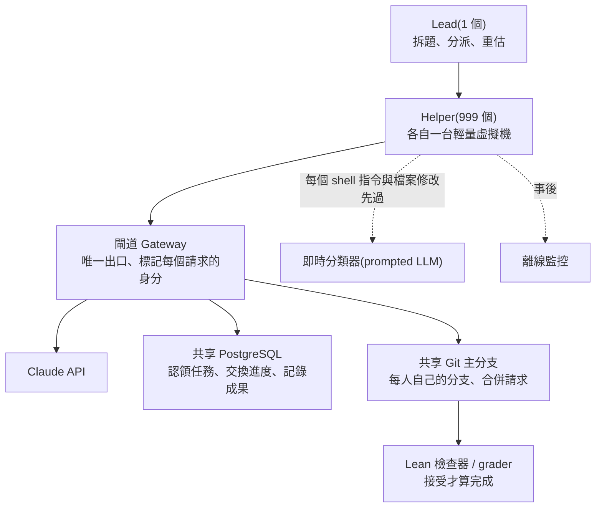

# Claude Fable 5.2:1000 個 Agent 的兩場實驗(作業系統原型與費馬大定理形式化),以及能搬進專案的四層檢查表(Why QQ)

> **來源影片:** Why QQ(為什麼叫 QQ)〈Claude Fable 5.2:1000个AI,8天造出系统原型〉,約 9 分半,2026-11-10 上傳。官方簡體字幕(`zh-Hans`)已讀,時間點全部取自帶時間字幕。
> **立場與利益揭露:** 說明欄與片中沒有業配、聯盟連結或自家產品;影片自述資料來自 Anthropic 官方公告、技術博客與模型文檔。
> **本篇做了什麼:** 讀了 Anthropic 官方公告(2026-11-09)、官方研究文〈Formalizing Fermat's Last Theorem〉(2026-09-04)、claude.dev 部落格〈Safely scaling multi-agent teams with Claude Fable 5.2〉(2026-11-09,影片「Agent Harness」細節的真正出處)與官方定價頁,逐項核對影片數字。**沒讀**:System Card、兩篇理論物理預印本、作業系統實驗的示範影片、Mythos 資安細節(都標在後面)。
> 相關既有筆記:[[fable-5-1-usability-over-capability]](Fable 5.1 的定價與「先用 Opus」建議)、[[claude-fable-72-hours-model-dependency]]、[[rsi-recursive-self-improvement-anthropic]]。

## TL;DR

1. 影片把兩件事拆開:**作業系統原型**(只公開整體過程)與**費馬大定理 Lean 形式化**(公開了 harness)。官方公告確實是兩條獨立實驗。
2. 真正值得帶走的是形式化實驗的 harness:**一個 Lead + 999 個 Helper、每人一台獨立輕量虛擬機、只靠 Git 與共享 PostgreSQL 協作、用 Lean 當機器可判定的驗收器**。
3. ✅ 影片的數字大多與官方一手文章一致(28.7 小時、60 個命題、47 條引理、2,418 個任務節點、五張表、17 人到 46–139 人等)。
4. ⚠️ 影片沒講、但看原文才知道的:①實驗是官方自稱的 **toy experiment**,用的是 **Fable 5.2 早期版本**;②「少三分之二 token、證明短七分之一」是跟九月那次(**不同模型、有 Prove2Me 平台與研究員指導**)比,而且這次**一開始就給了 47 條已證引理**;③同一組 1,000 個 Agent 換成 Opus 5.5,**30 小時只完成約 27%**(單次執行);④「一百萬次工具呼叫沒有一次達到攔截標準」那輪**只用了動作監控**,事後用思維鏈監控重放,有一次(檢查 root 權限)「接近」被攔。
5. ⚠️ 官方公告對作業系統只說「能在筆記本上啟動」,影片也自己強調這是內部原型;**「1000 個 Agent = 1000 倍產出」沒有任何證據**,影片說得對。

## 1. 兩場實驗,別混在一起

**[0:43](https://www.youtube.com/watch?v=i6ynxFOfkFU&t=33s)** 影片先拆開兩項實驗:前者公開整體過程,後者披露 Agent Harness。官方公告也是分開寫的:

| | 作業系統原型 | 費馬大定理 Lean 形式化 |
|---|---|---|
| 規模 | 一位工程師從**空資料夾**開始,Fable 5.2 協調 **1,000+ 子代理**,日夜不停 **8 天**(官方公告) | **1,000 個 Agent、28.7 小時**(官方部落格;公告寫「30 小時」是整場執行時限) |
| 產物 | 能在筆記本啟動的 OS:核心、磁碟/鍵盤/網路驅動、持久檔案儲存、視窗、登入畫面、安裝程式、內建 Claude 功能(公告列舉) | 全部命題在 Lean 檢查器接受,最終定理進入 Git 主分支 |
| 公開了什麼 | 公告頁內嵌一段影片;頁面沒有 repo 連結(我檢查了頁面全部連結) | 完整的 harness 設計、資料表、任務樹圖 |
| 影片態度 | 「先別拿它跟 Linux 比」、內部原型 | 「更適合研究架構」 |

> 應用上的第一個結論:**同一個發布會上的兩個案例,證據強度不同**。形式化那條有可檢查的 harness 描述,作業系統那條目前只有官方敘述與示範影片。

## 2. 費馬大定理形式化:Harness 設計(核心)

### 2.1 任務到底是什麼(影片說對了,補上原文口徑)

**[1:29](https://www.youtube.com/watch?v=i6ynxFOfkFU&t=79s)** 影片強調「**沒有重新發現怀尔斯的證明,也沒有從空白開始研究數學**」。官方部落格原文:團隊拿到 **60 個待證明命題(1 個是最終定理、59 個中間里程碑)**、**一句話的經典證明路線**、這些命題用到的**定義**,以及**九月那次形式化留下的 47 條已證引理**。除此之外官方「沒有提供其他證明或組織方式的指引」。

✅ 影片的 60 / 47 / 一句話路線全部屬實。

### 2.2 為什麼 Lean 是關鍵

**[2:01](https://www.youtube.com/watch?v=i6ynxFOfkFU&t=111s)** Lean 當**驗收器**:Agent 寫完證明要用 Lean 工具鏈建置檢查,提交到共享 Git 主分支,由 grader 複核;**檢查器接受,命題才算完成**。官方部落格另寫:每個命題一開始在 Lean 裡只是「證明處留空的佔位」,只有 Lean 檢查器接受完整證明才算 proved。

> 這是整套設計能放心放大的前提:**「完成」由機器判定,不是 Agent 自己說了算**。

### 2.3 架構

**[2:42](https://www.youtube.com/watch?v=i6ynxFOfkFU&t=152s)** 每個 Agent 一台獨立輕量虛擬機,不是 1,000 個 Agent 擠同一段超長對話。

各 Agent 的工具(官方部落格原文列出四項):

- Shell 與檔案編輯器,在**自己的沙箱、沒有網路**。
- Lean 工具鏈與 Mathlib,內建在沙箱映像。
- **自己的 Git 分支**,可對 main 開合併請求。
- 從 shell 連線的**共享 Postgres**。

官方原因(影片沒細說):選 SQL 是因為它提供通用的資訊組織原語、**交易能處理 1,000 個 Agent 的並發寫入**、而且 Claude 本來就熟。

✅ 影片「Agent 是工作進程、PostgreSQL 保存共享狀態、Git 管版本、Lean 校驗、Lead 調度」的類比與原文一致。

### 2.4 Lead 在開跑 10 分鐘內自己蓋出五張表

**[3:23](https://www.youtube.com/watch?v=i6ynxFOfkFU&t=193s)**

| 表 | 官方原文用途 |
|---|---|
| Announce | Lead 對全隊的命令(例如怎麼分工) |
| Assign | 誰負責哪個命題(寫了 999 列,每個 Helper 一列) |
| Notes | 開放佈告欄(認領、回報進度) |
| Subtasks | 待辦清單,任何 Agent 可新增,第一個認領的 Helper 擁有 |
| Landed | 已完成成果的紀錄 |

官方補充:Lead 先把每個命題分給約 16–17 人的小組、每組指定一位 captain 發計畫,並要求所有 Helper 先**判斷自己命題的難度並把結論貼到 Notes**。✅ 影片的「誰在做、做到哪、進了哪個提交」三問是影片自己的整理,與五表分工吻合。

Helper 的迴圈(官方):查計畫 → 認領任務 → 寫 Lean 證明並檢查、提交到 main → 標記完成 → 更新 Notes。✅ 影片 [3:40](https://www.youtube.com/watch?v=i6ynxFOfkFU&t=210s) 的描述一致。

### 2.5 Lead 在中途重估(影片精準)

**[4:01](https://www.youtube.com/watch?v=i6ynxFOfkFU&t=231s)** 約 27 分鐘時三個命題已完成;Lead 讀完 Helper 的難度評估,把 **47 個多數人判斷「預算內做不完」的命題暫時擱置**,把人手集中到剩下 10 個,組規模從約 17 人變成 **46–139 人**(✅ 與官方一致)。約 45 分鐘、5/10 完成時 Lead 寫下:「團隊的吞吐量遠高於一開始『預算內不可行』的判斷」;**10 個在約 70 分鐘內全部完成**,之後 Lead 把人手移去原本擱置的難題。

影片補的三點也都有對應:

- Helper 後來自己新增任務:官方寫到第 5.6 小時,**73 個 Helper 寫了 756 條任務,其中只有 16 位是 captain**。
- 到第三個小時 Lead 對空閒 Helper 說「do not wait for me」(✅ [4:23](https://www.youtube.com/watch?v=i6ynxFOfkFU&t=253s))。
- 官方結論:**Agent 傾向太早放棄、誤判難度;早期 Helper 判 47/60 做不到,團隊最後證出多數**。人類在這種時刻的鼓勵仍有用 — 影片沒提到這句。

### 2.6 最難的 Langlands–Tunnell

**[4:38](https://www.youtube.com/watch?v=i6ynxFOfkFU&t=268s)** 約第 18 小時只剩 Langlands–Tunnell 與依賴它的命題。官方補了影片沒說的前情:該命題的 captain 早先估計**至少需要 70–100 萬行 Lean、完成機率低於 1%**,Lead 也曾擱置它;最後 Lead 把**約 750 個 Helper**調上去並寫下 "Honest odds are low."。

任務樹:captain 先分成 10 個方向,Helper 遇到做不動的任務就往下拆;每個節點可以**先假設更下層結論成立**,因此數百人能並行。最終 **2,418 個任務節點、最多 10 層**,第 **28.4 小時**完成 Langlands–Tunnell、第 **28.7 小時**最終定理進入 main 並通過官方檢查器。✅ 影片數字全部吻合。

### 2.7 檢查點與恢復(影片精準,值得放大)

**[5:06](https://www.youtube.com/watch?v=i6ynxFOfkFU&t=296s)** 官方圖說:活動在約第 18 小時停止,**從最後一次保存點重啟並再給 12 小時**。所以「連續 28.7 小時」嚴格說是**有保存、有恢復**的一次執行(影片提醒對了)。公告頁的完成度曲線標了 18 小時後 resumed with 12 more hours。

## 3. 影片沒講的對照:同樣 1,000 個 Agent 換 Opus 5.5

官方公告圖(**單次執行**、同樣 1,000 Agent 設定):

| 時間 | Fable 5.2 | Opus 5.5 |
|---|---|---|
| 第 18 小時 | 約 0.86(完成度) | 約 0.26 |
| 第 30 小時 | 1.00 | 約 0.27 |

文字:Opus 5.5「18 小時只完成 26%,之後幾乎沒有進展」。⚠️ 圖說明確寫「a single run per model」,所以只能當**一次對照**,不是統計結論。

## 4. 比較口徑要看清楚(兩邊條件是否相同)

影片說 1,000 個 Agent 用 28.7 小時完成、並比九月那次省 token 與證明更短。官方部落格的比較對象是九月那次:

| | 九月(Sept 4) | 十一月(本次) |
|---|---|---|
| 時間 | 11 天 | 28.7 小時 |
| 模型 | 內部研究模型,「大致相當於 Fable 5.1」 | Fable 5.2 早期版本 |
| 協作方式 | **Prove2Me 平台** + 研究員指導 + Claude Code 多代理 harness | 通用工具(Git + PostgreSQL),**無 Prove2Me、無研究員指導** |
| 起點 | 從零 | **給 60 個命題 + 47 條九月已證引理 + 一句話路線** |
| 輸出 token | 約 60 億 | 官方:約**三分之一** |
| 證明長度 | 1,300 萬行 Lean | 官方:約**七分之一** |

> 解讀:這是官方自己的「toy experiment」,證明的是**同類任務的 harness 門檻下降**,不是「五小時從零證明費馬大定理」。官方自己也說:這結果**不取代領域專用的 harness**(例如 Prove2Me 仍可能提高效率),且**人類指導在適當時機仍有用**。

九月那次還有影片沒涉及、但對「為什麼要有任務圖」很關鍵的失敗史(官方研究文):早期 Agent 很快「弄丟專案狀態、不再有效協作」,失敗嘗試仍貢獻了最終證明約 **7%** 的非樣板行;換成 Prove2Me 的**有向無環圖(DAG)**後才成功。本次 Lead 自己用五張表重現了類似的功能。

## 5. 安全設計(影片說對了,補一個重要限制)

**[5:20](https://www.youtube.com/watch?v=i6ynxFOfkFU&t=310s)** 官方部落格:

- 沙箱:無網路、一條通往閘道的管道;Agent 沒有專用訊息工具,只能靠資料庫與 Git;**只能推自己的分支、開合併請求**,由另一個作業合併;資料庫呼叫在共用無特權角色下,每個 SQL 語句 **5 秒時限**、寫入超過 **256 MiB** 拒絕;閘道在沙箱外為每個請求標記 Agent 身分以防冒名;核心不含 loadable modules、kexec、raw memory、kernel probes 等並啟用 lockdown;最小權限、沒有 sudo。
- 即時監控:一個 prompted LLM 分類器檢查每個 shell 指令與檔案修改;**一旦攔截,整個團隊停下、需人工檢查**。
- 離線監控:用相同威脅模型,但可查其他 Agent 的行動。

影片的兩個數字:

- ✅ **100 個 Agent 共用一台機器時,超過一半的執行因記憶體、磁碟或 CPU 耗盡而停止或重啟**(官方原文);改為 1,000 個獨立沙箱。
- ✅ **超過一百萬次工具呼叫,沒有一次達到攔截標準**。⚠️ 但官方同一段還有兩句影片沒講:**這一輪只用了動作型(action-based)監控**;之後用**思維鏈(CoT)監控與今天的評分準則重放**這些呼叫,只有**一次(檢查 root 權限)接近被攔**;「事後」才新增並行的 CoT 監控。影片說「只能說明本次運行未觸發攔截,推不出系統絕對安全」— 完全正確,而且官方自己也這樣設計(模型可能還沒完成發布前的對齊評估,因此監控按「模型可能未對齊」設計)。

## 6. 其他案例與跑分(影片逐項核對)

### 6.1 官方公告原文對照

| 影片說法 | 官方原文 | 判定 |
|---|---|---|
| **[6:04](https://www.youtube.com/watch?v=i6ynxFOfkFU&t=354s)** 早期版本 Agent 團隊把關鍵生產服務 Python 遷 Rust、啟動約快 26 倍;只是啟動速度 | "a team of agents running an earlier version... migrated a critical production service from Python to Rust—the service is now more efficient, more reliable, and starts about 26 times faster" | ✅ 公告確實只給「啟動快約 26 倍」,「更有效率、更可靠」沒有量化。影片提醒別擴寫成吞吐量 26 倍是對的 |
| 三款設備:規格、元件、四層板、外殼、軟體;Diode 製造、工程師測試組裝 | 家庭語音助理底座、USB 擴音通話器、掌上虛擬寵物;與 Diode 合作;Claude 自己寫規格、選元件、佈四層板、CAD 外殼、寫軟體;每塊板**不到一天**就可送製;**三台都不需改電路**可運作 | ✅ |
| 理論物理以預印本公開,待同行評審 | 兩個黑洞問題,見兩篇 hexagonmath.org 預印本 | ✅ 影片說法審慎;⚠️ 預印本**我沒讀**,物理主張未能獨立核實 |
| FrontierCode 2.0:Fable 5.1 的 32.4% 升到 5.2 的 49.1%,增 16.7 點(**[6:42](https://www.youtube.com/watch?v=i6ynxFOfkFU&t=392s)**) | 表格:49.1%(Xhigh)對 32.4%(Xhigh);Opus 5.5 45.5%、GPT-6 Astra 42.8%、Gemini 4 Carbon 41.1%(Medium) | ✅ 算術正確(+16.7) |
| FrontierSWE v2 69.9% | 69.9%(5.1:56.3、Opus 5.5:62.3、Astra:65.5、Gemini:61.2) | ✅ |
| RoboDojo Sim 27.6% → 64.9%,模擬雙臂機器人 | 64.9%(5.1:27.6、Opus 5.5:39.4、Astra:29.8);「基於內部執行、各模型最高推理檔位」 | ✅ 影片「不是現實機器人成功率」的提醒也對 |
| **[7:04](https://www.youtube.com/watch?v=i6ynxFOfkFU&t=414s)** AutomationBench:Fable 5.2 51.4% 低於 Gemini 4 Carbon 53.9% | 51.4% 對 53.9%(Opus 5.5:42.5) | ✅ 影片抓到**官方自己也沒第一**的項目 |
| 表格列各模型最高推理檔位、預算不統一 | 官方註腳:"All scores show each model's highest-available effort unless otherwise noted";Gemini 在 FrontierCode 標 Medium | ✅ |

### 6.2 價格

**[7:24](https://www.youtube.com/watch?v=i6ynxFOfkFU&t=434s)**

- ✅ Fable 5.2:輸入 $8、輸出 $40(每百萬 token);**Opus 5.5 為 $4 / $20(官方定價頁),所以 Fable 5.2 是兩倍** — 影片屬實。
- ✅ Fast Mode:$16 / $80、最高快 2.5 倍(官方公告)。官方定價頁 Opus 5.5 的 Fast Mode 是 $8 / $40。
- 補充:公告說 Fable 5.2「比 Fable 5.1 **便宜**」、輸出速度最高快 30%;既有筆記記的 Fable 5.1 是 $10 / $50([[fable-5-1-usability-over-capability]])。
- ✅ High effort 45.3% 對 Opus 5.5 最高檔 45.5%、**單任務成本約一半**(**[7:47](https://www.youtube.com/watch?v=i6ynxFOfkFU&t=457s)**)。官方限定語是「early testing」,影片「厂商测试、适合当作复测假设」的態度正確。

## 7. 影片沒提、但選型時該知道的官方內容

> 這一節是本篇的**延伸**,不在影片裡;來源都是官方公告全文。

1. **官方自己建議:大多數寫程式與知識工作,先用 Opus 5.5(「最強的日常主力」),再視範圍往上切 Fable/Mythos 或往下切 Sonnet 5.5 / Haiku 5.5。** Fable 5.2 可當「Advisor」(小模型遇難題請教它)或「Orchestrator」(它把簡單任務派給小模型)。這與影片的「先用兩個 Agent 跑通」邏輯一致,而且說明為什麼 $8/$40 不是預設選項。
2. **Fable 與 Mythos 是同一個底層模型**:Fable 帶強的資安與生物安全防護(所以可給所有人);Mythos 給通過驗證計畫的機構。✅ 影片第一段也這樣說。
3. **防護誤擋變少**:官方稱 Fable 5.2 的攔截比 5.1 **少約 55%**(資安約少 60%、生物約少 40%);被擋時資安問題由 Opus 4.8、生物問題由 Opus 5 接手回答。
4. **反蒸餾**:官方稱 5.2 對蒸餾的防護是歷代最強,依其技術報告「讓蒸餾者收集到的資料減少 90% 到 99%」;**preserved thinking 現在對所有帳號開放**。
5. **沙箱逃逸評測(官方自報)**:在含 1,800+ 情境、沙箱刻意留有弱點的對抗實驗裡,Mythos 5.2 使用放在沙箱外憑證或檔案的比例是 **3.1%**,Opus 5.5 為 3.3%、Sonnet 5.5 為 5.1%、Mythos 5 與 5.1 分別為 **39% 與 21%**。同時官方坦承:**5.2 比近期任何模型都更常口頭表示懷疑自己正在被評測**,影響評估可信度。
6. **AI 研發能力被刻意壓著**:官方稱訓練中限制了與 AI 研發最直接相關的能力(加速器 kernel 最佳化、改進 LLM 架構),在這些領域約與 Opus 5.5 同水準;並對少數主題(例如某些非標準加速器的 kernel 開發)透明回退到 Opus 5。
7. 這週的**促銷**:合資格的付費方案獲得 1–3 次 Fable 重置,Pro 與 Team 標準席位 Fable 最多占每週用量上限的 50%(細節在 support 文章,**我沒讀**)。

> ⚠️ 以上第 3、4、5、6 項是**官方自報**,對應的 System Card 與技術報告**我沒讀**,只能引用公告文字。

## 8. 影片的建議:四層檢查表(可直接用)

**[8:05](https://www.youtube.com/watch?v=i6ynxFOfkFU&t=475s)** 影片整理的四層,對照官方 harness 的實際做法如下:

| 層 | 影片的檢查項 | 官方 harness 裡對應的設計 |
|---|---|---|
| 任務層 | 輸入、依賴、負責人;避免多代理改同一塊 | Assign 表、Subtasks 表(第一個認領者擁有)、每命題一個 captain |
| 狀態層 | 進度、鎖、重試次數、檢查點放可查詢的儲存,別只在對話 | Notes / Landed 表、Git 提交、第 18 小時保存點恢復 |
| 驗證層 | 每個任務綁自動測試與失敗處理,合併前跑整合檢查 | Lean 檢查器 + grader,只有通過才算完成 |
| 權限層 | 限制網路、憑證與可寫目錄,保留工具呼叫日誌 | 無網路沙箱、僅閘道出口、僅能推自己分支、5 秒 SQL 時限、256 MiB 寫入限制、分類器 + 離線監控 |

影片的順序建議「先用兩個 Agent 跑通認領、驗證與恢復,確認沒有重複勞動與狀態遺失,再擴大並發」,與官方「單機約 100 個 Agent 就崩」的教訓相互印證:**瓶頸先在基礎設施,不在模型**。

## 9. 應用案例

### 案例 1:你只有兩個 Agent 的小專案,怎麼用這套?

把「重構一個邊界清楚的小模組」分給 Agent A、B:

- 建一個最簡的 `tasks` 表(或甚至一個 JSON 檔 + Git):欄位 = 任務、負責人、依賴、**驗收命令**、狀態、產物連結。
- 規則:**沒有驗收命令的任務,只能標「進行中」,不能標「已完成」**(影片 [2:28](https://www.youtube.com/watch?v=i6ynxFOfkFU&t=138s) 的建議)。
- 每個 Agent 只推自己的分支,由合併作業處理衝突;完成條件 = 測試 + 型別檢查 + 靜態分析全過。
- 做一次「中途殺掉再恢復」的演練:確認從資料庫與 Git 就能接續,而不是靠聊天紀錄。

### 案例 2:評估別人宣稱的「N 個 Agent 做了 X」

用影片 [6:32](https://www.youtube.com/watch?v=i6ynxFOfkFU&t=382s) 的四個欄位逐項索取:**測量對象、測試環境、人類參與步驟、原始數據**。拿本篇來示範:

- 測量對象:費馬大定理 Lean 形式化 28.7 小時(官方部落格 ✔)。
- 測試環境:Fable 5.2 早期版本、1,000 台輕量 VM、無網路、有 Git + PostgreSQL;**起點含 47 條已證引理**。
- 人類參與:沒有 Prove2Me、沒有研究員指導(但有人設計 harness、設定 Lead / Helper 角色、第 18 小時手動恢復)。
- 原始數據:官方公開任務樹與資料表活動圖;**完整 harness 程式碼未見公開**。

### 案例 3:選型要不要上 Fable 5.2

用官方資料做一個小決策表,而不是只看排行榜:

1. 先用 Opus 5.5 跑你自己的任務集,記錄**每次通過驗收的成本**。
2. 只有在 Opus 5.5 在 Max 檔位仍卡住的任務(長時、跨模組)才升 Fable 5.2 的 High 檔,再比較成本。
3. 固定任務集、推理預算與工具權限(影片 [7:16](https://www.youtube.com/watch?v=i6ynxFOfkFU&t=426s)),別拿官方表格跨廠商直接比(推理檔位不統一)。
4. 若任務是資安或生物研究,先知道 Fable 會被分類器攔、攔到由 Opus 接手;需要的話走驗證計畫申請 Mythos。

## 10. 與既有筆記的關係

- [[fable-5-1-usability-over-capability]]:Fable 5.1 的定價、可用性與「先用 Opus」;本篇是 5.2 的延續(價格下調、攔截減少)。
- [[rsi-recursive-self-improvement-anthropic]]:AI 研發能力被刻意壓制的官方說法屬於同一條安全與自我改進脈絡。
- [[agent-sandbox-microvm-snapshot-iaa]]:每 Agent 一台輕量虛擬機與快照,是同一個基礎設施方向。
- [[multi-agent-data-consistency-reliability]]:多 Agent 共享狀態、並發寫入的一致性問題,本篇的 PostgreSQL 交易是一個實例。
- [[git-for-ai-agents-rubicon-pando-continuity-scion-why-qq]]:Agent 讓 Git 吃不消的另一側;本篇是「Git 當協作介面」的成功案例。
- [[agent-verification-before-scale-lauren-tan-reaction]]:先給 Agent 驗證再談規模,與本篇「Lean 當驗收器」同一原則。

## 11. 核實總表

| 項目 | 狀態 | 備註 |
|---|---|---|
| OS 實驗:1,000+ 子代理、8 天、空資料夾、元件清單 | ✅ | 官方公告原文;⚠️ 示範影片與原始碼**未見公開、未讀** |
| FLT:1,000 Agent、28.7 h、60 命題、47 引理 | ✅ | claude.dev 部落格 |
| 五張表、17 → 46–139 人、2,418 節點、10 層、28.4 / 28.7 h | ✅ | 同上 |
| 第 18 小時恢復再給 12 小時 | ✅ | 同上(圖說) |
| 少 1/3 token、短 1/7 | 🔶 | 官方數字,但比較對象條件不同(見 §4) |
| 100 Agent 單機半數失敗;百萬次呼叫無攔截 | ✅ / 🔶 | 官方原文;🔶 那輪只用動作監控,事後 CoT 重放有一次近攔截 |
| Python→Rust 26× | ✅ | 僅「啟動速度」 |
| 跑分與價格(含 Opus 5.5 對照) | ✅ | 官方公告表 + 官方定價頁 |
| 理論物理兩項 | ❓ | 預印本未讀 |
| Opus 5.5 對照(18 h 約 26%) | ✅ | 單次執行 |
| System Card 內容 | ❓ | 未讀 |
| 促銷細節 | ❓ | support 文章未讀 |

## 12. 字幕還原

官方簡體字幕與官方一手文章用語一致,沒有需要還原的詞(Agent、Harness、Lead、Helper、grader、PostgreSQL、Lean 等拼寫都正確)。

## 來源

- 影片:Why QQ〈Claude Fable 5.2:1000个AI,8天造出系统原型〉 https://www.youtube.com/watch?v=i6ynxFOfkFU (官方 `zh-Hans` 字幕,帶時間)
- Anthropic 官方公告〈Claude Fable 5.2 and Claude Mythos 5.2〉(2026-11-09):https://www.anthropic.com/claude-fable-and-mythos-5-2
- claude.dev 部落格〈Safely scaling multi-agent teams with Claude Fable 5.2〉(2026-11-09,影片 harness 細節的出處):https://claude.dev/blog/safely-scaling-multi-agent-teams-with-fable-5-2/
- Anthropic 研究〈Formalizing Fermat's Last Theorem〉(2026-09-04):https://www.anthropic.com/research/formalizing-fermats-last-theorem
- Claude 官方定價頁:https://platform.claude.com/docs/en/about-claude/pricing
- 公告引用但**本篇未讀**:System Card https://www.anthropic.com/document/claude-fable-5-2-mythos-5-2-system-card 、電子設計 https://www.anthropic.com/research/claude-electronics-design 、物理預印本 https://hexagonmath.org/2611.00175v1 與 https://hexagonmath.org/2611.00174v1 、促銷說明 https://support.claude.com/en/articles/17506494
