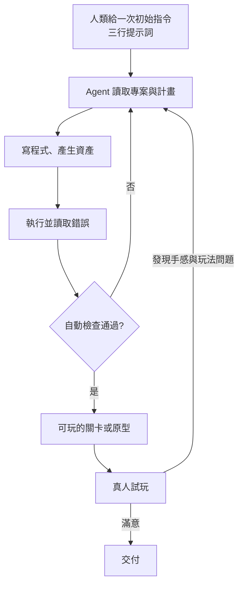

# Claude Fable 5.2 用三行提示詞做遊戲:Saltline、Gears 風格關卡、SNES 遊戲的帳單與長時間 Agent 成本結構(Why QQ)

> **來源影片:** Why QQ(為什麼叫 QQ)〈3 行 Prompt,做出「战争机器」?Claude Fable 5.2 的 1.5 个实验〉,11 分 18 秒,2026-11-12 上傳。官方簡體字幕已讀,時間點全部取自帶時間字幕(連結已提前 10 秒)。
> **立場與利益揭露:** 逐字稿中沒有業配或聯盟口播;說明欄未逐字檢查,若有連結以影片頁為準。
> **本篇做了什麼:** 影片裡的遊戲實驗(Saltline、Gears 風格關卡、Ember Wake、Lex 的家庭遊戲)出處都是開發者在社群平台的貼文,我查不到一手頁面,所以**專案細節一律標「影片轉述,未能核實」**。能核實的是兩塊:①**定價與成本算術**(對照 Anthropic 官方定價文件,自行重算影片的 3,668 美元與 165:1),②**GDC 2026 產業調查數字**(對照 GDC 官方文章)。
> 相關既有筆記:[[claude-fable-5-2-1000-agents-os-fermat-harness-why-qq]](同一個模型的另一組長時間實驗與 harness)、[[ai-morning-news-weekly-2026-11-05-to-11-10-juya]](11/10 Fable 5.2 發布週報)、[[fable-5-1-usability-over-capability]](Fable 5.1 的定價與用法)。

## TL;DR

1. 影片主張:Fable 5.2 這次最大的進展不是畫面,而是**在沒有人持續介入的情況下,獨立完成一段長工程**(Saltline 8 小時、Gears 風格實驗近 44 小時、SNES 遊戲 4 小時 26 分)。
2. ✅ **成本算術經得起重算**:445M 輸入 token × 8 美元/百萬 + 2.7M 輸出 × 40 美元/百萬 = 3,668 美元,和影片「不用快取要 3,668 美元」完全吻合;輸入輸出比 165:1 也對。
3. 帶得走的觀念:**長時間 Agent 的帳單主要是「每一步重讀上下文」的輸入,不是輸出**;快取讀取 0.2 美元對 8 美元(便宜 40 倍)決定了能不能跑得起。
4. ⚠️ 影片自己也承認:「一個可玩的關卡」不等於 3A 遊戲,**自動測試(能不能跑)和真人試玩(好不好玩)缺一不可**。
5. ⚠️ 所有「開發者報告的成本」(550、14,710、72 美元)與遊戲細節都是自述,本篇無法獨立驗證。

## 1. 影片逐段重點(帶時間)

| 時間 | 內容 | 本篇核實狀態 |
|---|---|---|
| [0:29](https://www.youtube.com/watch?v=IE6TXR86WjQ&t=19s) | 開發者 Matthew Berman 給 Fable 5.2 的初始指令:用 Unreal Engine 5 做《戰爭機器:E-Day》風格遊戲 | 未能核實(查不到原貼文) |
| [0:53](https://www.youtube.com/watch?v=IE6TXR86WjQ&t=43s) | 專案連續跑 43 小時 48 分 | 未能核實 |
| [0:57](https://www.youtube.com/watch?v=IE6TXR86WjQ&t=47s) | 約 86.3 億 token | 未能核實 |
| [1:00](https://www.youtube.com/watch?v=IE6TXR86WjQ&t=50s) | 依公開 API 價格折算約 14,710 美元 | 折算方式見 §3;未能核實 |
| [1:06](https://www.youtube.com/watch?v=IE6TXR86WjQ&t=56s) | 影片強調這是「等價成本」,不是開發者真付的錢 | 影片自己有講清楚 |
| [1:40](https://www.youtube.com/watch?v=IE6TXR86WjQ&t=90s) | 解釋 one-shot:人只給一次初始指令,之後不再逐步指揮、不人工指錯 | 定義合理 |
| [1:58](https://www.youtube.com/watch?v=IE6TXR86WjQ&t=108s) | Anthropic 工程師 Felix Rieseberg 的 Saltline:FPS、接近 3A 視覺、只做小關卡 | 未能核實 |
| [2:16](https://www.youtube.com/watch?v=IE6TXR86WjQ&t=126s) | 模型自己工作 8 小時,交付瀏覽器可玩的第一人稱射擊 | 未能核實 |
| [3:17](https://www.youtube.com/watch?v=IE6TXR86WjQ&t=187s) | 8 小時累計約 4.45 億輸入、270 萬輸出 token | 數字未能核實;**比例算術 ✅** |
| [3:22](https://www.youtube.com/watch?v=IE6TXR86WjQ&t=192s) | 輸入輸出比約 165:1 | ✅ 445 ÷ 2.7 ≈ 164.8 |
| [3:41](https://www.youtube.com/watch?v=IE6TXR86WjQ&t=211s) | Fable 5.2 快取讀取 0.2 美元/百萬,普通輸入 8 美元 | ✅ 官方定價文件 |
| [3:48](https://www.youtube.com/watch?v=IE6TXR86WjQ&t=218s) | 開發者報告實際約 550 美元 | 自述,未能核實 |
| [3:56](https://www.youtube.com/watch?v=IE6TXR86WjQ&t=226s) | 完全不用快取要約 3,668 美元 | ✅ 重算吻合(§3) |
| [5:12](https://www.youtube.com/watch?v=IE6TXR86WjQ&t=302s) | 模型與貼圖大量「程式碼生成」:用數學函數與 Shader 產生視覺 | Felix 補充說明,未能核實 |
| [6:43](https://www.youtube.com/watch?v=IE6TXR86WjQ&t=393s) | SNES 動作遊戲 Ember Wake:4 小時 26 分、約 72 美元、5 關 5 Boss、自稱真機 60 fps | 未能核實 |
| [6:57](https://www.youtube.com/watch?v=IE6TXR86WjQ&t=407s) | 模型自己組織 5 個 Agent 分管資源;Blender 建模→Python 量化→SNES 圖形格式 | 未能核實 |
| [7:25](https://www.youtube.com/watch?v=IE6TXR86WjQ&t=435s) | Lex 的家庭橫版遊戲:約 175 張圖、140 段音訊;模型自己寫 Bot 在無頭瀏覽器跑 12 關並截圖檢查 | 見 §5,僅二手標題對得上 |
| [8:10](https://www.youtube.com/watch?v=IE6TXR86WjQ&t=480s) | 作者判斷:AI 還不能做 3A,只能做高品質原型 | 觀點 |
| [9:38](https://www.youtube.com/watch?v=IE6TXR86WjQ&t=568s) | GDC 2026:36% 從業者已在工作使用生成式 AI | ✅ 官方文章 |
| [9:49](https://www.youtube.com/watch?v=IE6TXR86WjQ&t=579s) | 52% 認為生成式 AI 對產業有負面影響 | ✅ 官方文章 |

## 2. 三個實驗的規模對照(全部為影片轉述)

| 實驗 | 平台 | 時長 | 自述成本 | 成果 |
|---|---|---|---|---|
| Saltline(Felix Rieseberg) | 瀏覽器 FPS | 8 小時 | 約 550 美元(4.45 億輸入、270 萬輸出) | 雨中貨運港口小關卡,模型、貼圖、音效「從零生成」 |
| Gears 風格(Matthew Berman) | Unreal Engine 5 | 43 小時 48 分 | 等價約 14,710 美元(約 86.3 億 token) | 第三人稱、掩體射擊、敵我 AI、主動換彈,可玩關卡 |
| Ember Wake | 超級任天堂 | 4 小時 26 分 | 約 72 美元 | 5 關 5 Boss,自稱真機 60 fps |

觀察:三個案子的**單位時間成本差距極大**(Saltline 約 69 美元/小時、Gears 等價約 336 美元/小時、Ember Wake 約 16 美元/小時,皆為依影片數字自行相除)。差距主要來自「上下文有多大、快取命中多高」,而不是遊戲類型本身。

圖說:影片 [8:00](https://www.youtube.com/watch?v=IE6TXR86WjQ&t=470s) 的兩種驗證——自動測試管「能不能跑」,真人試玩管「好不好玩」。Lex 的案例中,模型自己寫的 Bot 跑完 12 關,孩子拿手柄玩過後又回頭修改,正是 G→B 這條回饋線。

## 3. 延伸查證:長時間 Agent 的成本到底怎麼算

### 3.1 官方定價(已核實)

對照 Anthropic 官方〈Pricing〉文件(`platform.claude.com/docs/en/about-claude/pricing`,2026-11-13 讀取):

| 項目 | Claude Fable 5.2 | Claude Fable 5.1(對照) |
|---|---|---|
| 基本輸入 | 8 美元 / MTok | 10 美元 / MTok |
| 5 分鐘快取寫入 | 10 美元 / MTok | 12.5 美元 / MTok |
| 1 小時快取寫入 | 16 美元 / MTok | 20 美元 / MTok |
| 快取命中與刷新 | **0.20 美元 / MTok** | 0.25 美元 / MTok |
| 輸出 | 40 美元 / MTok | 50 美元 / MTok |

✅ 影片的「快取讀取 0.2、普通輸入 8」與官方一致;Fable 5.2 的輸出是 40 美元。官方定價頁(claude.com/pricing)的方案表只列 Fable 在訂閱方案中的用量規則,沒有逐 token 價格,逐 token 價格以上述 docs 頁為準。

### 3.2 自行重算 Saltline(已核實算術)

| 情境 | 算式 | 結果 |
|---|---|---|
| 完全不用快取(影片的假設) | 445M × 8 + 2.7M × 40 = 3,560 + 108 | **3,668 美元** ✅ 與影片一致 |
| 輸入全部是快取命中(理論下限) | 445M × 0.2 + 2.7M × 40 = 89 + 108 | 約 197 美元 |
| 開發者自述 | — | 約 550 美元 |

✅ 3,668 這個數字就是「全部當一般輸入計價」的結果,影片沒有講錯。**550 介於理論下限 197 與無快取上限 3,668 之間**,代表大部分輸入走快取、但仍有一部分需要寫入快取或未命中——和影片「建立在大量快取命中的基礎上」的描述方向一致。(快取寫入每百萬 token 要 10–16 美元,比一般輸入還貴,所以不是「有快取就一定便宜」。)

### 3.3 為什麼輸入是輸出的 165 倍

影片 [3:26](https://www.youtube.com/watch?v=IE6TXR86WjQ&t=196s) 的解釋是 Agent 每一步都重讀專案上下文。這是長任務的通則:每一輪呼叫都要把「已有程式碼、前一步結果、任務計畫、先前紀錄」送進去,輪數乘上上下文長度,輸入就遠大於每輪只產出一小段的輸出。所以**成本的槓桿在於快取命中率與上下文管理,而不是壓縮輸出**。

### 3.4 Gears 實驗的 14,710 美元能否重算

86.3 億 token、14,710 美元,平均每百萬約 1.70 美元。若全部當一般輸入應是 69,040 美元,全部當快取命中約 1,726 美元,所以 1.70 落在合理區間,**但缺少輸入輸出與快取的拆分,無法重算,標未能核實**。影片也明講這只是等價成本。

## 4. GDC 2026 產業調查(已核實)

影片 [9:38](https://www.youtube.com/watch?v=IE6TXR86WjQ&t=568s) 引的數字,對照 GDC 官方文章〈GDC 2026 State of the Game Industry〉:

- ✅ **36%**:「over one-third (36%) of game industry professionals are using generative AI tools as part of their job」。
- ✅ **52%**:「over half (52%) of game industry professionals think generative AI is having a negative impact on the game industry」,官方文章寫「去年 30%」。
- 樣本:超過 2,300 位遊戲產業從業者。
- ⚠️ 需注意:官方文章沒有寫調查執行日期;二手報導提到樣本約一半在美國、偏北美與西歐,代表性有限;另有報導說 GDC 自己避免做逐年比較(因問卷設計差異),所以「30%→52%」的趨勢解讀要保守。
- ⚠️ 影片說「代碼輔助與原型製作是常見用途」:我在官方文章沒讀到這句,有二手摘要稱多數人用於研究與腦力激盪(未核實),所以這句標未能核實。

## 5. 影片提到、但本篇沒能查實的內容

- **Saltline、Gears 風格關卡、Ember Wake**:我搜尋了作者與專案名稱,沒有找到原始貼文或可讀的一手頁面(搜尋結果只有泛談 Fable 5.2 長時間建構的二手網站)。**成本、時長、功能清單、60 fps 都是自述。**
- **Lex 的家庭橫版遊戲**:搜尋到一則標題為「Fable 5.2 built my nephew's dream beat 'em up overnight」的二手轉貼,標題與影片情節對得上(侄子的設計、12 關),但我只看到標題,**175 張圖與 140 段音訊等細節未逐項核實**。
- **「這是 Gears 的複製品」**:Gears of War: E-Day 是微軟 The Coalition 的真實作品,影片說的是「風格」且自己指出動作生硬、翻越掩體動畫有瑕疵([8:19](https://www.youtube.com/watch?v=IE6TXR86WjQ&t=489s))。本篇不評論畫面品質,也不把它當成與官方遊戲同級的證據。
- ⚠️ 搜尋時看到某篇二手文章說 Anthropic「沒有 Fable 5.2 的官方頁面」,但官方定價文件已列有 Claude Fable 5.2,該說法過時,不採用。

## 6. 應用案例

**案例一:估算自己的長時間 Agent 預算。** 想讓 Agent 跑一晚做一個小型網頁遊戲。先估「步數 × 每步平均上下文」得到輸入 token,再用 §3.2 的兩個極端框出範圍:全無快取是上限,全部快取命中是下限。若估出來輸入 4 億 token,上限約 3,200 美元、下限約 80 美元(輸出另計),落差 40 倍,所以**先確認任務的呼叫方式是否能穩定命中快取**(固定前綴、不要每輪改系統提示),再決定要不要跑。

**案例二:給 Agent 的驗收分兩層。** 做小遊戲或前端時,第一層放機器可判定的檢查(能編譯、Bot 能跑完所有關卡、截圖無異常),第二層留給真人試玩並把回饋丟回去修。影片 Lex 的例子就是這個流程;自己做時把「手感、節奏、好不好玩」明確寫成人工驗收項,不要期待自動測試涵蓋。

**案例三:讓 Agent 選「程序化資產」降低成本。** 簡單的物件(貨櫃、地面、金屬反射)可要求用函數與 Shader 生成,不必逐個準備貼圖,改參數即可重做;複雜角色與動畫仍需專業資產流程([5:32](https://www.youtube.com/watch?v=IE6TXR86WjQ&t=322s)的邊界說明)。

**案例四:讀別人的「一鍵做出 3A」宣傳時的檢查表。** ①人給了幾次指令 ②跑了多久、花多少(是否為等價成本)③成果是關卡還是完整遊戲 ④開發者是否公開工具呼叫紀錄(影片 [4:42](https://www.youtube.com/watch?v=IE6TXR86WjQ&t=282s) 與 [6:18](https://www.youtube.com/watch?v=IE6TXR86WjQ&t=368s) 都說沒公開)。

## 7. 核實總表

| 項目 | 結果 |
|---|---|
| Fable 5.2 快取讀取 0.2、輸入 8、輸出 40(美元/MTok) | ✅ 已核實(官方 Pricing 文件) |
| 無快取 3,668 美元 | ✅ 重算吻合 |
| 輸入輸出比 165:1 | ✅ 重算吻合 |
| GDC 36% / 52% | ✅ 已核實(GDC 官方文章);趨勢解讀需保守 |
| GDC「常見用途」一句 | 未能核實 |
| 550 / 14,710 / 72 美元、各時長與 token 數 | 未能核實(開發者自述) |
| Saltline、Gears 風格、Ember Wake、Lex 專案細節 | 未能核實(查不到一手) |
| 「AI 還不能做 3A」 | 作者觀點,與其自陳的「只有單一關卡」一致 |

## 來源

- 影片:Why QQ〈3 行 Prompt,做出「战争机器」?Claude Fable 5.2 的 1.5 个实验〉,https://www.youtube.com/watch?v=IE6TXR86WjQ(官方簡體字幕,非 Whisper)
- Anthropic 官方 Pricing 文件:https://platform.claude.com/docs/en/about-claude/pricing
- Claude 方案定價頁(僅方案用量規則,無逐 token 價格):https://claude.com/pricing
- GDC 2026 State of the Game Industry:https://gdconf.com/article/gdc-2026-state-of-the-game-industry-reveals-impact-of-layoffs-generative-ai-and-more/
- GDC 新聞稿(Business Wire):https://www.businesswire.com/news/home/20260129438528/en/2026-State-of-the-Game-Industry-Report-Reveals-Widening-Effect-of-Layoffs-Broader-Perspectives-on-Generative-AI-Unionization-Tariffs-and-More
- 二手轉貼(僅標題核對 Lex 案例):https://zeli.app/story/50433659
