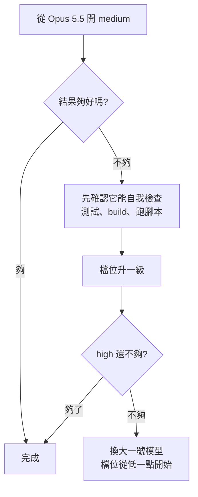

# Fable low 約等於 Sonnet max?模型與推理強度「斜著走」:四個模型 × 五個檔位怎麼選(Agent 煉金術士 + 官方文件核實)

**主題分類:** 科技 / AI 產業 — Claude 模型與 effort 選擇、任務成本
**來源:** YouTube〈Fable 開 low 跟 Sonnet 開 max 差不多?〉(Agent 煉金術士,2026-11-27,10 分 37 秒;**官方 zh 字幕**,時間點取自帶時間字幕)
**整理日期:** 2026-11-28

> ⚠️ **這支影片的數字大多出自第三方評測與社群貼文,說明欄只列兩篇官方文章。** 我讀了 Claude Code 官方 model-config 文件、Anthropic 兩篇選模型文章;**影片裡最醒目的「Sonnet max 約 10 美元 vs Fable low 約 3 美元」等數字,我沒能核實**(見 §2)。頻道無業配,片尾僅自我介紹與求訂閱。

---

## TL;DR

- **主張:** 最划算的路常常是**斜著走**——模型升一級、檔位降下來;最貴的設定不是最好的設定。
- **官方核實到的:** effort 有 low/medium/high/xhigh/max 五檔;Fable 5.2、Opus 5.5、Sonnet 5.5、Haiku 5.5 預設都是 medium;官方起點是 **Opus 5.5 開 medium**;官方三步順序、`max` 易 overthink 的警告、Opus 5.5 在 SWE-bench Pro 上 medium/high/xhigh 的分數與成本比例,都與影片一致 ✅。
- **沒能核實的:** Artificial Analysis 的 20 格分數與每題價錢、Anthropic 員工個人設定(Boris、Ado、Cat Wu、Lydia 的 Projects 預設)、Opus 帶 Sonnet 子代理 200 → 139 美元、Garry Tan 與 Axton 的實測、Zapier 657 任務。**這些只能當「影片轉述」**。
- **影片自己有講反例**,別只記「斜著走」:Haiku、Zapier、研究報告類題目都不是 Fable/Opus 勝出。

## 1. 影片脈絡(時間連結已提前 10 秒)

| 時間 | 內容 | 連結 |
|---|---|---|
| 0:23 | 官方推薦偏偏是 Opus 開 medium | [前往](https://www.youtube.com/watch?v=ztKRgSAwQfs&t=13s) |
| 0:46 | 換模型 = 換人;effort = 同一個人做多仔細 | [前往](https://www.youtube.com/watch?v=ztKRgSAwQfs&t=36s) |
| 1:15 | 五個檔位;四個模型預設都是 medium | [前往](https://www.youtube.com/watch?v=ztKRgSAwQfs&t=65s) |
| 1:56 | 四個模型各自角色與價格比 | [前往](https://www.youtube.com/watch?v=ztKRgSAwQfs&t=106s) |
| 3:18 | 20 個組合的地圖:斜著走比直著爬划算 | [前往](https://www.youtube.com/watch?v=ztKRgSAwQfs&t=188s) |
| 4:54 | Anthropic 員工自己怎麼設 | [前往](https://www.youtube.com/watch?v=ztKRgSAwQfs&t=284s) |
| 6:22 | 看任務成本,不看單價 | [前往](https://www.youtube.com/watch?v=ztKRgSAwQfs&t=372s) |
| 7:38 | 反例:斜著走不一定划算、max 不是最好 | [前往](https://www.youtube.com/watch?v=ztKRgSAwQfs&t=448s) |
| 9:08 | 官方三步驟與五種情況 | [前往](https://www.youtube.com/watch?v=ztKRgSAwQfs&t=538s) |

## 2. 影片說法與核實

### 官方文件可核實的

| 影片說法 | 一手來源 | 核實 |
|---|---|---|
| effort 五檔:low、medium、high、xhigh、max | [Claude Code model-config 文件](https://code.claude.com/docs/en/model-config) 表格:Fable、Opus 5.5、Sonnet 5.5、Haiku 5.5 等支援 low/medium/high/xhigh/max(Opus 4.6、Sonnet 4.6 沒有 xhigh) | ✅ |
| 四個模型預設都是 medium | 原文:Fable 5.2、Opus 5.5、Sonnet 5.5、Haiku 5.5 預設 `medium`;Opus 4.7 預設 `xhigh`;其餘預設 `high` | ✅ |
| effort 不只管想多久,還決定讀幾個檔、檢查幾次、做到哪回頭問你 | [Anthropic〈Choosing a Claude model and effort level〉](https://claude.com/blog/claude-model-and-effort-level-in-claude-code):effort 影響讀取檔案數、驗證程度、多步驟任務推進多遠;"Pick a higher effort level if Claude got it wrong by skipping a file";"Pick a larger model when the problem is genuinely hard" | ✅ |
| 模型決定曲線,effort 決定沿曲線走多遠 | 原文:"effort level picks how far Claude is willing to travel along the curve" | ✅ |
| 約 400 vs 2,800 token(低 vs 高檔) | 官方文字只寫「約 7 倍 token」;**絕對數字可能在圖裡,我沒看到圖** | ⚠️ 倍數吻合(2,800 ÷ 400 = 7),數字未核實 |
| max 邊際遞減、容易想太多 | 官方文件:"`max` may show diminishing returns and is prone to overthinking, so test before adopting it broadly";只對當前 session 生效、`effortLevel` 設定鍵不接受 max | ✅ |
| 官方起點:Opus 開 medium → 先確認能自檢 → 升一檔 → 還不夠才換大一號模型、檔位從低開 | [Osmani〈Which Claude model should you build with?〉](https://claude.dev/blog/which-claude-model-should-you-build-with/):"start most work on Opus 5.5 at its default effort level, medium";三步:①確認能自驗(測試、build、呼叫 endpoint 的腳本)②升一檔 ③換上一級模型並**從較低檔開始** | ✅(⚠️ 影片說「high 還不夠」才換模型;原文只寫順序、沒有「high」這個條件) |
| Opus 5.5 單價是 Fable 5.2 的一半 | 原文:Opus 5.5 $4 / $20、Fable 5.2 $8 / $40(每百萬 token 輸入/輸出)。影片的「Sonnet 1 : Opus 2 : Fable 4」中,**Opus:Fable = 1:2 ✅;Sonnet 的位置我沒查** | ✅ / Sonnet 未核實 |
| Opus 開 medium 比 high 低約 2.5 分、成本約 7 成;high → xhigh 多約 1 分多、成本 2.5 倍 | 官方 SWE-bench Pro(Opus 5.5):medium 比 high 低約 2.5 分、成本約 70%;low 低約 8 分、成本約 1/3;xhigh 高約 1.4 分、成本是 high 的 2.5 倍 | ✅ |
| Haiku 讀入超過 10 萬 token,單價大漲 | model-config 文件:Haiku 5.5 "costs more on prompts longer than 100K tokens";**「5 倍」「Sonnet 的 1/20」我沒讀到費率段** | 門檻 ✅;倍數未核實 |
| 要讓子代理用較小模型 | 官方:自訂 subagent 在 definition 設 `model`(如 `model: haiku`);子代理的 effort 也可在 frontmatter 設 `effort` | ✅ |
| Fable 適合開放、品質最重要、長時間無人看守;Opus 日常主力;Sonnet 範圍清楚;Haiku 大量小工作 | Osmani 文章:Sonnet 5.5「well-scoped coding, bug fixes…」、Haiku「classification, routing, tagging, high volume extraction」、Fable「major refactors and migrations, architecture planning, leading many subagents」 | ✅ |

### 官方文章與文件**找不到**的(影片轉述,未能核實)

- **Artificial Analysis 20 格地圖:** Sonnet low→max 約 25 → 54 分、每題 0.5 → 10 美元;Fable low 53.9 分、每題 3 美元出頭;Opus xhigh 57.5;Sonnet max 等 4.5 分鐘、Fable low 等 9 秒;Haiku max 等近 3 分鐘 vs Opus low 6 秒。**我沒打開 Artificial Analysis 頁面**。
- **Anthropic 員工的個人設定:** Boris Cherny 95% 時間開 medium、Ado 80% medium + 15% high、Cat Wu 多用 Opus、Lydia Hallie 的 Fable 指揮 + Opus 做事、Projects 預設 Opus low 指揮 + Sonnet medium 做事。**皆未在我讀到的官方頁出現**(Lydia 官方文章只講 effort 與模型的分工原則)。
- **Anthropic 內部數字:** 找程式缺陷考題 Opus medium 200 美元 → Opus 帶 Sonnet 子代理 139 美元(分數同)→ Haiku 子代理 47 美元(分數少近兩成);Opus 全 high 95.3% / 0.29 美元 vs 先 low、錯的再 high 約 97% / 0.17 美元;HLE 上 Fable low 追平 Opus 最高分、成本不到十分之一。**我沒找到原始出處**。
- **社群/第三方實測:** Axton 的 Haiku 帳單 0.62 → 2.11 美元(3.4 倍)、Garry Tan 52 題 Opus 0.65 vs Fable 1.83 美元、Zapier 657 任務(Sonnet xhigh 36.8% > Opus xhigh 34.4%)、Ari Wilson 的 max 三次只修好一次(改 600 行 vs high 改 140 行)、Uber 與 Rogo 案例。**皆未核實**,且多為個人貼文,樣本小。
- **Anthropic 官方一個與影片同方向的旁證(我之前讀過):** [[claude-sonnet-5-5-release-effort-migration]] 記錄官方 FrontierCode 圖上 xhigh 52.1 分、max 反掉到 46.2,與「max 不是最好」同向。

## 3. 重點拆解

**① 兩個旋鈕不同事。** 模型 = 換一個人;effort = 同一個人要多仔細。判斷法(官方原文):漏讀檔、沒跑測試 → 調 effort;資料都給了、也很努力、結果還是錯 → 換更強的模型。

**② 斜著走為什麼常見。** 影片引 Lance Martin 的說法:強模型開低檔常用較少 token 就做完,所以比弱模型開高檔便宜。官方 SWE-bench Pro 的「medium → xhigh 多 1.4 分、成本 2.5 倍」顯示**同一模型內往上加檔,邊際效益遞減**,這部分是官方證據;「換大一號模型更划算」的完整地圖則靠 Artificial Analysis(未核實)。

**③ 看任務成本不看單價。** 單價低不等於總價低:Haiku 在長對話超過 10 萬 token 後單價跳升(門檻 ✅),便宜模型可能做更久、更多輪。影片的 3.4 倍帳單故事是個人貼文(未核實),但**機制成立**。

**④ 反例。** 影片自己給了:Haiku max 勝過 Opus low 且更便宜(但要等近 3 分鐘)、Zapier 結果相反、研究報告題 Fable 成本 4.3 倍卻沒進步。結論不是「永遠用大模型低檔」,而是**用你的任務跑一遍**。

**⑤ 官方三步。** 先確認能自我檢查(測試、build)、再升一檔、再換模型且從低檔開始。「先有檢查回路」才是前提,否則加檔只是多燒錢。

## 4. 五種情況的建議(影片 9:34;官方文章可部分對上)

| 情況 | 影片建議 | 官方對照 |
|---|---|---|
| 寫信、聊天 | Sonnet low / medium | 影片轉述「官方說明中心:一般寫作不需額外推理」,**未查** |
| 整理大量資料(分類幾千筆留言) | Haiku medium | ✅ Osmani:分類、路由、標記、大量抽取用 Haiku medium |
| 日常文件與試算表 | Sonnet | 未查 |
| 從大量資料寫報告 | 從 Opus 開始 | 未查 |
| 寫程式 | Opus medium,卡住再 high;範圍清楚的 bug 給 Sonnet medium;長任務搬專案用 Fable medium,不夠再 high | ✅ 與 Osmani 對 Opus 起點、Sonnet 範圍清楚、Fable 大型遷移 medium 起手一致 |

## 5. 應用案例

- **幫自己的 Claude Code 訂預設:** 不改就是 medium。遇到「漏讀檔、沒跑測試」才暫時 `--effort high`;`max` 只在無人值守的難題(如找安全漏洞)開,且記得只對當前 session 有效。
- **自訂子代理省錢:** 把讀 log 的子代理設 `model: haiku`、指揮用主模型,這是官方範例做法;但 Haiku 輪數多、上下文過 10 萬 token 要留意單價跳升。
- **團隊跑 A/B:** 抽 20–50 個自己倉庫真實的小任務,同一批在 Opus medium、Opus high、Fable low 各跑一次,記「解題率與每解一題花費」,別只看單價。影片的 Garry Tan 故事給的教訓一樣:題目太簡單看不出大模型的優勢。
- **先建檢查回路再加檔:** 在 repo 放能一鍵跑的測試;沒有檢查回路的任務,用 high/max 是在花錢買自信,不是買正確。

## 相關筆記

- [[claude-sonnet-5-5-release-effort-migration]] — Sonnet 5.5 發布、effort 是成本旋鈕、FrontierCode 上 max 反低於 xhigh
- [[model-routing-compute-allocation]] — 模型路由與算力分配的一般原則
- [[claude-code-rethinking-best-practices-reversible-checkpoints-lydia-hallie-adam-lil]] — 同一位 Lydia Hallie 的另一場演講:驗證回路與權限
- [[opus-5-5-prompting-guide-13-points]] — Opus 5.5 的提示與 effort 搭配
- [[prompting-claude-fable-5-2-official-guide-checklist-why-qq]] — Fable 5.2 的官方提示指南

## 來源

- [YouTube:Fable 開 low 跟 Sonnet 開 max 差不多?(Agent 煉金術士,2026-11-27)](https://www.youtube.com/watch?v=ztKRgSAwQfs)(官方 zh 字幕,已讀帶時間全文;說明欄列兩篇官方文章)
- [Claude 部落格:Choosing a Claude model and effort level in Claude Code(Lydia Hallie)](https://claude.com/blog/claude-model-and-effort-level-in-claude-code)(已讀;文中只抽到原則句,影片所引圖與數字未見於我取得的文字)
- [Anthropic:Which Claude model should you build with?(Addy Osmani)](https://claude.dev/blog/which-claude-model-should-you-build-with/)(已讀)
- [Claude Code 官方文件:Model configuration](https://code.claude.com/docs/en/model-config)(已讀 effort 與 subagent 章節,頁面後 34,659 字元未讀)
- Artificial Analysis 評測頁、各人社群貼文:**未開啟**
