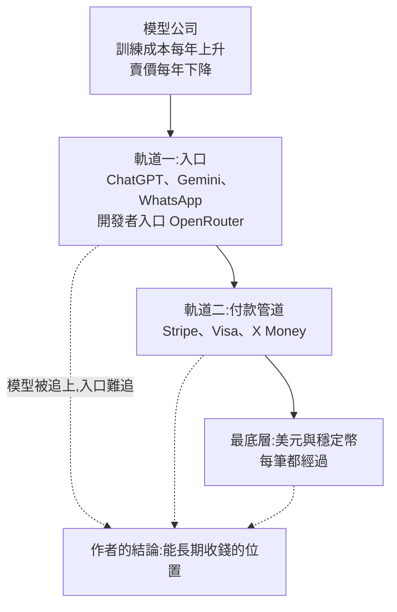

# 發明印刷機的人破產了,AI 呢?〈The Commanding Heights〉:模型每年便宜 13 倍,長期收錢的是入口與付款軌道(Agent 煉金術士)

**主題分類:** 科技 / AI 產業 — 價值鏈與護城河分析(⚠️非投資建議)
**來源:** YouTube 頻道 **Agent 煉金術士**〈發明印刷機的人破產了,AI 呢?〉(2026-11-25,11 分 08 秒)https://youtu.be/KZTifxyuX-8
**影片性質:** 介紹 Will Manidis 與 Joe Roberts 的長文〈The Commanding Heights〉https://commanding-heights.com/ ,片頭畫面取自 Bloomberg Tech 訪談 https://www.youtube.com/watch?v=ycfwZXnQO2Q 。有官方 zh 字幕,無業配;片尾為頻道自我介紹。
**整理日期:** 2026-11-26

> ⚠️ **誰在說話要分清楚:** 「模型公司不是最賺、入口與付款管道才是」是**兩位作者的論點**,不是事實。文章 31.5 萬字,我只讀到前 10 萬字(到第二部分中段),片中大量公司數字落在我沒讀到的後半,下表逐項標出。

---

## TL;DR

| 論點 | 影片說法 | 核實 |
|---|---|---|
| 同等 AI 能力每年便宜約 13 倍 | Epoch AI 量的 | ✅ Epoch:固定表現的成本每季降約 47%,約 13 倍/年。⚠️ Epoch 自己也說範圍 43–53%/季、最前沿約 66%/季、「不要當精確數字」、只有三年資料 |
| 最前沿模型訓練成本每年貴約 3.5 倍 | 一次訓練已 10 億美元 | ⚠️ 文章自述引用 Epoch 的修正值(2024 年估 2.4 倍,後修為 3.5 倍);Epoch 那篇價格文章**沒寫**訓練成本,未能獨立核實 |
| 美國雲端大廠今年資本支出約 8,000 億美元 | 平均每天超過 20 億 | ✅ 文章寫約 8,000 億(引 JP Morgan、Goldman);8,000 ÷ 365 ≈ 21.9 億,算術對 |
| 結論:智慧會變贈品,錢留在入口與付款軌道 | 作者命名「制高點」 | 作者主張,非可驗證事實 |
| 「制高點」一詞來自 1922 年列寧 | 重開民間貿易時,國家握著所有制高點 | ✅ 文章第六部分摘要原文 |
| 印度 TCS 2026 財年員工少 23,460 人,本業營收多 7.5% | 現實數字 | ✅ 少 23,460 人(584,519 人,對前一年 607,979);❌ 「多 7.5%」**未能核實** |
| Stripe 買下 OpenRouter,11/10 完成,媒體報導超過 70 億美元 | 付款管道買下開發者入口 | ✅ Stripe 新聞稿 2026-08-19「同意收購」,**未揭露價格**,OpenRouter 有 400+ 模型、80+ 供應商;完成日與價格區間為次級報導(NYT 約 75 億、Axios 逾 80 億、Bloomberg 逾 70 億) |
| Western Union 自家美元穩定幣 USDPT,Visa 接受結算 | 付款與美元走上同一條路 | ✅ 次級報導:Visa 透過 Anchorage Digital 將 USDPT 納入 VisaNet 結算 |

## 一、影片脈絡(附時間)

| 時間 | 內容 | 連結 |
|---|---|---|
| 0:10 | 印刷機、鐵路:AI 最大的一筆錢不會留在模型本身 | [前往](https://youtu.be/KZTifxyuX-8?t=0) |
| 0:51 | 虛構人物 Ravi(班加羅爾後台外包) | [前往](https://youtu.be/KZTifxyuX-8?t=41) |
| 1:42 | 現實:TCS 少 23,460 人 | [前往](https://youtu.be/KZTifxyuX-8?t=92) |
| 2:21 | 電晶體在貝爾實驗室發明,財富落在新竹與庫比蒂諾 | [前往](https://youtu.be/KZTifxyuX-8?t=131) |
| 2:28 | Epoch:同等能力價格每年便宜 13 倍;訓練成本每年貴 3.5 倍 | [前往](https://youtu.be/KZTifxyuX-8?t=138) |
| 3:35 | 虛構人物 Malena(布宜諾斯艾利斯設計師、USDT) | [前往](https://youtu.be/KZTifxyuX-8?t=205) |
| 4:41 | 兩條軌道:入口與付款管道 | [前往](https://youtu.be/KZTifxyuX-8?t=271) |
| 5:21 | 「制高點」與列寧 1922 | [前往](https://youtu.be/KZTifxyuX-8?t=311) |
| 5:57 | OpenAI、Gemini、Claude、Meta 的入口 | [前往](https://youtu.be/KZTifxyuX-8?t=347) |
| 7:41 | 開發者入口 OpenRouter | [前往](https://youtu.be/KZTifxyuX-8?t=451) |
| 8:14 | Stripe、Visa、X 的付款布局 | [前往](https://youtu.be/KZTifxyuX-8?t=484) |
| 9:20 | 最大的軌道:美元與穩定幣 | [前往](https://youtu.be/KZTifxyuX-8?t=550) |
| 10:28 | 結論:問兩件事 | [前往](https://youtu.be/KZTifxyuX-8?t=618) |

## 二、逐項核實

| 影片說法 | 結果 | 依據 |
|---|---|---|
| 同等 AI 能力每年便宜 13 倍 | **已核實(有但書)** | [Epoch:The Plunging Price of Thought](https://epoch.ai/publications/the-plunging-price-of-thought):固定表現成本每季降約 47%,稱約 13 倍/年。五個基準間 43–53%/季;最前沿起初約 66%/季,兩年後約 32%/季;換平均法為 42.9–58.0%/季。搜尋摘要另顯示 Epoch 後續整體說 5–10 倍/年,**13 倍是特定算法的頭條數字** |
| 「今年花一千元的事,明年不到八十元」 | 算術對 | 1000 ÷ 13 ≈ 77 |
| 訓練最前沿一次已 10 億美元,成本每年約貴 3.5 倍 | **未能獨立核實** | 文章表格:2024 年估 2.4 倍/年,後修為 3.5 倍/年(引 Epoch);Epoch 價格頁面沒有訓練成本。文章同時稱 10 億美元訓練比 2024 年預測早約半年到 |
| TCS 少 23,460 人 | **已核實** | 多家媒體:FY26 末 584,519 人,前一年 607,979 人,減幅約 3.85%。人事主管稱原因含效率提升與選擇性替換,不全是重組 |
| TCS「本業賺的多 7.5%」 | **未能核實** | 搜尋結果沒出現此數字;TCS 同年員工成本還增加約 1 萬億盧比 |
| Ravi 的部門「砍掉一半」 | **需修正(口徑不同)** | 我讀到的文章段落寫的是裁 2,178 人,部門「減編 90%」,與影片「砍一半」不同;可能是不同段落,無法釐清,別引用 |
| OpenAI 全產品每週超過 10 億人、Gemini App 每月超過 10 億人、WhatsApp 每天超過 20 億人 | **未能核實** | 文章前 10 萬字沒有這些數字(WhatsApp 只寫「數十億人每天用」)。本篇沒另外查 |
| Anthropic 年化營收約 810 億美元、年付 10 萬美元以上客戶逾 1 萬 1,900 家 | **年化營收已核實,客戶數未能核實** | 本庫[[anthropic-ipo-compute-bill-vs-growth-424b4-agent-alchemist]] 已對 424B4 核過:Run-Rate Revenue 約 810 億(2026-10-31)。文章寫的是第三季營收約 168 億,口徑不同 |
| Stripe 買 OpenRouter | **已核實(完成日為次級)** | [Stripe 新聞稿](https://stripe.com/newsroom/news/stripe-agrees-to-acquire-openrouter):2026-08-19「已同意收購」,**未揭露價格、未提完成**,稱 400+ 模型、80+ 供應商。完成日 11/10、價格 70 億到 80 億美元以上,來自次級報導(NYT、Axios、Bloomberg、Fortune),我沒讀到 Stripe 完成公告 |
| OpenRouter「超過 1,000 萬開發者、每天逾 10 兆 token」 | **次級來源** | 搜尋摘要稱出自兩位創辦人 8 月部落格,我沒讀到原文 |
| ChatGPT 2025 年 9 月開放結帳、2026 年 3 月收回 | **未能核實** | 本篇沒查 |
| Visa Intelligent Commerce(2025)、與 OpenAI 合作(2026 年 6 月) | **未能核實** | 本篇沒查 |
| X Money 7 月上線、X Card 走 Visa | **未能核實** | 本篇沒查 |
| Meta Muse 用 Stripe Link 代購、Zuckerberg 十月法說會那句 | **未能核實** | 本篇沒查原始法說會。Muse 背景見[[meta-muse-beginner-guide-instagram-threads-gary-chen]] |
| 全球外匯交易約每 10 筆有 9 筆一邊是美元 | **已核實(作者引用)** | 文章引 BIS 調查:2025 年 4 月 89.2% |
| Western Union USDPT、Visa 結算 | **已核實(次級)** | 次級報導:2026 年 5 月在 Solana 上由 Anchorage Digital Bank 發行;Visa 將其納入 VisaNet 結算。我沒讀到 Visa 或 Anchorage 新聞稿 |
| 「穩定幣不付利息給持有人,利息歸發行公司」 | **作者說法,依發行方而異** | 未查各發行方條款,別當通則 |

## 三、判讀

1. **「模型不賺錢」只對一半成立。** 價格每年降 13 倍是 Epoch 的平均數字,不代表每家模型公司都虧;本庫[[anthropic-ipo-compute-bill-vs-growth-424b4-agent-alchemist]] 顯示 Anthropic 年化營收仍高速成長,問題是營收浮動而算力合約固定。兩篇合讀:收入端有成長,但帳單端寫死。
2. **「入口難追」是這支影片最強的一句,也最缺證據。** 影片自己的例子就顯示入口不等於付款:ChatGPT 結帳功能被收回。入口給的是分發與廣告,付款又是另一群公司的生意。
3. **數字口徑要分開看。** 文章裡有營收(季)、年化營收、訂閱使用者、日活、週活,各家定義不同;影片把它們排成一列容易誤讀為同口徑。
4. **虛構故事不是證據。** Ravi 與 Malena 是作者的寓言,細節(例如數字)在我讀到的段落與影片不完全一致。

## 四、應用案例

- **判斷一家 AI 公司留不留得住錢:** 套用影片結尾兩問。①有沒有多人每天打開的入口(App、作業系統、開發者閘道);②收錢走誰的管道。例:自己做模型的新創若只賣 API,被追上的風險高;若同時握有 IDE 或企業工作流入口,風險較低。
- **做 AI 產品的小團隊:** 價格每年大跌,別把「模型加價」當護城河。把預算花在使用者每天用的入口(整合進 WhatsApp、Slack 等)與付款流程,並預期上游模型價格半年後再降。
- **讀這類「誰最後贏」的文章:** 先把每個數字標「作者推論 / 引用 / 次級報導」。本篇約三分之一的數字停在「未能核實」,不影響論點框架但不該被當事實引用。

## 相關筆記

- [[anthropic-ipo-compute-bill-vs-growth-424b4-agent-alchemist]] — 營收成長與算力帳單的對照,810 億年化營收出處
- [[ai-compute-token-economics]] — token 與算力經濟
- [[meta-muse-beginner-guide-instagram-threads-gary-chen]] — Meta Muse 與入口
- [[personal-agent-muse-meta-google-race]] — 個人 agent 入口之爭

## 來源

- [YouTube:發明印刷機的人破產了,AI 呢?(Agent 煉金術士,2026-11-25)](https://youtu.be/KZTifxyuX-8)(官方 zh 字幕,取其帶時間版本)
- [Will Manidis、Joe Roberts:The Commanding Heights(僅讀前約 10 萬字)](https://commanding-heights.com/)
- [Bloomberg Tech:AI Will Create 'Weird' Economic Benefits: Manidis(說明欄所列,未觀看)](https://www.youtube.com/watch?v=ycfwZXnQO2Q)
- [Epoch AI:The Plunging Price of Thought](https://epoch.ai/publications/the-plunging-price-of-thought)
- [Stripe 新聞稿:Stripe agrees to acquire OpenRouter(2026-08-19)](https://stripe.com/newsroom/news/stripe-agrees-to-acquire-openrouter)
- 次級報導(非一手):[The Next Web:Stripe seals its OpenRouter deal](https://thenextweb.com/news/stripe-openrouter-acquisition-confirmed)、[Fortune:Stripe 7 billion deal](https://fortune.com/2026/08/16/stripe-7-billion-deal-ai-firm-openrouter-acquisition/)、[The Wire:TCS FY26 headcount](https://thewire.in/economy/employee-headcount-of-tcs-goes-down-by-23000-in-fy26)、[Unchained:USDPT 成為 Visa 結算選項](https://unchainedcrypto.com/western-unions-usdpt-stablecoin-becomes-a-settlement-option-on-visa-anchorage-digital-says)
