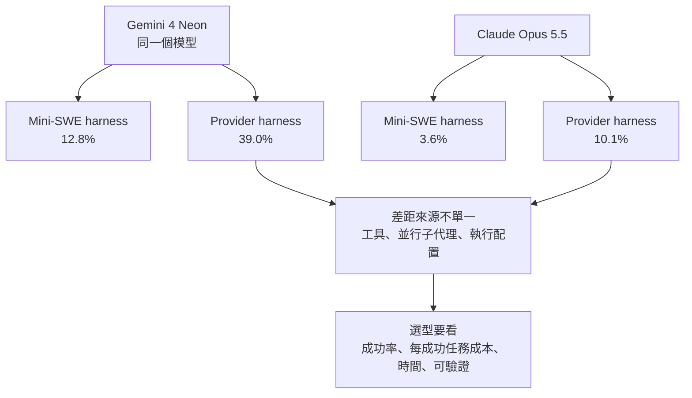

# Gemini 4 Neon:同一個模型 SWE-sweep 12.8% 對 39%,差的是 Harness 還是模型(Why QQ)

> 整理自 YouTube 頻道 **Why QQ**〈[Gemini 4 Neon:同一个 AI,换套工具成绩翻了 3 倍?](https://www.youtube.com/watch?v=enLak0cYRKk)〉(2026-11-20,約 9 分鐘)。
> 該片無字幕,逐字稿以 CPU 版 faster-whisper `large-v3-turbo` 轉錄取得,非官方字幕;時間點取自帶時間逐字稿,專有名詞(Hydrogen、Carbon、anti-gravity 等)以官方頁面拼法為準。
> 立場:說明欄無業配;片尾註明「嘗試新的視頻製作方法」。

## 一、一句話

Google 11/18 發布 Gemini 4 Neon(Hydrogen 與 Carbon 之間的中階型號)。影片抓住一組數字:**同一模型在 SWE-sweep,Mini-SWE harness 12.8%、Google 自家 harness 39.0%**。我讀了官方模型卡,數字屬實,而且**模型卡同時列出 Claude Opus 5.5 同樣兩欄:3.6% 與 10.1%**(影片沒提)。換 harness 兩家都大幅上升,結論「harness 影響很大」成立,但「Antigravity 帶來三倍」不能下。影片自己也講了這點([3:19](https://www.youtube.com/watch?v=enLak0cYRKk&t=189s))。

## 二、影片重點(附時間點與查證)

| 時間 | 重點 | 查證狀態 |
|---|---|---|
| [0:06](https://www.youtube.com/watch?v=enLak0cYRKk&t=0s) | Artificial Analysis 綜合智能指數 Neon 61 分,超過 Opus 5.5 的 59 分 | 61、全球第三 ✅(AA 文章);**Opus 5.5 的 59 分 AA 文章沒列,未能核實** |
| [0:17](https://www.youtube.com/watch?v=enLak0cYRKk&t=7s) | 編程 Agent 指數 58.6 | **AA 文章寫 Neon(xhigh)在 Antigravity CLI 下 59、Opus 5.5(max)58,沒有 58.6,未能核實(四捨五入後相容)** |
| [0:25](https://www.youtube.com/watch?v=enLak0cYRKk&t=15s) | SWE-sweep:mini SWE 12.8%,anti-gravity 39% | ✅ 模型卡:Mini-SWE harness 12.8%、Provider harness 39.0% |
| [1:10](https://www.youtube.com/watch?v=enLak0cYRKk&t=60s) | Terminal Bench 4.1:Neon 65.2%、Opus 65.8%;Frontier Code 2.0:46.2% 對 47.3% | ✅ 模型卡(Terminal-bench 4.1 標「Cheating adjusted accuracy」;FrontierCode 2.0 為 Main score) |
| [1:33](https://www.youtube.com/watch?v=enLak0cYRKk&t=83s) | 100 萬 token 上下文、四檔推理、3/15 美元每百萬 token | ✅ 模型卡「1M unified context window」;Google 發布文 $3/$15、四檔 thinking levels |
| [1:53](https://www.youtube.com/watch?v=enLak0cYRKk&t=103s) | SWE-sweep 來自 Meta 研究團隊;不給 issue、不說 bug 在哪,Agent 自己找、修、過隱藏測試 | **未能核實**(未讀 SWE-sweep 論文或 repo) |
| [3:00](https://www.youtube.com/watch?v=enLak0cYRKk&t=170s) | anti-gravity CLI 1.5.9;內建多 sub-agent 並行工具,適合 bug 搜尋 | **版本號與「sub-agent 並行是評測設定」未能核實**:模型卡表格只標 "Provider harness",評測方法頁 deepmind.com/models/evals-methodology/gemini-4-neon 我沒讀到 |
| [3:48](https://www.youtube.com/watch?v=enLak0cYRKk&t=218s) | Harness 定義:開檔、搜尋符號、跑命令、改碼、跑測試、壓縮歷史、多 Agent | 通用說明,非可驗證主張 |
| [4:41](https://www.youtube.com/watch?v=enLak0cYRKk&t=271s) | Orchestrator:Neon 規劃、Hydrogen 執行;卡關交還 Neon 重新規劃 | ✅ Antigravity 官方部落格:"pairing Gemini 4 Neon as the planner with Gemini 4 Hydrogen as the executor"、"If Hydrogen hits friction, it hands back to Neon";影片的「先以唯讀方式檢查」我沒找到對應原句 |
| [5:35](https://www.youtube.com/watch?v=enLak0cYRKk&t=325s) | 案例:Mont Blanc 地形 WebGL 滑雪模擬器、1936 年圖靈書房、50 萬公式試算表做 10 萬格影像 | ✅ Google 發布文:"first-person WebGL2 freeride ski simulator ... real Mont Blanc and Chamonix elevation terrain"、King's College Room X.8(用 /swarm)、"over 500,000 live spreadsheet formulas"、約 10 萬格;**影片說的「Dual Agent」一詞官方文章沒出現**(官方是 Orchestrator 加平行 Hydrogen 子代理與 swarm) |
| [6:26](https://www.youtube.com/watch?v=enLak0cYRKk&t=376s) | Plotly 43 題全對:Neon 17.03 美元、中位 46 秒;Hydrogen 6.36 美元、32 秒;只跑一次 | **未能核實**:Google 發布文與 Antigravity 文章都沒有 Plotly 與這組數字(影片已自述樣本只一次) |
| [7:17](https://www.youtube.com/watch?v=enLak0cYRKk&t=427s) | 模型卡:Neon 由 Carbon 適配而來,未披露具體訓練法,不能直接說是蒸餾 | ✅ 模型卡 "Gemini 4 Neon is adapted from Gemini 4 Carbon." |
| [8:26](https://www.youtube.com/watch?v=enLak0cYRKk&t=496s) | 選型四指標:真實任務成功率、每個成功任務的成本、完成時間、過程可驗證與可恢復 | 影片的判斷,與本庫其他筆記一致 |

## 三、延伸與核實(讀一手來源)

讀到的頁面:[Gemini 4 Neon 模型卡](https://deepmind.google/models/model-cards/gemini-4-neon/)、[Google 發布文](https://blog.google/innovation-and-ai/models-and-research/gemini-models/introducing-gemini-4-neon/)、[Antigravity 部落格](https://antigravity.google/blog/gemini-4-neon-in-google-antigravity/)、[Artificial Analysis 文章](https://artificialanalysis.ai/articles/gemini-4-neon-intelligence-gain)。以下為頁面摘要讀取結果。

### 3.1 模型卡的完整對照(影片只講 Neon 那一列)

| 基準 | 設定 | Neon | Claude Opus 5.5 |
|---|---|---|---|
| SWE-sweep | Provider harness | 39.0% | 10.1% |
| SWE-sweep | Mini-SWE harness | 12.8% | 3.6% |
| Terminal-bench 4.1 | Cheating adjusted accuracy | 65.2% | 65.8% |
| FrontierCode 2.0 | Main score | 46.2% | 47.3% |

- **Opus 5.5 也是「換 harness 約 2.8 倍」**(3.6 到 10.1),Neon 約 3.1 倍(12.8 到 39.0)。所以「模型名稱沒變、成績翻三倍」不是 Neon 獨有,更像 Mini-SWE 這個最小 harness 在 SWE-sweep 上本來就會把分數壓得很低。
- ⚠️ 兩家的 "Provider harness" 是各自供應商的 harness(Google 對 Antigravity、Anthropic 對其自家),模型卡沒給定義;不能理解成同一個 harness 下的公平對比。
- ✅ 這也補強影片的警告:跨 harness 比分數沒意義。

### 3.2 成本面(影片沒提)

- AA:Neon 每任務 **6.44 美元**(Coding Agent Index 跑法),Antigravity 中 Opus 5.5(max)平均 **12.61 美元**;Neon 每任務輸出 token 比 Carbon 多約 15%,但單價較低,總成本仍降。
- Antigravity 部落格:Neon 預設 High 檔的每任務成本比 Carbon 低 **32%**。
- 以上都是 Google 與 AA 對自家設定的數字,未經第三方複現。

### 3.3 未能核實清單

- SWE-sweep 的任務設計與「Meta 研究團隊」出處。
- Antigravity CLI 1.5.9 與並行 sub-agent 是評測設定。
- Opus 5.5 的 Intelligence Index 59;Coding Agent Index 58.6。
- Plotly 的 43 題與 17.03/6.36 美元。

## 四、我的判讀

1. **「Harness 很重要」成立,但證據該用 Opus 那一列補強,而不是 Neon 單列。** 同一份官方表就能證明,不需要引 Antigravity 的功勞。
2. **Orchestrator 的經濟邏輯可信**:規劃用中階、執行用小模型,AA 與 Google 兩邊都有每任務成本下降的數字,但屬廠商自報。
3. **Plotly 那組「小模型反而更省更快」是有趣的反例,但來源沒查到**,先當作影片單方說法,不要拿去做選型。
4. 與本庫[[gpt-6-2-astra-sol-reliability-regression-theo-system-card-why-qq]]同一主軸:榜單分數不等於長任務可交付,要看每個被接受成果的成本。

## 五、應用案例

**案例一:自己的 harness A/B**
用同一個模型,在最小 harness(只有讀檔、跑命令)與完整 harness(搜尋、子代理、測試回饋)各跑同一批 10 個舊 bug,記成功數與花費。這就是 SWE-sweep 12.8 對 39 的縮小版,能看出你的瓶頸在模型還是工具。

**案例二:規劃與執行分層**
把大型重構拆成「規劃模型寫計畫、小模型改檔跑測試、連續失敗就交還規劃者」。先用 3 個任務量每成功任務成本,再決定是否常態使用。

**案例三:選型表**
團隊評 Neon、Opus、Astra 時,表格欄位用:同 harness 的成功率、每成功任務成本、中位時間、是否可審查與回復,別直接抄廠商榜單。

## 六、相關筆記

- [[gemini-4-argon-release-benchmarks-pricing]] — Gemini 4 家族上一款(Argon)的發布與定價
- [[claude-fable-5-2-1000-agents-os-fermat-harness-why-qq]] — 長任務 harness 與 Agent 編排
- [[gpt-6-2-astra-sol-reliability-regression-theo-system-card-why-qq]] — 同週 GPT-6.2 的可靠性爭議
- [[astra-vs-fable-find-bugs-vs-fix-bugs]] — 找 bug 與修 bug 的能力差異
- [[ai-morning-news-weekly-2026-11-12-to-11-17-juya]] — 同期 AI 早報(Gemini Decisions 等)

## 七、來源

- Why QQ〈Gemini 4 Neon:同一个 AI,换套工具成绩翻了 3 倍?〉:https://www.youtube.com/watch?v=enLak0cYRKk (無字幕,逐字稿以 faster-whisper large-v3-turbo 轉錄,非官方字幕)
- Gemini 4 Neon 模型卡:https://deepmind.google/models/model-cards/gemini-4-neon/
- Google 發布文 Introducing Gemini 4 Neon:https://blog.google/innovation-and-ai/models-and-research/gemini-models/introducing-gemini-4-neon/
- Antigravity,Gemini 4 Neon in Google Antigravity:https://antigravity.google/blog/gemini-4-neon-in-google-antigravity/
- Artificial Analysis:https://artificialanalysis.ai/articles/gemini-4-neon-intelligence-gain
- 未讀到:評測方法頁 https://deepmind.com/models/evals-methodology/gemini-4-neon(模型卡引用)
