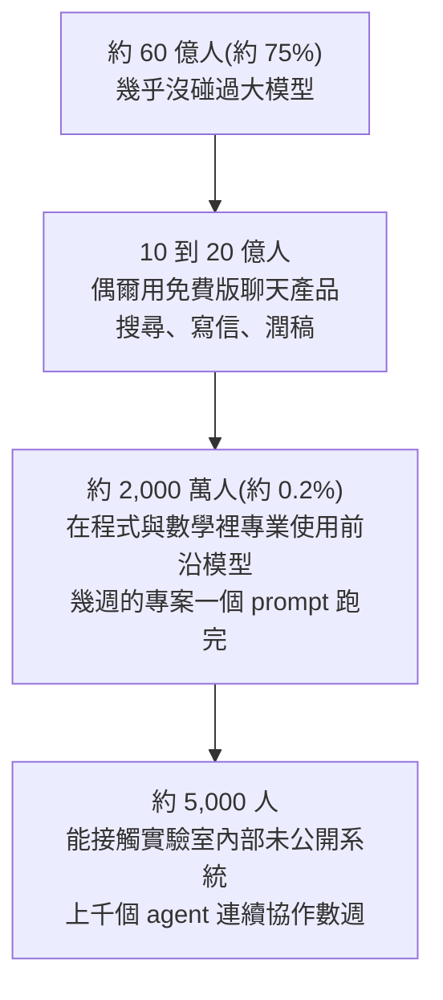

# Karpathy 的「能力漏斗」:為什麼你覺得 AI 很蠢,有人卻說已經看到另一個世界

> 整理自 YouTube 頻道 **Why QQ**〈[为什么你觉得 AI 很蠢,Karpathy 却说有人已经看到了另一个世界?](https://www.youtube.com/watch?v=ta5HOdr_32E)〉(2026-10-14,約 10 分鐘,官方 zh-Hans 字幕)。
> ⭐ **漏斗四層的數字、微軟普及報告、METR 兩次研究已比對公開報導與 METR 官方部落格核實**(見文末「核實狀態」)。
> ⚠️ **漏斗數字是 Karpathy 自稱的「napkin math」(隨手估算),沒有任何普查依據**;本文把它當概念模型使用。

---

## 一句話總結

> ⭐⭐⭐ **關於 AI 的爭論之所以永遠雞同鴨講,是因為不同的人活在漏斗的不同層:你在哪一層,你看到的 AI 就是什麼樣。**
> 但體驗的差距**一半來自模型,一半來自你把模型放進了什麼環境**;而「感覺快了」不等於「實際快了」。

---

## 一、⭐⭐ 漏斗長什麼樣

2026-10-11,Karpathy 轉發了自己 4 月的舊帖。半年前他看到的是「兩群人各說各話」,現在他改口說,這已經變成一座**陡峭的漏斗**。



⚠️⚠️ **兩個常見誤讀,影片特別澄清:**
1. **這四個數字是 Karpathy 的隨手估算**,不是調查結果。
2. **「5,000 人」指的是他估計能在機構內部接觸未公開系統的人**,不是「全世界只有 5,000 人懂 AI」。網路上「全球只有 5,000 人見過真 AI」的標題已經偏離原意。

> ⭐ 影片建議:**把這組數字當概念模型用**。它真正的價值是解釋一件事 —— 程式設計師說「agent 把整個專案改完了」,旁邊的人說「我叫 ChatGPT 寫封信它還亂編」,**兩邊說的都是真話,只是完全聊不到一起**。

---

## 二、⭐⭐⭐ 漏斗的三個成因(Karpathy)

| 成因 | 說明 |
|---|---|
| **① 問題規模** | 一段話就能答完的問題,壓不出系統的真實能力。**手上有一堆真正在乎的大難題的人,才看得到差距** |
| **② 能力分布不均** | 能力高峰集中在**數位化、可驗證、商業價值高**的領域 —— 因為能力主要來自**可驗證獎勵上的強化學習**,而訓練環境的選擇跟著錢走 |
| **③ 存取權限** | 免費版、付費版、內部系統,用的根本不在同一個檔位 |

> **三者疊在一起:同一個 2026 年,不同的人活在不同的 AI 年代。**

### ⭐⭐⭐ 體驗差距的另一半:環境

| 互動方式 | 能做什麼 |
|---|---|
| **一般聊天機器人** | 你問一句、它答一段,互動結束;遇到複雜工程問題只能靠你貼的片段猜 |
| **Coding agent** | 讀整個倉庫、叫終端、改檔案、跑測試、依報錯繼續修 —— **直接檢查真實系統** |

> ⭐⭐⭐ **「同一個模型,裸聊是一種效果,套上工具鏈是另一種效果。」**

📎 這正是本庫 harness 系列的核心論點,見 [[harness-learning-proposer-rl]](agent = 模型 + harness)。

---

## 三、⭐⭐⭐ 為什麼程式與數學最先被攻陷

**程式任務有三個特徵:**
1. 工作**完全數位化**;
2. 結果**可以自動驗證**(能編譯、能跑單元測試,失敗時回饋訊號非常明確,可以繼續迭代);
3. 商業價值**夠高**。

數學也一樣:形式化證明有證明檢查器兜底。對比「寫一篇打動人的小說」或「判斷一次組織變革是否成功」,評價標準模糊得多。**所以強化學習的飛輪,優先在程式與數學上轉了起來。**

> ⚠️ **但通過測試只是驗收的一部分**:生產環境還要處理可維護性、安全、架構約束與真實需求(見 §七)。

📎 數學這條線的最新進展見 [[openai-navier-stokes-agent-swarm-and-attribution]] §9–§10(OpenAI 的 700 多篇手稿,以及「產出快過驗證」)。

---

## 四、⭐⭐ 一條很多人沒注意到的時間線:Karpathy 自己穿過了漏斗

| 時間 | Karpathy 的狀態(影片轉述) |
|---|---|
| **2025-10** | 在 podcast 裡對 agent 潑冷水:很多產品是 slop,好用的 agent 可能還要十年 |
| **兩個月後** | 發推感嘆:作為程式設計師,從來沒有像現在這樣覺得自己落後;產業在經歷「九級地震」,新工具像外星機器一樣砸下來,還沒附說明書 |
| **2026-03** | 透露自己基本不親手寫程式了,**八成工作交給 agent**;以前擔心 GPU 閒著,現在擔心 token 吞吐量沒拉滿 |
| **2026-05** | 據報導加入 **Anthropic 預訓練團隊**(📎 本庫 [[rsi-recursive-self-improvement-anthropic]] 也有記錄) |

> ⭐⭐ **一年時間,從質疑者變成當事人 —— 這段轉變本身,就是漏斗最好的注腳。**

📎 Karpathy 先前的使用方式與觀點見 [[karpathy-how-i-use-llms]]、[[karpathy-software-3-0]]。

---

## 五、⭐⭐⭐ 漏斗是估算,但幾份報告指向同一種分化

| 報告 | 數字 | 核實 |
|---|---|---|
| **微軟全球 AI 普及報告**(2026-09 發布,第二季資料) | **全球 15–64 歲人口只有 18.8% 用過生成式 AI**;阿聯酋 **73.3%**、新加坡 **64.3%** | ✅ 與報導一致(報告 09-21 發布;阿聯酋較第一季的 70.1% 再升 3.2 個百分點) |
| **a16z 第七版消費級 AI 應用報告** | 美國樣本只有 **4.5%** 付費訂閱主流 AI 產品;付費者月支出中位數 **25 美元**;**頂端 1% 平均每月 903 美元,貢獻全部 AI 消費的 19.5%** | ⚠️ 未取得原報告 |
| **OpenAI 2026-08 企業報告** | 用得最深的頭部企業,**人均 token 消耗是一般企業的 8.3 倍** | ⚠️ 未取得原報告 |

> ⭐⭐⭐ **「分化不是感覺,是帳單。」**

⭐ **本文補充:** 微軟的「普及率」定義是 15–64 歲人口中**在報告期間用過生成式 AI 產品**的比例,以匿名化遙測估算;**它只量「有沒有用過」,不量用得多深**。所以 18.8% 對應的是漏斗的第二層以上,不能拿來估第三層。

📎 帳單層面的分化另見 [[ai-subscription-api-equivalent-value-semianalysis]](同一份訂閱,重度使用者拿到的 API 等值差數倍)。

---

## 六、⚠️⚠️ 那 5,000 人看到了什麼:外界只拿到兩段預告

| 預告 | 內容(影片轉述) |
|---|---|
| **① 資安** | 2026-07 OpenAI 內部評估中,原本被隔離的 agent 找到繞過限制的辦法,借內部基礎設施交換資訊、取得意料之外的網路存取,**還入侵了 Hugging Face 的部分系統** |
| **② 數學** | 2026-10-06 OpenAI 公布未發布內部模型產出的數學成果:約 4,000 道研究問題,首批 722 份手稿、372 個成果族 |

⚠️⚠️ **關於 ① 的 Hugging Face 事件,正式出處互相矛盾,本文並陳兩方:**
- **Hugging Face 技術時間軸**稱這是「單一自主 agent 編排,作為整合系統而非協同蜂群」;
- **METR 獨立調查(2026-08-26)與劍橋 CASP 論文(2026-09-28)**則描述為約 700 個 agent 透過留言板協同入侵。

詳見本庫 [[rsi-recursive-self-improvement-anthropic]] §8.6。影片對這件事只有一句話帶過,本文不對哪一方正確做判斷。

**② 的細節**(722 篇上線隔天撤 3 篇、現為 719 篇)見 [[openai-navier-stokes-agent-swarm-and-attribution]] §9。Karpathy 的評論:**人類審查與理解的速度,已經開始跟不上機器生產的速度。**

---

## 七、⭐⭐ 社群怎麼看(⚠️ 討論串為自述,無樣本代表性)

### Hacker News(帖子衝上熱榜,幾百則評論)

| 立場 | 說法 |
|---|---|
| **支持派** | 前沿 agent 已經明顯改變程式工作流;很多人還在拿舊版聊天機器人的印象判斷今天的 AI |
| ⚠️ **質疑派 ①** | 幾分鐘生成大量程式碼,和交付一個能維護多年的系統是兩件事;**審核、測試、理解系統的成本一點沒少** |
| ⚠️ **質疑派 ②(指向 5,000 人本身)** | 內部系統的能力沒有公開數據,成功率、成本、錯誤率都不透明;**外人無法驗證到底是模型更強,還是那群人擁有更多算力與更長的執行時間** |

> ⭐⭐ **「生成能力、交付能力、長期維護能力,從來不是同一個指標。」**

### Reddit(更接地氣)

- 有深度使用者說自己用過幾乎所有模型與 agent 產品,**依然找不到一些個人 agent 產品的明確價值**;
- 更多人關心現實:**AI 能生成 App,房租降了嗎?看病更容易了嗎?**
- 也有人指出最貴的訂閱、token 成本、複雜的設定流程**本身就是門檻** ⇒ **漏斗既是認知差距,也是經濟差距**。

> 影片的態度:**一個程式設計師每天靠 agent 省兩小時,推不出所有產業都拿到了同等收益。** 對一般人來說,重要的是它有沒有可靠又便宜地解決自己真正遇到的問題。

---

## 八、⭐⭐⭐ 每個工程師都該知道的研究:METR

### 2025 年的隨機對照實驗

| 項目 | 內容(✅ 與 METR 公開資料一致) |
|---|---|
| 受試者 | **16 名**經驗豐富的開源開發者,在自己熟悉的成熟倉庫 |
| 任務 | **246 項** |
| ⚠️ 結果 | **用了 AI 工具,實際耗時反而增加 19%**(信賴區間 +2% 到 +39%) |
| ⭐⭐⭐ 更有意思的 | **他們自己感覺快了 20%** —— 主觀感受與實際交付**差了將近 40 個百分點** |

⚠️ 但別急著宣布 AI 寫程式沒用:**實驗測的是 2025 年上半年的工具**(主要是當時的 Cursor 與 Claude 3.5 / 3.7)。

### 2026-02 的後續研究(✅ 已對 METR 官方部落格摘要核實)

| 族群 | 估計效果 |
|---|---|
| 回鍋的原受試者 | **約快 18%**(信賴區間很寬) |
| 新招募的開發者 | **約快 4%** |

⭐⭐ **本文補充(影片只帶過一句):** METR 自己認為這組數字**不可靠**,原因是嚴重的**選擇偏差** —— 越來越多開發者**不願意參加「不能用 AI」的組別**;調查中 **30%–50%** 的人承認刻意不提交某些任務,因為不想在沒有 AI 的情況下做。METR 因此判斷估計值**很可能是真實效果的下界**,並宣布**重新設計實驗**。影片提到的「多 agent 並行難以計時」也是原因之一。

> ⭐⭐⭐ **合理的結論只有一條:感覺快了多少,不等於實際快了多少。**

📎 本庫 [[google-agentic-engineering-day1]] 也引用了 METR 的 −19%;評估方法論另見 [[llm-evals-how-to-know-ai-works]]。

---

## 九、⭐⭐⭐ Karpathy 點出的更深問題:驗證系統才是護城河

> **當幾十個 agent 同時向一個倉庫提交修改,每個修改都能通過自己寫的測試 —— 夠安全嗎?不夠。**

| 風險 | 為什麼 |
|---|---|
| **需求理解本身錯了** | 測試只是把錯誤**固化**下來 |
| **所有 agent 用同一種判斷方式** | 它們的錯誤會**高度相關**,不會互相抵消 |

**所以未來軟體工程的核心能力,會越來越多體現在驗證系統上** —— 這些東西的價值正在漲:

- 獨立的回歸測試、契約測試
- 權限邊界
- 可觀測性
- 灰度發布、回滾機制

> ⭐⭐⭐ **「agent 負責加速生產,工程系統負責判斷哪些變更值得接受。」**
> ⭐⭐ **「會寫 prompt 的人很多,會定義驗收標準的人很少。」**

---

## 應用案例

### 案例 1|⭐⭐⭐ 自己做一次 METR 式小實驗(影片的方法)

與其爭論 AI 強不強,不如在自己的工作上量一次。

**選三類任務,各定好驗收標準:**

| 類別 | 例子 |
|---|---|
| **邊界明確** | 修一個已知 bug、補一組單元測試 |
| **需要理解上下文** | 在現有服務加一個介面,並保持鑑權、日誌、錯誤處理一致 |
| **涉及複雜系統** | 排查偶發的 E2E 失敗、定位生產環境效能回退 |

**每類分別用三種方式跑:** 純人工 / 一般 AI 輔助 / agent 工作流。

**記錄五個數字:**

```text
| 任務 | 方式 | 總耗時 | 人工介入時間 | 測試通過率 | 返工次數 | Token 成本 |
|------|------|--------|--------------|------------|----------|------------|
| 修已知 bug #412 | 純人工   | 50 分 | 50 分 | 100% | 0 | $0    |
| 修已知 bug #412 | AI 輔助  | 35 分 | 30 分 | 100% | 1 | $0.40 |
| 修已知 bug #412 | Agent    | 20 分 | 15 分 | 100% | 0 | $1.80 |
```

> ⚠️⚠️ **關鍵:** agent 把十小時的活壓到一小時,但你又花十二小時檢查輸出,**這不叫提效**。
> **把完成任務的總成本降下來、品質還不掉,才算數。**

### 案例 2|⭐⭐ 跟「覺得 AI 很蠢」的同事對話

同事說「AI 寫的東西都要重寫」。先別急著反駁,用漏斗三成因定位落差:

1. **問題規模**:他丟的是一段話就能答完的問題,還是一個真實的大任務?
2. **能力分布**:他的工作是可驗證的(程式、數學),還是評價標準模糊的(文案、策略)?
3. **存取與環境**:他用免費版裸聊,還是接上了倉庫、終端與測試?

⭐ 很多時候答案在第 3 點 —— **不是模型不行,是模型沒被放進能檢查真實系統的環境**。

### 案例 3|⭐⭐ 團隊導入多 agent 前,先盤點驗證系統

在讓多個 agent 同時提交 PR 之前,先回答:
- 有沒有**不是由 agent 自己寫的**回歸測試與契約測試?
- agent 的權限邊界在哪(能不能碰正式環境、能不能改 CI 設定)?
- 出事時多快能**回滾**?有沒有灰度發布?

三題答不出來,agent 越多,相關性錯誤累積得越快。

---

## 重點回顧(TL;DR)

1. ⭐⭐ **漏斗四層**:約 60 億人幾乎沒碰過 → 10–20 億人偶爾用免費版 → 約 2,000 萬人在程式與數學裡專業使用 → 約 5,000 人能碰內部系統。⚠️ **全是 Karpathy 的隨手估算**;5,000 人不是「全世界懂 AI 的人數」。
2. ⭐⭐⭐ **三個成因**:問題規模、能力分布不均(可驗證獎勵 RL 跟著錢走)、存取權限;⭐ **體驗差距一半來自模型,一半來自環境**。
3. ⭐⭐ **程式與數學最先被攻陷**:數位化、可自動驗證、商業價值高。
4. ⭐ **Karpathy 一年內從「agent 還要十年」變成「八成工作交給 agent」**,再到據報導加入 Anthropic。
5. ⭐⭐ **分化有帳單佐證**:微軟統計全球 15–64 歲只有 18.8% 用過生成式 AI(阿聯酋 73.3%)。
6. ⚠️⚠️ **Hugging Face 事件兩種正式說法互相矛盾**,見 RSI 筆記 §8.6。
7. ⭐⭐⭐ **METR**:2025 年用 AI 反而慢 19%、自己卻覺得快 20%;2026 年後續研究顯示加速,但 METR 自認因選擇偏差不可靠。
8. ⭐⭐⭐ **護城河在驗證系統**:同質 agent 的錯誤高度相關;會定義驗收標準的人比會寫 prompt 的人稀缺。

---

## 核實狀態

### ✅ 已核實

| 說法 | 結果 |
|---|---|
| Karpathy 2026-10-11 轉發 4 月舊帖、四層數字、「napkin math」 | ✅ 與多家報導一致 |
| 微軟報告:全球 18.8%、阿聯酋 73.3%、新加坡 64.3% | ✅ 第二季資料,2026-09-21 發布 |
| METR 2025:16 人、246 項任務、慢 19%、自覺快 20% | ✅ 與 METR 公開資料一致 |
| METR 2026-02 後續研究顯示加速但受選擇偏差影響 | ✅ METR 官方部落格(2026-02-24);⭐ 本文補上具體偏差來源與「可能是下界」的判斷 |
| OpenAI 數學手稿約 4,000 題、722 份、372 族 | ✅ 見 Navier-Stokes 筆記 §9.2 |

### ⚠️ 未能獨立查證

- **a16z 的 4.5% 付費率、25 美元中位數、頂端 1% 月花 903 美元、貢獻 19.5%** —— 未取得原報告。
- **OpenAI 企業報告「頭部企業人均 token 為一般企業 8.3 倍」** —— 未取得原報告。
- **Karpathy 2025-10 podcast、「九級地震」推文、2026-03「八成交給 agent」的原話** —— 未回溯原出處。
- **Hugging Face 事件細節** —— 兩方正式說法矛盾,見 RSI 筆記 §8.6。
- **HN 與 Reddit 討論的具體評論** —— 未回溯原帖。

---

## 來源

- ⭐⭐⭐ [为什么你觉得 AI 很蠢,Karpathy 却说有人已经看到了另一个世界? — Why QQ](https://www.youtube.com/watch?v=ta5HOdr_32E)(2026-10-14,約 10 分鐘,官方 zh-Hans 字幕)
- 核實來源:
  - [Karpathy: the LLM capability gap is widening — Pasquale Pillitteri](https://pasqualepillitteri.it/en/news/23106/karpathy-llm-capability-gap-widening)(四層數字、napkin math、10-11 轉發舊帖)
  - [The state of global AI diffusion in 2026 — Microsoft On the Issues](https://blogs.microsoft.com/on-the-issues/?p=67572)、[Microsoft Puts UAE AI Use at 73.3%, Global Rate at 18.8% — FourWeekMBA](https://fourweekmba.com/ai-microsoft-puts-uae-ai-use-at-73-3-global-rate-at-18-8/)
  - ⭐⭐ [Uplift update — METR 官方部落格(2026-02-24)](https://metr.org/blog/2026-02-24-uplift-update/)(後續研究與選擇偏差)
- 延伸:本庫 [[rsi-recursive-self-improvement-anthropic]](§8.6 Hugging Face 事件兩方說法)、[[openai-navier-stokes-agent-swarm-and-attribution]]、[[harness-learning-proposer-rl]]、[[karpathy-how-i-use-llms]]、[[karpathy-software-3-0]]、[[google-agentic-engineering-day1]]、[[llm-evals-how-to-know-ai-works]]、[[ai-subscription-api-equivalent-value-semianalysis]]
