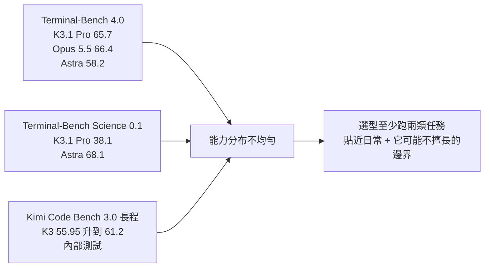
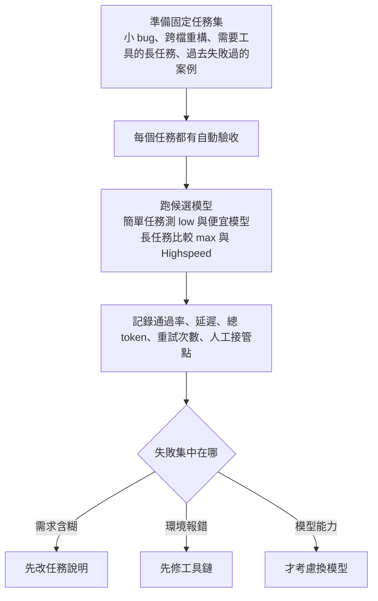

# Kimi K3.1 Pro:Terminal-Bench 65.7 只差 Opus 5.5 0.7 分,但選型要看你的倉庫驗收

> 整理自 YouTube 頻道 **Why QQ(為什麼叫 QQ)**〈[KIMI K3.1 Pro 能减少返工吗？65.7分照样要验收](https://www.youtube.com/watch?v=Mx8I6etcyL0)〉(2026-10-24,約 10 分鐘,官方簡中字幕)。
>
> ➕ **第十節增補**:**Caleb Writes Code**〈[Kimi K3.1 Pro explained in 6min..](https://www.youtube.com/watch?v=bi2np7qc3Lw)〉(2026-10-27,約 6 分鐘,英文自動字幕),從算力、推論分發與產品定位的角度補充。
>
> ✅ **已讀 Kimi 官方技術部落格原文對照**(〈Kimi K3.1 Pro Tech Blog: Advancing Open Intelligence〉)。影片說明欄自述資料來自官方部落格、API 文件、官方 X 發布帖與 Hacker News,**內部測試一律按官方自述處理**。部落格的跑分表是圖片,部分數字(Terminal-Bench Science、BenchCAD 無工具分數)本筆記沒能從文字版核對,見第九節。

---

## 一句話總結

月之暗面的 **Kimi K3.1 Pro** 是 3T 級開放權重模型,官方報告 **Terminal-Bench 4.0 拿 65.7%**,超過 GPT-6 Astra(58.2%)、只輸 Claude Opus 5.5(66.4%)0.7 分。但同一份報告裡 **Terminal-Bench Science 只有 38.1 對 Astra 的 68.1**,能力分布很不均勻。影片的主張:**跑分只負責讓它進候選名單,能不能留下要看它在你倉庫裡的驗收結果、重試次數、token 帳單和人工返工時間。**

---

## 一、規格與上線狀態

| 項目 | 內容 |
|---|---|
| 定位 | K3.1 系列第一個模型,在 K3 上做大量後訓練 |
| 參數 | 約 2.8 兆總參數、每 token 啟用約 1,040 億,MoE(影片引官方 X 發布帖;部落格正文沒寫參數數字) |
| 上下文 | 100 萬 token,支援多模態 |
| Highspeed 版 | 速度約 2–3 倍 |
| 上線 | Kimi.ai、Kimi Work、Kimi Code、Kimi API 同日上線;API 模型名 `kimi-k3.1-pro` / `kimi-k3.1-pro-highspeed` |
| 權重 | **2026-11-04 前釋出**(影片錄製時仍是計畫) |
| 其他 | API 客戶可用 Zero Data Retention;企業版預設關閉,需管理員開啟 |

**開放權重 ≠ 個人能跑**:3T 級模型對多數個人設備都不友好,開放權重給的是**自託管與稽核的入口**,硬體門檻不會跟授權一起消失。個人用戶更現實的入口仍是雲端 API 和託管服務。

---

## 二、後訓練重點:環境品質決定 agent 學到什麼

官方說 K3.1 Pro 把主要投入放在**跨數百個下游領域的大規模聯合 RL**,為此改了整條堆疊:RL 框架、長上下文推論、訓練效率、沙箱基礎設施、rollout 排程,以及一個**共用的環境品質檢查平台**,目標是讓每一份 RL 算力都有穩定、可預期的回報。

影片點出這層常被忽略的意義:

> 你讓模型反覆修程式碼,測試本身卻時好時壞,它學到的可能只是應付測試。**模型在 agent 任務裡的表現,也取決於它練習過的環境是否穩定、回饋是否可靠。**

這和本庫 [[why-reinforcement-learning-is-hard-caleb]] 的「獎勵設計」與「獎勵駭客」是同一件事。

---

## 三、跑分:三組數字放在一起看



| 基準 | K3.1 Pro | 對照 | 性質 |
|---|---|---|---|
| Terminal-Bench 4.0 | **65.7%** | Opus 5.5 66.4%、GPT-6 Astra 58.2% | 公開基準 |
| Terminal-Bench Science 0.1 | 38.1 | GPT-6 Astra 68.1 | 公開基準(影片數字) |
| Kimi Code Bench 3.0 Long-horizon | 61.2% | K3 55.95% | **官方內部基準** |
| BenchCAD(用工具) | 92.7% | Opus 5.5 96.2%、Astra 95.9% | 公開基準 |
| BenchCAD(不用工具,單次生成) | 72.8%(影片數字) | Astra 未報告 | 公開基準 |

### ⭐ 跑分條件不完全相同(影片沒講)

官方腳註寫明:

- **K3.1 Pro 用 Claude Code harness 評測**;Terminal-Bench 4.0 其他模型的分數取「各家部落格或官方排行榜的最大值」。也就是說,**對照組是各家自報的最佳成績,評測 harness 不一定相同**。
- 所有 K3.1 Pro 成績都在 `reasoning_effort=max`、`temperature=1.0`、`top_p=0.95` 下取得。
- 內部 Kimi Code Bench 的註記:「專有模型的測試可能有部分 fallback 行為」。

影片建議的做法正好對應這點:**榜單腳註裡的 harness 和推論設定也要一起截圖保存**,內部測試要等第三方復現。

### 第三方數字

Artificial Analysis Intelligence Index 給 K3.1 Pro **55 分**,比前代高 11 分(搜尋摘要,未直接讀原頁)。

---

## 四、兩個官方案例

### 案例 A:人體行走模擬(內部測試)

- 以開源人體解剖模型 **human-atlas**(296 個骨骼元件、402 個肌肉元件)為基礎,建行走動力學模擬器與訓練評估管線。
- 經過 **167 個任務、420 次獨立審查**,讓模擬人從幾秒內倒下到**交替步伐連續行走 11.2 秒**。
- 關鍵細節:**獎勵塑形改善不了手臂動作時,它沒有繼續調獎勵,而是做開環探測檢查模擬器動力學,找出並修正 36 處肩部肌肉力臂計算錯誤,再重新訓練。**

影片的評論:官方沒給完整軌跡,不能當成普遍能力證明;但這條排查路徑值得學:**實驗受挫後去檢查被測系統本身**。工程裡很多 bug 也藏在假設裡,測試一直失敗時,除了改實作,還得有人驗證測試、工具和物理模型。⇒ 影片作者會把「環境自檢」列進 agent 的預設排查步驟。

### 案例 B:BenchCAD 的工具增益

- 用工具 92.7 vs 不用工具 72.8,差 **19.9 分**。
- 不需要 MCP connector,就能直接寫並執行 Blender 與 CAD 腳本,修改幾何、材質與場景佈局。

可帶走的經驗:**模型寫參數化腳本 → 軟體執行 → 評分程式檢查輸出 → 失敗訊息回到下一輪。** 單靠提示詞讓模型「想仔細一點」很難取代這條回饋鏈。你的 agent 專案也可以**先補齊執行器和檢查器**,這比加長提示詞更接近可靠自動化。

### 遊戲與網頁展示

官方展示了 Unity、Unreal、Godot 的完整遊戲與網頁。影片提醒:畫面適合傳播,但能不能維護要看依賴有沒有鎖定、資源路徑是否穩定、場景能否重複建置、改動有沒有越界。**能重新 clone、重新安裝、重新跑通,才開始接近可交付。**

---

## 五、API 接入細節(遷移時會踩的坑)

| 項目 | 內容 |
|---|---|
| SDK | 用 OpenAI SDK,換 `base_url`、金鑰和模型名就能發基本請求 |
| 思考 | **始終開啟**;`reasoning_effort` 可選 `low` / `high` / `max`,**預設 `max`** |
| 取樣參數 | `temperature`、`top_p` 等被固定,請求裡應省略 |
| 串流 | `reasoning_content` 和最終 `content` 分開,前端別混著渲染 |
| 工具呼叫 | 多輪請求要**完整回傳 assistant 訊息**再追加對應的 tool 結果,不能只留 `content`;動態載入的工具定義也要留在歷史裡,**服務端不會替你保存** |
| 網頁搜尋 | 官方搜尋工具正在更新,文件暫不建議用於近期生產流程 |

```python
# 影片描述的最小接入方式(OpenAI SDK 相容)
from openai import OpenAI

client = OpenAI(
    base_url="https://api.moonshot.ai/v1",   # 以官方 API 文件為準
    api_key="YOUR_KIMI_API_KEY",
)

resp = client.chat.completions.create(
    model="kimi-k3.1-pro",
    messages=[{"role": "user", "content": "修這個失敗的測試……"}],
    reasoning_effort="low",   # 簡單修改先試 low;長任務再比較 max
    # 不要傳 temperature / top_p:已被固定
)
```

### 價格與快取(官方國際站)

| 版本 | 輸入 / 百萬 token | 輸出 / 百萬 token | 快取命中輸入 |
|---|---|---|---|
| K3.1 Pro | **US$2** | **US$10** | US$0.20 |
| K3.1 Pro Highspeed | US$4 | US$20 | — |
| (對照)K3 | US$3 | US$15 | US$0.30 |

- **始終思考 ⇒ 推理 token 也進實際消耗。** Hacker News 有人擔心「單價下降,單任務成本不一定下降」,影片認為這要用實驗回答。
- 快取:符合條件的重複前綴會自動快取,**TTL 可選 5 分鐘或 1 小時,寫入單獨計費**;不足一個快取塊的部分無法寫入。長前綴任務要把快取寫入費算進去,百萬上下文也不建議每次整庫重傳。

---

## 六、幻覺率與網路安全

### 幻覺:方向對,但不能推成日常錯誤率

- 內部壓力測試 Kimi Hallu Bench Hard:**陳述級幻覺率從 K3 的 23.4% 降到 8.3%**(約 −65%)。
- ⭐ 官方另一個數字影片沒講:「**含至少一個事實錯誤的回答比例**」降到前代的 42.4%,降幅比陳述級小。
- 官方自己註明:題目是刻意挑容易出錯的場景,**報告的比率不代表日常使用的整體錯誤率**。

影片建議:涉及生產環境時,給模型唯讀權限起步、要求引用檔案與行號、再用測試和人工審查兜底。**可靠性要落進流程,不能只掛在模型宣傳頁上。**

### 網路安全:少見的「有清理 vs 沒清理」對照

| 檢查點 | xdev-bench-hard(pass@3) |
|---|---|
| 沒做網安資料移除與 RL 環境過濾的內部檢查點 | **90.5%** |
| 發布版 K3.1 Pro | **81.0%** |

官方說明:

- 網安相關內容**原本就混在通用中期訓練語料和 RL 環境裡**,是廣泛資料訓練的副產品;不移除的話下游網安能力會大幅上升。
- 發布版在**中期訓練與 RL 兩個階段**都移除了網安資料,但保留通用程式任務。
- 即使清理過,**K3.1 Pro 仍比前代強很多** ⇒ 通用程式與長程除錯能力會外溢到漏洞研究。
- ⭐ 影片沒講的兩條原則:①**不釋出會推進網安能力絕對前沿的開放權重**,K3.1 Pro 的攻擊能力刻意低於自家管線能做到的、也落後「**公開上市至少三個月的前沿專有模型**」;②打算**逐步提高**開放權重可用的網安能力,理由是讓防守方(包括很少被審計的舊系統)也能用上。

Hacker News 分成兩派:一派擔心防禦能力也被削弱,一派支持控制開放權重的攻擊能力。影片的結論:兩種擔心都真實;**做安全審計時把模型放進隔離沙箱、限制網路與憑證、保存完整操作日誌**,權限設計不能依賴模型自覺,開放權重之後這些防護更要部署方自己完成。

> 對照本庫 [[php2shell-cve-2026-109618-embargo-leak]]:PHP 團隊同期也說 AI 找漏洞的速度遠快過修補。開放權重模型的網安能力管控是同一條線的另一端。

---

## 七、API vs 自託管:先分清你買的是哪種控制權

| | API / 訂閱 | 自託管 |
|---|---|---|
| 買到的 | 省去運維、快速驗證 | 資料、客製化與基礎設施的控制權 |
| 成本 | 單價 × 用量;要注意限額 | 硬體與運維另算 |
| 適合 | 先試水溫、延遲敏感的互動 | 資料不能出境、要二次訓練 |

單純拿 API 單價和包月訂閱比,會漏掉用量與限額。影片判斷:這個分歧很適合交給實踐檢驗,團隊約束會先替你篩選。

---

## 八、應用案例:用固定任務集決定要不要換模型

影片給的方法,整理成可執行的流程:



**具體範例**:團隊想評估能不能把部分工作從 Opus 5.5 換到 K3.1 Pro。

| 任務 | 驗收方式 | 記錄 |
|---|---|---|
| 修一個單元測試失敗的小 bug | 該測試轉綠且其他測試不變 | low 與 max 各跑 3 次 |
| 跨 5 個檔案的重新命名重構 | 型別檢查通過 + `git diff` 沒動到無關模組 | 人工審查時間 |
| 需要讀日誌、查資料庫的長任務 | 預先寫好的端到端腳本 | 總 token(含推理 token)與重試次數 |
| 上個月 Opus 也失敗過的案例 | 同上 | 失敗原因分類 |

判斷標準:**每個「通過驗收的任務」花多少錢**,而不是每百萬 token 單價。例如 K3.1 Pro 單價是對手的一半,但若始終思考讓推理 token 多一倍、通過率又低 15%,單任務成本可能反而更高。

注意事項:

- **測試集別頻繁更換**,否則不同版本結果無法橫向比較。
- 接手 AI 生成的專案時,先要求它輸出執行命令和驗證步驟,再補一條最小測試;別讓「一次成功執行」變成唯一驗收標準。
- 工具定義有變化時要重跑一輪相容測試;接官方搜尋前先準備替代工具和失敗降級。

---

## 九、核實與補正

**✅ 已對照官方部落格原文:**

- 3T 級開放權重、100 萬上下文、K3 的後訓練版本、Highspeed 2–3 倍速、11-04 前釋出權重、四個產品同日上線。
- Terminal-Bench 4.0:65.7% vs Astra 58.2% vs Opus 5.5 66.4%(影片「只差 0.7 分」正確)。
- Kimi Code Bench 3.0 Long-horizon:55.95% → 61.2%。
- human-atlas 案例:296 骨骼 / 402 肌肉元件、167 任務、420 次審查、11.2 秒、36 處肩部力臂錯誤。
- BenchCAD 用工具 92.7%;Blender/CAD 腳本不需 MCP connector。
- 幻覺率 23.4% → 8.3%,以及「不代表日常錯誤率」的官方聲明。
- xdev-bench-hard 90.5% → 81.0%(pass@3)與資料移除的說明。
- 價格 $2 / $10、快取命中 $0.20(搜尋摘要多個來源一致)。

**⭐ 原文有、影片沒講:**

- Terminal-Bench 4.0 對照組分數是**各家自報或排行榜的最大值**,K3.1 Pro 則用 Claude Code harness,評測條件不完全一致。
- BenchCAD 用工具的對照:Opus 5.5 96.2%、Astra 95.9%,K3.1 Pro 仍落後 3–4 分。
- 「含至少一個事實錯誤的回答比例」只降到前代的 42.4%。
- 網安的兩條開放權重原則,以及「落後公開上市至少三個月的前沿專有模型」的自我定位。
- 官方另列金融基準:OfficeQA Pro v2 64.4(稱 SOTA)、內部財務建模 +7.2、財務研究 +11.6、商業營運約 4.2 倍。

**⚠️ 未能核實:**

- Terminal-Bench Science 0.1 的 38.1 vs 68.1、BenchCAD 不用工具 72.8:官方表格是圖片,本筆記沒讀到數字。
- 2.8 兆總參數 / 1,040 億啟用:部落格正文沒寫;另有 OpenRouter 頁面寫的是不同數字,以官方模型卡為準。
- Highspeed $4 / $20、快取 TTL 5 分鐘 / 1 小時與寫入計費、`reasoning_effort` 預設 `max` 與取樣參數固定、工具呼叫回傳規則:影片引 API 文件,本筆記沒讀到原文件。
- Artificial Analysis 55 分:經搜尋摘要轉述。

---

## 十、增補:從算力與產品定位看 K3.1 Pro(Caleb Writes Code)

Caleb 的角度和 Why QQ 不同,不談怎麼驗收,而是問:**在算力短缺的時候做最大的開放模型,Moonshot 卡在哪裡?**

### 1. 算力:模型越大,越吃最新的卡

- 他引用 SemiAnalysis 的圖表:**GPU 租金又在上漲**。
- 2.8T 參數的模型,在 Hopper(H100 / H200)多節點上跑雖然可行,但推論複雜度與開銷讓它不實際;比較合理的是放在 **Blackwell(B200 / B300)**,而這類卡的供給更緊。
- 三個月內從 K3 練出新 checkpoint,代表訓練效率下了很大功夫。

### 2. 推論分發:中國模型靠美國推論商

- 前一代 K3 在 OpenRouter 上的推論供應商幾乎全是美國公司(Amazon Bedrock、DigitalOcean、Together AI、Fireworks、Baseten)。
- ⇒ 做這麼大的模型,等於**要求整個生態系在算力短缺下幫你分發**。

### 3. 後訓練:算力預算正從預訓練移往 RL

- 他引用的估算:前沿實驗室 2026 年第四季**超過 50% 的算力預算**投在後訓練與 RL。
- K3.1 和 K3 架構相同,進步主要來自後訓練 ⇒ 後訓練本身就是很大的算力成本(對應本文第二節的「大規模聯合 RL」)。
- **Artificial Analysis 綜合分數 +11 分,代價是平均多生成約 15% 的 token。**(⭐ 和第五節「始終思考、推理 token 也計費」是同一件事:分數提升有一部分是用更多 token 換來的)

### 4. 網安:刻意削弱,對開放權重是兩難

- 他把官方「中期訓練與後訓練都移除網安資料」(第六節)解讀為:**故意讓模型在網安上變弱**,在開放模型可能被監管的時間點,這是降低分發風險的避險做法。
- 但開放權重的目的是擴大採用,網安能力較弱反而可能違背這一點。
- 他舉的例子:7 月 Hugging Face 入侵事件中,鑑識團隊因為**前沿專有模型一直拒絕分析日誌**,最後改用 GLM 開源模型才找到根因。⇒ 開放模型在防守端有實際用途。
  - ⚠️ 補正:Caleb 說是「OpenAI 內部團隊」用了 GLM;依本庫 [[rsi-recursive-self-improvement-anthropic]] §8.6 的整理,**是 Hugging Face 在鑑識階段被專有模型拒絕,改用 GLM-5.2 量化版**。該事件「約 700 個 agent 協同」的說法另有兩種正式出處互相矛盾,詳見該節。

### 5. 定位:卡在中間的尷尬

- 這是 Moonshot **第一次在模型名加上「Pro」**,暗示之後可能有 **Flash** 版(DeepSeek、小米、Z.AI 都已採用 Flash / Pro 雙線)。
- Flash 版能用較低營運成本擴大採用。
- Caleb 的判斷:**最便宜的是 DeepSeek,性能領先的是 Opus 和 GPT-6**;Moonshot 做了最大的模型卻卡在中間,兩端都有更便宜或更聰明的選擇。

⚠️ **未能核實**:SemiAnalysis 的 GPU 租金圖、「2026 Q4 後訓練占算力 >50%」、Artificial Analysis「多 15% token」三項,本筆記沒有讀到原始圖表。

---

## 相關筆記

- [[gpt-6-astra-token-efficiency-and-harness]]:Astra 的 token 效率與 harness 之爭,本文對照組之一。
- [[deepseek-v4-engineering]]:另一個開放權重的中國前沿模型,官方表格也引用了 V4.1-Flash。
- [[llm-evals-how-to-know-ai-works]]:固定任務集與自動驗收背後的評估方法。
- [[why-reinforcement-learning-is-hard-caleb]]:RL 環境與獎勵設計為什麼決定 agent 學到什麼。

---

## 來源

- YouTube:Why QQ〈KIMI K3.1 Pro 能减少返工吗？65.7分照样要验收〉 https://www.youtube.com/watch?v=Mx8I6etcyL0 (2026-10-24,官方簡中字幕)
- Kimi,〈Kimi K3.1 Pro Tech Blog: Advancing Open Intelligence〉: https://www.kimi.ai/blog/kimi-k3-1-pro
- The Decoder,〈Chinese AI model Kimi K3.1 Pro is closing in on Anthropic's Claude Opus 5.5〉: https://the-decoder.com/chinese-ai-model-kimi-k3-1-pro-is-closing-in-on-anthropics-claude-opus-5-5/
- Unite.AI,〈Moonshot AI Releases Kimi K3.1 Pro, First Model in New K3.1 Series〉: https://www.unite.ai/moonshot-ai-releases-kimi-k3-1-pro-first-model-in-new-k3-1-series/
- OpenRouter,Kimi K3.1 Pro 頁面: https://openrouter.ai/moonshotai/kimi-k3.1-pro
- Terminal-Bench 排行榜: https://www.tbench.ai/
- YouTube:Caleb Writes Code〈Kimi K3.1 Pro explained in 6min..〉 https://www.youtube.com/watch?v=bi2np7qc3Lw (2026-10-27,英文自動字幕;第十節)
