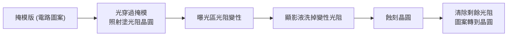
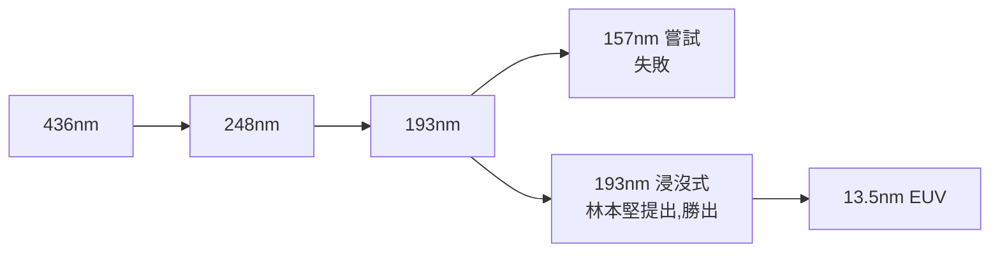
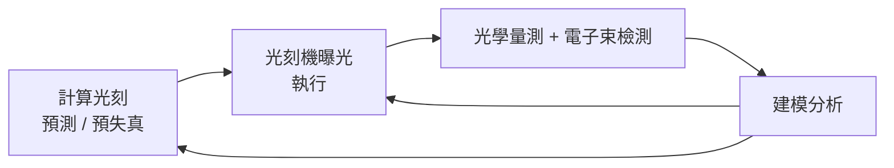

# 光刻機原理系列:從光的衍射、X 光的死路到 13.5nm EUV,再到 ASML 如何「繞過」阿貝極限

> Redknot(喬紅)「光刻機制造指南」系列。本篇合併兩支影片:**①光源篇**(為什麼波長要越來越短、X 光光刻為何失敗、為何選 13.5nm)與 **②ASML 控光篇**(阿貝衍射極限、離軸照明、計算光刻、量測檢測)。兩集共用同一條物理主線:**衍射 → 數值孔徑 NA → 波長 → k1**。
> 後續集數(13.5nm 光如何產生、功率從數瓦到數百瓦)作者預告但本篇涵蓋的影片尚未包含,待該集出現時於本篇追加章節。

> 📌 揭露:第②支影片(〈「欺骗」物理极限——ASML 的控光艺术〉)**含 ASML 業配**(片尾「ASML 全景光刻」段落為廣告口吻)。本篇**不轉述該段落與其宣傳立場**,只取前面的客觀物理與技術說明,並以公開資料核實。

---

## TL;DR

1. 光刻 = 把掩模圖案用光投影到塗了光阻的晶圓,顯影後蝕刻。圖案到奈米級時,**光是波、會衍射**,不能再當直線(幾何光學)看。
2. 解析度公式:**CD = k1 × λ / NA**。要縮小線寬只有三條路:**縮短波長 λ、加大數值孔徑 NA、降低 k1**。
3. 第一集講 λ:X 光太短波卻無法用透鏡、光罩會被燒壞,走進死胡同;DUV 從 436→248→193nm,157nm 失敗、被林本堅的**浸沒式 193nm** 擊敗;之後直接跳到 **13.5nm EUV**。
4. 第二集講 k1:阿貝極限對應 k1=0.5,**離軸照明**可讓物理下限降到 0.25;再加**計算光刻**(故意把光罩做「錯」)與**量測檢測回饋**,讓實際工藝 k1 逼近 0.27 這類數字。這不是違反物理,而是工程上繞開。

---

## 1. 基本流程與為什麼要談「光是波」

線路粗時像皮影戲,光走直線就夠。**線寬進入奈米級、與光波長同量級時**,光通過狹縫會擴散(衍射):縫越窄,晶圓上的光斑反而越寬。想讓晶圓上圖案變小,有兩種流派:

| 流派 | 做法 | 問題 |
|---|---|---|
| 接近式 | 晶圓貼近掩模,在光還沒擴散前曝光 | 掩模須與晶片 1:1 同大;距離小(影片稱 X 光案約 15–25 微米),一碰撞連掩模一起報廢;高端製程已不用 |
| 投影式 | 晶圓拉遠,用透鏡把掩模縮小成像 | 透鏡能收集多少衍射光,由 **NA(數值孔徑)** 決定 |

## 2. 第一集:光源——為什麼波長越短越好、卻不能亂短

### 2.1 X 光光刻為何是死胡同(影片說法,附核實)

- 動機:波長越短,衍射越小。IBM 自 1960 年代起把 X 光光刻列為核心方向,影片稱其波長約 1nm。
- **無法用透鏡**:X 光幾乎無視玻璃透鏡,不是穿透就是被吸收 ⇒ 只能走接近式 ⇒ 掩模要 1:1、貼極近。
- **近場衍射**不穩:離掩模遠處的「遠場衍射」形狀穩定,近處的「近場衍射」能量分散、形狀隨距離劇變,差一微米圖案就不同。影片指「X 光成像品質差」的根因就是工作在近場。
- **掩模被燒**:圖案用黃金吸收 X 光,吸收的能量全變熱,反覆熱脹冷縮,掩模可能破裂。
- 趣聞:林本堅當時也在 IBM,看衰 X 光,在同事的「X-ray works」T 恤後加上「for the dentist」。

### 2.2 波長演進與 13.5nm 的選擇

- 157nm 被林本堅提出的 **193nm 浸沒式**打敗,台積電與 ASML 因此躍升龍頭(影片說法,後續集數再展開)。
- **選 13.5nm 的邏輯**:要夠短,又要能被光學元件操控。EUV 不能用玻璃透鏡,改用**多層膜布拉格反射鏡**:鉬(Mo)與矽(Si)交替,每層約四分之一波長厚,堆疊幾十層,對 13.5nm 反射率約 70%。做成曲面即相當於透鏡。
- 影片也提到「鉬+鈹」鏡可反射約 11nm、反射率 80%,但**鈹劇毒**,晶圓廠沒人敢用,所以選 13.5nm。作者另提業界在探索 6.7nm,但個人悲觀。

> 逐字稿還原:「木和龟」= **鉬和矽**;「皮」= **鈹**(推定,與布拉格鏡材料吻合)。

## 3. 第二集:阿貝衍射極限與 ASML 怎麼「繞過」

### 3.1 衍射 = 把掩模資訊編成頻譜

光穿過掩模後,資訊以**頻率分布**記錄:

- **0 級**:最低頻,只含平均亮度;
- **±1 級**:較高頻,含邊緣與細節;更高級次含更細節。

透鏡把這些衍射光重新匯聚,才在晶圓上還原圖像。**收集的級次越多,邊緣越銳利**。NA 就是透鏡收集光的能力,由口徑、焦距、像側介質折射率決定。口徑太大時邊緣光線出射角過大會全反射;於是在透鏡與晶圓間注水,提高折射率,這就是 DUV 的**浸沒式光刻**。

### 3.2 阿貝極限與 ASML 公式

- 掩模圖案越小,衍射角越大,±1 級飛出透鏡 ⇒ 成像消失。極限是「0 級 + ±1 級剛好都被收進」:**CD = λ / (2·NA)**,即 k1 = 0.5。
- ASML 慣用 **CD = k1·λ/NA**。影片稱 ASML 機台做到 **k1 = 0.27 < 0.5**,看似超越阿貝極限。

### 3.3 為什麼 k1 可以低於 0.5:離軸照明

±1 級是同一資訊的共軛鏡像(振幅相同、相位相反),**只需 0 級加任一條 1 級**就能成像。把照明改成傾斜入射,犧牲一條 1 級、換另一條進入透鏡 ⇒ 分辨率極限減半,**k1 的物理下限 = 0.25**。影片指這同樣是阿貝 1873 年論文中就寫下的斜照明結論。

ASML 的實作是 **FlexRay** 可程式化照明器:由數千面可獨立偏轉的微反射鏡組成,依場景把光「捏」成任意瞳孔形狀。

### 3.4 計算光刻:故意把光罩做錯

離軸照明解決收集問題,但成像仍失真:線端縮短、直角變圓。工程師改「預失真」光罩:

- 線端會縮 ⇒ 預先加長加寬成**錘頭**;
- 直角變圓 ⇒ 在拐角補**小方塊**。

軟體針對每個場景同時算出最佳照明形狀(交給 FlexRay)與最佳光罩形狀,讓「失真的機器 × 失真的光罩」輸出正確圖案,這就是**計算光刻**。

### 3.5 量測與檢測:閉環

| 方式 | 原理 | 優缺點 |
|---|---|---|
| 光學量測 | 用固定波長光照晶圓,比對實際與理論衍射光波 | 快、全片掃描;只能指出一區有問題,定位粗 |
| 電子束檢測 | 電子打入表面數奈米,收集二次電子 | 極準、可定位奈米缺陷;很慢 |

產線上光學掃描圈出可疑區,電子束拿座標複核;結果建模後**回饋給光刻機修正下一片曝光**,並校準計算光刻模型。於是「光刻系統執行 + 計算光刻預測 + 量測檢測校準」形成自我修正的閉環。

## 4. 應用案例

- **讀新聞判斷技術路線**:看到「High-NA EUV」就是在 NA 這條軸上加碼(代價是機台更貴);看到「6.7nm」就是在 λ 軸上押注;看到「計算光刻、AI OPC」就是在 k1 軸上榨性能。三條軸互相獨立,能自行拆解每則光刻新聞押在哪一軸。
- **估算解析度**:ArF 浸沒式 λ=193nm、NA=1.35、k1 取下限 0.25 ⇒ CD ≈ 0.25×193/1.35 ≈ 36nm(單次曝光理論下限,實際需多重曝光等手段);EUV λ=13.5nm、NA=0.33、k1=0.4 ⇒ CD ≈ 16nm。數字僅為公式代入的示意。
- **理解「為什麼國產替代難」類討論**:光源、反射鏡鍍膜、照明器、計算光刻軟體、量測回饋是**不同子系統**,不只是「做一台大機器」。

## 5. 核實狀態

- **已核實**:ASML FlexRay 為可程式化照明器,由數千面可獨立調整的微反射鏡產生任意瞳孔形狀,2010 年起隨 XT:1950i / NXT:1950i 浸沒式機台出貨([ASML 新聞稿 2010](https://www.asml.com/news/press-releases/2010/asml-flexray-illuminators-successfully-enter-market))。
- **已核實(範圍內)**:Mo/Si 多層膜 13.5nm 反射率,文獻常見約 67%–74%(日常可達約 67.5%,專利標示約 74%,理論上限約 74%),影片「約 70%」落在範圍內;Mo/Be 於 11.3nm 約 70–71%(Chkhalo 簡報),理論上限約 78%。影片說的「80%」**偏高、需修正為約 70%(理論上限約 78%)**。出處:[OSTI](https://www.osti.gov/biblio/310916)、[Chkhalo PXRNMS 2016](https://utwente.nl/en/tnw/xuv/workshops/archive/pxrnms-workshop-2016/oral-presentations/chkhalo-pxrnms-2016-structural-and-reflective-characteristics-of-mobe-multilayer-with-barriers.PDF)。
- **未能核實**:「4000 面」微鏡的精確數量(公開資料僅稱「數千面」);「ASML k1=0.27」的具體機型與出處;IBM X 光波長 1nm、15–25 微米間距的原始出處;林本堅「X-ray works for the dentist」軼事。
- **k1 下限 0.25**:為光學理論慣例值(單次曝光),本篇依影片敘述與標準光學知識,未逐項查原論文。

## 來源

- 影片:[光刻机制造指南--光源篇(Redknot-乔红,2026-04-18)](https://www.youtube.com/watch?v=BUHHheaKlDY)
  - ⚠️ 該片無官方字幕,逐字稿以 CPU 版 Whisper 轉錄,可能有同音字誤差(「眼膜」=掩模、「木和龟」=鉬和矽、「皮」=鈹等已校正)。
- 影片:[“欺骗”物理极限--ASML的控光艺术(Redknot-乔红,2026-09-16)](https://www.youtube.com/watch?v=EsJKkDbHsec)(自動字幕;含 ASML 業配,廣告段落未納入)
- [ASML:FlexRay illuminators successfully enter market](https://www.asml.com/news/press-releases/2010/asml-flexray-illuminators-successfully-enter-market)
- [OSTI:Multilayer reflective coatings for extreme-ultraviolet lithography](https://www.osti.gov/biblio/310916)
- [Chkhalo:Mo/Be multilayer with barriers](https://utwente.nl/en/tnw/xuv/workshops/archive/pxrnms-workshop-2016/oral-presentations/chkhalo-pxrnms-2016-structural-and-reflective-characteristics-of-mobe-multilayer-with-barriers.PDF)
- 延伸(本庫):[[advanced-packaging-explained]]、[[hbm-high-bandwidth-memory-principle]]
