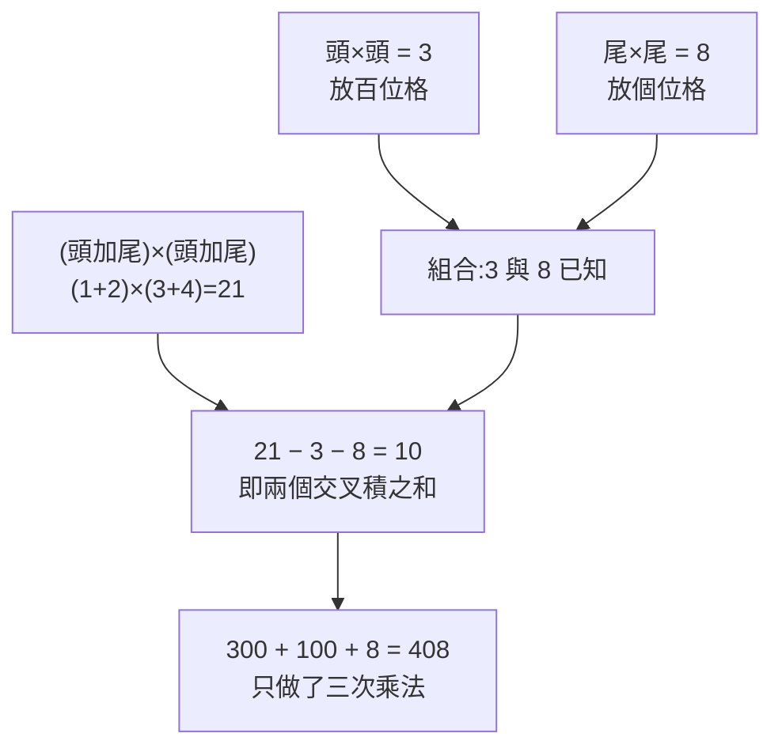

# 竖式是最慢的乘法:從 Karatsuba、FFT 到 OpenAI「低於 n log n」整數乘法,與 Harvey 用 Claude 讀了兩週(Mia 码上 AI)

**主題分類:** 科技 / AI 產業 — AI 數學成果與演算法科普
**來源:** YouTube 頻道 **Mia 码上 AI**〈你从小用的竖式是最慢的乘法,AI 刚打破了最快的纪录〉(2026-11-24,17 分 23 秒)https://youtu.be/cgVYAFPk8hU
**無官方字幕**:逐字稿以 CPU **faster-whisper large-v3-turbo(int8,不帶詞表)** 轉錄、非官方字幕。簡體中文口播,Whisper 把「乘法」大量聽成「惩罚」、「竖式」聽成「数式 / 术式」,下文已全數還原(見〈字幕還原〉)。揭露:片尾邀請加入付費會員(奶茶贊助),內容無商品業配;說明欄列有素材來源,本篇逐一對照。
**整理日期:** 2026-11-26

> 一句話:**竖式要 n² 次小乘法,Karatsuba 用三次換四次(約 n^1.585),FFT 類方法到 n log n;2026 年 OpenAI 的預印本宣稱把 log n 的指數壓到略小於 1。** 影片的算術示範我全部手算驗證過;對「AI 破紀錄」的數字則以 David Harvey 本人筆記與社群倉庫為準,標出哪些核實、哪些沒查到。

---

## TL;DR

| 重點 | 一句話 | 核實 |
|---|---|---|
| 竖式 | n 位乘 n 位要 n² 次小乘法;位數翻倍,工作量變四倍 | ✅ 手算 |
| Karatsuba | 四次小乘法省成三次,多做加減法;遞迴下去約 n^1.585 | ✅ 手算(12×34、21×32 皆對) |
| FFT 乘法 | 1971 年 Schönhage–Strassen 搬來做乘法,n log n log log n;每一輪每一段碰一次,輪數 ≈ log n | ✅ Quanta |
| 2019 | Harvey 與 van der Hoeven 做到 n log n | ✅ Quanta(論文 2019 年 3 月發表) |
| 2026 OpenAI | 預印本〈Integer multiplication below n log n〉,作者欄只有 OpenAI,未經同行評審,指數為 (log n)^(1−ε) | ✅ Harvey 筆記、GitHub README |
| ε 有多小 | 初稿 ε = 2^−182,影片說「往後數 54 個 9」 | ✅ 2^−182 ≈ 1.6×10^−55,小數點後恰 54 個 9 |
| Harvey 的反應 | 他沒讀完論文、放棄過,改問 Claude Fable 5.1 兩週,仍只懂一小部分 | ✅ 他的筆記原文 |
| 社群接力 | 第二天網友用 AI 刷紀錄 | ⚠️ 倉庫存在;「第二天」「Opus 5.5」「六週七千多份」**未能核實** |

## 一、影片脈絡(附時間)

| 時間 | 內容 | 連結 |
|---|---|---|
| 0:00 | 數學家守了 7 年的紀錄被 AI 破了,他看不懂論文,問了 Claude 兩週 | [前往](https://youtu.be/cgVYAFPk8hU?t=0) |
| 0:51 | 為什麼豎式最慢(n² 次小乘法) | [前往](https://youtu.be/cgVYAFPk8hU?t=41) |
| 1:57 | Kolmogorov 1960 年斷言省不掉 | [前往](https://youtu.be/cgVYAFPk8hU?t=107) |
| 2:31 | 示範:12×34 只用三次乘法 | [前往](https://youtu.be/cgVYAFPk8hU?t=141) |
| 4:51 | 練習 21×32 與三句口訣 | [前往](https://youtu.be/cgVYAFPk8hU?t=281) |
| 5:42 | Karatsuba 故事 | [前往](https://youtu.be/cgVYAFPk8hU?t=332) |
| 6:39 | 套娃:四位數、一百萬位 | [前往](https://youtu.be/cgVYAFPk8hU?t=389) |
| 7:32 | 賽跑:豎式 / Karatsuba / FFT | [前往](https://youtu.be/cgVYAFPk8hU?t=442) |
| 8:20 | FFT 與 n log n 的「光速」 | [前往](https://youtu.be/cgVYAFPk8hU?t=490) |
| 9:51 | OpenAI 那篇 73 頁論文 | [前往](https://youtu.be/cgVYAFPk8hU?t=581) |
| 10:54 | Harvey 的 38 頁筆記 | [前往](https://youtu.be/cgVYAFPk8hU?t=644) |
| 12:13 | 作者讓 Opus 5.5 當高中老師講論文 | [前往](https://youtu.be/cgVYAFPk8hU?t=733) |
| 15:38 | 網友刷紀錄、作者的看法 | [前往](https://youtu.be/cgVYAFPk8hU?t=928) |

## 二、Karatsuba 一步一步

把兩位數 ab × cd 拆成「頭」(十位)和「尾」(個位)。豎式要四次小乘法:頭×頭、尾×尾、頭×尾 兩次交叉。Karatsuba 發現中間那格只需要「兩個交叉積的和」,不必分開算:

**我的驗算:**

- 12×34:頭×頭 1×3=3(實為 300)、尾×尾 2×4=8、(1+2)(3+4)=21,21−3−8=10(實為 100),300+100+8=**408**。✅
- 21×32:頭×頭 2×3=6(實為 600)、尾×尾 1×2=2、上排頭加尾 2+1=3、下排頭加尾 3+2=5,3×5=15,15−6−2=7(實為 70),600+70+2=**672**。✅
- 四位數 1234×5678 拆兩半後是 3 次兩位數乘法,每次再拆成 3 次一位數乘法:3×3=9 次,豎式 16 次。✅
- **一百萬位的算力帳:** 豎式約 10^12 次小乘法,每秒一次約 3.2 萬年(影片「三萬多年」✅)。Karatsuba 約 3^20 ≈ 3.5×10^9 次(100 萬位約 20 層),約 110 年(影片「一百來年」✅)。**但影片說「省出 300 多倍」,實算 10^12 ÷ 3.5×10^9 ≈ 290 倍,略偏高(需修正為約 290 倍)。**

## 三、賽跑與 FFT

- 作者在自己電腦上讓三種演算法比賽,每輪位數翻倍:豎式用時 ×4、Karatsuba ×3、FFT 只有 ×2 出頭;一千萬位 FFT 0.45 秒、Karatsuba 17 秒多、豎式「按趨勢推算」約半小時。⚠️ 為作者自測、豎式為推算,**未能核實**,但倍率與理論(4、3、略大於 2)一致。
- 「Python 乘幾千位大整數,背後就是 Karatsuba」:說明欄附 CPython `Objects/longobject.c`。✅ 這點與 CPython 的長整數乘法實作相符(小數字豎式,大數字 Karatsuba),本篇未重讀原始碼,標為依常識與說明欄。
- FFT 的「一本帳」:大數切成段,一輪一輪加工,每輪每段碰一次,共 ≈ log n 輪,總帳 n log n。Schönhage–Strassen(1971)的 n log n log log n 與他們的 n log n 猜想,Quanta 2019 報導皆有。✅

## 四、OpenAI 低於 n log n 與 Harvey 的筆記

我下載並讀了 Harvey 筆記(UNSW,2026-10-20,38 頁)的開頭與核心段落:

| 影片說法 | 結果 | 依據 |
|---|---|---|
| Harvey 守了 7 年紀錄 | ✅ | n log n(2019 年 3 月)到 2026 剛好 7 年;2021 年演算法是他與 van der Hoeven 的 |
| 論文作者欄只有 OpenAI | ✅ | GitHub 預印本資料夾與 README:作者 OpenAI、日期 2026-09-23、稱「OpenAI Math Release preprint」。⚠️ 日期是預印本版本日,影片說「10 月 6 日放出」,**未能核實**兩者關係 |
| 「700 多篇」數學論文一口氣放出 | ⚠️ 未能核實 | Harvey 只說「a large pile of manuscripts」(math dump),沒寫篇數 |
| 73 頁 | ⚠️ 未能核實 | 我沒打開 paper.pdf;Harvey 筆記提到共有三篇相關預印本 |
| 指數壓到 0.99999…(54 個 9) | ✅ | 筆記:初稿 ε = 2^−182,指數約 0.9999…(同樣的 9 的個數)。筆記強調「ε 的實際值無關緊要」 |
| 「快了個寂寞」被網友笑 | ✅ | 筆記自己提到網路評論專挑 ε 太小 |
| Harvey 說進步大得嚇人 | ✅ | 原文:「gobsmackingly enormous」,因為過去 50 年改進的都是 log n 前面那條小尾巴 |
| 「我其實沒讀這篇論文,試過很快放棄」 | ✅ | 原文:「I have not actually read the paper… I tried, but soon gave up」 |
| 問的是 Fable 5.1 | ✅ | 筆記聲明:主要使用 Claude Fable 5.1 |
| 兩週只看懂一小部分、Claude 新對話幾分鐘就讀完 | ✅ | 原文:兩週後只懂一小部分;Fable 即使新對話也幾分鐘讀懂全篇 |
| 「請像給人類講解那樣講給我聽」 | ✅ | 原文提出 ELIH(explain it to me like I'm human) |
| 「痛苦和深深的失落」、祝賀無名模型 | ✅ | 原文:pain and profound sense of loss;congratulate the unnamed Model |
| 用 30 多頁拆解給同行 | ✅ | 筆記共 38 頁 |
| Harvey 說這條線像「光速」 | ⚠️ 未能核實 | 本篇沒查到出處 |
| 此結論已被證實 | ❌ **不能這麼說** | Harvey 自己只說「主要結果可能正確」、「我沒仔細檢查證明」;社群倉庫也聲明結果「不是量測到的執行速度提升」,也未宣稱獨立人工或形式化證明完整定理 |

### 完美乘法「大到宇宙寫不下」

影片說 2019 年那個 n log n 演算法「要真比別的快,數字要大到整個宇宙都寫不下」。Quanta 2019 報導**沒有**這句(我查過全文);這是 galactic algorithm 的常見說法(論文需極高維度的 FFT),本篇未重讀原論文,標為**未能核實**。

### 社群接力

說明欄的 `CrocSwap/integer-mult-bounds` 倉庫確實存在:它在 OpenAI 框架之下繼續推 O(n (log n)^(1−κ)) 的 κ 值紀錄,目前最佳 κ ≈ 0.00363(PR #7000),約 9,700 個 commit、1,400 個 PR,並請 AI 代理貢獻。**但 README 沒有說用了哪個模型,也沒有「第二天開始」「Opus 5.5」「六週七千多份」這些細節**,這些標為未能核實;「想比老辦法快一倍,數字照樣大到宇宙寫不下」同屬未核實。

## 五、作者的 Opus 5.5 實驗與數字對不上的插曲

- 作者把論文丟給 Opus 5.5 要它「像給高中生講課」,3 分 36 秒得 5 節講義,第 4 課(AI 怎麼破紀錄)沒跟上,改問「這招跟四次變三次是不是一個道理」,得到卡片與公共箱子的比喻:一大疊卡片只能從頭到尾翻,最費勁的是「整疊翻一遍」,新方法把多家的資訊放進公共箱子攪在一起、各自取回再剪掉鄰居的已知部分。這是**作者自己的實驗、未經獨立重現**,比喻能否忠實對應論文,我沒有能力驗證。
- **數字對不上那段是好的查證示範:** 模型先說「每層省百億分之 1.5」、再說「每 666 億次省一次」,作者按計算器發現論文分數是「千億分之 1.5」。我的驗算:1.5×10^−11 的倒數 = 6.67×10^10,**約 666 億,與影片第二個說法一致**,第一個「百億分之」差十倍(模型自承翻譯時少寫一個零)。⚠️ 但「論文裡的那個分數是 1.5/10^11」本身我沒對照原論文,標為未能核實。
- 作者的三招(「按高中生講」「用我會的去問是不是一個道理」「模型報的數字自己再按一遍」)是穩妥的讀不懂論文方法,第三招最值錢。

## 六、應用案例

- **自己驗 Karatsuba(10 行):** 用 Python 寫遞迴 Karatsuba,與 `a*b` 比對 1000 組隨機大數,再量時間;位數翻倍時看倍率是否接近 3。可重現影片賽跑的前兩名。
- **讀不懂的論文:** 依 Harvey 與作者的做法,先請模型用高中生語氣講,再用已知結構類比(「是不是跟 Karatsuba 同一個道理」),最後**所有模型給的常數自己重算**。本篇的「百億 vs 千億」就是靠重算抓到的。
- **資安相關理解:** 影片說瀏覽器 HTTPS 背後有幾百位的大數乘法;速度提升對實際加密無立即影響(ε 太小,在實用範圍內沒有加速),別把它與破解加密連在一起。

## 七、字幕還原(Whisper 聽錯處)

| 逐字稿 | 推定 | 依據 |
|---|---|---|
| 惩罚、惩罚表、久久惩罚表 | 乘法、九九乘法表 | 語意、上下文 |
| 数式、术式、呈、成 | 竖式、乘 | 說明欄章節「你从小用的竖式」 |
| 卡拉兹巴、卡达兹吧、卡拉楚巴 | Karatsuba | 說明欄素材 |
| Kolmogorov / Komogorov / Cole McGorff教授 | Kolmogorov | 前後文、Quanta |
| 快速复理液变换 | 快速傅里叶变换(FFT) | 語意 |
| Shen Haag和Straßen | Schönhage 與 Strassen | Quanta |
| Okanei | OpenAI | 語意 |
| login、N.Log.N | log n、n log n | 語意 |
| 股价完全一样 | 推定「思路完全一樣」(未核實) | 語意 |
| 置顶先控着 | 置頂先空著 | 語意 |
| 「比银还体面」 | 推定「比誰都體面」(未核實) | 語意 |

## 相關筆記

- [[openai-navier-stokes-agent-swarm-and-attribution]] — 同一批 OpenAI 數學成果的另一個案例與署名問題
- [[riemann-hypothesis-alpoge-claude-lean-proof-agent-alchemist-why-qq]] — AI 數學證明與可驗證性(Lean)
- [[ai-boss-luna-andon-market-fired-human-mia]] — 同頻道的另一篇 Mia 科普
- [[openai-matrix-multiplication-exponent-nine-fourths-lower-bound-why-qq]] — 同系列 OpenAI 數學稿:矩陣乘法指數 9/4 的上界、下界與 Lean 範圍

## 來源

- [YouTube:你从小用的竖式是最慢的乘法,AI 刚打破了最快的纪录(Mia 码上 AI,2026-11-24)](https://youtu.be/cgVYAFPk8hU)(無字幕,逐字稿以 CPU faster-whisper large-v3-turbo 轉錄,非官方字幕)
- [David Harvey:On the recently proposed o(n log n) integer multiplication algorithm(2026-10-20)](https://web.maths.unsw.edu.au/~davidharvey/research/subnlogn.pdf)
- [OpenAI:Integer multiplication below n log n(2026-09-23,預印本資料夾)](https://github.com/openai/math/tree/main/preprints/Integer-multiplication-below-n-log-n-September-23-2026)
- [CrocSwap/integer-mult-bounds(社群刷紀錄倉庫)](https://github.com/CrocSwap/integer-mult-bounds)
- [Quanta Magazine:Mathematicians Discover the Perfect Way to Multiply(2019)](https://www.quantamagazine.org/mathematicians-discover-the-perfect-way-to-multiply-20190411/)
- [CPython:Objects/longobject.c(說明欄,未重讀)](https://github.com/python/cpython/blob/main/Objects/longobject.c)
