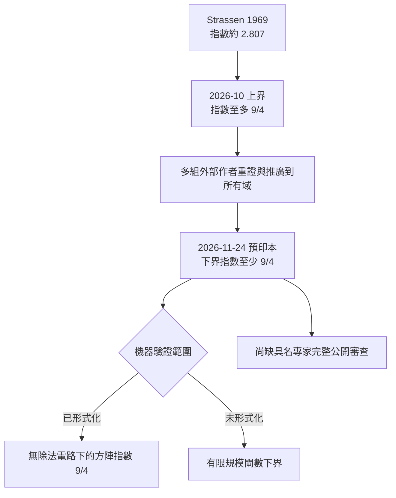

# OpenAI 稱矩陣乘法指數恰為 9/4(2.25):上界、下界、Lean 範圍,與對訓練、推理、晶片的真實影響(Why QQ + 一手來源核實)

**主題分類:** 科技 / AI 產業 — AI 做數學、計算複雜度與算力工程
**來源:** YouTube〈AI 算出矩阵乘法的极限?OpenAI 宣称 2.25 已经到头了!〉(Why QQ @whycallqq,2026-11-27,12 分 28 秒;**官方簡中字幕**,時間點取自帶時間字幕)
**整理日期:** 2026-11-28

> ⚠️ **預印本、尚未同行評議。** 影片自己也反覆強調這一點;本文把「已被機器檢查的」「別人重證的」「只有 OpenAI 自己說的」分開標。
> 頻道無業配;片尾求三連。說明欄附了一篇個人部落格的整理文章(見來源)。

---

## TL;DR

- **事實層:** OpenAI 在 `openai/math` 倉庫放了 2026-11-24 版預印本〈The matrix multiplication exponent is nine fourths〉,宣稱方陣乘法指數 ω 對**每個域**恰為 9/4 = 2.25。**上界 ω≤9/4 早在 10 月就出現並已被多組外部作者重證;這次新增的是下界。**
- **機器驗證的範圍比標題小:** Lean 只涵蓋**無除法**電路的方陣指數 9/4;影片點名的「有限規模閘數下界 ⌈n^(9/4)/2⌉」**未形式化**。
- **對工程:** 影片判斷短期不會讓訓練或推理變快、也不必改晶片架構,理由合理(§4),但那是頻道的工程判斷,不是論文的結論。
- **看 AI 數學新聞的三層濾網:** 聲稱了什麼、機器驗了多少、有沒有具名專家完整審過。

## 1. 影片脈絡(時間連結已提前 10 秒)

| 時間 | 內容 | 連結 |
|---|---|---|
| 0:39 | 背景:n×n 矩陣相乘 n³、Strassen 把 2×2 從 8 次壓到 7 次 | [前往](https://www.youtube.com/watch?v=a36Qg9nw8tE&t=29s) |
| 1:49 | 2026 年的時間線:上界一路推到 2.25 | [前往](https://www.youtube.com/watch?v=a36Qg9nw8tE&t=99s) |
| 2:38 | 11/24 新稿補上的是**下界** | [前往](https://www.youtube.com/watch?v=a36Qg9nw8tE&t=148s) |
| 3:38 | 還是預印本;Hacker News 的大 O / 大 Θ 之爭 | [前往](https://www.youtube.com/watch?v=a36Qg9nw8tE&t=208s) |
| 4:19 | 社群兩派:震撼派與懷疑調侃派 | [前往](https://www.youtube.com/watch?v=a36Qg9nw8tE&t=249s) |
| 5:37 | 問題一:大模型訓練會變快嗎 | [前往](https://www.youtube.com/watch?v=a36Qg9nw8tE&t=327s) |
| 6:50 | 問題二:推理成本會降嗎(預填充 vs 解碼) | [前往](https://www.youtube.com/watch?v=a36Qg9nw8tE&t=400s) |
| 8:01 | 問題三:芯片架構要改嗎 | [前往](https://www.youtube.com/watch?v=a36Qg9nw8tE&t=471s) |
| 10:00 | 三層濾網 | [前往](https://www.youtube.com/watch?v=a36Qg9nw8tE&t=590s) |
| 10:48 | 核驗口徑:111 頁、內部模型生成、Lean 範圍 | [前往](https://www.youtube.com/watch?v=a36Qg9nw8tE&t=638s) |

## 2. 影片說法與核實

| 項目 | 影片說法 | 一手來源 | 核實 |
|---|---|---|---|
| 論文 | 11/24 預印本,「指數是九分之四」 | [openai/math 預印本目錄](https://github.com/openai/math/tree/main/preprints/The-matrix-multiplication-exponent-is-nine-fourths-November-24-2026):README 標 "November 24, 2026 edition",「The exponent of square matrix multiplication is 9/4 over every field」 | ✅ |
| 下界形式 | 邊長 n≥2 時,非標量乘/除閘至少 ⌈n^(9/4)/2⌉ | README 寫 "At every side length n≥2, at least …" 個非標量乘法或除法閘(算式本身我靠論文結論的轉述,README 抓取內文未帶公式) | ✅(原文公式 ⚠️ 取自二手整理) |
| 上界時程 | 8 月 Alman–Williams 等 2.371177;9/24 OpenAI 壓到 2.258 以下;10/2 提出 2.25+ε | 部落格整理與 arXiv 都只指出「OpenAI 10/2 提出 ω≤9/4」;**8 月 2.371177 與 9/24 的 2.258 我沒查到一手來源** | 10/2 ✅;其餘 **未能核實** |
| 外部重證 | Lü、Amanov–van den Berg–Zuiddam、Shpilka | [arXiv 2610.30054(Amanov、van den Berg、Zuiddam)](https://arxiv.org/abs/2610.30054) 摘要:其版本「gives ω_F ≤ 9/4 over every field」;部落格另列 Uznański、Lü、Pass、Li、Doğan 等共六組 | Amanov 等 ✅;Lü ✅(據部落格);**Shpilka 我沒找到** |
| 內部模型生成 | 稿件由未公開內部模型生成,宜視為原始研究資料 | [openai/math README](https://github.com/openai/math):"best understood as a form of raw research data, rather than polished academic papers";"Some of the unformalized results could have issues" | ✅ |
| 倉庫規模 | 好幾百篇手稿 | README:730 篇、375 個家族、約 4,000 個問題、約 42% 主結果已形式化 | ✅ |
| 111 頁 | 111 頁 | 部落格寫「約 111 頁」;我沒打開 `paper.pdf` 數頁 | ⚠️ 二手 |
| Lean 範圍 | 無除法模型下的方陣指數 9/4;有限規模閘數下界**不在**形式化內 | 預印本 README:"The Lean development proves the square exponent 9/4 for division-free circuits";部落格:有限規模下界 "remains unformalized" | ✅ |
| 10 月有稿被撤回 | 部分稿件因出錯撤回 | 部落格:10/7 撤下三篇 Hodge 猜想稿(一個符號錯誤牽連兩篇);**倉庫 README 本身沒提撤回**,更正以新版本記錄、舊版仍可存取 | ✅(來源是部落格與先前我讀 `history.md` 的紀錄,詳見 [[openai-navier-stokes-agent-swarm-and-attribution]] §9) |
| 長方矩陣另有指數 | 論文單獨討論長方矩陣,不等於方陣 9/4 | 部落格:論文證明對偶指數 1/2 ≤ α ≤ 2/3;Lean 範圍陳述的比論文證明的還多 | ✅(⚠️ 部落格指出 Lean 與論文有落差) |
| Scott Aaronson 評論「HOLY SHIT」、網友對照清單八題 | 影片轉述 | **未讀 Aaronson 部落格與 HN 討論串**;部落格整理文也沒提 Aaronson | **未能核實** |
| Anthropic 同期掛出 VP≠VNP 證明 | 影片順帶一句 | 未查 | **未能核實** |

**一個容易漏掉的不一致:** 摘要的下界寫「乘法**或除法**閘」,Lean 只證**無除法**電路。所以「所有域上恰為 9/4」的完整版本,機器驗證並沒有全包。影片 10:48 之後有講到,但標題與開頭容易讓人以為整件事已被機器證明。

## 3. 影片裡的數學背景(為什麼是 2 和 2.25)

- 兩個 n×n 矩陣相乘,輸出就有 n² 個數,所以指數不可能低於 2。樸素算法 n³;Strassen(1969)用 7 次乘法取代 8 次,遞迴後約 n^2.807。
- 過去猜想 ω 最終等於 2(可無限逼近)。**若這份下界成立,在「形式算術電路」這個模型裡,ω=2 的猜想就終結了**:最好只能到 2.25。
- 「大 O vs 大 Θ」之爭是 Hacker News 標題一度寫成 O(n^2.25),評論說更貼近論文聲稱的是 Θ,因為上界早已有、新的是下界(影片轉述,我未讀 HN)。

## 4. 影片的三個工程判斷(頻道意見,附我的檢查)

| 問題 | 影片判斷 | 我的檢查 |
|---|---|---|
| 訓練會變快? | 短期不會:漸近結論、基礎矩陣尺寸可能大到 2 的 1/ε 多項式次方;生產庫預設走高度優化的立方算法,Strassen 類很少是預設 | 邏輯成立,與 [[openai-integer-multiplication-below-n-log-n-karatsuba-fft-mia]] 的「漸近優勢要多大才反超」是同一類問題;「基礎矩陣大小」我沒在論文裡查到(Shpilka 構造也沒找到),屬影片轉述 |
| 推理成本? | 預填充吃算力,解碼多半卡顯存帶寬;論文數的是**精確標量運算**,INT8/INT4 量化這類近似不被它堵住;論文主定理限形式算術電路,不是 Word RAM 位元複雜度 | 與 [[nvidia-moat-memory-bandwidth-cuda-software]] 的記憶體帶寬論點一致 ✅(論文限定模型這點見預印本 README 的 "formal arithmetic circuits") |
| 晶片要改? | 不用:脈動陣列與 Tensor Core 為規則資料流而生;Strassen 類遞迴打亂規則性、省下的乘法常被額外搬運吃掉;片外存取能耗常比一次乘加高幾個數量級 | 後者影片自己標明是「工程界經驗、不是這篇論文測的」,我同意這個標示;可對照 [[tpu-vs-gpu-systolic-array-cuda-anthropic-four-chips-agent-alchemist]] 的脈動陣列原理 |

影片的結論句值得抄:**「理論負責畫出天花板,工程負責把地板抬高」**,實務槓桿仍是帶寬、低精度與稀疏化。

## 5. 看「AI 數學大突破」新聞的三層濾網(影片 10:00,我加上本案檢查結果)

| 濾網 | 本案 |
|---|---|
| 1. 它聲稱了什麼 | 方陣 ω 在所有域恰為 9/4;有限規模閘數下界 |
| 2. 機器驗了多少 | Lean:無除法方陣指數 ✅;**有限規模下界未形式化**、除法情形函式庫有證明但未經 Comparator 認證(部落格轉述,我未跑驗證) |
| 3. 有沒有具名專家完整審過 | 上界:多組外部重證 ✅;**下界:我沒找到公開的完整審查**,部落格作者也建議等人類讀者審定理 2.1 後再引用 |

## 6. 應用案例

- **工程師讀到「O(n^2.25)」新聞時:** 先問它在哪個模型成立(精確算術電路)、對你的瓶頸有沒有幫助。LLM 解碼是搬運權重與 KV cache,論文的算術下界碰不到。
- **評估量化方案:** 影片說這個下界不排除 INT8/INT4 這類近似路線;你可以放心繼續做低精度,不必因為「數學天花板」而改路。
- **引用這類新聞做簡報:** 寫「OpenAI 預印本宣稱,尚待審查;上界已被多組外部作者重證」,別寫「已證明」;有限規模下界別引。
- **自己做 AI 科研 pipeline:** 學這個倉庫的做法:**稿件 + 形式化範圍文件 + 版本更正**一起放,並明講哪些沒形式化。

## 相關筆記

- [[openai-integer-multiplication-below-n-log-n-karatsuba-fft-mia]] — 同系列 OpenAI 數學稿:整數乘法低於 n log n
- [[openai-navier-stokes-agent-swarm-and-attribution]] — `openai/math` 倉庫、撤稿與「答案到了、理解沒到」
- [[nvidia-moat-memory-bandwidth-cuda-software]] — 解碼卡帶寬而非算力
- [[tpu-vs-gpu-systolic-array-cuda-anthropic-four-chips-agent-alchemist]] — 脈動陣列為何偏愛規則的立方算法

## 來源

- [YouTube:AI 算出矩阵乘法的极限?OpenAI 宣称 2.25 已经到头了!(Why QQ,2026-11-27)](https://www.youtube.com/watch?v=a36Qg9nw8tE)(官方簡中字幕,已讀帶時間全文;說明欄為頻道原文)
- [openai/math 倉庫 README](https://github.com/openai/math)(已讀)
- [預印本目錄 README:The matrix multiplication exponent is nine fourths(2026-11-24 版)](https://github.com/openai/math/tree/main/preprints/The-matrix-multiplication-exponent-is-nine-fourths-November-24-2026)(已讀 README;**未讀 paper.pdf 全文**)
- [arXiv 2610.30054:Multiplying matrices via polynomials: exposition and barriers(Amanov、van den Berg、Zuiddam)](https://arxiv.org/abs/2610.30054)(已讀摘要)
- [個人部落格整理:Matrix multiplication exponent is nine fourths(影片說明欄連結)](https://ai.satyajit.si/articles/matrix-multiplication-exponent-nine-fourths)(二手整理,已讀;其中 Lean 範圍、六組重證、撤回稿細節皆由它轉述)
