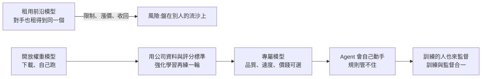

# Palo Alto 花 45 億美元買下 Applied Compute:「不擁有自己的 AI 就會被擁有」,開放權重 + 強化學習,以及訓練與監督合一

**主題分類:** 科技 / AI 產業 — 企業自訓模型、開放權重、AI Agent 資安監督
**來源:** YouTube〈OpenAI 出身三人創業 18 個月,賣給 Palo Alto 45 億美元〉(Agent 煉金術士,2026-11-24,約 9 分 50 秒;**依官方 zh 字幕整理**,說明欄附 SEC 新聞稿與開場原片連結)
**整理日期:** 2026-11-25

> ⚠️ **非投資建議:** 本文涉及上市公司併購、估值倍數與目標,僅整理公開資訊與影片論點,不構成買賣建議。
> ⚠️ **性質說明:** 影片的產業敘事多來自 Applied Compute 與 Palo Alto 自家說法(併購新聞稿、官網案例),兩者都是**利害關係方**;客戶成果數字未經第三方審計。
> 📎 相關:本庫談資安平台化的 [[cybersecurity-ai-agent-identity-platformization]]、談開放權重模型的 [[kimi-k3-1-pro-open-weight-coding-acceptance]]。

---

## 1. 一句話

資安公司 Palo Alto Networks 以**全股票、約 45 億美元**收購 Applied Compute(幫企業用自己的資料與評分標準,把開放權重模型用強化學習練成「自己的模型」)。影片的論點:**AI 若是租來的,規則在供應商手上;要管得住會自己動手的 Agent,得先會訓練它,所以「訓練」與「監督」會變成同一門生意。**

## 2. 影片內容與時間點

| 段落 | 影片說法 | 時間 |
|---|---|---|
| 交易 | Palo Alto 用價值 45 億美元股票買 Applied Compute;創辦人 Yash Patil 成共同首席 AI 長 | [0:18](https://www.youtube.com/watch?v=uX5HOd7Xiw4&t=8s)、[0:41](https://www.youtube.com/watch?v=uX5HOd7Xiw4&t=31s) |
| 估值軌跡 | 2025-06 種子 1 億 → 同年 10 月約 5 億 → 2026-04 Kleiner Perkins 領投 13 億 → 11/2 新一輪 32.5 億 → 16 天後 Palo Alto 出價 45 億 | [0:47](https://www.youtube.com/watch?v=uX5HOd7Xiw4&t=37s) |
| 租 AI 的兩個問題 | ①對手租同一個模型,做不出差別 ②規則在別人手上(可限制、漲價、收回,供應商還可能變對手) | [1:50](https://www.youtube.com/watch?v=uX5HOd7Xiw4&t=100s) |
| Fable 5 例子 | 2026-06 Anthropic 新模型 Fable 5 的說明文件寫,遇到開發 AI 相關問題模型可能不正面回答 | [2:21](https://www.youtube.com/watch?v=uX5HOd7Xiw4&t=131s) |
| 怎麼擁有 | 開放權重模型 + 公司資料 + 強化學習;「最難的是決定要爬哪一座山」= 先定義什麼叫做好 | [2:45](https://www.youtube.com/watch?v=uX5HOd7Xiw4&t=155s)、[3:08](https://www.youtube.com/watch?v=uX5HOd7Xiw4&t=178s) |
| 難處 | 基礎設施要幾個月;評分標準偏一點模型就學歪;工程師進駐客戶公司,成果與智財留客戶手上 | [3:36](https://www.youtube.com/watch?v=uX5HOd7Xiw4&t=206s) |
| DoorDash | 菜單照片轉線上菜單,專家檢查方式做成自動評分,嚴重菜單錯誤少三成 | [4:17](https://www.youtube.com/watch?v=uX5HOd7Xiw4&t=247s) |
| Harvey | 一次最多一萬份文件,每格成本比前沿模型少一半以上,使用者回饋再訓練下一版 | [4:41](https://www.youtube.com/watch?v=uX5HOd7Xiw4&t=271s) |
| 為什麼是現在 | DeepSeek R1(2025-01)後開放權重變強;Arora 稱企業 token 中開放權重占比一年內從不到 5% 到超過 60% | [5:16](https://www.youtube.com/watch?v=uX5HOd7Xiw4&t=306s)、[5:45](https://www.youtube.com/watch?v=uX5HOd7Xiw4&t=335s) |
| 為何資安公司買 | 規則管不住會改資料、寄信、付款的 Agent;用專門訓練的模型監督,且「做事的與監督的要一起練」 | [6:26](https://www.youtube.com/watch?v=uX5HOd7Xiw4&t=376s)、[6:53](https://www.youtube.com/watch?v=uX5HOd7Xiw4&t=403s) |
| 訓練+監督 | 「先進入訓練這門生意,才做得好監督這門生意」;Palo Alto 比較九家訓練公司後整家買下 | [7:27](https://www.youtube.com/watch?v=uX5HOd7Xiw4&t=437s)、[7:41](https://www.youtube.com/watch?v=uX5HOd7Xiw4&t=451s) |
| 目標與貴不貴 | 2029 財年此交易帶來超過 10 億美元 ARR;45 億約年化營收 45 倍且未審計;Arora 自稱是押注 | [8:12](https://www.youtube.com/watch?v=uX5HOd7Xiw4&t=482s)、[8:29](https://www.youtube.com/watch?v=uX5HOd7Xiw4&t=499s) |
| 給一般公司 | 多數用法現成模型加好工具就夠;只有決定產品、利潤、護城河的少數流程值得自己擁有;最值錢的是評分標準 | [8:59](https://www.youtube.com/watch?v=uX5HOd7Xiw4&t=529s) |

## 3. 核實紀錄(讀一手來源內文)

| 影片說法 | 結果 | 依據 |
|---|---|---|
| 價值 45 億美元股票收購、2026-11-18 公布 | **已核實** | Palo Alto 8-K 新聞稿:45 億美元(含調整)、**全股票**,預計 2027 財年第三季完成,需主管機關核准 |
| Patil 成為共同首席 AI 長(Co-Chief AI Officer) | **已核實** | 同上新聞稿 |
| 2029 財年超過 10 億美元 ARR | **已核實(媒體)** | CNBC、SecurityWeek 搜尋摘要:預期到 2029 財年為其新一代安全業務增加超過 10 億美元 ARR;**但 SEC 新聞稿本身沒寫這個數字**(新聞稿未提 ARR 目標),屬公司於法說會的說法 |
| 七萬多家客戶 | **已核實** | 新聞稿樣板文字「Trusted by 70,000+ customers」 |
| 「目前沒有大供應商能安全提供開放權重模型」 | **已核實** | 新聞稿:「Today, no large provider is delivering those models securely.」 |
| 估值 32.5 億、2026-11-02、年化營收超過 1 億美元 | **已核實** | Applied Compute 官網:2026-11-02 募 3.5 億美元、估值 32.5 億美元、Elad Gil 領投、成立不到 18 個月年化營收達 1 億美元(跟投含 Kleiner Perkins、Lux、NVIDIA、Blackstone 等) |
| 種子 1 億、約 5 億、2026-04 估值 13 億 | 未能核實 | 官網與新聞稿沒有這些早期輪次數字 |
| 創辦人 23 歲、史丹佛休學、寫信給 Altman、做 Codex | 未能核實 | 說明欄未附一手來源,未查到 |
| 由 32.5 億到 45 億 約漲四成 | **已核實(算術)** | 45 ÷ 32.5 ≈ 1.38 |
| 45 億約年化營收 45 倍 | **已核實(算術)** | 45 億 ÷ 1 億+ ≈ 45 倍(是「至少 1 億」,倍數是上限);營收為公司自報 |
| DoorDash:嚴重菜單錯誤少三成 | **已核實** | Applied Compute DoorDash 案例頁:「約 30%」重大菜單錯誤相對下降,正式菜單 A/B 測試;方法是自動評分器當獎勵訊號做強化學習,人工審核確認進步;**未公開基礎模型** |
| Harvey:每格成本比前沿模型少一半以上 | **需補正** | Harvey 案例頁:平均每格成本比 **Claude Sonnet 5** 低 54.8%,**只對照這一個模型**,不是「前沿模型」泛稱;準確度分數 0.903 對 Fable 5 的 0.867、GPT-5.6-Sol 的 0.857;引用精確 84.1%、召回 91.93%;基底是 GLM 5.2 |
| Harvey:一次最多一萬份文件、一張表數十萬次呼叫 | **已核實** | 案例頁:「up to 10,000 files」、一張表可觸發數十萬次呼叫(原文為 hundreds of thousands) |
| 企業 token 中開放權重占比「<5% → >60%」 | 未能核實 | 我讀的 CNBC 內文沒有此數字,搜尋摘要也找不到;疑為 Arora 在法說會逐字稿中說的,**需查法說會逐字稿** |
| Fable 5 說明文件寫「遇開發 AI 的問題可能不正面回答」 | 未能核實 | 沒讀到 Anthropic 該份文件,影片當作例子,不確定原文措辭 |
| Palo Alto 比較九家訓練公司後買下 | 未能核實 | 新聞稿與 CNBC 皆未提 |
| 「訓練與監督合一」是 Arora 的論述 | 部分核實 | 新聞稿只說「協助客戶安全地訓練、調整、部署開放模型」,**沒提監督**;CNBC 引述 Arora:「想成為提供安全運算與安全能力的單一玩家」。「訓練+監督」是影片的詮釋,出處可能在法說會 |
| 監督用的 agent 組、不可刪除的稽核紀錄、拿掉考試線索 | 未能核實 | 影片說是 Applied Compute 的做法,官網摘錄未見 |

**影片沒提或值得補的:**
- **價格是押注而非定價。** 45 億對應自報、未審計的年化營收約 45 倍;影片也承認(8:29–8:48)。BofA 稱此舉「大膽」、把 Palo Alto 從「保護 AI」延伸到「訓練開放權重模型」;Citi 說符合其「長期布局」(CNBC)。**這兩句是分析師正面或中性評論,文中找不到質疑價格的分析師。**
- **客戶成果是廠商案例頁。** DoorDash 與 Harvey 數字都來自 Applied Compute 自己的案例頁,對照基準由廠商選定(Harvey 對照 Sonnet 5)。
- **成本結構的另一面:** Applied Compute 官網另一個客戶(Handshake)稱推論成本最多降 47%,同樣是廠商披露。
- **「評分標準比資料量重要」值得單獨記:** 與本庫 [[agent-verification-before-scale-lauren-tan-reaction]] 談的「先驗證再放大」是同一個問題的兩面:自訓模型最難的是定義「什麼叫做好」。

## 4. 應用案例

1. **用量大又重複的結構化任務(文件抽取、菜單整理):** 像 Harvey 一張表幾十萬次呼叫,租 API 的帳單會吃掉利潤;值得評估自訓小模型。先用成本算:每格成本 × 呼叫次數。
2. **一般公司的判斷標準(影片結論):** 90% 的用法用現成模型 + 好工具資料就夠;只挑「決定產品、利潤、護城河」的 1–2 個流程,先把專家的判斷標準寫成可自動評分的清單(DoorDash 做法:專家對怎麼整理常有歧見,但對「整理好的對不對」容易有共識,所以先做驗證器)。
3. **資安角度:** 部署 Agent 前先問「它能碰哪些資料、每一步有沒有刪不掉的紀錄」(影片轉述 Applied Compute 的做法);prompt injection 的防禦見 [[prompt-injection-5-techniques-defenses]]。
4. **供應商依賴盤點:** 把產品依賴的模型列表,標出「換模型就會壞」的環節;Anthropic 上市文件揭露的算力成本結構見 [[anthropic-ipo-compute-bill-vs-growth-424b4-agent-alchemist]],可對照模型公司自己也在做應用的趨勢。

## 相關筆記

- [[cybersecurity-ai-agent-identity-platformization]] — Palo Alto 與資安平台化、Agent 身份管理
- [[kimi-k3-1-pro-open-weight-coding-acceptance]] — 開放權重模型的實際能力與驗收
- [[anthropic-ipo-compute-bill-vs-growth-424b4-agent-alchemist]] — 模型供應商的算力成本與成長(同頻道)
- [[agent-verification-before-scale-lauren-tan-reaction]] — 先驗證再放大:評分標準的重要性
- [[prompt-injection-5-techniques-defenses]] — Agent 被惡意指令劫持的防禦

## 來源

- Agent 煉金術士:〈OpenAI 出身三人創業 18 個月,賣給 Palo Alto 45 億美元〉 https://www.youtube.com/watch?v=uX5HOd7Xiw4 (2026-11-24,官方 zh 字幕)
- Palo Alto Networks 收購 Applied Compute 新聞稿(SEC 8-K 附件 99.2) https://www.sec.gov/Archives/edgar/data/0001327567/000132756726000030/ex992pressrelease_november.htm
- CNBC:Palo Alto stock jumps on earnings beat and company's big bet on securing open-weight models(2026-11-19) https://www.cnbc.com/2026/11/19/palo-alto-networks-earnings-applied-compute.html
- SecurityWeek:Palo Alto Networks to Buy AI Startup Applied Compute for $4.5 Billion(僅見搜尋摘要) https://www.securityweek.com/palo-alto-networks-to-buy-ai-startup-applied-compute-for-4-5-billion/
- Applied Compute:Applied Compute hits $100M run rate and raises $350M(2026-11-02) https://www.appliedcompute.com/company/100m-run-rate-fundraise
- Applied Compute:DoorDash 案例 https://www.appliedcompute.com/case-studies/doordash
- Applied Compute:Harvey Review Table 案例 https://www.appliedcompute.com/case-studies/harvey-review-table
- 開場畫面原始影片:The Generalist〈An Ex OpenAI Researcher on the Real Risk of Frontier Models〉 https://www.youtube.com/watch?v=B-MxM-OqON8 (說明欄所列,未逐句對照)
