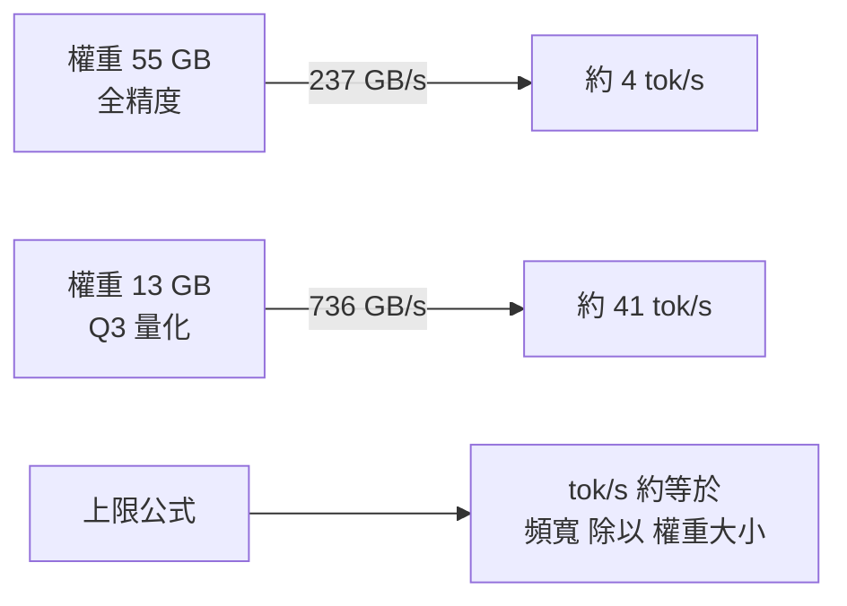

# 在家跑 27B 比雲端便宜 8 倍?Qwen3.8 27B 的本地經濟學,與八月「三天四個模型」的 checkpoint 浪潮

> 整理自 YouTube 頻道 **Caleb Writes Code** 兩支影片:〈Qwen3.8 27B is something else..〉(2026-08-26,約 9.8 分鐘)與〈Grok 4.6, Nemotron 3.5 Lightning, Muse Glimmer, DeepSeek V4 Pro 0813..〉(2026-08-14,約 8.8 分鐘)。
>
> **立場揭露:** 兩支影片都含業配,本文**不轉述其內容**:前者含 DevRev「Computer」(團隊共用 AI 隊友)業配,後者含 Micro Center 業配(硬體促銷)。
>
> **逐字稿說明:** 兩片皆無官方字幕,逐字稿以 CPU 版 Whisper(language=en)轉錄,可能有同音字誤差。已還原的詞:Quen / Coin → Qwen;Deepsync、DeepSix → DeepSeek;Rock → Grok;GBT → GPT;Loggingface → Hugging Face;Alibama → Alibaba;DJI Spark / DSPARK(依上下文)→ DGX Spark(推定);「30 million parameters」依上下文應為 30 billion(講者口誤或聽寫錯誤)。
>
> **整理日期:** 2026-11-06。對照 Qwen 官方 Hugging Face model card、各廠 / 第三方公開頁核實;核實狀態見 §6。

---

## TL;DR

1. **Qwen3.8-27B 是 Apache-2.0、約 27B 的稠密(dense)視覺語言模型**,原生 262,144 token 脈絡。官方卡片自報 SWE-bench Pro 61.7(對照 Opus 4.6 Max 的 53.4),但 Terminal Bench 2.1、GPQA Diamond 仍輸 Opus 4.6 Max —— **「接近 Luna / Opus 4.6」是自報分數的挑選性說法**。
2. **本地跑的速度主要由「記憶體頻寬 ÷ 權重大小」決定**:講者的 GPU(736 GB/s、Q3 量化 13 GB)跑出 41 tok/s,DGX Spark(237 GB/s、全精度 55 GB)只有 4 tok/s。
3. **「電費 0.37 美元 / 百萬輸出 token vs CoreWeave 3 美元,省近 8 倍」的算式是對的,但比較的條件不對等**(只算電費、不含硬體攤提;Q3 量化 vs FP8;單人 vs 雲端)。
4. 四個新模型三天內上線(Grok 4.6、DeepSeek V4 Pro 新 checkpoint、Nemotron 3.5 Lightning、Muse Glimmer),講者的主軸是 **「進步來自後訓練(post-training),不是更大的預訓練」**。

---

## 1. Qwen3.8-27B:官方卡片說了什麼

| 項目 | Hugging Face model card(自報) |
|---|---|
| 授權 | Apache-2.0 |
| 規模 / 架構 | 約 27B 稠密;64 層、hidden 5120;**Gated DeltaNet 與 gated attention 混合**,附 multi-token prediction |
| 脈絡 | 原生 262,144 token,可用 YaRN 擴到 1M(卡片警告靜態 YaRN 可能傷短文本表現,需要才開) |
| 模態 | 文字 + 圖像 + 影片輸入 |
| 推理控制 | 預設開思考;`reasoning_effort` 為 xhigh(預設)/ medium / low |
| 對照組 | Qwen3.6-27B、Qwen3.7-Plus、Muse Glimmer-30B、Claude Opus 4.6 Max |
| 自報分數 | SWE-bench Pro **61.7**(Opus 4.6 Max 53.4);Terminal Bench 2.1 **73.0**(Opus 78.2);GPQA Diamond **89.2**(Opus 91.3);OSWorld-Verified 84.3 |

卡片自己註明部分分數用內部 benchmark 或自訂 harness。**重點:卡片比的是 Opus 4.6,不是 GPT-5.6 Luna** —— 影片說「落在 Luna 與 Opus 4.6 附近」,Luna 這半句我沒在官方卡片找到依據(可能出自 Artificial Analysis 等第三方,未核實)。

影片還講了四個**未能獨立核實**的數字:Alibaba 2026 年已發 51 個模型 / 變體(引 Hugging Face 報告)、Qwen 系列下載破 20 億、Qwen3.8-27B 在 Code Arena 總榜第 9 而 Gemma 4 31B 第 80、發布數日內社群出了 800+ 個量化版本。這些都是講者引用,當作「據稱」。

---

## 2. 本地推論的算術:為什麼是頻寬,不是算力

講者的兩個設定:

| 設定 | 權重大小 | 頻寬 | 實測速度 |
|---|---|---|---|
| 獨立 GPU,Q3 量化 | 約 13 GB | 736 GB/s | 約 41 tok/s |
| DGX Spark,全精度 | 約 55 GB | 237 GB/s(講者量到的) | 約 4 tok/s |

**Roofline 驗算(我加的):** 解碼時每生成一個 token,要把全部權重(稠密模型)從記憶體讀一次,所以速度上限 ≈ 頻寬 ÷ 權重大小。

- GPU:736 ÷ 13 ≈ **56 tok/s** 上限,實測 41(約 73%)。
- Spark:237 ÷ 55 ≈ **4.3 tok/s** 上限,實測約 4(吻合)。
- 講者的「3.1 倍頻寬 × 4.2 倍縮小 ≈ 13 倍理論加速,實際 10 倍」同一邏輯。

這和本庫 [[nvidia-moat-memory-bandwidth-cuda-software]] 的結論一致(單人生成速度由頻寬決定),也呼應 [[rtx-spark-gb10-soc]] 的統一記憶體取捨:容量大、頻寬低,適合「放得下」不適合「跑得快」。

### 量化的代價:KL divergence

影片引用 Atomic Chat 的圖:各社群(Unsloth、LM Studio Community、ggml)把檔案從 32 GB 壓到 8 GB,**越壓,輸出機率分佈離全精度基準越遠(KL divergence 越大)**。講者選的 Q3_K_M 約 12.5 GB、KL 約 0.07。意思是:同一個 prompt,每個位置的 logits 經 softmax 後的 token 機率會略有偏移。KL 0.07 的「實際任務品質掉多少」影片沒有量測,**這是比較成本時最容易被略過的隱藏成本**。

---

## 3. 「省 8 倍」怎麼算,以及哪裡不公平

講者的算式:

1. 41 tok/s → 生成 100 萬 token 需 ≈ 6.7 小時(1,000,000 ÷ 41 ÷ 3600 ≈ 6.8)。
2. GPU 約 250 W、密西根住宅電價約 0.21 美元 / kWh → 6.7 h × 0.25 kW × 0.21 ≈ 0.35 美元(講者說 0.37)。
3. 對照 CoreWeave 跑 FP8、約 17 tok/s、**3 美元 / 百萬輸出 token** → 3 ÷ 0.37 ≈ **8 倍**。

**算式本身正確;但三個條件不對等:**

| 被忽略的項目 | 方向 |
|---|---|
| 硬體購置與折舊、閒置待機電力 | 讓「在家」的真實成本變高 |
| Q3 量化(KL 約 0.07)vs 雲端 FP8 | 品質不同,不是同一個產品 |
| 單人序列推論 vs 雲端批次服務 | 雲端的 3 美元含利潤、可用性、並行能力 |
| CoreWeave 的 3 美元、17 tok/s | 影片未給來源,本文**未能核實** |

**更精確的說法:** 「以邊際電費計,在家跑一個 27B 的單人用量,約是雲端按量計價的十分之一量級」。若你一天只生成幾十萬 token,硬體攤提會主導,結論可能反過來。

---

## 4. 八月中的「三天四個模型」

影片的主軸:**模型層供給暴增**(各家每 2–4 週放新 checkpoint),同時應用層需求仍在長、基礎設施層毛利被壓、晶片層算力受限(連六年的 A100 都被 CoreWeave 簽到 2029)。講者特別強調,**這幾個數字(4.5→4.6、3.5…)是 checkpoint,進步來自後訓練。**

| 模型 | 影片說法 | 核實 |
|---|---|---|
| **Grok 4.6**(xAI) | 比同級低 50% 以上,價格約等於 Sonnet 5;xAI 稱加了更高品質資料的追加預訓練 + 更好的 RL | 聚合站多數列 **$2 / $6 每百萬 token**;發布日有 8/7 與 8/12 兩種說法;能力為廠商自報,**未見獨立驗證** |
| **DeepSeek V4 Pro 新 checkpoint** | 相對 4 月的 Flash / Pro 躍進更戲劇化 | 本次搜尋**未找到**一手資料,未能核實 |
| **Nemotron 3.5 Lightning**(NVIDIA) | 架構與去年 12 月 Nemotron 3 Nano 相同,多了 MTP 預訓練;**蒸餾自 4 倍大的 Nemotron 3 Super**;pinch bench 準確度相近、快 30%;輸出速度近 4 倍但智能輸給 Qwen3.6 系列與 Gemma 4 | BF16 權重 2026-08-11 上 Hugging Face;**30B 總參數、3B 啟用**(Mamba-2 + MoE + attention 混合)、最長 1M 脈絡。⚠️ Together AI 描述為**蒸餾自 Nemotron 3 Ultra**,我沒找到「Super」的說法,**此處與影片不一致** |
| **Muse Glimmer**(Meta) | 約 30B,略低於 Qwen3.6-27B;美國實驗室更多加入開放權重 | Meta 2026-08-10 釋出,**30B 稠密、Apache-2.0**,為 Llama 4 以來首個開放權重;Meta 尚未自己提供 API;The Register 評價「並未明顯改變美國開放權重劣勢」 |

### 一個影片略過的細節:「30B 帶」其實不是同一種 30B

講者說 Nemotron 3.5 Lightning 與 Muse Glimmer「約 30B、算力預算相近」。但前者是 **30B 總參數、3B 啟用的 MoE**,後者是 **30B 稠密** —— 解碼時每個 token 實際搬運 / 計算的參數量差約 10 倍。這正是 Lightning 輸出速度可以快近 4 倍、智能卻較低的結構性原因;**「同一個參數量級」不等於「同一個算力預算」**。

### 中階模型為何是「每單位算力的智能」之戰

講者的分層:旗艦模型追求最大智能(像 o1、Fable 5 那樣,領先期可以收高價);中階模型多半跑在本地,瓶頸是「單位算力能塞多少智能」。這解釋了為什麼 Qwen3.6 27B(已四個月)仍是該尺寸的標竿,以及為什麼 Grok 4.6 與 DeepSeek 都走「更低價格」路線。可對照 [[xiaomi-mimo-v26-rl-live-dashboard-scaling]] 中的開放權重定價戰。

---

## 5. 講者的幾個判斷,及其保留

- **「小模型吃掉資料中心的聚合需求」**:方向合理,但目前仍是少數愛好者;文中的證據是下載量與量化版本數,不是需求替代的量測。
- **「取消 Claude 訂閱、在家跑 AI 太早」**:講者自己也說「跨面向還太早」。真正留住人的是 **harness 與記憶層**(對話、skills、workflow、connectors、排程都綁在平台),模型層被挑戰會迫使大廠在 harness 與記憶加碼。見 [[agent-harness-launches-august-2026]]。
- **「晶片層優勢不會是模型創新的瓶頸」**:觀點性推論,無量測。

---

## 6. 核實狀態

### 已核實
- Qwen3.8-27B 的授權、規模、架構、脈絡與自報分數(Hugging Face model card)。
- Muse Glimmer 的 8/10 發布、30B 稠密、Apache-2.0、Llama 4 之後首個開放權重。
- Nemotron 3.5 Lightning 的 8/11 BF16 釋出、30B / 3B 啟用、MTP、1M 脈絡、vLLM 支援 MTP / DFlash / DSpark 三種 speculative decoding。
- Roofline 與成本算式的內部一致性(自行驗算)。

### 需修正 / 要註明
- Qwen3.8-27B 卡片的對照組是 **Opus 4.6 Max**,非 Luna;且有兩項輸給對照組。
- Nemotron 3.5 Lightning 的蒸餾來源:影片 Super,第三方描述為 **Ultra**,存疑。
- 「在家便宜 8 倍」只比電費,條件不對等(見 §3)。
- 影片的「30 million parameters」應為 30 billion。

### 未能核實(以影片轉述看待)
- 51 個模型、20 億下載、Code Arena 第 9 / 第 80、800+ 量化版本。
- CoreWeave 3 美元 / 17 tok/s、CoreWeave 簽 A100 到 2029。
- DeepSeek V4 Pro 新 checkpoint 的細節;Thinking Machines「Inkling」開放權重。
- Grok 4.6 與 Sonnet 5 價格「相當」的比較(兩者的官方價格我未逐一對照)。

---

## 應用案例

### 案例 1|算出「我的硬體能跑多快」再決定要不要買

公式:**預期 tok/s ≈ 0.7 × 頻寬(GB/s) ÷ 權重大小(GB)**(0.7 取自本文實測效率,僅供估算)。

- 想在 24 GB、900 GB/s 的卡上跑 27B:Q4 約 16 GB → 約 0.7 × 900 ÷ 16 ≈ 39 tok/s,可用。
- 想在 128 GB、273 GB/s 等級的統一記憶體機器上跑全精度 55 GB:0.7 × 273 ÷ 55 ≈ 3.5 tok/s,**放得下但慢**;改選 MoE 模型(啟用參數少)速度才會好看。

### 案例 2|別被「同一個尺寸」騙了

看到「30B 模型」先問兩件事:**是稠密還是 MoE?啟用參數多少?** 例如 Lightning(3B 啟用)比 Glimmer(30B 稠密)快很多,但智能較低。選本地模型時,速度看啟用參數,智能看總容量與訓練品質。

### 案例 3|做「在家 vs 雲端」成本表時的檢查清單

1. 把硬體按 2–3 年攤提 + 待機電力放進去。
2. 同一個精度與量化等級比,或明確寫出 KL / 品質差。
3. 區分單人序列與批次吞吐。
4. 算「你實際每天生成多少 token」。每天幾十萬 token 以下,雲端 API 通常更省事。

---

## 來源

- YouTube:[Qwen3.8 27B is something else.. — Caleb Writes Code](https://www.youtube.com/watch?v=3WbXyUolFA0)(2026-08-26)—— **該片無官方字幕,逐字稿以 CPU 版 Whisper 轉錄,可能有同音字誤差**;含 DevRev 業配,未納入。
- YouTube:[Grok 4.6, Nemotron 3.5 Lightning, Muse Glimmer, DeepSeek V4 Pro 0813.. — Caleb Writes Code](https://www.youtube.com/watch?v=Cx-pVoBR7C0)(2026-08-14)—— **該片無官方字幕,逐字稿以 CPU 版 Whisper 轉錄,可能有同音字誤差**;含 Micro Center 業配,未納入。
- 核實用:
  - [Qwen/Qwen3.8-27B model card — Hugging Face](https://huggingface.co/Qwen/Qwen3.8-27B)
  - [Alibaba releases Qwen3.8-27B — DataNorth](https://datanorth.ai/news/alibaba-releases-qwen3-8-27b)(第三方)
  - [Meta releases Muse Glimmer — Artificial Analysis](https://artificialanalysis.ai/articles/muse-glimmer)、[The Register 報導](https://www.theregister.com/a/5285666)
  - [Announcing Day-0 Support for NVIDIA Nemotron 3.5 Lightning on vLLM](https://vllm.ai/blog/2026-08-10-nemotron-3-5-lightning-vllm)、[Together AI 模型頁](https://www.together.ai/models/nemotron-3-5-lightning)
  - [Grok 4.6 pricing — MindStudio](https://www.mindstudio.ai/blog/grok-4-6-pricing-access)(第三方,價格 $2 / $6)
- 本庫相關:[[nvidia-moat-memory-bandwidth-cuda-software]]、[[rtx-spark-gb10-soc]]、[[inference-engines-llamacpp-vllm-sglang-tensorrt]]、[[xiaomi-mimo-v26-rl-live-dashboard-scaling]]、[[agent-harness-launches-august-2026]]

> ⚠️ 本文涉及的模型價格與跑分變動快速,具體數字以各廠官方頁為準。
