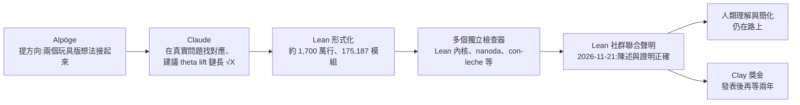

# Alpöge 與 Claude 的黎曼猜想 Lean 證明:短文、1,737 萬行、驗證到哪一步(Agent 煉金術士 + Why QQ)

> 兩支影片講同一件事,併成一篇:Agent 煉金術士〈菲爾茲獎得主估2050年,黎曼猜想提早24年〉([`q6SFeJqgkaQ`](https://www.youtube.com/watch?v=q6SFeJqgkaQ),2026-11-23,官方 zh-Hant 字幕)與 Why QQ〈Claude 帮数学家挑战黎曼猜想,陶哲轩也下场了〉([`o2U-s57RZso`](https://www.youtube.com/watch?v=o2U-s57RZso),2026-11-23,**無字幕,Whisper large-v3-turbo 轉錄 327 段**)。
> **本篇做了什麼:** 讀了 Alpöge 本人的 4 頁短文(PDF 全文)、Lean FRO 與 Mathlib 的聯合聲明、MIT Sutherland 的檢查彙整頁、Aaronson 部落格、Scientific American 報導、Clay 頁面,逐項核對兩支影片。**沒讀到**:陶哲軒 11/20 部落格原文、Rubinstein 164 頁工作稿、Radziwiłł 與「數學家團體聲明」出處、Numberphile 原片(都標在表裡)。
> 作者利益:兩支片都沒有業配;Agent 煉金術士片尾有頻道自我介紹,Why QQ 片尾要三連,無商品。

---

## 一、先講結論

1. **事件本身有一手來源,不是謠言**:Alpöge 的短文(2026-11-20)開頭就寫「我相信我和 Claude 一起發現了黎曼猜想的證明」,並公開 14 個分卷的 Lean 壓縮檔。Lean FRO 與 Mathlib Initiative 在 11/21 發聯合聲明,確認**陳述與 Mathlib 的 `RiemannHypothesis` 完全一致**、證明通過多個獨立檢查器。
2. **「已被機器檢查」不等於「已被人類接受」**:Clay 獎金規則是正式發表後再等兩年(Aaronson 留言引述);短文作者自己也說還沒掌握證明周圍的數學。兩支影片都講到這點,是對的。
3. 兩支影片的主要數字多數對得上一手來源;**影片沒提、但我認為重要的保留**列在第五節(例如 Lean 內核本身的漏洞風險、MIT 頁自己揭露的檢查限制)。
4. 影片裡幾個**說得很具體但我找不到出處**的說法(Radziwiłł 引言、數學家團體聲明、Rubinstein 164 頁、陶哲軒的「五十年最大進展」)一律標「未能核實」,不要當事實轉述。

---

## 二、時間線(以一手來源為準)

| 日期 | 事件 | 來源 |
|---|---|---|
| 2026-10-06 | Claude 整理的 20 步時間線第一步:Stepanov determinant | Alpöge 短文 p3 |
| 2026-11-15 | 20 步中有 **8 步**標在這天(含 m 次 theta lift 鏈、取 m 約 √X) | 短文 p3–4,我逐項數過 ✅ |
| 2026-11-16 | 第 20 步:**GRH** | 短文 p4 |
| 2026-11-20 | 短文與 Lean 檔公開 | Lean 聲明、MIT 頁 |
| 2026-11-21 | Lean FRO × Mathlib Initiative 聯合聲明 | Lean 聲明 |
| 2026-11-23 | MIT 檢查彙整頁最後更新 14:35 UTC,**部分檢查仍在跑** | MIT 頁 |

---

## 三、逐項核對:Agent 煉金術士那支

> 連結的 `&t=` 一律是逐字稿 `[m:ss]` 減 10 秒。

| 影片說法([時間點](https://www.youtube.com/watch?v=q6SFeJqgkaQ&t=80s)) | 一手來源怎麼說 | 判定 |
|---|---|---|
| Alpöge 是 Anthropic 數學家,貼出 4 頁短文,第一句「我相信,我和 Claude 一起,找到了黎曼猜想的證明」([0:20–0:36](https://www.youtube.com/watch?v=q6SFeJqgkaQ&t=10s)) | 短文第 1 頁:「I believe I have, working with Claude, discovered a proof of the Riemann Hypothesis.」 | ✅ 已核實 |
| 短文同時說方法延伸到**廣義黎曼猜想**([6:38](https://www.youtube.com/watch?v=q6SFeJqgkaQ&t=388s)) | 短文:method extends to GRH,「I expect, with more time, the Extended Riemann Hypothesis too」 | ✅ 已核實;⚠️ 影片沒提「預期擴展 ERH」只是預期 |
| **1,737 萬行** Lean([1:30](https://www.youtube.com/watch?v=q6SFeJqgkaQ&t=80s))、約整個數學庫七倍 | Lean 聲明只寫約 "17 million lines";MIT 頁寫 175,187 個模組、1,472,825 個宣告 | 約數 ✅;**精確的 1,737 萬與「七倍」未能核實** |
| AI 寫成文字超過 **25 萬頁**,貼出來也只是 slop([1:40](https://www.youtube.com/watch?v=q6SFeJqgkaQ&t=90s)) | 短文註 2:「hit 250,000+ pages」;正文用 "slop" 一詞 | ✅ 已核實 |
| 10/6 第一步、11/16 全證完,約六週([1:57](https://www.youtube.com/watch?v=q6SFeJqgkaQ&t=107s)) | 短文時間線 10/6 與 11/16,共 41 天 | ✅ 已核實 |
| 「陶哲軒說 2050」時這條路已走九天([2:06](https://www.youtube.com/watch?v=q6SFeJqgkaQ&t=116s)) | 需要 Numberphile 原片日期;我沒讀 | 未能核實 |
| 質數定理、78,498 個質數([3:02–3:31](https://www.youtube.com/watch?v=q6SFeJqgkaQ&t=172s)) | 一般數學常識:π(10⁶)=78,498 | ✅ 常識(未另查來源);⚠️ 影片說「高斯約十五歲猜到、1896 年證出」未讀一手 |
| 電腦已檢查前 **10 兆**個例子([5:28](https://www.youtube.com/watch?v=q6SFeJqgkaQ&t=328s)) | Clay 頁:「checked for the first 10,000,000,000,000 solutions」 | ✅ 已核實 |
| 2018 年 Atiyah 發表證明、數學界不接受([5:41](https://www.youtube.com/watch?v=q6SFeJqgkaQ&t=331s)) | 我沒讀一手 | 未能核實(廣為人知,但本次未查) |
| 十月 OpenAI 證出「準黎曼猜想」,陶哲軒稱五十年最大進展([5:58](https://www.youtube.com/watch?v=q6SFeJqgkaQ&t=348s)) | Scientific American 只說十月出現「第一道裂縫」,**沒提「準黎曼猜想」,也沒提陶哲軒評語** | 未能核實 |
| 「重數」「鏈」「√X」:Claude 建議鏈長 √X([8:02–8:25](https://www.youtube.com/watch?v=q6SFeJqgkaQ&t=472s)) | 短文:chaining theta lifts,對長度 X 的 von Mangoldt 和,**Claude 建議的 theta lift 鏈長度是 √X**,「And yet, what else could it be?」 | ✅ 已核實;📝 影片只說「鏈」,原文精確是 **theta lifts 的鏈**,每一環模仿「重數」 |
| 二十步裡八步標在 11/15,隔天 GRH 證完([8:52](https://www.youtube.com/watch?v=q6SFeJqgkaQ&t=522s)) | 我逐項數:第 8、9、10、12、14、15、17、18 步 = 8 步;第 20 步 11/16 | ✅ 已核實 |
| Lean 社群確認題目沒偷換、數十人各自跑、有人用別的語言重寫檢查器([10:04](https://www.youtube.com/watch?v=q6SFeJqgkaQ&t=594s)) | Lean 聲明:陳述經 `comparator` 與 `con-leche --compare` 比對;「數十人」編譯得到相同匯出;檢查器以不同語言實作 | ✅ 已核實 |
| 11/21 聯合聲明:「我們在此認證,黎曼猜想的命題和證明都是正確的」([10:26](https://www.youtube.com/watch?v=q6SFeJqgkaQ&t=616s)) | 聲明日期與意旨相符,聲明表示 "full confidence";**逐字引句我未在讀到的版本逐字比對** | 意旨 ✅;逐字未能核實 |
| Aaronson:比一般期刊審論文更嚴格([10:34](https://www.youtube.com/watch?v=q6SFeJqgkaQ&t=624s)) | Aaronson 原文:「a much higher degree of verification than a typical human paper accepted to a math journal」 | ✅ 已核實(是他的主張) |
| 獎金還沒發:發表後再等兩年([10:44](https://www.youtube.com/watch?v=q6SFeJqgkaQ&t=634s));克雷官網標「未解決」 | Aaronson 留言引述「期刊發表兩年後才評估」;**Clay 頁面我讀到狀態是 "Active"、未見 "Unsolved" 字樣**,規則細節要看另一頁 | 兩年 ⚠️ 二手;「Unsolved」字樣未能核實 |
| Radziwiłł:「這份證明完全沒有回答為什麼」([11:10](https://www.youtube.com/watch?v=q6SFeJqgkaQ&t=660s));數學家團體聲明 | Scientific American 與搜尋都**沒找到** | **未能核實** |
| Aaronson 估計數學家拆解要好幾年([11:29](https://www.youtube.com/watch?v=q6SFeJqgkaQ&t=679s)) | Aaronson:"that will probably take years" | ✅ 已核實 |
| MIT Sutherland 把證明接上別人的 Lean 證明,證完 Robin 不等式:n>5040 時 σ(n) 小於固定上限([12:08](https://www.youtube.com/watch?v=q6SFeJqgkaQ&t=718s)) | MIT 頁:`robin_inequality`,對所有 n>5040,σ(n) < e^γ·n·log log n,結合獨立形式化的 `kimihiro64/Robin1984`,不含假設、不提 zeta 函數 | ✅ 已核實(影片的「固定公式」就是 e^γ·n·log log n) |
| 提早 24 年(2050−2026) | 算術;但 2050 的出處是 Numberphile 陶哲軒,未讀 | 算術 ✅,出處未能核實 |

---

## 四、逐項核對:Why QQ 那支(Whisper 逐字稿)

| 影片說法 | 一手來源 | 判定 |
|---|---|---|
| 175,187 個模組、約 1,700 萬行([0:38](https://www.youtube.com/watch?v=o2U-s57RZso&t=28s)、[4:46](https://www.youtube.com/watch?v=o2U-s57RZso&t=276s)) | MIT 頁:175,187 個模組編譯通過;Lean 聲明約 17 million lines | ✅ 已核實 |
| 最終五個主要定理只依賴三個標準公理([7:50](https://www.youtube.com/watch?v=o2U-s57RZso&t=470s)) | MIT 頁:`#print axioms` 只顯示 `propext`、`Classical.choice`、`Quot.sound`;**頁內寫「全部五個定理與挑戰檔相符」** | ✅ 已核實 |
| 獨立檢查器含 Rust 的 Nanoda、Conleach、LinsLin([8:05](https://www.youtube.com/watch?v=o2U-s57RZso&t=485s)) | MIT 頁列 nanoda(接受,27 分 42 秒,80 執行緒)、con-leche、con-ron、lean4lean。Whisper 的「Conleach」=**con-leche**,「LinsLin」疑為 **con-ron**(推定) | ✅(名稱已校正) |
| 檢查 Mathlib 既有黎曼猜想定義是否與定理一致([8:10](https://www.youtube.com/watch?v=o2U-s57RZso&t=490s)) | Lean 聲明:另建只匯入 Mathlib 的檔案,以 `comparator` 與 `con-leche --compare` 比對 | ✅ 已核實 |
| MIT Sutherland 公開驗證日誌([8:24](https://www.youtube.com/watch?v=o2U-s57RZso&t=514s)) | MIT 頁即是 Sutherland 的檢查彙整頁 | ✅ 已核實 |
| Waterloo 的 Michael Rubinstein 公布獨立檢查結果與 **164 頁**工作稿,主部等式 M 部分直接引用 Lean([8:28、9:01](https://www.youtube.com/watch?v=o2U-s57RZso&t=531s)) | 搜尋與已讀來源**都沒找到** | **未能核實** |
| 陶哲軒 **11/20** 部落格討論三項 AI 數學突破(三維 Euler 有限時間爆破、Navier–Stokes、GRH),且「沒有替他背書」([6:09](https://www.youtube.com/watch?v=o2U-s57RZso&t=359s)) | 搜尋沒取回該文;我另查到 9 月 Navier–Stokes 風波中陶哲軒的態度(憂心驗證跟不上),但不是這篇 | **未能核實**;「沒有背書」的立場與九月態度一致,僅屬推測 |
| Alpöge 說最後 Claude「飛了起來,跳起舞,閃閃發亮」([3:16](https://www.youtube.com/watch?v=o2U-s57RZso&t=186s)) | 短文:「Claude flew, and danced, and sparkled near that finish line」 | ✅ 已核實 |
| 關鍵思路:函數域的 Stepanov 方法連到 theta lifts([3:38](https://www.youtube.com/watch?v=o2U-s57RZso&t=218s)) | 短文:descendant of Stepanov's argument(函數域上解黎曼),multiplicity 對應整數上「微分」,以 theta lift 鏈模仿 | ✅ 已核實 |
| 「先把黎曼猜想轉成素數加權和估計,再構造 φ 核、格結構」([4:09](https://www.youtube.com/watch?v=o2U-s57RZso&t=239s)) | 短文第 20 步前有 Λ(von Mangoldt)和 `∑Λ(n)(X/n−1)+…` 的步驟(第 5 步);「φ 核、格」我沒在短文找到明確對應 | 部分 ✅;「φ 核」未能核實 |
| 克雷規則:發表後至少兩年且被普遍接受,才進入評審([10:53](https://www.youtube.com/watch?v=o2U-s57RZso&t=643s)) | 同上,Aaronson 留言引述 | ⚠️ 二手,未讀 Clay 規則頁 |

### Whisper 校正表(Why QQ 逐字稿)

| 逐字稿寫法 | 應為 | 依據 |
|---|---|---|
| Ling / Lin / Lin-Only | **Lean** | MIT 頁、Lean 聲明 |
| Levent Elpage / Alpergi / L-Page | **Levent Alpöge** | 短文、聲明 |
| Cloud | **Claude** | 全篇語境 |
| 零界线 | **臨界線** | 黎曼猜想術語 |
| 实步 / 1分之2 | **實部 / 二分之一** | 黎曼猜想術語 |
| Zetas等于1加1除以2加… | ζ(s)=1+1/2^s+1/3^s+…(複數 s,Whisper 的「负数」疑為「複數」) | 推定 |
| step-off 方法 | **Stepanov** 方法 | 短文 |
| Conleach / LinsLin | **con-leche / con-ron**(後者推定) | MIT 頁 |
| 三维吾外力 / Auler | **三維歐拉(Euler)方程** | 語境(推定) |
| 素数加全核 | **素數加權和**(von Mangoldt Λ 加權)(推定) | 短文第 5 步 |

---

## 五、影片沒提、但一手來源裡有的重要保留

1. **Lean 內核不是不會錯**:Aaronson 寫明 Lean 有過「讓 0=1 被證出」的內核漏洞,底層型別理論的健全性也有不確定,他認為應立刻修;並擔心被強力訓練的 AI 可能 reward-hack 這類漏洞。影片只轉述「比期刊嚴格」,沒講這條保留。
2. **MIT 檢查頁自己揭露的限制**(最後更新 2026-11-23 14:35 UTC):
   - 「GRH」在此**只指 Dirichlet L 函數**(所有模數與特徵),**不含** Dedekind、Hecke 或一般自守 L 函數。
   - Comparator v4.33.0 的 `lake build` 步驟是用 stub 滿足的,比對的 Challenge 模組是作者自己編的版本,頁面自行揭露。
   - Lean 預設內核檢查花 **48 小時 3 分**(調整分配器後 9 小時 8 分);`lake comparator`(v4.36.0)與 paranoid 內核預設設定版**當時仍在跑**。
   - 175,187 個檔案中有 1 個 `LocModel.olean` 編譯結果不具確定性(頁面認為不影響 export)。
   - 隨 v4.36.0 附帶的舊版 con-leche / con-ron 因不支援證明中的自反歸納型別而 exit 2(**不是證明被拒**)。
   - 結論仰賴各內核與 Mathlib 定義的正確性。
3. **短文裡的坦白**:作者說這是「在尚未掌握周邊大片數學之前就交出完整論證」;時間線是 Claude 整理、他自己「paraphrasing a slop summary」,可能有誤;他預期證明會**被大幅簡化**。他也提到發佈時機「horrible」,並在週日深夜先傳訊息給 Dario 詢問能否公布。
4. 聲明驗證的是**形式正確性**;聲明自己寫期待數學界「explain the new ideas in this proof」,即思想層面尚待解釋。
5. Scientific American 的三位評論者影片都沒引:Pasten(完成不同數學分支之間的「字典」)、Pagano(新想法可能開啟數論新方向)、Sutherland(「建造一台會思考的機器」是關鍵一步)。

---

## 六、判讀

1. **這是「驗證成本」故事,不只是「AI 強」故事**:找到證明約六週、機器檢查約一天到數日,最慢的是人類理解。這與 [[agent-verification-before-scale-lauren-tan-reaction]] 的主軸一致:能被機器判定的驗收器,才是讓 agent 大規模跑下去的前提。
2. **Lean 是這次最重要的「可判定驗收器」**:同一個思路也出現在 [[claude-fable-5-2-1000-agents-os-fermat-harness-why-qq]] 的費馬大定理形式化。但這次的教訓是:驗收器本身(內核、陳述翻譯、Mathlib 定義)才是新的信任錨點,要持續被審。
3. **人機分工**:短文描述的是「人指方向、AI 在不熟的領域當專家並做最後衝刺」,與九月 [[openai-navier-stokes-agent-swarm-and-attribution]] 那種「給 prompt 讓 agent 群跑出結果」的路線不同,也牽涉署名與貢獻歸屬的爭論(Alpöge 與 Buckmaster 同為前一波事件的當事人)。
4. 影片裡「某某人說了某句話」類的引述,凡我找不到一手出處的,日後引用前要先去查。

## 七、應用案例

- **讀 AI 數學/科學新聞時的檢查清單**:①作者是否公開一手檔案(這次有:短文、Lean 檔、聲明);②驗收器是誰、版本與限制(MIT 頁逐項列);③陳述是否與標準定義對齊(Lean 聲明做了 `comparator`);④誰說「已被接受」(獎項規則、期刊發表)。
- **自己的 agent 專案**:把「驗收器」設計成機器可判定(型別檢查、Lean、確定性測試),再放大平行度;同時保留一條人類可讀的理解路徑(像 Rubinstein 式的解釋稿,若屬實)。
- **評估他人報導**:兩支影片重疊度高,但只有逐項對照短文與 MIT 頁才發現「GRH 只限 Dirichlet L 函數」「Comparator 用了 stub」這類細節——面對「已驗證」的標題,去讀驗證頁的限制欄。
- **形式化小練習**:想體會 Lean 的嚴格,可在 Lean 4 + Mathlib 試寫「n>5040 的 Robin 不等式」的陳述(只寫陳述、不證),再對照 MIT 頁的 `robin_inequality`,看陳述如何一字不差地被比對。

## 相關筆記

- [[claude-fable-5-2-1000-agents-os-fermat-harness-why-qq]] — Claude 用 Lean 當驗收器做費馬大定理形式化
- [[openai-navier-stokes-agent-swarm-and-attribution]] — 九月 Navier–Stokes 風波與 Alpöge、Buckmaster 的貢獻歸屬爭議
- [[agent-verification-before-scale-lauren-tan-reaction]] — 先有確定性驗證再擴大 agent 規模
- [[karpathy-ai-capability-funnel-perception-gap]] — AI 能力與外界認知落差的另一個視角
- [[openai-integer-multiplication-below-n-log-n-karatsuba-fft-mia]] — 另一個 AI 數學成果:整數乘法低於 n log n 與「人類讀不懂、問 Claude」的 Harvey 案例
## 來源

- 影片:[菲爾茲獎得主估2050年,黎曼猜想提早24年(Agent 煉金術士,2026-11-23)](https://www.youtube.com/watch?v=q6SFeJqgkaQ);說明欄列出的資料來源即下列 Lean 聲明與短文。官方 zh-Hant 字幕。
- 影片:[Claude 帮数学家挑战黎曼猜想,陶哲轩也下场了(为什么叫QQ,2026-11-23)](https://www.youtube.com/watch?v=o2U-s57RZso)。⚠️ 該片無官方字幕(僅有燒錄在畫面的少量字幕),逐字稿以 CPU 版 faster-whisper large-v3-turbo 轉錄取得,**非官方字幕**,專有名詞已依校正表處理。
- 一手:[Alpöge 短文(PDF,4 頁)](https://alpo.ge/remark.pdf)、[Lean FRO 與 Mathlib 聯合聲明](https://leanprover-community.github.io/blog/posts/riemann-hypothesis/)、[MIT Sutherland 的 Lean 檢查彙整頁](https://math.mit.edu/~drew/grh/)、[Clay 黎曼猜想頁](https://www.claymath.org/millennium/riemann-hypothesis/)
- 二手:[Aaronson:The stochastic parrots have apparently proved the Riemann Hypothesis](https://scottaaronson.blog/?p=10344)、[Scientific American 報導](https://www.scientificamerican.com/article/anthropic-mathematician-claims-to-prove-riemann-hypothesis-most-famous-problem-in-all-of-math/)
- 未讀:Numberphile〈No More Heroes - Terence Tao Talks to Numberphile About AI〉(https://www.youtube.com/watch?v=bAnwMdfcMVw)、陶哲軒 11/20 部落格、Rubinstein 164 頁工作稿。
- 附註:搜尋另見 Anthropic 研究頁〈riemann zeta〉(https://anthropic.com/research/riemann-zeta),搜尋摘要稱較早有一項「零點落在臨界線比例的下界改進」結果,與本次完整證明是不同事件;我只看到摘要、**未讀內文**,不採信其數字。
