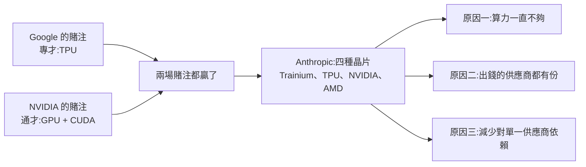

# TPU 與 GPU 到底差在哪:專才的脈動陣列、通才的 CUDA,以及 Anthropic 為什麼四種晶片都買

**主題分類:** 科技 / AI 產業 — AI 晶片架構(TPU 對 GPU)與大客戶的多晶片策略
**來源:** YouTube 頻道 **Agent 煉金術士**〈TPU 和 GPU 到底差在哪?Anthropic 為什麼四種晶片都要買〉(2026-11-26,9 分 02 秒;**官方繁中字幕**,時間點取自帶時間字幕)
**整理日期:** 2026-11-27
⚠️ **非投資建議。** 本文談產業結構與官方文件,不構成對任何公司股票的看法。

> 一句話:**TPU 是只做矩陣乘加的生產線(脈動陣列,快又省電、不通用);GPU 是什麼都能做的工廠,外加 CUDA 十幾年累積的工具生態。** Anthropic 的 S-1 明白寫它在四種晶片上原生訓練與服務 Claude——不是為了誰比較強,而是**算力不夠、要分散供應商、又剛好每一家都出過錢**。

## 一、影片脈絡(時間連結已提前 10 秒)

| 時間 | 內容 | 連結 |
|---|---|---|
| 0:10 | Anthropic 不挑晶片:五月三種、十月 S-1 寫成四種 | [前往](https://www.youtube.com/watch?v=MrPEhOvqX-k&t=4s) |
| 0:42 | 2013 年 Google 語音辨識的算帳,決定自己做晶片 | [前往](https://www.youtube.com/watch?v=MrPEhOvqX-k&t=32s) |
| 1:50 | TPU:十五個月做出來,第一代只做推論 | [前往](https://www.youtube.com/watch?v=MrPEhOvqX-k&t=100s) |
| 2:56 | 方格計算單元與脈動陣列(接力賽) | [前往](https://www.youtube.com/watch?v=MrPEhOvqX-k&t=166s) |
| 3:33 | 比同機房 GPU 快 15–30 倍 | [前往](https://www.youtube.com/watch?v=MrPEhOvqX-k&t=203s) |
| 3:43 | 專才的代價:不能跑文書處理 | [前往](https://www.youtube.com/watch?v=MrPEhOvqX-k&t=213s) |
| 4:43 | NVIDIA 的賭注:2006 年 CUDA | [前往](https://www.youtube.com/watch?v=MrPEhOvqX-k&t=273s) |
| 5:42 | 為什麼離不開 CUDA(注音與倉頡的比喻) | [前往](https://www.youtube.com/watch?v=MrPEhOvqX-k&t=332s) |
| 6:32 | S-1 自己寫:四種晶片都能訓練與執行 Claude、換很貴 | [前往](https://www.youtube.com/watch?v=MrPEhOvqX-k&t=382s) |
| 7:32 | 晶片跟著錢走:Google、Amazon、NVIDIA、AMD | [前往](https://www.youtube.com/watch?v=MrPEhOvqX-k&t=442s) |

## 二、GPU 與 TPU 的差別(核對 Jouppi 等 2017 TPU 論文)

影片用「工廠與生產線」比喻:

- **GPU:** 幾千個什麼都會做的工人,每做完一步把結果放回倉庫再拿下一批——彈性高,但工人得在倉庫與工作台間跑。
- **TPU:** 計算單元排成大方格,資料從一邊流入、每格乘一次加一次、結果直接交給隔壁格,中途不回倉庫——這叫**脈動陣列(systolic array)**。權重載入後算完一整批才換下一塊。

| 影片說法 | 一手來源核對 | 核實 |
|---|---|---|
| 2013 年語音辨識算帳,電腦數量加倍 | 論文:2013 年預估若人們每天用 3 分鐘語音搜尋(語音辨識 DNN),資料中心需**加倍**才夠 | ✅ 一致;⚠️ 影片的「一億使用者」「Google 全公司電腦數量加倍」是 Jeff Dean 訪談口述,論文沒寫「一億人」,未能核實 |
| 十五個月做出來並裝進資料中心 | 論文:「designed, verified, built, and deployed in datacenters in just 15 months」 | ✅ |
| 第一代方格有六萬五千多個計算單元 | 論文:**65,536 個 8 位元 MAC**(256×256 矩陣單元) | ✅ |
| 第一代只做推論,用 8 位元整數 | 論文:專攻 NN 推論;訓練用現成 GPU | ✅ |
| 控制電路「不到 2%」 | 論文兩處寫 control「just 2%」(晶片面積) | ✅(精確說是約 2%,影片說「不到」略偏) |
| 比同機房 GPU 推論快 15–30 倍 | 論文:比同時期的 **K80 GPU 與 Haswell CPU** 平均快約 15–30 倍,每瓦效能高 30–80 倍 | ✅,但要補條件:⚠️ 因延遲限制 K80 在推論時利用率低(「只比 Haswell 快一點」),這是 **2015 年一代對一代**的比較,不能套到今天的 GPU |
| 「原本半分鐘的工作一兩秒做完」 | 由 15–30 倍倒推的比喻,論文無此數字 | 比喻,非引述 |
| 「Google 自己的文件寫 TPU 不能跑文書處理、控制火箭引擎、處理銀行交易」 | Google Cloud 文件〈TPU architecture〉:原文「TPUs can't run word processors, control rocket engines, or execute bank transactions」,但能快速處理神經網路的大量矩陣運算;並稱此為脈動陣列架構 | ✅ |
| AlphaGo 用的是 TPU,兩個月後公開晶片 | 論文只把 DeepMind AlphaGo 的 CNN 當**基準測試**之一 | ⚠️ 「比賽用 TPU」「兩個月後公開」**未能核實**(我沒讀對應來源) |
| 2017 年 NVIDIA 加入 Tensor Core | 常識性正確,但我沒讀 NVIDIA 原文 | 未能核實 |

**對照 Tensor Core 的重點:** 影片在 4:20 說 GPU 也補了專算矩陣的電路,「差別只剩晶片空間怎麼分」——這是對「TPU vs GPU」常見二分法的合理修正,今天兩者都是「矩陣單元 + 其餘彈性電路」的比例問題。

## 三、NVIDIA 的賭注與 CUDA 護城河

影片:2006 年 11 月 GeForce 8800 與 CUDA 同日發表;黃仁勳在 Joe Rogan 節目說「公司成本加倍卻沒人為 CUDA 付錢」;2012 年 AlexNet 用兩張遊戲卡訓練,在 ImageNet 上錯誤率遠低於第二名。

核實:這一段是**影片轉述的歷史與訪談引述,我沒有逐一讀原始來源**(CUDA 發表日、Rogan 訪談、AlexNet 兩張卡與「每四張錯一張 vs 六七張錯一張」),全部標**未能核實**。「注音 vs 倉頡」是很好的轉換成本比喻;論點本身(CUDA 十幾年累積的程式與教學讓人不想換)與本庫另一篇 [[nvidia-moat-memory-bandwidth-cuda-software]] 一致。

## 四、Anthropic S-1 怎麼寫(我讀了 SEC 原文)

影片說 Anthropic 在 S-1 寫出四種晶片。我下載 S-1 全文逐段搜尋,核對如下:

| 影片說法 | S-1 原文 | 核實 |
|---|---|---|
| 四種晶片:Trainium、TPU、NVIDIA GPU、AMD GPU | 「multi-chip compute architecture across AWS Trainium, Google TPUs, NVIDIA GPUs, and AMD GPUs」;又寫「train and serve Claude natively across four major chip families」 | ✅ |
| 靠自製系統把每份工作派給最適合的晶片 | 「proprietary orchestration layer」,為價格與效能最佳化 | ✅ |
| 花了好幾年與大筆錢 | 「took years and significant investment to build」 | ✅ |
| 換到別家硬體會很貴、很花時間,效率也可能變差 | 風險因素:「Migrating workloads to alternative providers would be costly, time-consuming, and operationally complex」;並說維持跨新硬體環境效能需要工程投入 | ✅(「效率可能變差」我只確認到工程投入與遷移風險,逐字未見) |
| 客戶要的算力一直比手上有的多 | 「consistently operated in a compute-constrained environment where customer demand exceeds available compute」 | ✅ |
| 目的是減少對任何一家供應商依賴 | 「reduces dependence on any single vendor」 | ✅ |
| 今年七月 AMD 簽供貨協議,交貨到一定進度就買 Anthropic 股票 | 2026 年 7 月 Hardware Supply Agreement:AMD Helios 機櫃(Instinct MI450 系列 GPU);AMD 承諾**最多購買 50 億美元 Class N 股票**,在特定 AMD GPU 交付達成後分批可動用 | ✅(S-1 的金額影片沒提) |
| 去年十月 Google 最多一百萬顆 TPU;去年十一月 NVIDIA 承諾投資最多 100 億美元、Microsoft 同加入 | 我在 S-1 全文**沒搜到**這兩項(搜尋「million TPU」「NVIDIA 投資」皆無結果;S-1 有 Google 2026 NPA 200 億美元與 Google 100 億美元股票選擇權,與影片所述不是同一件事) | ❌ **未能核實**(可能來自新聞稿,我沒讀) |
| 財務長今年五月說「三種晶片換著用」 | 我未查該次發言 | 未能核實 |
| 黃仁勳 4 月 Dwarkesh 訪談:「當年拿不出幾十億美元,Google 與 Amazon 有」「同樣的錯不會再犯」 | 我未查訪談 | 未能核實 |

**我的判讀:** 影片的結構論點「出錢的供應商 ≈ 用的晶片」有 S-1 的 AMD 條款支持;但要寫成完整的「一家對一種」,Google/Amazon/NVIDIA 三條我都得回頭找原文才算數。S-1 另有一個影片沒講的對照:Google 2026 NPA(最多 200 億美元)與 Amazon(150 億)等**融資額度**,說明「晶片跟著錢走」不只是晶片採購。另見 [[anthropic-ipo-compute-bill-vs-growth-424b4-agent-alchemist]] 與 [[anthropic-s1-ipo-claude-code-unit-economics]]。

## 五、應用案例

- **判斷「該不該為某顆專用晶片改程式」:** 先問三件事——①你的工作負載是不是幾乎全是大矩陣乘加(是,才有脈動陣列的紅利);②程式是否綁了 CUDA 專屬函式庫;③是否有人願意長期維護多後端。Anthropic 的做法是做一層自己的「編排層」,把工作路由到不同晶片,且自承這要好幾年與大筆投資。
- **讀「X 倍更快」類行銷數字:** 像 TPU 論文的 15–30 倍,要同時看**比較對象(K80、Haswell)、工作負載(推論,有延遲上限)、年代(2015)**。把它當成「現今晶片比較」會誤導。
- **評估自家 AI 供應鏈風險:** 套用 S-1 的思路——單一供應商缺貨時你的產品只能等。可列三欄:能否換供應商、換的成本(工程人天)、換了之後效能掉多少,再決定是否值得養第二套。

## 相關筆記

- [[nvidia-moat-memory-bandwidth-cuda-software]] — NVIDIA 護城河:記憶體頻寬與 CUDA 軟體生態
- [[anthropic-s1-ipo-claude-code-unit-economics]] — Anthropic S-1 的單位經濟
- [[anthropic-ipo-compute-bill-vs-growth-424b4-agent-alchemist]] — 同頻道:Anthropic 上市的算力帳單與成長
- [[ai-compute-token-economics]] — AI 算力與 token 經濟
- [[nvidia-ceo-exit-ecosystem-commitments-three-scenarios-why-qq]] — NVIDIA 生態承諾的情境分析

## 來源

- [YouTube:TPU 和 GPU 到底差在哪?Anthropic 為什麼四種晶片都要買(Agent 煉金術士,2026-11-26)](https://youtu.be/MrPEhOvqX-k)(官方字幕)
- [Jouppi 等:In-Datacenter Performance Analysis of a Tensor Processing Unit(2017)](https://arxiv.org/abs/1704.04760)(已讀全文)
- [Anthropic S-1 上市申請文件(SEC EDGAR)](https://www.sec.gov/Archives/edgar/data/2130357/000162828026067168/anthropicpbc-sx1.htm)(下載全文搜尋晶片、風險因素與 AMD 條款)
- [Google Cloud:TPU architecture](https://docs.cloud.google.com/tpu/docs/system-architecture)
