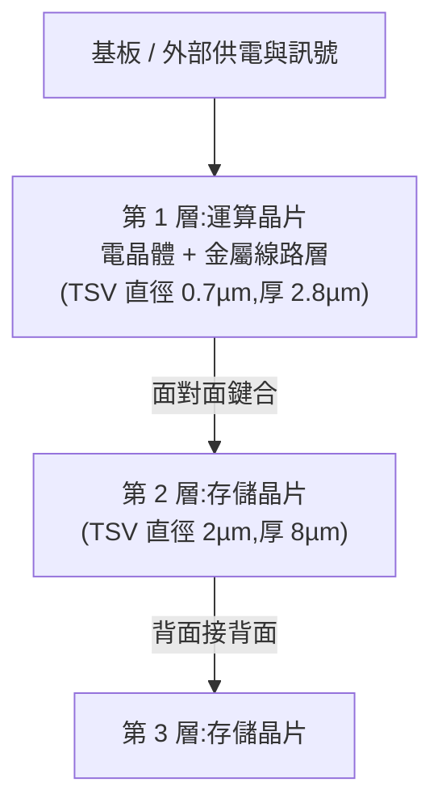

# 玄戒 O100 的三層堆疊:TSV 打孔、晶圓級鍵合與混合鍵合怎麼做

> Redknot(喬紅)〈3层堆叠! TSV+混合键合:玄戒O100的堆叠之路〉(2026-08-26)。小米 2026-08 發布的端側 AI 推理晶片,**邏輯晶圓 + 兩層 DRAM 垂直堆疊**。本篇拆解兩件關鍵事:**怎麼在矽上打洞(TSV)**、**怎麼把晶片黏起來(混合鍵合)**。與 [[advanced-packaging-explained]]、[[hbm-high-bandwidth-memory-principle]] 互補。

---

## TL;DR

1. 要提高記憶體與運算晶片之間的頻寬:**更多導線 + 更短距離**。資料中心 GPU 走「矽中介層 + HBM」(2.5D);端側晶片體積、功耗、成本受限,玄戒 O100 改走**直接把兩層記憶體疊在運算晶片頂上**(3D)。
2. 堆疊的兩個關鍵:**給矽打洞(TSV)** 與 **把晶片鍵合**。
3. O100 用 **晶圓對晶圓(Wafer-on-Wafer)+ 混合鍵合**,而非傳統先切再疊(Chip-on-Chip)與微凸點(micro-bump)。
4. 結果(影片數字,畫面亦顯示):TSV「50 萬條以上」(未能以一手來源核實,見核實)、混合鍵合點 258 萬個以上、最小鍵合間距 1.4µm、頻寬約 1200GB/s(官方稱 1.22TB/s)。

---

## 1. 結構:三層怎麼互相通訊

- 運算層與第一層存儲層**線路面對面**鍵合,運算層可直接存取它。
- 第三層貼在第二層**背面**,但第二層電路在正面 ⇒ 必須在第二層打 TSV(矽穿孔)並填銅,才能讓運算層存取第三層。
- 外界供電與訊號要進來 ⇒ 運算層本身也要打 TSV,再整顆焊到基板。

## 2. 打洞:深反應離子刻蝕(DRIE,Bosch 製程)

1. 塗光阻、光刻機曝光洞位、顯影。
2. 通入 **六氟化硫(SF6)**:電漿產生氟自由基蝕刻矽,但同時橫向蝕刻會形成球形空腔,所以只蝕一段就停。
3. 改通 **八氟環丁烷(C4F8)**:在洞壁沉積保護膜。
4. 再通 SF6,並加電場使離子垂直轟擊,**只打掉洞底的保護膜**,側壁保留 ⇒ 繼續向下蝕刻。
5. 重複「蝕刻-保護-轟擊」,洞逐步向下。

後續填孔:

| 步驟 | 做法 | 目的 |
|---|---|---|
| 絕緣層 | 正矽酸乙酯 + 臭氧,洞壁生成二氧化矽 | 絕緣 |
| 阻擋層 | 物理氣相沉積(離子轟擊靶材)鉭或氮化鉭 | 銅在矽與二氧化矽中擴散性強,會破壞矽晶體結構 |
| 種子層 | 同工藝做銅種子層 | 為電鍍打底 |
| 電鍍銅 | 逐步填滿 | 導電 |

**深寬比(深度/孔徑)** 是關鍵限制:太大則氣體到不了洞底、阻擋層覆蓋不到底、電鍍會留空腔或過早封口。O100 深寬比僅 **4:1**,但絕對尺寸極小——存儲層孔徑 2µm、矽厚 8µm;運算層孔徑 0.7µm、矽厚 2.8µm。矽磨到這麼薄會像紙一樣可彎曲,良率與後續流程都困難(對比 HBM3E 的 TSV 深寬比遠大於 4:1,代價是矽較厚)。

## 3. 疊法:Chip-on-Chip vs Wafer-on-Wafer

- **Chip-on-Chip**:晶圓上做完後切割,再一顆顆疊。O100 每層太薄、最窄焊點間距僅 1.4µm,成本、產能、對位精度都成問題。
- **Wafer-on-Wafer(O100 採用)**,影片步驟:
  1. 兩片存儲晶圓先做好器件與金屬佈線,尚未打孔磨薄(厚 775µm)。
  2. 一片黏在臨時載片上,背面磨到 8µm,從背面打 TSV,再做背面多層金屬佈線(連通正背面)。
  3. 另一片存儲晶圓**整片倒扣**上去,混合鍵合。
  4. 拆載片;運算晶圓倒扣在存儲晶圓上(正面對正面)鍵合,運算層磨到 2.8µm,打 0.7µm TSV,再做背面金屬層。
  5. 最後才切割成單顆。三層合計 800 多微米(底層仍是厚晶圓),有源區僅約 38µm。

## 4. 混合鍵合 vs 微凸點

| 項目 | 微凸點(micro-bump) | 混合鍵合 |
|---|---|---|
| 做法 | 銅觸點凸起,頂部覆錫,加熱加壓熔接 | 銅觸點略低於二氧化矽表面,表面對表面直接鍵合 |
| 優點 | 簡單;焊錫表面張力可自動對正 | 間距極小(O100 達 1.4µm),互連密度極高 |
| 缺點 | 間距不能太窄(錫球會連在一起);凸起造成空隙,需填樹脂,**散熱差**,強度也差 | 表面須極光滑;製程複雜 |
| 典型用途 | HBM 等發熱低的存儲堆疊 | 運算層參與的高密度堆疊 |

**混合鍵合步驟**:
1. 表面磨到極平,觸點銅**略微凹陷**於二氧化矽;
2. 高能電漿轟擊,打斷矽氧鍵、產生**懸空鍵**;
3. 超純水沖洗,表面掛滿**羥基(-OH)**;
4. 兩片貼合,羥基間產生很大吸引力;
5. 加熱至約 **400°C**:羥基脫水縮合,變成矽氧共價鍵,二氧化矽介面融成一體;同時銅受熱膨脹填滿凹陷,兩側銅觸點接觸並擴散融合。氧化物和銅同時「混合」,故名混合鍵合。

金屬佈線採**大馬士革(Damascene)製程**:先沉積二氧化矽、刻線路凹槽、再填銅,中間用鉭當阻擋層。

## 5. 數字對照

| 項目 | HBM3E(影片對照) | 玄戒 O100 |
|---|---|---|
| 觸點間距 | 約 40µm | 最小 1.4µm |
| 晶片尺寸 | — | 11.882 × 7.834 mm |
| TSV 數量 | — | 影片稱「50 萬條以上」 |
| 混合鍵合點 | — | 258 萬個以上 |
| 頻寬 | 約 1200GB/s(影片稱) | 約 1200GB/s |
| 對照手機 SoC | 約 60–140GB/s | — |

## 6. 應用案例

- **判斷「3D 堆疊」新聞的含金量**:看到「晶圓級堆疊 / 混合鍵合」,就問兩件事:間距(µm)與是否讓**發熱的運算層參與**堆疊。微凸點+樹脂的方案散熱差,所以多半只用在 HBM 這種低發熱存儲;O100 把運算層放在底層(靠基板散熱路徑)是設計取捨。
- **理解端側 AI 為何卡在頻寬**:LLM 推理常是頻寬受限,手機 60–140GB/s vs 1200GB/s 差約 10 倍,等於把「搬資料」瓶頸解開。
- **供應鏈聯想**:混合鍵合需要高平整度的 CMP、電漿活化、對位與鍵合設備,是先進封裝設備商的題材(設備商名稱本篇未核實,不列)。

## 7. 核實狀態

- **已核實**(多方報導,[EqualOcean](https://www.equalocean.com/news/2026082522135-xiaomi-unveils-xring-o100-1-22tb-s-ai-accelerator-device-models)、[AICybr](https://aicybr.com/blog/xiaomi-ai-cube-xring-o100-local-ai)等,來源為小米官方發布轉述):2026-08-24 發布、6nm、晶圓對晶圓 3D 堆疊 + 混合鍵合、一顆邏輯 + 兩層 AI 用 DRAM、鍵合間距 1.4µm、TSV 直徑 0.7µm、頻寬 1.22TB/s(影片的 1200GB/s 為取整)、預計 2027 年商用。(2026-11-07 補充:[PC Watch](https://pc.watch.impress.co.jp/docs/news/2135253.html) 明確寫 TSV「孔径 0.7μm」、接合間距「1.4μm」;EqualOcean 轉述小米「明年」商用,即 2027。EqualOcean 未說明 0.7µm 是孔徑或間距,以 PC Watch 為準。)
- **原判「可能是聽寫或口誤」撤回(2026-11-07 畫面核對)**:截圖顯示影片畫面文字即為「50w+ 硅通孔」與「258w+ 混合键合点」,字幕亦為「有 50 萬條以上的硅通孔」,**並非聽寫錯誤**,而是影片本身給的數字。但小米官方與 PC Watch、EqualOcean 報導皆未給 TSV 或鍵合點數量,**兩個數字仍未能以一手來源核實**;引用請以官方資料為準。
- **未能核實**:各層厚度(8µm、2.8µm、38µm)、深寬比 4:1、11.882×7.834mm 為影片引述的拆解/官方數據,獨立第三方測試資料少(EqualOcean 原文亦稱晶片尺寸未揭露)。「HBM3E 觸點間距約 40µm」「HBM3E 頻寬 1200GB/s」為影片對照,未逐項查。
- 逐字稿還原:「归」=矽、「CHIP ON CHIP」=Chip-on-Chip、「WEAVER」=Wafer、「TESV」=TSV;「正规酸椅脂」推定為**正矽酸乙酯(TEOS)**,「八伐环丁丸」=八氟環丁烷(C4F8)。

## 延伸閱讀與深度補充(2026-11-07 核實增補)

- **Bosch 製程(TSV 深蝕刻)一手來源**:[US 5,501,893](https://patents.google.com/patent/US5501893A/en)(Robert Bosch GmbH,發明人 Franz Laermer、Andrea Schilp;優先權 1992-12-05、美國申請 1993-11-27、授權 1996-03-26)。實際讀到的獨立請求項是「交替執行蝕刻步驟與聚合步驟」:蝕刻各向異性地刻矽,聚合在暴露表面沉積高分子層當側壁暫時的蝕刻阻擋,蝕刻步驟再在孔底打穿。與影片相比:影片的「保護膜」機制一致;但**專利實施例列的聚合氣體是 CHF3(與 Ar 混合),蝕刻氣體為 SF6 + Ar**。影片說的 C4F8 是業界常用的聚合氣體,在該專利中未見,標為「業界常用、未能於該專利核對」。專利亦說明可換用其他含氟蝕刻氣體與聚合物形成氣體。
- **混合鍵合退火溫度**:搜尋摘要指出 Cu/SiO2 混合鍵合「常需約 400°C」,並報告以電漿加酸處理做親水化、可於 200°C 完成 Cu-Cu 與 SiO2-SiO2 鍵合([ICEPT 2021,DOI 10.1109/icept52650.2021.9568007](https://doi.org/10.1109/icept52650.2021.9568007))。另一份 [Meidensha 技術資料](https://www.meidensha.co.jp/npi/corporate/pdf/03-01-11.pdf) 摘要描述流程為電漿活化 → 去離子水親水化 → 面對面貼合 → 高溫脫水縮合(摘要提到 N2 下 400°C、2 小時的測試條件)。兩份我都只讀到摘要或無法解析的 PDF 二進位,**「400°C」與影片相符,但全文未能核實**。低溫(約 200°C)路線是另一條已有研究的方向。
- **小米官方宣稱的細節(轉述)**:[EqualOcean](https://www.equalocean.com/news/2026082522135-xiaomi-unveils-xring-o100-1-22tb-s-ai-accelerator-device-models) 寫小米稱 1.22TB/s「近記憶體頻寬,約為主流手機記憶體的 16 倍」(1.22TB/s ÷ 16 ≈ 76GB/s,與影片「60–140GB/s」同量級);[PC Watch](https://pc.watch.impress.co.jp/docs/news/2135253.html) 寫 NPU 14 核心、330 TOPS。兩篇都沒有列 TSV 數量、層厚或裸晶面積。
- **影片沒講、但報導提到的風險**:搜尋摘要提到一篇評論文章指出,小米公開說法中承認要處理高溫鍵合時的晶圓翹曲與破裂;1.22TB/s 也需量產硬體驗證。代工廠 TSMC 為媒體報導,非小米原文(未核實)。

## 來源

- 影片:[3层堆叠! TSV+混合键合: 玄戒O100的堆叠之路(Redknot-乔红,2026-08-26)](https://www.youtube.com/watch?v=eOcyZqtw0Fg)
  - ⚠️ 該片無官方字幕,逐字稿以 CPU 版 Whisper 轉錄,可能有同音字誤差。本片未見業配。
- [EqualOcean:Xiaomi Unveils XRING O100](https://www.equalocean.com/news/2026082522135-xiaomi-unveils-xring-o100-1-22tb-s-ai-accelerator-device-models)
- [AICybr:Xiaomi AI Cube and Xring O100](https://aicybr.com/blog/xiaomi-ai-cube-xring-o100-local-ai)
- 延伸(本庫):[[advanced-packaging-explained]]、[[hbm-high-bandwidth-memory-principle]]
