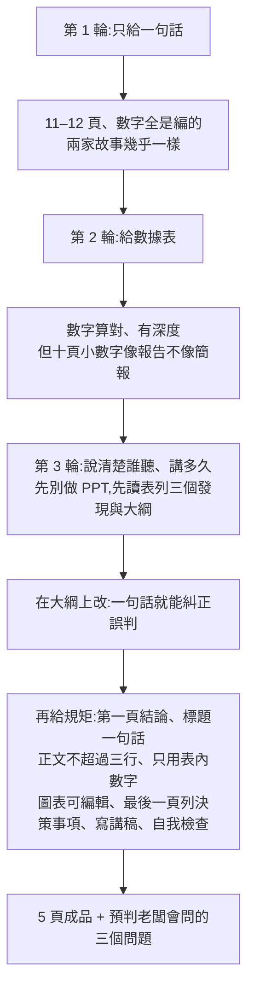

# 讓 Claude 和 GPT 做 PPT:差的是那幾句話——從「一句話」到能上台的四步提示法

**主題分類:** 科技 / AI 生產力 — AI 簡報製作工作流
**來源:** YouTube〈我让 Claude 和 GPT 做 PPT,差的就是这几句话〉(Mia 码上 AI,2026-11-07,6 分 14 秒;[影片連結](https://www.youtube.com/watch?v=Uj8nORSksP8));說明欄的[演示與提示詞頁](https://miaainow.com/zh/ai-ppt/)
**逐字稿:** 該片無字幕,**逐字稿以 faster-whisper `large-v3-turbo` 轉錄,非官方字幕**;模型名與數字對照說明欄與演示頁校正。
**一手來源核實:** 讀了演示頁(含完整提示詞)、Anthropic 官方 [`anthropics/skills` 的 `pptx` SKILL.md](https://github.com/anthropics/skills/blob/main/skills/pptx/SKILL.md);並串接本庫既有的幻覺筆記([[why-llms-hallucinate-benchmarks-reward-guessing]])。
**整理日期:** 2026-11-09

> ⚠️ **立場揭露:** 頻道在說明欄導向自家網站 `miaainow.com`(放提示詞與兩份成品);**未見業配或聯盟連結**。
> ⚠️ 影片是**單一題目、單次(各做一輪)的主觀比較**,不是 benchmark。

---

## 1. 一句話

給 AI 一句「幫我做第三季度銷售匯報 PPT」,它會交出 11–12 頁**看起來很專業、數字全是編的**簡報;真正能上台,靠的是四件事:**給真數據 → 說清楚誰聽、講多久 → 先要大綱、在大綱上改 → 再定規矩(結論先行、一頁一句話、寫講稿)**。

## 2. 影片逐輪重點與時間點

| 時間 | 輪次 | 發生什麼 |
|---|---|---|
| 0:00([連結](https://www.youtube.com/watch?v=Uj8nORSksP8&t=0s)) | 開場 | 一句話、幾分鐘後得到 12 頁:圖表、目標完成率、下季度計畫、哪個區沒達標都寫好——**她一個數字都沒給**。 |
| 0:44([連結](https://www.youtube.com/watch?v=Uj8nORSksP8&t=34s)) | 第 1 輪 | 兩家都交得像樣(Claude 11 頁、GPT 12 頁),且**互相沒商量卻編出幾乎一樣的故事**:都「超額完成目標」、都「華北區沒達標」。 |
| 1:10([連結](https://www.youtube.com/watch?v=Uj8nORSksP8&t=60s)) | 誠實度差異 | GPT 每頁角落標「示意數據」;Claude 只在**聊天回覆**說數字是編的,**簡報頁面上沒有任何標示**——沒看回覆直接上台,老闆聽到的是編造的業績。 |
| 1:28([連結](https://www.youtube.com/watch?v=Uj8nORSksP8&t=78s)) | 第 2 輪 | 給虛構咖啡店三家分店 7–9 月營收、訂單、品類、外送占比與備註(例如河濱店門口修路一個多月)。數字全對,兩家都多挖一層:外送平台抽成後,到手反而比上季少。但是十頁、每頁一堆小數字、附錄——「一份讓人坐下來慢慢看的報告,不是上台講五分鐘的 PPT」。 |
| 2:24([連結](https://www.youtube.com/watch?v=Uj8nORSksP8&t=134s)) | 第 3 輪(先要大綱) | 說清楚下週一向老闆報告、只有五分鐘、老闆只要結論與要他拍板的事;並要求「先別做 PPT,先讀表,告訴我最值得講的三個發現,再給每頁一句話的大綱」。 |
| 2:46([連結](https://www.youtube.com/watch?v=Uj8nORSksP8&t=156s)) | 大綱的價值 | Claude 的三個發現:外送漲了但扣抽成後到手少了、河濱店下滑是修路造成、7 月新品冷脆首季就占 14%。GPT 把河濱店下滑當成要改善的問題,建議做四週恢復試點,**但備註寫明是修路、9 月 20 日已通**,且沒提新品——直接做成 PPT 會在台上被問「路不是通了嗎」。大綱階段改一句話就好。 |
| 3:36([連結](https://www.youtube.com/watch?v=Uj8nORSksP8&t=206s)) | 定規矩 | 第一頁放結論、每頁標題是一句完整的話、正文不超過三行、只用表內數字不許編、圖表要能在 PowerPoint 直接改、最後一頁列要老闆拍板的事、每頁寫演講備註、念下來五分鐘、做完自己檢查。 |
| 4:02([連結](https://www.youtube.com/watch?v=Uj8nORSksP8&t=232s)) | 成品 | 兩家都交 5 頁。Claude 的第一頁「生意是健康的,但有兩件事要您定」,外送頁一張圖講清楚(帳面多 3,400、抽成多交 7,400、到手少 4,000)。GPT 較謹慎(表裡沒寫外送占比按營收或訂單,所以不估抽成),但最後一頁只剩一句「請老闆確認冷脆推廣重點與外送投入條件」,老闆不知道要決定什麼——再補一句「每件事給兩個選項、帶建議與理由」後也能用。 |
| 5:00([連結](https://www.youtube.com/watch?v=Uj8nORSksP8&t=290s)) | 真能上台嗎 | 兩家演講備註她都數過:Claude 900 多字、GPT 1,100 字,照念約五分鐘;最後問「老闆最可能問哪三個問題」,Claude 想到的第一個是「外送單獨加價客人會不會跑掉」並備好回答。 |
| 5:40([連結](https://www.youtube.com/watch?v=Uj8nORSksP8&t=330s)) | 結論 | 「AI 做 PPT 現在是真能用,差的不是它,是你給它的那幾句話」:真數據、說清誰聽與講多久、先要大綱、在大綱上改、定規矩(結論先行、一頁一句、寫備註)。 |

## 3. 逐項對照一手來源

| 影片說法 | 一手來源 | 狀態 |
|---|---|---|
| 模型:Claude Opus 5.5、GPT-6 Astra | 演示頁:「Claude Opus 5.5 和 Codex 里的 GPT-6 Astra(推理开到最高档)」 | ✅ 已核實;**補充:GPT 是在 Codex 裡、推理檔位最高;Claude 的推理/Effort 設定演示頁未寫**,兩邊條件並不對等 |
| 第 1 輪提示詞「帮我做一份第三季度销售汇报的 PPT」 | 演示頁相同 | ✅ 已核實 |
| 「先别做 PPT,先读表」、第一頁放結論、只用表裡的數字不要編、最後一頁列拍板事項、每頁寫演講備註、約 5 分鐘、最後自我檢查 | 演示頁第二步提示詞包含這些規則(含「檢查是否溢出、重疊、不可讀」) | ✅ 已核實 |
| 事後問「老闆最可能問的 3 個問題」 | 演示頁:「最后帮我想想:老板听完最可能问的 3 个问题是什么?」 | ✅ 已核實 |
| 兩份成品都是 5 頁 | 演示頁:「两份都是 5 页」 | ✅ 已核實 |
| 抽成多交 7,435.5、到手少 4,000(畫面 4,036) | 演示頁:「抽成多交 7,436」「到手少了 4,036」(四捨五入) | ✅ 已核實(影片「約 4,000」與頁面 4,036 相符) |
| 比上季度只漲 0.8% | 演示頁:「比 Q2 只涨了 0.8%」 | ✅ 已核實 |
| 比去年同期漲 10%、河濱店少 9%、冷脆首季占 14% | 演示頁沒有這些數字,**示例 Excel 我沒有下載核算** | ❓ 未能核實(只能說影片自述一致) |
| 演講備註 Claude 900 多字、GPT 1,100 字 | 演示頁只說「照著念正好 5 分鐘左右」,**無字數** | ❓ 未能核實 |
| 「Claude 只在聊天回覆說數字是編的,簡報頁面沒提」「GPT 每頁標示意數據」 | 影片畫面觀察;演示頁無對應敘述 | ❓ 未能核實(單次觀察) |
| 兩家都能直接交 PowerPoint 檔、圖表可編輯 | Anthropic `pptx` SKILL:建立用 `pptxgenjs`,**要求 `addChart()` 做原生圖表**(Keep charts native)、講稿用 `slide.addNotes()` | ✅ 已核實(Claude 這邊;OpenAI 一側我沒讀官方文件,**未能核實**) |
| (演示頁補充)Claude 中文簡報用微軟雅黑,Mac 沒裝 Office 排版可能跑掉 | 演示頁提示 | ✅ 已核實(影片未提) |

## 4. 延伸:這段影片「提到但沒細講」的概念

### 4.1 為什麼兩家會編出幾乎一樣的故事?

影片的觀察是「兩家沒商量過,編出的故事卻幾乎一樣——超額完成目標、華北區沒達標」,並稱這就是 AI 心中標準季度匯報的樣子。**這是現象觀察,不是證明**:我沒有找到官方資料直接解釋這個例子。可以確認的相關機制見本庫 [[why-llms-hallucinate-benchmarks-reward-guessing]]:模型被訓練與評測獎勵**「猜一個像樣的答案」勝過「承認不知道」**,所以缺資料時傾向補出最典型的內容。把這個機制套到「季度匯報」,是**合理推論,不是影片或原文的結論**。

### 4.2 「圖表要能在 PowerPoint 裡直接改」是怎麼做到的

Anthropic 的 `pptx` Skill(讀 SKILL.md 原文):
- `.pptx` 是 XML 的 ZIP 壓縮檔;**新建用 `pptxgenjs` 腳本、改現有簡報則解壓改 XML 再壓回**。
- 規則明寫:**圖表保持原生**(`addChart()`,不要貼圖),且預設圖表「很陽春」,要自己設定標題、資料標籤與配色。
- **演講備註放 `slide.addNotes("...")`**(純文字、每頁一次),不要放在投影片上的文字框——正是影片第 3 輪要求的「每頁寫好演講備註」的實作位置。
- 檔案產出後要跑 `scripts/office/validate.py` 驗證(有已知會讓檔案損毀的陷阱,例如十六進位色碼加 `#`、堆疊柱狀圖用 `outEnd` 標籤、負的陰影偏移)。
- 預設畫布 `LAYOUT_16x9` 是 10"×5.625",座標超出邊界不會被截斷,只是看不到。

這解釋了為什麼影片裡 Claude 能交出「PowerPoint 開了就能改」的檔案;**但這只是 Anthropic 開源 Skill 的做法,不等於 claude.ai 目前內部執行的完全同一流程**,我沒有驗證。

### 4.3 「先要大綱」本質是什麼

它是把「理解資料、挑重點」與「排版出頁」拆成兩步,讓你在**便宜的階段**(一句話一頁)糾正方向。第 3 輪的實例就是 GPT 把「修路造成的暫時下滑」誤判成需要恢復試點:在大綱改只需一句話,做完十頁再改就是重工。這是工作流設計,**無需一手文件佐證**。

## 5. 批判性閱讀

1. **只比一次、單一題材。** 沒有重複實驗,也沒有「同樣的提示詞跑 3 次」的變異;「Claude 這份我能直接講、GPT 比較謹慎」可能在下一次就相反。
2. **兩家條件不對等。** 演示頁顯示 GPT-6 Astra 是在 Codex 並開最高推理;影片沒有說 Claude 的設定,不能把差異全歸因於模型。
3. **「誠實度」評分是一次觀察。** Claude 沒在頁面標註、GPT 有標註,但這屬於提示詞沒有要求標註時的行為;若第一輪一開始就寫「缺資料時請在頁面標示示意」,結果可能不同。
4. **虛構咖啡店資料。** 數字都是作者編的,所以「算對了」只代表算術,不代表真實場景的資料髒亂(缺值、口徑不一致)也處理得好。
5. **GPT 的「不估抽成」是優點還是缺點?** 影片把它當嚴謹,但也導致最後一頁沒有決策選項;這是**取向差異而非對錯**。
6. **方法本身通用。** 即使不同模型表現會變,「給真資料、說清楚聽眾與時間、先大綱、定規矩、要預判問答」可以直接搬到任何工具。

## 6. 應用案例

**案例 A:你要做週報/月會簡報(給主管)。** 第一步貼資料表,打:「下週一向主管報告,只有 5 分鐘,他只關心結論與要他拍板的事。先別做 PPT,先讀表,列最值得講的三個發現(每個附表內數字)與每頁一句話的大綱。」看過、改完大綱,再貼規則:「第一頁放結論;每頁標題是完整句子;正文不超過三行;只用表內數字;圖表要能在 PowerPoint 編輯;最後一頁列需要我拍板的事,每件事兩個選項並附建議與理由;每頁寫演講備註,念起來約 5 分鐘;完成後檢查溢出、重疊與看不清的內容。」最後問:「聽完最可能問的 3 個問題是什麼?」

**案例 B:防止編造數字。** 在規則裡加一行「只用表內數字;缺資料時在該頁標示『待補』,不要估算」,並在驗收時**逐頁對照原表**(影片也展示了 GPT 因表裡沒寫外送占比的口徑而選擇不估算)。

**案例 C:給自己的 Claude Skill 加進階規則。** 本倉庫生態中若要做簡報類 Skill,可把「先大綱再成品」「規則清單」「預判問答」寫成固定步驟,並參考官方 `pptx` Skill 對原生圖表與講者備註的要求。

## 7. 逐字稿校正與未核實

| Whisper 寫法 | 校正為 | 依據 |
|---|---|---|
| Cloud、Cloud Design | **Claude** | 標題與說明欄 |
| GPT6 Astra | **GPT-6 Astra** | 演示頁 |
| 視力數據 | **示意數據**(推定) | 上下文:GPT 在每頁角落標註的是「示意數據」;**推定** |
| 要旧、反攻 | **要改善**、**返工**(推定) | 上下文;**推定** |
| 烧(演講備註「內欄題詞」) | **內部講稿/提詞**(推定) | 上下文;**推定** |
| 奖(上台奖) | **講** | 上下文 |

**未能核實:** 示例 Excel 內容與 +10%、−9%、14% 三個數字;備註字數;OpenAI 側產出 PPTX 的官方文件;兩家成品檔案本身(我沒有下載)。

## 來源

- [影片:我让 Claude 和 GPT 做 PPT,差的就是这几句话(Mia 码上 AI)](https://www.youtube.com/watch?v=Uj8nORSksP8)
- [Mia 的演示與提示詞頁](https://miaainow.com/zh/ai-ppt/)
- [anthropics/skills — pptx SKILL.md](https://github.com/anthropics/skills/blob/main/skills/pptx/SKILL.md)
- 本庫:[[why-llms-hallucinate-benchmarks-reward-guessing]]
- 逐字稿:faster-whisper `large-v3-turbo` int8,非官方字幕
