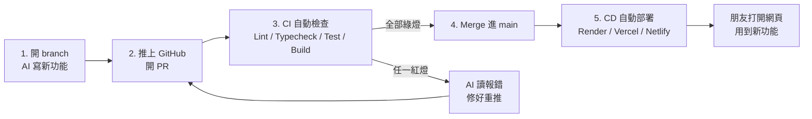

# 用 AI 寫程式為什麼要懂 CI/CD:Lint、Typecheck、Test、Build 四道關卡與「CI 全綠只是底線」

> 整理自 YouTube 頻道 **Gary Chen**〈[用 AI 寫程式你得懂的 CI/CD?新手一支影片看懂](https://www.youtube.com/watch?v=aCvEYczBVSY)〉(2026-11-18,約 13.9 分鐘,自動字幕 zh-Hans,時間點均取自帶時間字幕)。
> ⚠️ **立場揭露:作者在片尾與說明欄推廣自己的 Skool「AI 實戰營」,並提供兩個付費的「CI 健檢 Prompt」;本文只整理公開影片內容,不轉述付費素材。**
> ⭐ **本文對 GitHub 與 Render 官方文件、LLM-as-a-judge 論文做了核實,補出影片沒提的三處**(見〈三、延伸與核實〉)。

## 一、一句話

AI 說「等 CI 通過再 Merge」時,它是在要你信任一條**自動把關流水線**:改動先在雲端乾淨機器上跑完 Lint、Typecheck、Test、Build,全綠才合併,合併後平台再自動部署。這條線是你在「AI 寫程式很快」之後,唯一能放心一直疊功能的底層防線,但它只是**最低底線**,不是品質保證。

## 二、影片重點(附時間點)

| 時間 | 重點 |
|---|---|
| [0:44](https://www.youtube.com/watch?v=aCvEYczBVSY&t=34s) | 開發流程五步:開 branch → 推 GitHub 開 PR → CI → Merge 進 main → CD 部署。「記帳軟體加匯出月報表」貫穿全片 |
| [2:44](https://www.youtube.com/watch?v=aCvEYczBVSY&t=154s) | CD 有兩種說法:Continuous Delivery(準備好隨時能上線,最後人工按確認)與 Continuous Deployment(自動上線);Render 這類平台是後者 |
| [3:12](https://www.youtube.com/watch?v=aCvEYczBVSY&t=182s) | 不用 CI/CD 的代價:每次手動全功能測一遍、手動上傳到 Render,改版越快越容易疏忽 |
| [3:44](https://www.youtube.com/watch?v=aCvEYczBVSY&t=214s) | CI 本質是**一份自動化檢查指令清單**,放在專案 `.github/workflows/ci.yml`,通常由 Claude Code / Codex / Cursor 幫你寫好 |
| [4:29](https://www.youtube.com/watch?v=aCvEYczBVSY&t=269s) | 三道基本檢查,見下表 |
| [7:36](https://www.youtube.com/watch?v=aCvEYczBVSY&t=446s) | GitHub Actions 每次開 PR 借一台**全新空白電腦**重跑,排除「我電腦裝過、清單沒寫」的殘留環境干擾 |
| [8:43](https://www.youtube.com/watch?v=aCvEYczBVSY&t=523s) | 畫面導覽:PR 列表綠勾「3/3」、紅叉「2/4」;進 Checks 分頁看逐步執行;點 Details 看報錯,可請 AI 經 GitHub connector 讀報錯並修 |
| [9:32](https://www.youtube.com/watch?v=aCvEYczBVSY&t=562s) | GitHub 只是倉庫,不會自己更新網站;更新靠部署平台綁定 repo 後盯著 main(= CD) |
| [10:20](https://www.youtube.com/watch?v=aCvEYczBVSY&t=620s) | 進階關卡:**Playwright** 瀏覽器端到端測試(只加在穩定且壞了影響核心體驗的路徑,如登入、付款、匯出)、**LLM as a judge**(AI 產品:準備 20 題常見提問,讓另一個模型打分,通過率低於門檻就紅燈) |
| [12:12](https://www.youtube.com/watch?v=aCvEYczBVSY&t=722s) | 兩層防線:底層 CI/CD 流水線 + 上層「獨立 AI 像真實用戶實機點擊驗證」(承接 Lauren Tan 的 pstack 工作流) |

### 三道基本檢查

| 關卡 | 指令(影片舉例) | 抓什麼 | 影片的例子 |
|---|---|---|---|
| Lint | `npm run lint` | 垃圾與危險寫法 | AI 改完忘記刪舊元件;把「禁用 `useEffect`」寫進 ESLint 規則,AI 一寫就紅燈退貨 |
| Typecheck | `npm run typecheck` | 資料型別對不上 | 把「一百元」純文字當數字做加總,報表變亂碼或無效數字;幾秒掃完、不用真的跑網站 |
| Test | `npm run test` | 改新功能有沒有改壞舊功能 | 虛擬用戶記三筆假帳看總額,再試匯出與登入 |
| Build | `npm run build` | 零散檔案拼起來打不打得開 | 幾百個小檔、開發語法 → 翻譯壓縮成瀏覽器看得懂的成品;每個小檔沒事,拼起來才發現缺東西 |

> 註:影片說「保底三道」,但把 Lint 與 Typecheck 合為第一道,實際是四個指令。

## 三、延伸與核實

### 3.1 GitHub Actions 的說法 — ✅ 已核實(官方文件)

讀 GitHub Docs「Understanding GitHub Actions」與「Events that trigger workflows」:

- ✅ 工作流程是放在 repo `.github/workflows` 目錄下的 YAML 檔,與影片一致。
- ✅ 官方原文:「Each workflow run executes in a fresh, newly-provisioned virtual machine.」——「借一台全新空白電腦」是正確說法;GitHub-hosted runner 提供 Ubuntu、Windows、macOS。
- ➕ **影片沒提的觸發細節**:`pull_request` 若沒指定 `types`,預設只在 `opened`、`synchronize`(推新 commit)、`reopened` 時跑。所以「推新修正 → 自動重跑」成立,但若有人自行改 `types` 就可能不重跑。
- ➕ **影片沒提的安全面**:來自 fork 的 PR,除 `GITHUB_TOKEN` 外**不會傳入 secrets**;而 `pull_request_target` 在 base repo 的權限下執行,官方警告「Running untrusted code on the `pull_request_target` trigger may lead to security vulnerabilities」。**請 AI 寫 CI 時,別讓它為了「讓測試能過」就改成 `pull_request_target` 去跑外部 PR 的程式碼。**

### 3.2 CD 與 Render — ⚠️ 需補充(影片講得太順)

讀 Render 官方部署文件:

- ✅ 「Whenever you push or merge a change to that branch, by default Render automatically rebuilds and redeploys your service.」影片說「主線一更新 Render 就自動部署」屬實。
- ⚠️ **但預設是 `On Commit`,也就是只要 branch 有新 commit 就部署,不管 CI 有沒有過。** 影片的流程圖(CI 綠才 merge → merge 才部署)靠的是「你只把 CI 綠的東西 merge 進 main」這個人為紀律,而**不是平台自動串起來的**。若有人直接推 main,或 CI 紅燈仍被強制 merge,Render 照樣上線。
- ➕ **Render 其實有 `After CI Checks Pass` 選項**(Settings → Auto-Deploy,三選項:On Commit / After CI Checks Pass / Off):等該 commit 的 CI 檢查通過才部署;沒偵測到任何 check 或有一個失敗就不部署。支援 GitHub Actions、GitHub checks API 工具、GitLab CI/CD、Bitbucket Pipelines。判定:GitHub 上 conclusion 為 success、neutral、skipped 算過。
- ⚠️ **陷阱**:選了 `After CI Checks Pass` 的 repo 若根本沒有 CI,就永遠不會部署,官方明說沒有 CI 請用 On Commit。
- ❓ 影片同時點名 Vercel、Netlify;本文**只讀了 Render 文件**,另兩者的預設與串接 CI 設定 **未能核實**。

### 3.3 LLM as a judge — ✅ 已核實(論文),❗ 影片略過了偏誤

讀 arXiv:2306.05685〈Judging LLM-as-a-Judge with MT-Bench and Chatbot Arena〉(Zheng 等,2023-06-09,v4 2023-12-24):

- ✅ 強模型(如 GPT-4)當裁判,與人類偏好一致率超過 80%,和人類之間的一致率相當,所以「用另一個模型打分」是有依據的做法。
- ➕ **論文同時列出裁判偏誤:位置偏誤、冗長偏誤、自我增強偏誤(偏愛自己家模型的輸出),以及推理能力有限。** 影片只講了通過率門檻。放進 CI 時建議:裁判模型與被測模型**不同家**、交換答案順序各評一次、評分標準寫成具體 rubric。
- 本庫相關:[[llm-evals-how-to-know-ai-works]] 談評測題庫與誰來當標準答案。

### 3.4 其他說法

- 「Lint 能攔下語法沒錯但會出事的寫法」:例子「禁止 `useEffect`」是團隊自訂規則,不是 ESLint 預設行為;能攔是因為把規則寫進設定檔。影片原話即是「寫進 Lint 規則裡」,說法正確。**影片提到的 Lauren Tan 與 pstack 內容,本篇沒有重新查證,細節見相關筆記。**
- 兩個 CI 健檢 Prompt 在付費社群,**未能核實**。

## 四、我的判讀

1. **CI 是「事先寫好的考卷」,擋得住的只有你出過的題。** 影片最後自己也這樣說:全綠是底線。AI 寫得越快,越要有人定義「什麼算壞掉」。
2. **最大的盲區是「平台與 CI 沒綁在一起」**(見 3.2)。新手最容易以為「CI 紅燈 = 不會上線」,其實預設不是。
3. **Test 的品質取決於測試誰寫**:AI 同時寫功能與測試,可能互相遷就。可參考本庫[[claude-code-team-code-review-seven-layers]]的分層審查,以及[[agent-verification-before-scale-lauren-tan-reaction]]談的「先驗證再放大」。

## 五、應用案例

**案例一:個人記帳網站(影片情境)**
讓 Claude Code 建專案時直接說「幫我建 GitHub Actions CI,跑 lint、typecheck、test、build」,並在 repo 設定開啟 branch protection、要求 CI 通過才能 merge。到 Render 把 Auto-Deploy 改成 `After CI Checks Pass`。如此「紅燈不上線」是平台保證,不靠自律。

**案例二:AI 客服 / 理財顧問功能**
準備 20 題真實提問加標準帳目,CI 裡跑 LLM as a judge。裁判用不同家模型、答案順序隨機;通過率門檻先用「上週版本的分數」減 5% 設定,避免一開始就天天紅燈。

**案例三:AI 把測試改到能過**
AI 修紅燈時偷偷刪掉失敗的測試或把斷言改鬆。對策:在 PR 檢視裡專看 `test` 目錄的 diff;或寫一條 CI 規則,要求測試數量不得下降。

## 六、相關筆記

- [[git-github-for-vibe-coders]] — 同作者前作:branch、PR、commit 的基本概念(本片的前置)
- [[deployment-for-vibe-coders-platform-selection]] — 同作者前作:把專案部署到 Render 與平台選擇(本片的 CD 對象)
- [[pstack-poteto-mode-cursor-plugin]] — 影片末段引用的 Lauren Tan 工作流與三關驗證
- [[agent-verification-before-scale-lauren-tan-reaction]] — 「先驗證再放大」,CI 全綠之上的實機驗證
- [[claude-code-team-code-review-seven-layers]] — 程式碼審查的分層做法
- [[llm-evals-how-to-know-ai-works]] — LLM 評測與裁判模型

## 七、來源

- Gary Chen〈用 AI 寫程式你得懂的 CI/CD?新手一支影片看懂〉:https://www.youtube.com/watch?v=aCvEYczBVSY (YouTube 自動字幕 zh-Hans,非人工字幕)
- GitHub Docs, Understanding GitHub Actions:https://docs.github.com/en/actions/get-started/understand-github-actions
- GitHub Docs, Events that trigger workflows:https://docs.github.com/en/actions/reference/workflows-and-actions/events-that-trigger-workflows
- Render Docs, Deploys:https://render.com/docs/deploys
- Zheng et al., Judging LLM-as-a-Judge with MT-Bench and Chatbot Arena:https://arxiv.org/abs/2306.05685
