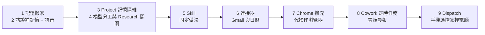

# Claude 訂閱的 9 個「付了錢卻沒打開」的設定:記憶搬家、Skill、連接器、Chrome、Cowork 排程與 Dispatch

**主題分類:** 科技 / AI 生產力 — Claude 桌面/網頁 App 功能清單與使用紀律
**來源:** YouTube 頻道 **YAHA学堂**〈你每月交 20 美元,Claude 藏得最深的 9 个隐藏设置你居然从来没打开过?〉(2026-08-19,約 11.3 分)
**整理日期:** 2026-11-05

> **該片有 YouTube 自動字幕(簡中,品質尚可),但偶有同音字誤差**(例:「在 Cowork 派的活」「Hold to record」等依上下文判讀)。
> ⚠️ **核實說明(2026-11-07 增補):** 本文是**影片操作流程的整理**。App 介面與方案規則變動很快。本次已用 Anthropic 官方部落格(Memory)、官方說明文(Cowork 定時任務、Dispatch)與影片截圖(0:35 Memory 頁、1:06 匯入框、6:42 連接器目錄、9:39 Dispatch 側邊欄)逐項比對;結果見各節「**核實**」標註與文末「核實總表」。凡仍標「影片自述」或「未核實」者,請以你當下 App 為準。影片未見業配段落;片中推薦的 SkillsMP 為第三方技能市集,影片結尾有 YouTube「Hype」求互動呼籲(略)。

---

## TL;DR

九個設定的邏輯是一條**由內而外**的鏈:**記憶**(了解你)→ **模型與額度**(止損)→ **Skill**(固定做法)→ **連接器**(讀你的資料)→ **Chrome 擴充**(動你的瀏覽器)→ **Cowork 排程**(你睡覺時在雲端跑)→ **Dispatch**(手機遙控自己的電腦)。前半是「省錢省坑」,後半是「把工作外包出去」。

---

## 1. 把 ChatGPT 的記憶搬進 Claude(影片自述流程)

1. 進 **Settings → Memory**。最上面兩個開關都要開,尤其 **Generate memory from chats**——關著 Claude 什麼都記不住。
2. 按 **Start import**,會給一段 prompt;貼到 ChatGPT,它會把記住的你(身份、工作、專案、偏好)分類吐出來。
3. 把輸出貼回 Claude 的導入框 → **Add to Memory**,等一下處理完。
- **核實:** 1、2 步的入口已由 0:35 截圖確認——Memory 頁頂部是 **Search and reference chats** 與 **Generate memory from chats** 兩個開關(影片所說「第二個」正確),下方 **Import memory from other AI providers** 旁有 **Start import** 按鈕;1:06 截圖可見貼回結果後的 **Add to memory** 按鈕。
- **核實(需修正):** 官方部落格(2025-09-11)只說「bring your memory details over from a different AI tool」並指向支援文件,**未在部落格內寫出逐步流程**;功能先推 Team/Enterprise(2025-09-11),Pro/Max 於 2025-10-23 才開放([Claude 官方部落格 — Memory](https://claude.com/blog/memory))。因此「需付費方案」只對 Pro/Max 以上成立,免費版是否可用未能核實。第三方文章另稱「可能只匯入部分」,為單一網友回報(Reddit,僅供參考),未能官方證實。匯完務必回 Memory 頁**逐條檢查、刪錯的**。

## 2. 讓它「採訪你」補記憶,用語音回答

- 匯入的記憶幾乎全是工作(技術棧),缺的是「你這個人」。解法:請 Claude **一輪一輪訪談**(技術棧、作息、要先結論還是先過程)。
- 第三輪講協作偏好時話會變多,**用輸入框右邊的麥克風(語音聽寫)**比打字快;設定裡有 **Hold to record**(按住說話、放開上屏)。⚠️ 旁邊的**波形按鈕是即時語音對話模式**,別按錯。

## 3. 「Project 裡失憶」不是 bug

- 影片宣稱(**自述為官方設計**):**每個 Project 有獨立記憶空間**,與主記憶完全隔開——本意是隔離、保密場景。所以普通對話裡它記得你的套件管理器,Project 裡問同一句卻說沒聊過。
- **核實(已確認隔離):** 官方部落格寫「If you use projects, **Claude creates a separate memory for each project**」(2025-09-11),10-23 更新文又寫「each project has its own separate memory」,並說機密討論與一般作業分開([Claude 官方部落格 — Memory](https://claude.com/blog/memory))。先前標「未核實」的第三方說法與此不符,以官方為準。官方文字未明說「Project 能否讀取主記憶」,第三方分析稱不能,**此點未能由官方原文核實**。
- 實務建議:在 Project 裡**把必要背景寫進 Project 指示**,不要依賴主記憶。

## 4. 模型分工與兩個吃額度的開關

- 影片的分工:**Haiku**(閒聊、格式轉換、批量小任務)/ **Sonnet**(日常主力,作者 8 成對話停在這)/ **Opus**(多層依賴分析、大重構)/ **Fable**(最高檔,每週碰不了幾次)。同一題成本差 5–10 倍(影片自述)。**核實:** 目前只找到單一第三方來源列 Fable 5 為每百萬 input token $10、output $50,Haiku 4.5 為 $1/$5(同為 10 倍級),其餘價格與各檔位現行定價**未能由官方頁核實**,請以 Anthropic 定價頁為準。作者早期「天天掛最大模型閒聊,兩天撞一次上限」。
- **Research 模式是開關不是模型**,會全網翻資料寫報告,**燒額度速度是普通對話的好幾倍**——影片自述,需要時才開。
- 完整的選型表、effort 與 Advisor Strategy(貴模型只在拍板處出手)見同作者另一片的整理:[[claude-sonnet-5-5-release-effort-migration]] §10;跨模型成本分配見 [[model-routing-compute-allocation]]。

## 5. 把每週重複的格式化工作做成 Skill

- 觀念區分:**記憶 = 它對你這個人的了解;Skill = 某一件事的固定做法**。
- 做法:把本週流水帳貼進去,末尾加一句「把這個流程做成 Skill」。Claude 會參考官方 Skill 寫法,產出技能檔(例:周報規則「按性質重組、不按時間排」「寫結果不寫動作」「沒完成的要說清楚卡在哪」,並附反面示例),先照它跑一遍給你看,再右上角 **Save skill**,之後在 **Customize → Skills** 看得到。
- 下次丟碎片記錄,一句「寫週報」,新對話會亮出 `Loaded weekly-report skill`。
- **現成技能**:第三方市集 **SkillsMP**(聚合 GitHub 公開技能)。**核實(數字需修正):** 其官網 About 頁舊數字為 21,000+;第三方報導(Korben,2026-07,僅搜尋摘要可見)稱超過 200 萬,另有其他第三方估 1.6M+、80 萬、36.4 萬等,彼此差距極大。未能統一核實,影片的「約 200 萬」只能視為其中一個報導數字。索引來自公開 GitHub 倉庫,數量含大量廢棄或重複技能;下載是 zip,到 Customize → Skills 上傳。⚠️ **第三方技能等於別人寫的指令,安裝前務必讀過內容**(可對照 [[claude-skills-governance-man-group]]、[[building-claude-skills]])。

## 6. 連接器(Connectors):Gmail 與日曆

- 入口 **Settings → Connectors**;Gmail 在首頁那排,標準 Google 登入;**日曆要從右上角 Add 進目錄找**。**核實:** 6:42 截圖的 Connectors → Directory 頁,頂部是「Top connectors」(Google Drive、Gmail、Google Calendar…),右上角為「Show all」連結,目錄總數在截圖中被游標遮住,**影片的「1,700 多個」無法由畫面確認**;第三方統計數字差異極大(369–986 不等,時間點各異),一律以 claude.com/connectors 當下數字為準。建議**先只加 Google 日曆一個**,連太多容易拿錯東西。
- 影片自述:只在你開口問時才讀信箱,不在背景監看。
- 示範:「把收件匣沒回的信按緊急程度分類,需回覆的起草回信」。**只能起草,發送要你自己來**——作者認為這限制是對的(AI 偶爾會講錯話)。作者宣稱每天早上處理信件從 1 小時降到 15 分鐘(個人自述)。
- 日曆前提:**它只認日曆上有的東西**;填得越全,排得越準。**核實:** Google Calendar 連接器是讀取還是可建立/修改事件,第三方說法互相矛盾(有說只讀、有說可建立與刪除),未能核實;只加日曆前建議先查清楚權限範圍。

## 7. Chrome 擴充:讓它代你操作瀏覽器

- 官方 Chrome 擴充住在瀏覽器側邊,能讀頁、點按鈕、填表單、切分頁。想跨分頁工作,要**先把這些分頁拖進它的分頁群組**(拖進去的才看得到)。
- 例子:兩個網站賣同一商品、各 300 條評論,讓它自己翻頁、彙總。
- **使用紀律(影片重點):** 每次對頁面做修改動作前它會先問你,**別嫌煩,是保命機制**;開工前先**關掉網銀與隱私頁面**;頭幾次先拿**低風險任務**練手。

## 8. Cowork 定時任務:睡醒前先把晨報做好

- **Cowork**(Claude 桌面 App 的工作模式)的定時任務會把前面全串起來:讀信與日曆靠第 6 點的連接器,晨報格式可套第 5 點的 Skill。
- 影片自述:**Cowork 派的活在你電腦上跑;定時任務在雲端跑,關機照做,代價是碰不到本地檔案**。
- **核實(大致成立,但需補條件):** 官方說明文([Cowork 定時任務說明](https://support.claude.com/en/articles/13854387))寫「Scheduled tasks run remotely, so they run on their cadence even when your computer is asleep」,並說即使 Claude Desktop App 關閉也會按時執行;同文又寫「If a scheduled task requires local files or apps, it will only run locally」,即**需要本地檔案或應用的任務只會在本機跑**(因此仍需電腦醒著、可選擇工作資料夾)。錯過排程時的補跑行為,原文未說明,未能核實。另有第三方文章稱「本機任務需電腦醒著」,但與上述原文的確切措辭未能逐字對上,以官方頁為準。
- 作者建議:今晚睡前設一個晨報定時任務。

## 9. Dispatch:手機遙控家裡的電腦

- 定時任務碰不到本地檔案時,用 **Dispatch**(桌面 App 側邊欄)。先開兩個開關:**Keep awake**(頂住電腦休眠)、**Mobile notifications**(手機收進度)。手機裝 Claude、登**同一帳號**,手機就成了電腦的遙控器。
- **硬性條件:** 電腦要開著、桌面 App 要開著(活全程在你自己機器上跑);Mac 合蓋仍會睡,出門別合蓋。
- **核實:** 官方 Dispatch 說明文([Dispatch 設定說明](https://support.claude.com/en/articles/13947068))原文:「Your computer must be awake and the app must be open for Claude to work on tasks」,與影片的硬性條件一致;設定時在 Cowork 側邊欄點 Dispatch、完成 Finish setup,並可同時開啟檔案存取與 keep your computer awake;手機會收到任務完成或需要確認的推播。9:39 截圖可見側邊欄的 Dispatch 旁標有 **Beta**。官方說明寫明目前為「limited beta」,僅部分 Pro/Max/Ultra 方案,且**不開放新用戶**——影片說「側邊欄裡就躺著」與實際可用性不同,使用前先確認你的帳號是否看得到。「Mac 合蓋仍會睡」未在官方說明文中見到,未能核實。
- ⚠️ **安全:** 手機能遙控的權限**與 Cowork 本身一樣大**(動檔案、開瀏覽器)。官方也警告「instructions from your phone can trigger real actions on your computer」,建議先「Trust every app and service in the chain」、「Know how to quickly disconnect or revoke access」。所以**只連自己的設備、帳號不要與人共用**(官方文未明寫「須同一帳號」,僅說對話會在兩端自動同步,此為隱含推論)。

---

## 應用案例

- **轉職/換工具的第一週**:先做 1(匯入)→ 2(語音訪談補「人」)→ 回 Memory 頁刪錯條目,三步就能讓 Claude 從陌生人變成熟人;之後再進 Project 工作時,記得把核心背景寫進 Project 指示(第 3 點)。
- **每週五周報**:把一週流水帳貼進去 → 做成 `weekly-report` Skill → 下週起一句話出稿;格式規則(結果導向、未完成要註明卡點)集中在 Skill,不再每次口述。
- **早上 15 分鐘收信**:連 Gmail + 日曆 → 設 Cowork 晨報定時任務(雲端)→ 醒來看「待回覆清單 + 草稿 + 今日行程衝突」,你只負責審稿與發送。
- **比價**:開 Chrome 擴充,拖兩個商品頁進分頁群組,請它彙總 600 條評論的共同缺點;期間不開網銀頁。
- **外出遙控**:在外用手機叫家裡電腦整理檔案夾,到家驗收;電腦保持開機、Keep awake 開著。

## 核實總表

| 項目 | 結果 |
|---|---|
| Memory 兩個開關、Import memory 的 Start import、Add to memory | ✅ 截圖(0:35、1:06)確認;匯入的逐步流程官方部落格未寫出 |
| 記憶匯入需付費方案 | ⚠️ 需修正:官方 2025 年先推 Team/Enterprise,10-23 起 Pro/Max;免費版未能核實 |
| 匯入可能只匯入部分 | 🔎 單一網友回報,未能官方證實 |
| Project 記憶是否與主記憶隔離 | ✅ 官方部落格(2025-09-11、10-23)明載每個 Project 有獨立記憶;「Project 能否讀主記憶」未能核實 |
| 模型分工與成本差 5–10 倍 | ❓ 影片自述;Fable $10/$50 vs Haiku 4.5 $1/$5 僅單一第三方來源,未核實 |
| Research 模式較耗額度 | ❓ 影片自述,未核實 |
| SkillsMP 約 200 萬技能 | ⚠️ 數字來源不一(官網舊值 21,000+;第三方報導 >200 萬),未能統一 |
| 連接器 1,700 多個 | ❌ 截圖總數被遮、第三方數字差異大(約 369–986),無法確認 |
| Gmail / Google Calendar 連接器可用 | ✅ 6:42 截圖顯示兩者在 Top connectors 中且已連接(打勾) |
| Calendar 能否建立事件 | ❓ 第三方說法互相矛盾,未核實 |
| Cowork 定時任務:雲端執行、需本地檔案者只在本機跑 | ✅ 官方說明文原句確認;錯過排程的補跑行為未能核實 |
| Dispatch:需電腦醒著且 App 開啟、Keep awake 與推播設定 | ✅ 官方說明文確認;但 Dispatch 為 limited beta,僅部分方案、不開放新用戶 |
| Dispatch 手機權限等同 Cowork、需安全防護 | ✅ 官方警告原句確認 |
| Mac 合蓋仍會睡 | ❓ 官方說明文未見,未能核實 |
| 郵件處理 1 小時→15 分鐘 | 個人自述 |

## 來源

- YouTube:[你每月交 20 美元,Claude 藏得最深的 9 个隐藏设置…](https://www.youtube.com/watch?v=Wq1icAZYr4E)(YAHA学堂,2026-08-19;YouTube 自動字幕)
- 官方(2026-11-07 核實):[Claude 官方部落格 — Memory](https://claude.com/blog/memory)、[Cowork 定時任務說明](https://support.claude.com/en/articles/13854387)、[Dispatch 設定說明](https://support.claude.com/en/articles/13947068)
- 第三方數據(來源不一;以下兩頁本次直接讀取皆回 HTTP 403,數字僅取自搜尋摘要,未能讀全文核對):[SkillsMP 官網 About](https://skillsmp.com/about)、[Korben — SkillsMP 超過 200 萬 skills](https://korben.info/skillsmp-marketplace-skills-claude-code-github.html)、[Anthropic API 價格彙整(Haiku / Opus 數字)](https://finout.io/blog/anthropic-api-pricing)(Fable 價格未在此彙整中核到,見前述單一來源)
- 影片截圖:0:35 Memory 頁、1:06 匯入框、6:42 Connectors 目錄、9:39 Dispatch 側邊欄(由 `transcript_tools.py frames` 擷取,未存入版控)
- 記憶匯入(第三方、非官方):[Product Hunt — Claude import memory](https://www.producthunt.com/p/claude/claude-import-memory)、[Medium — How to Import Memory into Claude](https://medium.com/@unicodeveloper/how-to-import-memory-into-claude-from-chatgpt-gemini-or-grok-step-by-step-guide-c78ac8f7e4a4)
- 本庫延伸:[[claude-sonnet-5-5-release-effort-migration]]、[[model-routing-compute-allocation]]、[[building-claude-skills]]、[[claude-skills-governance-man-group]]
